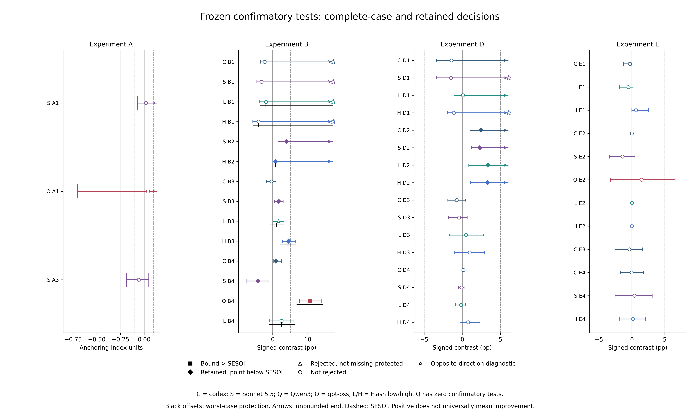
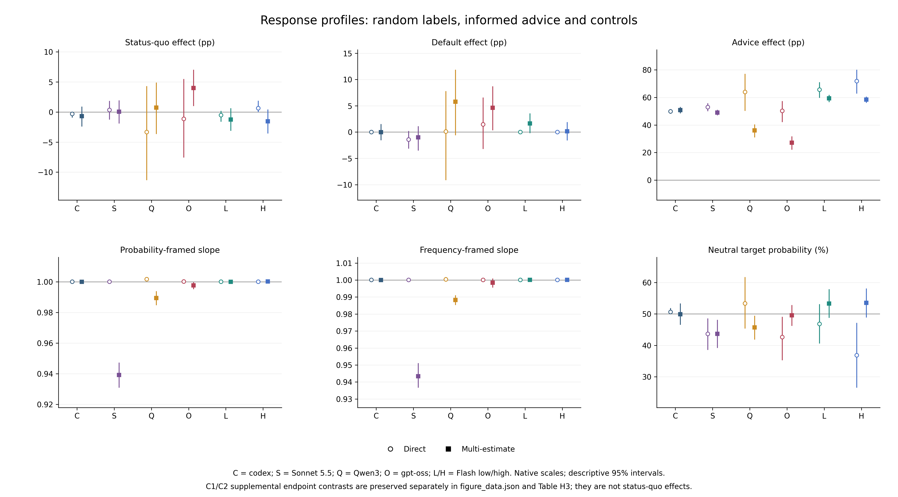
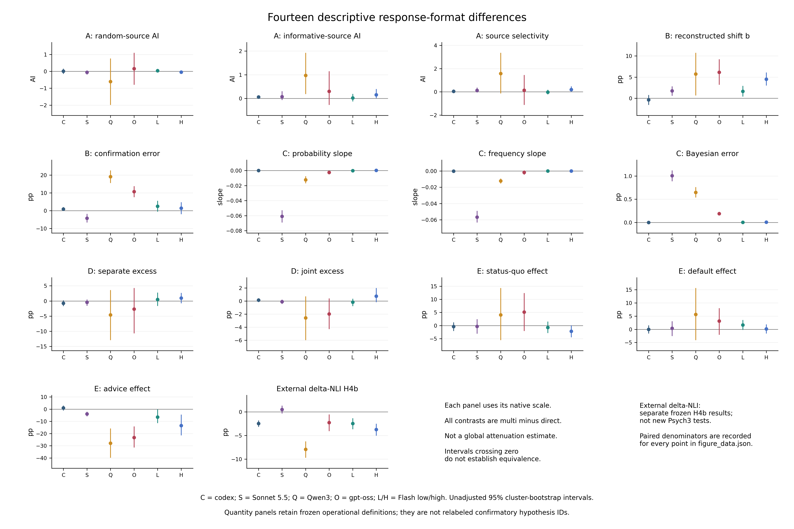

# Multi-Estimate Elicitation Does Not Uniformly Debias Language Model Judgments

**An-Sheng Jhang**  
Dongguan University of Technology

## Abstract

Does eliciting five weighted estimates within a single response consistently improve numerical judgments? We compare direct and multi-estimate elicitation across anchoring, hindsight, base-rate, conjunction, and status-quo/default tasks in six frozen configurations. Each configuration contributes 618 admitted development units and 3,702 admitted formal units; the six-configuration formal cohort contains 22,212 units, including 21 missing outcomes. Of 45 preregistered confirmatory tests across five configurations, 12 reject on complete cases and 11 retain directional confirmation after the prespecified missingness-protection rule. Only one adjusted bound exceeds its smallest effect size of interest: gpt-oss-120b shows a 10.68-percentage-point increase in post-outcome confirmation error under multi-estimate elicitation (worst-case estimate 10.04 points). The remaining ten retained effects have sub-threshold point estimates; non-rejection does not establish equivalence. Joint presentation lowers signed conjunction excess in four confirmatory configurations, but this comparison changes both constraint visibility and call structure. Flash-high combines two disjoint execution-window batches under an approved continuation protocol, preserving their identities and non-causal interpretation. Post-hoc candidate-spread associations across all six configurations remain in-sample and require independent predictive validation. The completed cohort provides no evidence for uniform debiasing by multi-estimate elicitation. Materials: [https://github.com/asj252/llm-judgment-studies](https://github.com/asj252/llm-judgment-studies)

## 1 Introduction

Asking a language model for several weighted estimates in a single answer alters more than response length: the resulting weighted average can shift the numerical judgment extracted from the model. In our preceding study on single-sentence probability updating ($\delta$-NLI) [@jhang2026hearsay], eliciting five weighted estimates (`ASK_MULTI`) instead of a single direct probability (`ASK_DIRECT`) substantially reduced extreme endpoint reports ($\le 5\%$ or $\ge 95\%$) across all seven tested configurations. Yet that format also reduced direction-aligned updating to relevant evidence by roughly $43\%$ and $68\%$ in two local models, while shifting updates by $-3.7$ to $+0.5$ percentage points across five wrapper-accessed configurations. Because compressing responses toward the middle of a scale can mimic improved calibration when cues are uninformative while degrading sensitivity when evidence is diagnostic, an important question remains open: does multi-estimate elicitation uniformly dampen numerical responses, or do its effects depend on the normative meaning of the information?

We investigate this question by placing three distinct normative reference points side by side across five classic judgment paradigms: anchoring (Experiment A), hindsight (Experiment B), base-rate integration (Experiment C), conjunction probability (Experiment D), and status quo/default framing (Experiment E). Within the same item banks, our manipulations contrast (i) cues explicitly described as uninformative or randomly generated, (ii) information framed as relevant or specified by normative probability inputs, and (iii) coherence constraints that probabilities must satisfy (Table 1). Crossing these paradigms with direct and multi-estimate response formats allows us to test whether multi-estimate elicitation selectively filters out irrelevant cues, attenuates responses to evidence-related inputs, or improves probabilistic coherence.

**Table 1. Normative reference points and limits across the completed cohort**

| Experiment | Reference point | What is measured | Main limitation |
| --- | --- | --- | --- |
| A | Random versus informative-source framing | Log-scale anchoring and source sensitivity | Source framing is not factual accuracy |
| B | Prospective F, retrospective HI/HP, post-outcome PO | Reconstructed shifts, wording contrast, confirmation error | Exposure and wording remain potential influences |
| C | Specified Bayesian posterior | Slopes, intercepts, posterior error | Direct-format ceiling; no confirmatory C tests |
| D | Conjunction extension rule | Signed excess under separate versus joint calls | Visibility and call structure change together |
| E | Random labels versus informed advice | Status, default and advice probability effects | Not behavioral choice or loss aversion |

The complete six-configuration cohort replaces the earlier three-configuration staged report. Its central result is heterogeneity rather than a common reduction in response magnitude. One retained effect exceeds its prespecified bound threshold and reflects worse post-outcome confirmation accuracy; ten other retained effects have sub-SESOI points. Cross-configuration comparisons remain descriptive. Qwen3 retains its descriptive identity; completion of both Flash settings does not create a new confirmatory interaction.

## 2 Related Work

**Judgment Biases in Language Models.** Prior studies of classic cognitive biases in LLMs report mixed patterns across model families and prompting protocols. In anchoring (Experiment A), Huang et al. [@huang2025understanding] reported lower anchor susceptibility in larger and reasoning models within their 11-model SynAnchors panel, and Takenami et al. [@takenami2025anchoring] similarly observed reduced anchoring in reasoning models during price negotiations. By contrast, Lou and Sun [@lou2026anchoring] documented persistent anchoring in stronger GPT models that resisted chain-of-thought and ignore instructions. Most relevant to our design, Borjigin et al.'s AnchorBench [@borjigin2026anchorbench] separates plausible from irrelevant anchors across prompt pathways. Drawing on human anchoring paradigms [@jacowitz1995measures; @mussweiler2000overcoming], we pair identical numbers with random-generator versus reliable-source framing and adapt the anchoring index [@jacowitz1995measures] to the natural-log scale item by item.

In hindsight (Experiment B), human judges systematically inflate retrospective probability estimates after learning an outcome [@fischhoff1975hindsight; @arkes1988eliminating; @roese2012hindsight], a phenomenon examined in recent retrospective-judgment research [@chen2021retrospective]. In LLMs, Malberg et al. [@malberg2025comprehensive] included hindsight in a 30-bias battery across 20 models, and Matsuura et al. [@matsuura2026hindsight] reported outcome-conditioned shifts consistent with hindsight in comparisons of clinical timelines. Related work reports limitations in simulated pre-cutoff ignorance for forecasting [@li2026simulated]. Separately, self-blinding work on discrimination and sycophancy distinguishes instructions to ignore information from preventing access to it [@christian2026selfblinding]. Using ProbCOPA items [@kamath2026humans; @roemmele2011choice], we separate prospective foresight, retrospective reconstruction with and without an explicit ignore instruction, and post-outcome confirmation.

In base-rate tasks (Experiment C), humans often neglect base rates under probability framing [@kahneman1973psychology; @eddy1982probabilistic] but improve under natural frequencies [@gigerenzer1995improve]. Prior work examines judgment inconsistencies [@macmillanscott2024irrationality], coexisting Bayesian and representativeness patterns [@li2024dual], and models' use of natural-frequency representations [@araya2025chains]. Early work explored ChatGPT on structured Bayesian problems [@krohling2023bayesian]; the ceiling reported here is an empirical finding of our own development screening. In conjunction tasks (Experiment D), early choice-based work found that GPT-3 committed the Linda fallacy [@binz2023using]. Related studies examine representativeness and token-pattern sensitivity [@wang2024real; @jiang2024peek], including reduced violations after hashing trigger words in a modified Linda task [@chadimova2024meaningless]. Numerical probability evaluations are rarer: Zhu and Griffiths [@zhu2024incoherent] found probability-identity incoherence that narrowed in larger models, and Imannezhad et al. [@imannezhad2026divergent] reported lower violation rates among GPT-5 judgments ($18.8\%$) than among human judgments ($58.5\%$). We author new person profiles following [@tversky1983extensional] and event pairs following [@costello2014surprisingly] to compare separate and joint numerical elicitation. In status quo and default tasks (Experiment E), human preferences for current states and preselected defaults are well established [@samuelson1988status; @johnson2003defaults; @jachimowicz2019defaults], whereas LLM findings conflict in direction: Malberg et al.'s models preferred change on average [@malberg2025comprehensive], whereas Horton's model-based experiments [@horton2023homo] (arXiv v2) found status quo preferences under their prompts. Because prior prompts often mix status quo labels, prefilled defaults, and implied endorsement, Experiment E separates these three manipulations on a probability scale.

**Inner-Crowd Aggregation and Elicitation Formats.** Human studies have found that aggregating multiple estimates from a single judge ("the crowd within") can improve accuracy under the studied protocols [@vul2008crowd; @steegen2014measuring; @herzog2009wisdom; @litvinova2020inner], and eliciting full distributions has been studied for overprecision [@haran2010simple] and for jointly measuring base-rate neglect and conservatism [@howe2022base]. In LLMs, Verbalized Sampling requests multiple candidates with probabilities in one response to counter mode collapse [@zhang2025verbalized], and verbalized confidence has been compared with token-based confidence [@tian2023just]. Other studies examine response consistency and confidence-elicitation strategies [@xiong2024llms], or distributional verbalization for confidence estimation [@wang2025distribute]. DiNCo estimates confidence for incompatible claims separately and then normalizes them within its method [@wang2026dinco]; this does not make arbitrary continuous numeric candidates mutually exclusive. Forecast aggregation gains can depend on sample diversity and correlation [@aitchison2026diversity], and Bayesian-sampler theory models systematic deviations in human probability judgments using finite samples and a generic prior [@zhu2020bayesian]. Related work examines input certainty markers and question-answering accuracy [@zhou2023navigating], integer clustering [@dai2026beyond], model–human reasoning comparisons [@yax2024studying], confidence-measurement protocols [@kim2026same], service-version drift [@chen2024chatgpt], and hard–easy patterns in confidence [@michael2026confidence]. Unlike temporally separated human inner-crowd estimates, our multi-estimate format generates five interdependent candidates in a single autoregressive call; we test its effects empirically across paradigms without assuming that it replicates human inner-crowd mechanisms.

## 3 Methods

### 3.1 Preregistration, completion, and configurations

The plan, hypothesis definitions, sidedness, smallest effect sizes of interest (SESOIs), missingness rules, screening criteria and configuration-specific Holm lists were frozen before formal collection and published on October 22, 2026 (commit `802d760`). Addendum 1 (`940aee5`, October 24) changed the codex executable binding before its formal collection. Addendum 2 recorded stopping and disposition decisions, including a post-hoc session closure. This v2 completes the original six configurations without expanding their frozen lists or creating new cross-model confirmatory tests.

**Table 2. Frozen execution identities and confirmatory scope**

Identifiers are transcribed from frozen metadata. They identify requested configurations; unobserved provider-side routing or service changes are not independently verified.

| Alias | Frozen model identifier | Interface / setting | Tests |
| --- | --- | --- | --- |
| codex | gpt-6.1-sol | codex 0.163.0-alpha.10.2; medium | 11 |
| Sonnet 5.5 | claude-sonnet-5-5-medium | agy 1.4.0; medium | 12 |
| Qwen3 | Qwen/Qwen3-8B | local GGUF Q8_0; non-thinking | 0 |
| gpt-oss-120b | gpt-oss-120b-medium | agy 1.4.0; medium | 3 |
| Flash low | gemini-3.8-flash-low | agy 1.4.0; low | 9 |
| Flash high | gemini-3.8-flash-high | agy 1.4.0; high | 10 |

For codex and agy, provider system prompts, sampling controls and server seeds are not fully observable. Calls excluded tools and web search and used no researcher-written system prompt. Five candidates generated in one autoregressive call are interdependent. Requested model identities are preserved from the freeze rather than replaced retrospectively by names from another task or session.

Flash high required a separately bound execution-window continuation. F0 contributes 3,049 admitted formal units (2,687 r0 and 362 r1; 3,048 OK, one missing); F1 contributes 653 (531 r0 and 122 r1; all OK). Their disjoint union is exactly 3,702. The inherited development set is used once. F1 follows `window-addendum-high-20261104/protocol.json`, whose start boundary is `2026-11-05T00:00:00+08:00`, after the earlier study-window cutoff. The two batches retain their own sessions and fingerprints, while the union uses the original ten-hypothesis Flash-high list. Tables F1 and H11 expose the execution-window partition. Cluster D / w01 spans F0 (7 r0 calls) and F1 (3 r0 calls) across both response formats. There are zero cross-batch r0/r1 repeat pairs: every repeated unit has its r0 and r1 calls in the same batch.

F0 and F1 are non-randomized execution windows confounded with item schedule order and collection time. Differences are exploratory and do not identify a causal execution-window or model effect.

### 3.2 Response Formats, Call Protocol, and Real Example

Each unit (item $\times$ condition $\times$ response format $\times$ round) was executed in an independent, stateless call with seeded cluster-then-unit shuffling. Parsing or contamination failures allowed one retry, retaining the first valid attempt. The **direct format** (`ASK_DIRECT`) requests a single final-line number. The **multi-estimate format** (`ASK_MULTI`) requests five estimates with weights in $[0, 1]$ summing to 1, aggregated by the parser as $\bar{y}_{\text{multi}} = \sum_{m=1}^5 \tilde{w}_m y_m$ (normalizing weights by their sum whenever $\sum w_m > 0$). Experiments B, C, E, and separate D statements use the verbatim $0$–$100\%$ suffixes from $\delta$-NLI [@jhang2026hearsay]; Experiment A requests positive finite quantities; joint D requests four probabilities per line.

#### Box 1. From a recorded answer to a weighted estimate

This post hoc display example is not a preregistered analysis or statistical evidence for a format effect. We fixed the completed codex configuration, formal round r0, and the separately elicited conjunction condition, then selected the first self-written person-profile item in lexicographic ID order with valid admitted direct and multi-estimate records. The selected item is p01; both records retain their first valid attempt (attempt 0).

**Shared question stem (verbatim).**

```text
Here is a situation: Tomasz is 34 and spends nearly every weekend hiking in the hills near his home, carrying a camera and a field guide. He keeps a notebook listing every bird species he has seen and often gets up before dawn to reach his favourite lookout.

Using common sense, how likely is it that the following statement is true?
Statement: Tomasz drives a long-haul truck for a living and belongs to a local birdwatching club.
```

**Direct-format request suffix (verbatim).**

```text
What is the probability that the statement is true?

On the last line of your answer, give the answer strictly in the following format:
Probability: NN%
where NN is a number from 0 to 100 (decimals allowed), and it must be followed by a percent sign.

Do not use any tools; answer directly.
```

**Observed direct final output (numeric line excerpted verbatim).**

```text
Probability: 2%
```

**Multi-estimate request suffix (verbatim).**

```text
Give 5 probability estimates that the statement is true, each with a weight for how likely you think that estimate is; the weights sum to 1.

At the end of your answer, give the 5 estimates strictly in the following format, one per line:
Estimate 1: NN% | Weight: W
Estimate 2: NN% | Weight: W
Estimate 3: NN% | Weight: W
Estimate 4: NN% | Weight: W
Estimate 5: NN% | Weight: W
where each NN is a number from 0 to 100 (decimals allowed) followed by a percent sign, and each W is a number from 0 to 1 (decimals allowed); the five weights sum to 1.

Do not use any tools; answer directly.
```

**Observed multi-estimate final output (numeric lines excerpted verbatim).**

```text
Estimate 1: 0.5% | Weight: 0.15
Estimate 2: 1% | Weight: 0.30
Estimate 3: 2% | Weight: 0.30
Estimate 4: 3% | Weight: 0.15
Estimate 5: 5% | Weight: 0.10
```

The weights sum to 1. The parser's recorded weighted mean is 0.15 × 0.5 + 0.30 × 1 + 0.30 × 2 + 0.15 × 3 + 0.10 × 5 = **1.925%**, compared with the separate direct response of **2%**. The displayed outputs omit the answers' introductory prose; no output wording is repaired or synthesized. These are two calls to the same item under different response formats, while the five candidates come from one call and are not independent samples. This example shows the requested format and parsing operation, without identifying an internal mechanism or establishing an effect.

Source units are `D:p01_S_conj_direct|r0` and `D:p01_S_conj_multi|r0`, both in the admitted codex session `11df552506824d299603df5db02361e7`. The source prompts, final-answer text and hashes are retained in the editorial evidence record.

### 3.3 Experimental Designs and Operational Definitions (A–E)

**Experiment A (Anchoring, 10 dev / 50 formal items, 500 formal units).** We selected 36 eligible items with standalone, positive factual truths from the 60-item SynAnchors semantic subset [@huang2025understanding] (`TimTargaryen/SynAnchors`, rev. `e6df428`) and wrote 24 verifiable factual items (formal split: 30 SynAnchors, 20 self-written). High and low anchors were frozen at $\text{truth} \times 1.5$ and $\text{truth} \div 1.5$, with rounding at the prespecified item precision. Each item has 10 units: unanchored baseline, **irrelevant anchors** (high/low, framed as outputs of an unrelated random-number generator with a higher/lower comparison question), and **informative anchors** (high/low, identical numbers framed as a "reliable reference source"), crossed with both response formats. We define the item-level log anchoring index as $\text{AI}_c = [\ln(\text{estimate}_{c,\text{high}}) - \ln(\text{estimate}_{c,\text{low}})] / [\ln(\text{anchor}_{\text{high}}) - \ln(\text{anchor}_{\text{low}})]$ for $c \in \{\text{irrelevant}, \text{informative}\}$, and source selectivity as $S = \text{AI}_{\text{informative}} - \text{AI}_{\text{irrelevant}}$. Because quantity estimates have no upper bound, Experiment A uses complete-item subsets without worst-case missingness substitution. *Local validity condition:* Because informative anchors deviate from truth by a factor of $1.5$, $\text{AI}_{\text{informative}}$ and $S$ measure selectivity to source framing rather than factual accuracy; a model that knows the exact answer may reasonably ignore both anchors.

**Experiment B (Hindsight, 15 dev / 90 formal items, 1,440 formal units).** All 105 COPA effect items [@roemmele2011choice] in ProbCOPA [@kamath2026humans] (`McGill-NLP/probabilistic-reasoning`, rev. `b983b12`) were matched after removing `canary` entries. Each item has two outcomes $O_1, O_2$ (not necessarily mutually exclusive or exhaustive) elicited across 16 units: prospective foresight ($F$); outcome disclosure with an instruction to set the outcome aside and reconstruct a prediction "from the situation alone" ($\text{HI}$); outcome disclosure with the same retrospective reconstruction question but without the ignore instruction ($\text{HP}$); and post-outcome confirmation disclosing $O_k$ before repeating the $F$ question ($\text{PO}$), crossed with $k \in \{1, 2\}$ and both response formats. We define reconstructed prospective shift $b = \frac{1}{2}\sum_{k=1}^2 [\text{HI}(O_k) - F(O_k)]$, uninstructed shift $b_{\text{HP}} = \frac{1}{2}\sum_{k=1}^2 [\text{HP}(O_k) - F(O_k)]$, post-outcome confirmation error $e_{\text{PO}} = \frac{1}{2}\sum_{k=1}^2 [100 - \text{PO}(O_k)]$, and input-condition contrast $c = \frac{1}{2}\sum_{k=1}^2 [\text{PO}(O_k) - F(O_k)]$. *Local validity condition:* Given COPA's public availability, $b$ measures reconstructed prospective shifts after outcome disclosure rather than guaranteed memory-free hindsight bias, and $b_{\text{HP}} - b$ isolates the wording effect of the ignore instruction. Human ratings are descriptive references, not true probabilities or calibration targets.

**Experiment C (Base Rates, 4 dev / 20 formal scenario clusters = 40 formal items, 480 formal units).** Twenty-four newly written scenarios were crossed with two test accuracy sets (Set A: $90\%$ hit / $10\%$ false-positive rate, posteriors $8.33\%, 50.00\%, 79.41\%$; Set B: $80\%$ / $5\%$, posteriors $13.91\%, 64.00\%, 87.27\%$). Each item has 12 units: 3 base rates ($1\%, 10\%, 30\%$) $\times$ 2 presentations (probabilities vs. natural frequencies out of $10,000$, which also reduce calculation steps) $\times$ 2 response formats. Responses clipped to $[0.5\%, 99.5\%]$ are logit-transformed and regressed on $\text{logit}(\text{base rate})$ by 3-point OLS to obtain the **slope** (normative $= 1$, interpreted together with the intercept and probability error); **Bayesian error** is the mean unclipped absolute deviation from the Bayes posterior across the three base rates, equally weighted across accuracy sets and scenarios.

**Experiment D (Conjunction, 7 dev / 35 formal items: 20 person items $P$, 15 event pairs $W$; 350 formal units).** Newly written person items $P$ pair a character sketch with a fitting event $A$ and a less likely event $B$ [@tversky1983extensional]; event pairs $W$ span positive, independent, and negative dependence strata (5 formal items each) [@costello2014surprisingly]. Each item has 10 units: statements $A$, $B$, "$B$ and $A$," and "$B$ or $A$ (or both)" elicited **separately** ($\text{S}$, 4 independent calls) or **jointly** ($\text{J}$, 4 values in 1 call in a seeded item-fixed order), crossed with both formats. In joint multi-estimate calls, one weight vector aggregates the four statements before computing $\Delta = P(A \text{ and } B) - P(B)$, $\Delta_{\min} = P(A \text{ and } B) - \min(P(A), P(B))$, and additive-identity deviation $X = P(A) + P(B) - P(A \text{ and } B) - P(A \text{ or } B)$. *Local validity condition:* $\Delta_S$ includes between-call variance, $\Delta_J$ makes the extension constraint ($\Delta \le 0$) visible within the prompt, and D2 ($\Delta_S - \Delta_J > 0$) tests mean signed $\Delta$ rather than binary violation rates.

**Experiment E (Status Quo and Defaults, 8 dev / 32 formal items, 448 formal units).** Newly written binary everyday decision items ask the probability that target option $T$ (listed first on 17 formal items, second on 15) is better for the protagonist across 14 units: neutral baseline, plus a **status quo label** (explicitly randomly assigned), a **prefilled default** (explicitly randomly set), and **informed advice** (from an independent adviser who reviewed the person's circumstances), each assigned to $T$ or to the other option $O$, with zero switching cost, crossed with both formats. We define $E_m = y(m \text{ assigned to } T) - y(m \text{ assigned to } O)$ for $m \in \{\text{status\_quo}, \text{default}, \text{advice}\}$ and $S_E = E_{\text{advice}} - E_{\text{status\_quo}}$. $E_{\text{advice}}$ serves as a prespecified positive-control diagnostic outside Holm (threshold $\ge 5\text{ pp}$). *Local validity condition:* Experiment E measures third-party probability judgments rather than behavioral choices; loss framing and omission bias were not manipulated.

### 3.4 Hypotheses, Screening, Inference, and Execution Accounting

We preregistered four hypotheses per experiment (20 total; SESOI $= 0.10$ in A, $0.20$ for slopes in C1–C3, and $5\text{ pp}$ in B, C4, D, E):
- **Direct-format baseline tests:** One-sided $>0$ for **A1** ($\text{AI}_{\text{irrelevant}}$), **A2** ($S$), **B1** ($b$), **B2** ($b_{\text{HP}} - b$), **C1** ($1 - \text{probability slope}$), **C2** ($\text{frequency} - \text{probability slope}$), **D1** ($\Delta_S$ on $P$), and **D2** ($\Delta_S - \Delta_J$ on $P$); two-sided for **E1** ($E_{\text{status\_quo}}$) and **E2** ($E_{\text{default}}$).
- **Multi-estimate minus direct format-difference tests (all two-sided):** **A3** ($\text{AI}_{\text{irrelevant}}$), **A4** ($S$), **B3** ($b$), **B4** ($e_{\text{PO}}$), **C3** (probability slope), **C4** (probability Bayes error), **D3** ($\Delta_S$ on $P$), **D4** ($\Delta_J$ on $P$), **E3** ($E_{\text{status\_quo}}$), and **E4** ($E_{\text{default}}$).

All six development sets passed the original acceptance rule. C's ceiling gate triggered across all configurations; A's known-truth gate triggered in codex and both Flash settings. Development power simulations and the E no-expansion exception determined the remaining lists (Table H1). Qwen3 was retained as a descriptive benchmark with zero confirmatory hypotheses. No hypothesis was rescued by rescreening after family reduction.

Inference uses 5,000 whole-cluster bootstrap draws (seed 2026101903), non-interpolated quantiles and step-down Holm adjustment within each configuration by experiment family at alpha 0.05. Rank-specific intervals are not fixed 95% simultaneous intervals. The strongest retained tier requires an adjusted bound beyond its SESOI; weaker directional tiers distinguish whether the point reaches the threshold. Reverse one-sided bounds below zero at the same Holm-step alpha are descriptive opposite-direction diagnostics, not extra confirmatory rejections. Finite-bootstrap tail proportions displayed as zero are reported as p < .001, not zero population probabilities.

For bounded probability outcomes, the prespecified sensitivity analysis retains observed values and assigns missing cells feasible worst-case 0/100 endpoints. It has its own Holm ordering and full planned denominator. The complete-case rejected flag remains visible, but final directional strength follows the protection rule. A uses positive unbounded quantities and complete-item subsets without finite worst-case protection. E recommendation-control interpretation caveats remain separate from development eligibility.

Each configuration contributes 3,218 primary r0 and 484 repeat r1 formal units. Across six configurations, 22,294 formal JSONL lines yield 22,212 admitted units (22,191 OK and 21 missing), excluding 82 historical lines. Primary r0 has 19,308 admitted units (19,288 OK, 20 missing); r1 has 2,904 (2,903 OK, one missing). Development adds 3,708 admitted units (3,707 OK, one missing), giving 25,920 admitted units overall. Admitted is an accounting category, not a synonym for usable numeric answers. Table A1 separates stages, rounds, exclusions and the two Flash-high batches.

The earlier codex post-hoc closure retained 359 completed units after integrity checks following an append permission error; it remains a disclosed inclusion deviation. Minor frozen descriptive resampling departures for B's tied-F stratum and C's marginal item proportions also remain. The audited v2 supplementary inventory now exposes all 20 endpoint expressions per configuration, including B2 and C1-C2 when the older descriptive export lacked a value. This adds descriptive transparency without changing confirmatory code or family membership.

## 4 Results

### 4.1 Confirmatory decisions and missingness protection

Of 45 frozen tests in five configurations, 12 reject on complete cases and 11 retain directional confirmation; 33 complete-case tests do not reject. One retained test has an adjusted bound beyond its SESOI, while ten are point_below. None is point_reaches. These outcomes do not establish equivalence, and not all contrasts test a debiasing benefit.

The strongest effect is gpt-oss-120b B4: multi-estimate minus direct post-outcome confirmation error is +10.68 pp [7.61, 13.81] complete-case and +10.04 pp [6.78, 14.32] worst-case (both p < .001). Larger e_PO means greater error: this is deterioration, not an anchoring reduction. Sonnet's B4 instead decreases error (-4.19 pp [-7.35, -1.08]), with a sub-5-pp absolute point estimate.

Flash-low B3 illustrates the distinction between rejection and retained confirmation: +1.64 pp [0.09, 3.24], p = .0108 at alpha .0167 with 89 clusters, becomes +1.14 pp [-0.79, 3.18], p = .1724 with 90 clusters under protection. Its complete-case rejected flag remains true, but missing_protected and final.directional are false. Flash-high B3 retains direction (+4.53 pp [2.76, 6.45] complete-case; +4.11 pp [1.98, 6.58] worst-case), without a bound exceeding 5 pp.



**Figure 1. All 45 frozen confirmatory tests.** Squares: final bound exceeds SESOI; diamonds: retained directional point below SESOI; triangles: complete-case rejection not retained under missingness protection; circles: no complete-case rejection. Hollow stars mark six opposite-direction diagnostic bounds, not additional rejections. Colored intervals show complete-case Holm-step bounds; black offset intervals show protection when required. Arrows indicate unbounded ends. A uses native anchoring-index units, not factual percentage-error reduction; B/D/E use signed operational contrasts in pp. A positive sign does not universally indicate improvement. Qwen3 forwarded zero hypotheses. Table H2 reports complete numeric results.

Six reverse-bound diagnostics qualify: B1 in codex, Sonnet, Flash low and Flash high, and D1 in Sonnet and Flash high. They use rank-specific alpha, not a fixed 95% cutoff. They are not six new tests.

### 4.2 Anchoring and source framing

The configurations do not exhibit a uniform response to random versus informative-source framing. Codex and Sonnet have small mean direct irrelevant-anchor indices. Qwen3's paired direct index is approximately 0.946 and falls to 0.338 with multi-estimate elicitation; the gpt-oss paired index instead rises from 0.039 to 0.197. These are descriptive paired means; single-format endpoint denominators can differ.

Sonnet A1/A3 and gpt-oss A1 do not reject. Codex and both Flash A families were downgraded after development known-truth screening. Source sensitivity does not measure factual accuracy: a model knowing the answer may appropriately ignore an inaccurate informative anchor. Tables H3 and F2 retain the distinction.

### 4.3 Reconstructed hindsight, wording and confirmation error

Direct b is negative in the four configurations that forwarded B1; reverse adjusted upper bounds are -1.23, -1.84, -0.29 and -2.42 pp in codex, Sonnet, Flash low and Flash high. This is the operational HI-minus-F contrast. Public-item exposure, reconstruction wording and conditioning on noisy prospective ratings remain possible influences; none is identified as the cause of the overall negative means.

Removing the ignore instruction while retaining the retrospective question produces retained B2 shifts in Sonnet (+3.93 pp) and Flash high (+0.85 pp). The multi-minus-direct b shift B3 retains direction in Sonnet and Flash high but not in Flash low after protection. B4 varies by configuration, including gpt-oss deterioration and Sonnet improvement. Differences in b and e_PO cannot be pooled as a universal attenuation factor. Human ProbCOPA ratings remain descriptive references, not normative probability targets.

### 4.4 Base rates and the direct-response ceiling

All C endpoints are descriptive after the development ceiling. Direct slopes are near one and posterior errors small; displayed 1.000 and 0.000 values are rounded. A slope near one alone is insufficient: intercepts and probability error also matter. Multi-estimate responses increase paired posterior error in Sonnet by approximately 1.006 pp and in Qwen3 by 0.647 pp, while codex error slightly decreases. Elicitation and aggregation change together, so increased error does not identify aggregation arithmetic as an isolated mechanism.

### 4.5 Conjunction presentation and call structure

Direct separate-minus-joint signed excess D2 retains confirmation in codex (+2.46 pp), Sonnet (+2.30 pp), Flash low (+3.37 pp) and Flash high (+3.34 pp), all with sub-SESOI points. Qwen3 and gpt-oss D2 remain descriptive because they were not forwarded. Joint prompts make constraints visible while placing related values in the same call; separate prompts involve independent calls. D2 therefore does not identify constraint visibility alone or confirm a reduction in binary violation rates. D3/D4 format contrasts do not yield retained confirmation.

### 4.6 Status quo, defaults and informed advice

No E test yields retained confirmation. This does not establish absence of a framing effect or equivalence. Several status/default means are small under explicit random-label provenance and zero switching cost, while advice effects remain large. Advice effects decline under multi-estimate elicitation in gpt-oss and both Flash settings, with a different pattern in codex. All formal recommendation controls remain above the 5-pp diagnostic threshold; this diagnostic does not remove frozen tests.

Formal neutral summaries use 32 distinct items. The development neutral diagnostic uses eight original manifest IDs, not E01-E08 renumbering; E12 did not cause formal-item screening. Tables H3-H4 report complete paired subsets, controls and supplemental endpoints.



**Figure 2. Direct and multi-estimate descriptive profiles across six configurations.** Status-quo, default and advice effects occupy the top panels; C probability/frequency slopes and E neutral judgments occupy the lower panels. Intervals are unadjusted 95% cluster-bootstrap intervals. C1 is 1 minus direct probability slope and C2 is direct frequency-minus-probability slope; they are not status-quo endpoints or the underlying slope means. Supplemental C1/C2 values are reported separately in H3.



**Figure 3. Fourteen descriptive multi-estimate-minus-direct quantities.** Panels use the physical quantities from the frozen cross-experiment export: A's irrelevant/informative anchoring indices and selectivity; B's b and e_PO; C's probability/frequency slopes and Bayesian error; D's separate/joint signed excess; E's status/default/advice effects; and external delta-NLI H4b. Each has its own native scale and paired subset. These quantity panels are not identical to confirmatory hypothesis IDs. The external comparison comes from a separate frozen study, with a different codex CLI version, and is not a new cross-task confirmatory test. Intervals crossing zero do not establish equivalence.

### 4.7 Flash-high execution windows

The 3,049 F0 and 653 F1 units are disjoint. F0 retains one missing B710 unit; F1 has none. Both inherit one development set of 618 admitted OK units. The combined formal export retains the frozen nine-key schema (3,718 lines; 3,702 admitted; 16 excluded). Material scheduling and execution windows are associated. Cluster D / w01 spans F0 (7 r0 calls) and F1 (3 r0 calls) across both response formats. There are zero cross-batch r0/r1 repeat pairs: every repeated unit has its r0 and r1 calls in the same batch. Tables F1 and H11 expose actual frozen condition codes without invented plausible/implausible or HI/LO renaming.

F0 and F1 are non-randomized execution windows confounded with item schedule order and collection time. Differences are exploratory and do not identify a causal execution-window or model effect.

## 5 Exploratory candidate spread

Candidate-spread analysis was proposed after viewing formal results and is not preregistered. All six configurations use the original pure analyse_items function, 5,000 cluster-bootstrap draws and seed 20261029 on admitted r0 items. The three v1 configurations reproduce their earlier exploratory families with exact JSON value equality. This manuscript-generation sandbox reads registered result JSON without opening raw attempt files or the protected original freeze; strict raw admission belongs to the audited host bundle, not a new claim by this builder.

A spread is weighted candidate log-quantity SD, while extracted estimates retain the log of the weighted arithmetic mean. B-E use probability points. D joint-call spread averages the conjunction and B component spreads, not four independent calls. Correlations aggregate within item and resample whole clusters. Undefined correlations remain undefined, including constant-input cases; zero valid resamples are not failed experiments.

Tables G1 and H7-H10 provide all six distributions, pairing denominators, spread-effect associations, A spread-error associations and D P/W strata. Within-sample median splits are descriptions, not deployment thresholds. Shared arithmetic inputs, difficulty/source composition, framing and cell availability limit interpretation. Independent task splits, targets and difficulty/scale baselines are required before claiming predictive utility.

## 6 Discussion and conclusion

The complete cohort does not support uniform debiasing by changing the response format. The sole above-SESOI bound reflects increased confirmation error. Other retained changes are smaller, and Flash-low B3 shows how missingness protection can change the substantive decision despite a complete-case rejection.

Random-source cues differ from unlabeled everyday information; probability judgments differ from choices; signed conjunction excess differs from violation frequency; and source selectivity differs from correctness. Person descriptions may inform component probabilities without overriding extension constraints. Direct-response ceilings constrain conclusions about base-rate neglect. Cross-configuration differences remain descriptive under distinct development-screened families.

Limitations include self-written material, public-item exposure in B, uncontrolled provider instructions and service changes, CLI access rather than fully controlled APIs, and non-random collection windows. Flash-high continuation preserves provenance without randomizing time. Repeat diagnostics concern a fixed subset (D: four P and two W items), not all primary items. Five candidates from one call are not five independent samples, and output length alone cannot establish one-fifth the cost of five independent calls. Non-rejection and sub-SESOI points are not evidence of equivalence.

Independent preregistered studies could compare information-equivalent arithmetic and narrative Bayesian tasks, validate candidate spread on held-out errors, test practically negligible effects with calibrated equivalence procedures, or separate source reliability and call structure. None becomes newly confirmed by completing this cohort.

### AI Tool Disclosure and Bibliographic Note

AI tools assisted coding, drafting and editorial work; the author retains responsibility for the final research and text. The bibliography is retained byte-for-byte from v1. Key and hash checks establish provenance, not a new full-text audit of every citation. No upload or submission is performed by this build.
