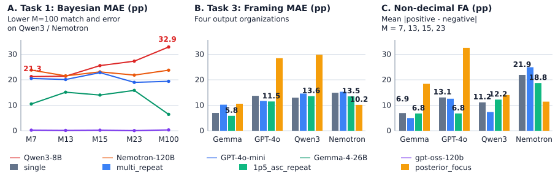
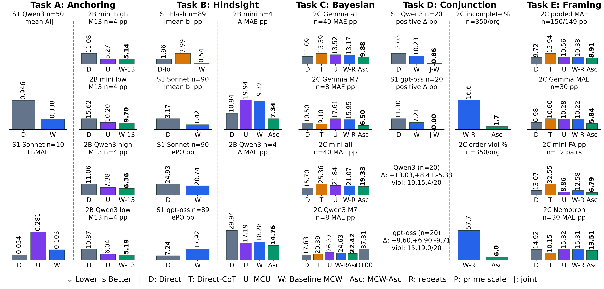
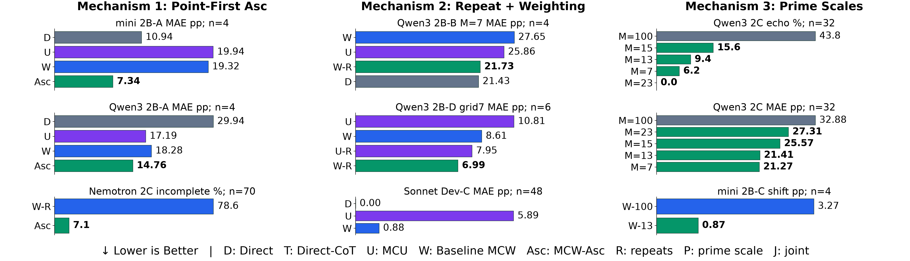

# English paper appendices A-H

Original preregistration materials and Addendum 1 are public in the study repository. The v2 CSVs and analysis products are local package deliverables, without a claim that they are publicly uploaded. Original third-party SynAnchors and COPA/ProbCOPA texts are not reproduced.

## Appendix A. Materials, scale, and seeds

**A: anchoring.** SynAnchors 0.1 semantic subset, Hugging Face `TimTargaryen/SynAnchors` revision `e6df428`, whose data card specifies Apache-2.0. We use questions and truths, not its anchors or prompts. Eligibility was frozen before development: the question must stand alone; truth must be positive and finite, with clear units and reference time (time-invariant quantities need no year); anchors must be expressible at the item's precision. Of 60 items, 36 were eligible and 24 excluded: 19 lacked factual truth (subjective preferences, bargaining, compensation, etc.), 3 had ambiguous units or quantities, and 2 had clearly questionable truths. With fewer than 40 eligible items, we followed the plan and wrote 24 additional items with verifiable sources and review. Development has 10 items (6 SynAnchors, 4 new); formal testing has 50 (30, 20). Analyses also describe source strata. Anchors were rounded to customary item-specific precision and frozen individually, requiring 0 < low anchor < high anchor.

**B: hindsight.** ProbCOPA, GitHub `McGill-NLP/probabilistic-reasoning` revision `b983b12`. Its repository LICENSE is MIT, with no separate data-license clarification in README/LICENSE. There are 105 COPA effect items, each with two outcomes rated from 0–100 for likelihood by 25–30 native speakers. All 105 were matched using source IDs and premise text. Synthetic canary entries inserted by the authors were removed by deleting rows with `type == canary` and retaining the bytes of all other rows. Each source file was reduced from 5,908 to 5,858 rows; downloaded cleaning code was not executed. Human ratings are descriptive only: mean ratings (`mean_response`) are primary and medians secondary. Spearman correlations with F aggregate by UID and use average ranks for ties. Acquisition, reconstruction, and file SHA-256 values appear in `third-party-data.md`.

**C: base rates.** There are 24 newly written scenarios, without classic item wording. Bayesian answers are 8.33, 50.00, and 79.41% for accuracy set A (90%/10%), and 13.91, 64.00, and 87.27% for set B (80%/5%). Prompts define the event meant by “positive” and state that the person is randomly selected from positive cases, without other information.

**D: conjunction.** Item bank v0.2. Authors stored complete conjunction and disjunction sentences for person items. Components must be single, independently truth-evaluable facts, without protected attributes as the basis for A or B. Person items use “now” as a shared assessment time, and event pairs are restricted to “the same day.” Development includes P 4 and W 3 (1 per dependence stratum); formal testing includes P 20 and W 15 (5 per stratum).

**E: status quo and defaults.** The 40 items span 19 domains, including 4 each on software settings, insurance add-ons, and subscriptions. Scenarios establish registration, activation, or initial setup; cost-related items specify that the choice precedes payment. T is P in 20 items and Q in 20, with P listed first; the formal split is 17/15. Stratification by whether T is first or second is therefore a cross-item description, without identifying a position effect.

**Scale** (per configuration; `manifest_ids.json`)

| Experiment | Clusters (development/formal) | Units per item | Development | Formal | Repeat subset |
| --- | --- | --- | --- | --- | --- |
| A | 10/50 items | 10 | 100 | 500 | 80 (8 items) |
| B | 15/90 items | 16 | 240 | 1,440 | 192 (12 items) |
| C | 4/20 scenarios (8/40 items) | 12 | 96 | 480 | 96 (4 scenarios) |
| D | 7/35 items (P 4/20, W 3/15) | 10 | 70 | 350 | 60 (P 4, W 2) |
| E | 8/32 items | 14 | 112 | 448 | 56 (4 items) |
| Total |  |  | 618 | 3,218 | 484 |

**Seeds**

| Purpose | Seed | Source |
| --- | --- | --- |
| A split/repeats (SynAnchors) | 20261440/20261441 | `gen_a.py` |
| A split/repeats (new items) | 20261442/20261443 | `gen_a.py` |
| B split/repeats | 20261450/20261451 | `gen_b.py` |
| C split/repeats | 20261410/20261412 | `gen_c.py`, `manifest.py` |
| D joint order/split/repeats | 20261430/20261431/20261432 | `gen_d.py` |
| E split/repeats | 20261460/20261461 | `manifest.py` |
| Execution/call base seeds (development/formal) | 20261080/20261081 (same as δ-NLI) | `run_psych3.py` |
| Analysis/power bootstrap | 2026101903 | `analysis_psych3.py` |

Execution order initializes from “base seed × 10 + configuration offset,” shuffling clusters and then units within clusters. Configuration offsets follow δ-NLI (qwen3-off 0, codex 3); agy uses the first 8 hexadecimal digits of the configuration-name string's SHA-256 (e.g., of the string `agy:claude-sonnet-5-5-medium`). A call seed is the first 8 SHA-256 digits of “set|configuration|unit ID|a<attempt number>|base seed,” affecting Qwen3 only.

**Table A1. Admitted units and historical exclusions**

Excluded formal lines are reported once per configuration (on its r0 row), not allocated to a round. F0/F1 rows partition Flash high; they are not additional configurations.

| Configuration | Stage / round | Admitted | OK | Missing | Excluded lines |
| --- | --- | --- | --- | --- | --- |
| codex | dev r0 | 618 | 618 | 0 | 6 |
| codex | formal r0 | 3218 | 3215 | 3 | 22 |
| codex | formal r1 | 484 | 484 | 0 | see r0 |
| Sonnet 5.5 | dev r0 | 618 | 618 | 0 | 3 |
| Sonnet 5.5 | formal r0 | 3218 | 3218 | 0 | 9 |
| Sonnet 5.5 | formal r1 | 484 | 484 | 0 | see r0 |
| Qwen3 | dev r0 | 618 | 617 | 1 | 0 |
| Qwen3 | formal r0 | 3218 | 3211 | 7 | 1 |
| Qwen3 | formal r1 | 484 | 483 | 1 | see r0 |
| gpt-oss-120b | dev r0 | 618 | 618 | 0 | 4 |
| gpt-oss-120b | formal r0 | 3218 | 3210 | 8 | 24 |
| gpt-oss-120b | formal r1 | 484 | 484 | 0 | see r0 |
| Flash low | dev r0 | 618 | 618 | 0 | 1 |
| Flash low | formal r0 | 3218 | 3217 | 1 | 10 |
| Flash low | formal r1 | 484 | 484 | 0 | see r0 |
| Flash high | dev r0 | 618 | 618 | 0 | 1 |
| Flash high | formal r0 | 3218 | 3217 | 1 | 16 |
| Flash high | formal r1 | 484 | 484 | 0 | see r0 |
| Flash high F0 | r0 | 2687 | 2686 | 1 | 13 |
| Flash high F0 | r1 | 362 | 362 | 0 | see r0 |
| Flash high F1 | r0 | 531 | 531 | 0 | 3 |
| Flash high F1 | r1 | 122 | 122 | 0 | see r0 |

**Table A2. Formal missingness retained under Addendum 2 and the frozen rules**

Missing records remain missing; historical excluded lines are a different category. No missing result is silently treated as an observed number.

| Configuration | Experiment | Round | Missing | Batch |
| --- | --- | --- | --- | --- |
| codex | A | r0 | 3 | original batch |
| Qwen3 | E | r0 | 6 | original batch |
| Qwen3 | C | r0 | 1 | original batch |
| Qwen3 | E | r1 | 1 | original batch |
| gpt-oss-120b | B | r0 | 6 | original batch |
| gpt-oss-120b | A | r0 | 2 | original batch |
| Flash low | B | r0 | 1 | original batch |
| Flash high | B | r0 | 1 | F0 |

## Appendix B. Subject settings, parsing, and retries

**Qwen3.** Qwen3-8B, HF commit b968826, converted to GGUF Q8_0 using llama.cpp build b11560. Parameters are temperature 0.6, top-k 20, top-p 0.95, min-p 0, with other samplers disabled; context 16,384 and generation limit 8,192 tokens. The HF tokenizer's chat template is used with `enable_thinking=False`, one user message, and no system prompt. Exhausting the length limit before an end token counts as truncation.

**codex.** codex CLI 0.163.0-alpha.10.2, separately installed under Addendum 1, with executable SHA-256 in the fingerprint; gpt-6.1-sol, reasoning effort medium, ChatGPT login. Isolation options, the global `AGENTS.md` hash, event-stream checks, and internal-log checks follow δ-NLI. Tool contamination invalidates an attempt and permits one retry separate from parsing retries; persistent contamination is `tool_contaminated`. Disconnections invalidate attempts and permit retries, stopping only after three consecutive instances for the same unit. Calling errors or quota indications stop continuation; the unit is redone later. Changes to global instructions or log-integrity failures invalidate the entire session. psych3 executes codex sequentially in one worker.

**agy.** agy CLI 1.4.0 with automatic updates disabled. Each call starts outside a git repository in a fresh temporary directory containing only a custom agent definition: `tools: []`, default components excluded, and body “Answer the user's question directly.” Execution uses `--sandbox`, without conversation continuation, and a 600-second call timeout. Any event-stream step other than user input and final answer—including tool events, rejected actions, or unknown step types—counts as contamination and triggers a retry. Timeout, disconnection, and truncation invalidate attempts and permit retries; three consecutive instances of the same class for one unit stop execution for review. Rate limits trigger exponential backoff from 5 to 60 minutes; after 6 continuous hours, execution sleeps until the next day; 3 cumulative days for the same unit stop execution. Completed units remain valid. Before and after each unit, environment snapshots compare agy version, permission-setting hash, setting-key names, agent-file hash, and server-reported model name; any change stops execution before the next unit. Finalization is per unit: persist raw attempt → append result → read back and verify → atomically update registration.

**Parsing.** Probability cells use δ-NLI parser v2. Direct responses use the final answer field; an invalid number on that line fails without fallback. Multi-estimate responses use the last group beginning with a line resembling “Estimate 1.” Exactly 5 lines numbered 1–5 are required, with values from 0–100 carrying percent signs and weights in [0, 1]; a positive weight sum is normalized. A accepts finite positive quantities, including decimals and scientific notation such as `1.2e6`, but not commas or ranges; item-consistent unit suffixes may be ignored. Nonpositive or nonfinite values, an empty final field, an incomplete final multi-estimate group, or total weight ≤ 0 all fail. Joint D reads the final four lines for direct responses, or the final group of 5 lines each containing four percentages and a weight. Any missing number fails the entire cell; partial use is prohibited. Before parsing agy answers, Unicode space-separator characters (Zs) are replaced with ordinary spaces. For A's comparison answer, the first whole-word occurrence of higher/lower/equal in the full response is used, case-insensitively.

**Strict reader.** Analysis reads only records from normally finalized, noninvalidated sessions with matching fingerprints (registered units for agy), and matching result/raw-file hashes (`analyse_psych3.load_valid(..., strict=True)`). Residual records from unfinalized sessions and superseded retries are excluded.

## Appendix C. Missing-value substitutions and preregistered descriptive measures

**General missingness-protection rule** (PLAN §§1, 5b.3, 7.1 rules 3–4). Observed values remain unchanged; only missing cells are replaced. Linear statistics have lower- and upper-bound versions. The lower version assigns 0 to missing cells with positive coefficients and 100 to those with negative coefficients; the upper version reverses this. The positive-direction tail probability uses the lower version (proportion of resampled statistics ≤ 0); the negative direction uses the upper version (≥ 0). Conservative two-sided p is twice the smaller tail proportion, capped at 1. Protection uses the full formal item set for that hypothesis, equal item weights, and whole-cluster resampling; complete-item and protected analyses report separate denominators. Clipping bounds C's item-level slopes at approximately ±3.01, which supplies finite worst-case values. When a hypothesis requires both accuracy sets to be complete within a scenario, a scenario with one complete set is excluded from the complete-item analysis but filled by substitution in the protected analysis. A has no upper bound and no protection (Section 3.4).

**Statistic-specific substitutions in D** (any missing number in a joint-response cell makes all four missing)

| Statistic | Supported direction | Worst-case substitution |
| --- | --- | --- |
| D1: Δ_S | Positive | Missing P_S(A and B) = 0; P_S(B) = 100 |
| D2: Δ_S − Δ_J | Positive | Minimize Δ_S as above; if joint values are missing, P_J(A and B) = 100 and P_J(B) = 0 (whole-cell missingness gives Δ_J = +100) |
| D3: Δ_S,multi − Δ_S,direct | Two-sided | Obtain feasible lower and upper difference bounds; use the lower for the positive direction and upper for the negative direction; crossing zero does not confirm direction |
| D4: Δ_J,multi − Δ_J,direct | Two-sided | As D3, using joint elicitation |

**E.** Item-level E1/E2, y(direct,T) − y(direct,O), ranges over [−100, 100]. E3/E4, y(multi,T) − y(multi,O) − y(direct,T) + y(direct,O), ranges over [−200, 200]. Both use the general rule. The advice control uses the same cell-level substitutions and descriptive intervals, outside Holm.

**Combined reporting.** Complete-item and protected results are combined into one report only when no cells required by the entire confirmatory family are missing. Because a test without missing cells can still change Holm position through other members' conservative p-values, the two versions are otherwise reported separately.

**Preregistered descriptive measures** (outside Holm; no significance conclusions)

- A: log errors relative to truth in each condition, including unanchored; weighted proportions of multi-estimate candidates beyond the anchor (above high anchors, below low anchors); agreement between comparison answers and final estimates; strata by item source.
- B: b stratified by whether the disclosed outcome is higher/lower in F; weighted proportions of multi-estimate HI candidates below the same-format F aggregate; Spearman correlations between F and human ratings; input-condition difference c = ½ Σₖ [PO(O_k) − F(O_k)].
- C: three-point scatterplots per item and nonmonotonicity rates; clipping-bound proportions and sensitivity to [0.1%, 99.9%] clipping; proportions within 1 percentage point of Bayesian answers; weight assigned to the multi-estimate candidate nearest the Bayesian answer; joint descriptions of |slope − 1|, intercept, and Bayesian error.
- D: violation rates for P and W separately by presentation and response format; means and SDs of Δ, Δ_min, and additive-identity deviation X for W by dependence stratum; disjunction excess; weighted candidate-level violation proportions under joint multi-estimate elicitation; whether P(B) < P(A) in person items; repeat-subset distributions of differences between two reports for the same unit.
- E: “label assigned to T − neutral” and “neutral − label assigned to the other option”; neutral-response distributions; E_advice, S_E = E_advice − E_status_quo (also relative to defaults), and their format changes; E_status_quo − E_default; weighted candidate proportions on either side of 50; strata with T first/second.
- Cross-experiment (PLAN §10): within each configuration, paired differences and 95% intervals on original scales for A's AI_irrelevant, AI_informative, and S; B's b and e_PO; C's slope and Bayesian error; D's Δ under separate and joint elicitation; and E's E_status_quo, E_default, and E_advice, showing values and differences across formats. δ-NLI s is a comparison only; no ratios are used.


## Appendix D. Development diagnostics and power

**Power simulations** (PLAN §§7, 7.1; `power_dev_summary.md`). Development clusters are resampled while retaining condition correlations within items. At the hypothesis-statistic level, mean contributions are shifted to the specified effect (AI scale in A), and planned numbers of clusters are resampled. Hypotheses in one family are resampled together; with fewer than 4 development clusters, they are instead resampled separately and this is noted. Missingness is generated from development cell-failure rates with a minimum of 2%; D joint elicitation fails as a whole cell. Scenarios are zero effect, the SESOI, and twice the SESOI (plus a ceiling scenario in C), under 1, 1.5, and 2 times the development SD. Each scenario has 1,000 simulations, each running the complete family Holm procedure and decisions with inner bootstrap B = 499. Power targets use complete-item-subset decisions. Protected-version attainment rates are reported alongside them but do not determine screening. For example, Sonnet B1's direction-confirmation rate at the SESOI is 1.000 for complete items and 0.003 with protection; the frozen rule retains it.


Table H1 gives the unchanged lists and all six development acceptance sets. Exact downgrade reasons remain in the audited supplementary JSON, separate from formal recommendation-control interpretation caveats. The E no-expansion exception preserves development fingerprints. Qwen3 is retained by decision as the descriptive benchmark.

## Appendix E. Execution details, addenda, and accounting

**Fingerprints.** The execution fingerprint binds the plan, material files and item manifest (`manifest_ids.json`), prompt and parsing code, runner code (including δ-NLI `run.py` and `parse.py`), subject-wrapper code, subject settings (version, model, reasoning effort, isolation options, instruction-source hashes, etc.), and retry rules. For the original agy F0 batches it also binds night-scheduler code and settings: 4 workers, Asia/Shanghai, new units 00:00–07:45, hard cutoff 08:00, and automatic-release limit 8. The analysis freeze separately binds analysis-code hashes, B, seed, α, hypothesis specifications, configuration lists, and development acceptance. Startup recomputes the execution fingerprint and rejects mismatches against the freeze.

**Time windows (original batches).** Night schedules for codex and Qwen3 start new attempts, including retries, only between 00:00 and 07:45. Calls in progress are not forcibly stopped at 08:00; units blocked by the window after 07:45 are redone the next night. Since Addendum 1, codex also permits daytime batches bounded by end time or unit count; no new units start after the boundary. Historical periods for the initial three configurations were codex 10-25 00:01 to 10-27 20:53; Sonnet 10-23 00:01 to 10-28 01:00; and Qwen3 10-23 00:01 to 10-24 06:00.

The original agy F0 batches used four workers, the 00:00-07:45 admission window and an 08:00 hard cutoff. F1 is the approved protocol exception for agy:gemini-3.8-flash-high: one worker, continuous admission from the approved start until formal coverage completed, and no 08:00 hard cutoff, with completion and safety stopping. The subject configuration, materials, prompts, parsing and ten-hypothesis list remain unchanged; the distinct F1 batch fingerprint is preserved.

**Addendum 1 (2026-10-24, commit `940aee5`).**

- At formal startup on 10-23 00:00, the desktop-installed codex CLI had automatically updated. Version checks refused startup, and no formal codex units ran. The same version, 0.163.0-alpha.10.2, was separately installed through npm that day in a location not updated by the desktop app. The new entry point verifies executable SHA-256 on startup, retaining per-call version checks. Model, reasoning effort, login, isolation options, global `AGENTS.md`, prompts, parsing, inclusion, and retry rules are unchanged. Only version-string equality is claimed, not byte identity with the original executable.
- The preregistered codex fingerprint included the model entry's SHA-256 from `codex debug models`. Snapshots on 10-24 showed the same model entry alternating between two versions within minutes, neither matching the preregistered hash. There were six differences: two plugin/application sections in base instructions; browser/computer confirmation policy; one default-collaboration-mode sentence; context window (500,000 versus 272,000 tokens); and `available_access_programs`. Most concern features disabled through isolation and unused by the task, but the context window differs as well. We did not test effects on answers. The fingerprint was changed to bind executable SHA-256. The complete entry and hash are saved at session start, which identifies only the version observed then, not which version served an individual call. Additional snapshots were scheduled every two hours for 14 days from 10-24.
- Development was fully rerun under the new fingerprint (10-24 14:35–17:14, seven sessions) and accepted using original criteria: 618/618 included, 618 first-attempt parses, 0 missing. The preregistered development set and an interrupted partial rerun remain archived unchanged. Only codex's entry in the analysis freeze changed (executable path/hash, removal of directory-entry hash, fingerprint ID); the other five configurations were unchanged.
- Execution changes without fingerprint effects: sessions stopped solely by inability to connect to OpenAI automatically restart after waits of 5, 10, and 20 minutes, with at most 8 restarts per runner launch and failed units redone. Night jobs no longer open a console window; closing a terminal had interrupted the first formal night on 10-23 at 00:14.

**Addendum 2 (2026-10-29; public commit to be added after release), §4 rules and decisions.** These do not change prompts, parsing, fingerprints, or scoring of completed answers. agy rules run in a separate script before the frozen night queue; fingerprint-bound files are unchanged and every action has an audit record.

1. Another recognized connection-failure message was added to codex automatic continuation (10-25); failed units remain subject to rerun.
2. Initial gpt-oss B710 disposition (decided 10-25, executed 10-26): a unit rejected by provider content-safety filtering three times on each of two nights was administratively marked missing (`manual_disposition`), referencing all six actual attempts without further calls. The same transaction registered two earlier interrupted-session residues as excluded; neither had been included.
3. General content-safety rule (10-26): an agy formal unit stopped after three attempts strictly matching provider content-safety criteria is retried the next night. A second such stop on another night leads to an administrative missing record.
4. gpt-oss B710-specific rule (10-27): all six units disclosing the second outcome were blocked, whereas the other ten were not. Only for this item and configuration, one strictly verified filtering stop suffices for an administrative missing record. On 10-28, a B710 unit with one capacity error (HTTP 503) and two content-safety refusals across three attempts was also assigned missing under this rule, with per-attempt reasons recorded. Units completed before filtering remain included.
5. Setting conflicts (night of 10-25 to 26): agy settings were restored to preregistered baseline before each night, but another project repeatedly added permission rules during execution. Environment checks stopped agy configurations; manual release followed the next day and affected units were redone. Other projects subsequently avoided agy during the night window.
6. Insufficient capacity (from 10-29): stops with three attempts strictly matching HTTP 503, at least 30 minutes since the last attempt, can be automatically released and rerun, at most 2 times per unit and 6 per model per night; beyond these limits, review is required. Stopped sessions remain invalidated.
7. Manual review: other stops (response-check failures, disconnections, environment checks, refused startup) were reviewed and released on 10-23, 24, 25, 26, and 29. Units were redone under unchanged rules, with an audit file for each review.


The completed-cohort dispositions and stage/round counts appear in Tables A1-A2. Missing values remain missing and enter the original complete-subset and worst-case procedures. The post-hoc closure of 359 codex units retains its disclosed inclusion status; it is not reclassified as a preregistered closure.

## Appendix F. Execution-window amendment and full endpoint inventory

The Flash-high identities are retained verbatim:

F0: `a532f2d198d661032c96b98e9eb0c88e15f391400c4e789dc0c8e9f652fe0a11`

F1: `8c35dff8fab0d60b39ee4fba09786f0ddca63c43df1c51a515be07438e434885`

F1 binds a new start boundary, remaining order, inherited development baseline and independent commit receipts. The original agy F0 batches used four workers, the 00:00-07:45 admission window and an 08:00 hard cutoff. F1 is the approved protocol exception for agy:gemini-3.8-flash-high: one worker, continuous admission from the approved start until formal coverage completed, and no 08:00 hard cutoff, with completion and safety stopping. The subject configuration, materials, prompts, parsing and ten-hypothesis list remain unchanged; the distinct F1 batch fingerprint is preserved. Cluster D / w01 spans F0 (7 r0 calls) and F1 (3 r0 calls) across both response formats. There are zero cross-batch r0/r1 repeat pairs: every repeated unit has its r0 and r1 calls in the same batch. Its union with F0 uses the original ten-hypothesis list; no development set or response prompt is changed. The host analysis passed v1 byte reproduction and seven-batch strict admission; this builder does not claim to rerun protected raw admission in the sandbox.

**Table F1. Flash-high primary-call assignment by material condition**

F0 and F1 are non-randomized execution windows confounded with item schedule order and collection time. Differences are exploratory and do not identify a causal execution-window or model effect.

| Batch | Experiment | Condition (frozen cell key) | Units |
| --- | --- | --- | --- |
| F0 | A | ('informative', 'high') | 86 |
| F0 | A | ('informative', 'low') | 86 |
| F0 | A | ('irrelevant', 'high') | 86 |
| F0 | A | ('irrelevant', 'low') | 86 |
| F0 | A | ('none', 'none') | 86 |
| F0 | B | ('F', 1) | 152 |
| F0 | B | ('F', 2) | 152 |
| F0 | B | ('HI', 1) | 152 |
| F0 | B | ('HI', 2) | 152 |
| F0 | B | ('HP', 1) | 152 |
| F0 | B | ('HP', 2) | 152 |
| F0 | B | ('PO', 1) | 152 |
| F0 | B | ('PO', 2) | 152 |
| F0 | C | ('frequency', 1) | 68 |
| F0 | C | ('frequency', 10) | 68 |
| F0 | C | ('frequency', 30) | 68 |
| F0 | C | ('probability', 1) | 68 |
| F0 | C | ('probability', 10) | 68 |
| F0 | C | ('probability', 30) | 68 |
| F0 | D | ('J', 'a') | 59 |
| F0 | D | ('S', 'a') | 60 |
| F0 | D | ('S', 'b') | 59 |
| F0 | D | ('S', 'conj') | 60 |
| F0 | D | ('S', 'disj') | 59 |
| F0 | E | ('default_O',) | 48 |
| F0 | E | ('default_T',) | 48 |
| F0 | E | ('neutral',) | 48 |
| F0 | E | ('recommend_O',) | 48 |
| F0 | E | ('recommend_T',) | 48 |
| F0 | E | ('status_O',) | 48 |
| F0 | E | ('status_T',) | 48 |
| F1 | A | ('informative', 'high') | 14 |
| F1 | A | ('informative', 'low') | 14 |
| F1 | A | ('irrelevant', 'high') | 14 |
| F1 | A | ('irrelevant', 'low') | 14 |
| F1 | A | ('none', 'none') | 14 |
| F1 | B | ('F', 1) | 28 |
| F1 | B | ('F', 2) | 28 |
| F1 | B | ('HI', 1) | 28 |
| F1 | B | ('HI', 2) | 28 |
| F1 | B | ('HP', 1) | 28 |
| F1 | B | ('HP', 2) | 28 |
| F1 | B | ('PO', 1) | 28 |
| F1 | B | ('PO', 2) | 28 |
| F1 | C | ('frequency', 1) | 12 |
| F1 | C | ('frequency', 10) | 12 |
| F1 | C | ('frequency', 30) | 12 |
| F1 | C | ('probability', 1) | 12 |
| F1 | C | ('probability', 10) | 12 |
| F1 | C | ('probability', 30) | 12 |
| F1 | D | ('J', 'a') | 11 |
| F1 | D | ('S', 'a') | 10 |
| F1 | D | ('S', 'b') | 11 |
| F1 | D | ('S', 'conj') | 10 |
| F1 | D | ('S', 'disj') | 11 |
| F1 | E | ('default_O',) | 16 |
| F1 | E | ('default_T',) | 16 |
| F1 | E | ('neutral',) | 16 |
| F1 | E | ('recommend_O',) | 16 |
| F1 | E | ('recommend_T',) | 16 |
| F1 | E | ('status_O',) | 16 |
| F1 | E | ('status_T',) | 16 |

**Table F2. All 120 planned endpoints and development eligibility**

Each endpoint is reported once per configuration. Confirmatory decisions are in H2 only. Development eligibility is separate from formal recommendation-control interpretation caveats. Full exact eligibility reasons and feasible missingness bounds are retained in the audited supplementary JSON.

| Configuration | H | Complete / planned clusters | Estimate [unadjusted 95% CI] | Missing cells | Eligibility |
| --- | --- | --- | --- | --- | --- |
| codex | A1 | 50/50 | -0.030 [-0.156, 0.087] | 0 | dev_diagnostic |
| codex | A2 | 50/50 | 0.459 [0.285, 0.657] | 0 | dev_diagnostic |
| codex | A3 | 49/50 | 0.005 [-0.151, 0.158] | 2 | dev_diagnostic |
| codex | A4 | 49/50 | 0.051 [-0.108, 0.206] | 2 | dev_diagnostic |
| codex | B1 | 90/90 | -2.289 [-3.589, -1.033] | 0 | frozen_confirmatory |
| codex | B2 | 90/90 | 48.256 [44.144, 52.028] | 0 | dev_power |
| codex | B3 | 90/90 | -0.363 [-1.570, 0.797] | 0 | frozen_confirmatory |
| codex | B4 | 90/90 | 0.905 [0.337, 2.013] | 0 | frozen_confirmatory |
| codex | C1 | 20/20 | -0.000 [-0.000, -0.000] | 0 | dev_diagnostic |
| codex | C2 | 20/20 | 0.000 [0.000, 0.000] | 0 | dev_diagnostic |
| codex | C3 | 20/20 | -0.000 [-0.000, -0.000] | 0 | dev_diagnostic |
| codex | C4 | 20/20 | -0.002 [-0.002, -0.001] | 0 | dev_diagnostic |
| codex | D1 | 20/20 | -1.425 [-3.850, 0.375] | 0 | frozen_confirmatory |
| codex | D2 | 20/20 | 2.458 [1.175, 3.875] | 0 | frozen_confirmatory |
| codex | D3 | 20/20 | -0.741 [-1.708, 0.231] | 0 | frozen_confirmatory |
| codex | D4 | 20/20 | 0.143 [-0.134, 0.446] | 0 | frozen_confirmatory |
| codex | E1 | 32/32 | -0.312 [-0.938, 0.000] | 0 | frozen_confirmatory |
| codex | E2 | 32/32 | 0.000 [0.000, 0.000] | 0 | frozen_confirmatory |
| codex | E3 | 32/32 | -0.383 [-2.086, 1.234] | 0 | frozen_confirmatory |
| codex | E4 | 32/32 | -0.023 [-1.555, 1.523] | 0 | frozen_confirmatory |
| Qwen3 | A1 | 50/50 | 0.946 [-0.231, 2.231] | 0 | descriptive_only |
| Qwen3 | A2 | 50/50 | -1.316 [-2.827, 0.060] | 0 | descriptive_only |
| Qwen3 | A3 | 50/50 | -0.608 [-1.955, 0.723] | 0 | descriptive_only |
| Qwen3 | A4 | 50/50 | 1.576 [-0.114, 3.309] | 0 | descriptive_only |
| Qwen3 | B1 | 90/90 | -7.751 [-12.228, -3.201] | 0 | descriptive_only |
| Qwen3 | B2 | 90/90 | 54.128 [49.861, 58.583] | 0 | descriptive_only |
| Qwen3 | B3 | 90/90 | 5.721 [0.677, 10.757] | 0 | descriptive_only |
| Qwen3 | B4 | 90/90 | 19.053 [15.600, 22.624] | 0 | descriptive_only |
| Qwen3 | C1 | 20/20 | -0.002 [-0.003, -0.000] | 0 | descriptive_only |
| Qwen3 | C2 | 19/20 | -0.001 [-0.003, -0.000] | 1 | descriptive_only |
| Qwen3 | C3 | 20/20 | -0.012 [-0.017, -0.008] | 0 | descriptive_only |
| Qwen3 | C4 | 20/20 | 0.647 [0.537, 0.761] | 0 | descriptive_only |
| Qwen3 | D1 | 20/20 | 13.025 [8.000, 19.075] | 0 | descriptive_only |
| Qwen3 | D2 | 20/20 | 15.775 [9.400, 22.900] | 0 | descriptive_only |
| Qwen3 | D3 | 20/20 | -4.613 [-12.936, 3.610] | 0 | descriptive_only |
| Qwen3 | D4 | 20/20 | -2.583 [-5.984, 0.726] | 0 | descriptive_only |
| Qwen3 | E1 | 32/32 | -1.648 [-9.719, 6.562] | 0 | descriptive_only |
| Qwen3 | E2 | 32/32 | -0.532 [-8.913, 6.589] | 0 | descriptive_only |
| Qwen3 | E3 | 31/32 | 4.042 [-5.568, 14.325] | 2 | descriptive_only |
| Qwen3 | E4 | 29/32 | 5.659 [-4.104, 15.685] | 3 | descriptive_only |
| Sonnet 5.5 | A1 | 50/50 | 0.019 [-0.069, 0.098] | 0 | frozen_confirmatory |
| Sonnet 5.5 | A2 | 50/50 | 0.471 [0.340, 0.606] | 0 | dev_power |
| Sonnet 5.5 | A3 | 50/50 | -0.057 [-0.187, 0.049] | 0 | frozen_confirmatory |
| Sonnet 5.5 | A4 | 50/50 | 0.131 [-0.044, 0.365] | 0 | dev_power |
| Sonnet 5.5 | B1 | 90/90 | -3.169 [-4.772, -1.633] | 0 | frozen_confirmatory |
| Sonnet 5.5 | B2 | 90/90 | 3.931 [1.678, 6.344] | 0 | frozen_confirmatory |
| Sonnet 5.5 | B3 | 90/90 | 1.750 [0.613, 2.836] | 0 | frozen_confirmatory |
| Sonnet 5.5 | B4 | 90/90 | -4.193 [-6.646, -1.792] | 0 | frozen_confirmatory |
| Sonnet 5.5 | C1 | 20/20 | -0.000 [-0.000, -0.000] | 0 | dev_diagnostic |
| Sonnet 5.5 | C2 | 20/20 | 0.000 [0.000, 0.000] | 0 | dev_diagnostic |
| Sonnet 5.5 | C3 | 20/20 | -0.061 [-0.069, -0.053] | 0 | dev_diagnostic |
| Sonnet 5.5 | C4 | 20/20 | 1.006 [0.888, 1.121] | 0 | dev_diagnostic |
| Sonnet 5.5 | D1 | 20/20 | -1.480 [-3.730, 0.080] | 0 | frozen_confirmatory |
| Sonnet 5.5 | D2 | 20/20 | 2.300 [1.305, 3.490] | 0 | frozen_confirmatory |
| Sonnet 5.5 | D3 | 20/20 | -0.417 [-1.560, 0.508] | 0 | frozen_confirmatory |
| Sonnet 5.5 | D4 | 20/20 | -0.095 [-0.439, 0.211] | 0 | frozen_confirmatory |
| Sonnet 5.5 | E1 | 32/32 | 0.344 [-1.250, 1.844] | 0 | dev_power |
| Sonnet 5.5 | E2 | 32/32 | -1.406 [-3.125, 0.219] | 0 | frozen_confirmatory |
| Sonnet 5.5 | E3 | 32/32 | -0.298 [-3.066, 2.423] | 0 | dev_power |
| Sonnet 5.5 | E4 | 32/32 | 0.389 [-2.530, 3.095] | 0 | frozen_confirmatory |
| gpt-oss-120b | A1 | 50/50 | 0.039 [-0.944, 0.978] | 0 | frozen_confirmatory |
| gpt-oss-120b | A2 | 50/50 | -0.040 [-1.288, 1.099] | 0 | dev_power |
| gpt-oss-120b | A3 | 50/50 | 0.158 [-0.777, 1.133] | 0 | dev_power |
| gpt-oss-120b | A4 | 49/50 | 0.147 [-1.068, 1.473] | 1 | dev_power |
| gpt-oss-120b | B1 | 89/90 | 0.028 [-2.764, 2.837] | 1 | dev_power |
| gpt-oss-120b | B2 | 89/90 | 49.612 [46.197, 52.988] | 2 | dev_power |
| gpt-oss-120b | B3 | 89/90 | 6.143 [3.198, 9.236] | 2 | dev_power |
| gpt-oss-120b | B4 | 89/90 | 10.679 [7.607, 13.805] | 2 | frozen_confirmatory |
| gpt-oss-120b | C1 | 20/20 | -0.000 [-0.000, -0.000] | 0 | dev_diagnostic |
| gpt-oss-120b | C2 | 20/20 | -0.000 [-0.000, -0.000] | 0 | dev_diagnostic |
| gpt-oss-120b | C3 | 20/20 | -0.003 [-0.005, -0.000] | 0 | dev_diagnostic |
| gpt-oss-120b | C4 | 20/20 | 0.191 [0.155, 0.231] | 0 | dev_diagnostic |
| gpt-oss-120b | D1 | 20/20 | 9.600 [3.200, 17.100] | 0 | dev_power |
| gpt-oss-120b | D2 | 20/20 | 17.350 [9.750, 25.550] | 0 | dev_power |
| gpt-oss-120b | D3 | 20/20 | -2.695 [-10.673, 4.297] | 0 | dev_power |
| gpt-oss-120b | D4 | 20/20 | -1.963 [-4.289, 0.402] | 0 | dev_power |
| gpt-oss-120b | E1 | 32/32 | -1.133 [-7.561, 5.484] | 0 | dev_power |
| gpt-oss-120b | E2 | 32/32 | 1.478 [-3.219, 6.572] | 0 | frozen_confirmatory |
| gpt-oss-120b | E3 | 32/32 | 5.121 [-2.083, 12.396] | 0 | dev_power |
| gpt-oss-120b | E4 | 32/32 | 3.144 [-2.042, 8.020] | 0 | dev_power |
| Flash low | A1 | 50/50 | 0.042 [-0.047, 0.183] | 0 | dev_diagnostic |
| Flash low | A2 | 50/50 | 0.179 [0.042, 0.310] | 0 | dev_diagnostic |
| Flash low | A3 | 50/50 | 0.038 [-0.036, 0.145] | 0 | dev_diagnostic |
| Flash low | A4 | 50/50 | -0.018 [-0.208, 0.178] | 0 | dev_diagnostic |
| Flash low | B1 | 90/90 | -1.939 [-3.973, 0.022] | 0 | frozen_confirmatory |
| Flash low | B2 | 90/90 | 10.967 [7.222, 14.844] | 0 | dev_power |
| Flash low | B3 | 89/90 | 1.643 [0.410, 2.943] | 1 | frozen_confirmatory |
| Flash low | B4 | 90/90 | 2.520 [-0.513, 5.570] | 0 | frozen_confirmatory |
| Flash low | C1 | 20/20 | -0.000 [-0.000, -0.000] | 0 | dev_diagnostic |
| Flash low | C2 | 20/20 | 0.000 [0.000, 0.000] | 0 | dev_diagnostic |
| Flash low | C3 | 20/20 | -0.000 [-0.000, -0.000] | 0 | dev_diagnostic |
| Flash low | C4 | 20/20 | 0.005 [0.003, 0.007] | 0 | dev_diagnostic |
| Flash low | D1 | 20/20 | 0.085 [-1.015, 1.495] | 0 | frozen_confirmatory |
| Flash low | D2 | 20/20 | 3.373 [1.137, 6.130] | 0 | frozen_confirmatory |
| Flash low | D3 | 20/20 | 0.487 [-1.654, 2.775] | 0 | frozen_confirmatory |
| Flash low | D4 | 20/20 | -0.167 [-0.772, 0.355] | 0 | frozen_confirmatory |
| Flash low | E1 | 32/32 | -0.531 [-1.625, 0.188] | 0 | frozen_confirmatory |
| Flash low | E2 | 32/32 | 0.000 [0.000, 0.000] | 0 | frozen_confirmatory |
| Flash low | E3 | 32/32 | -0.731 [-2.833, 1.519] | 0 | dev_power |
| Flash low | E4 | 32/32 | 1.645 [-0.183, 3.558] | 0 | fingerprint_preservation_exception |
| Flash high | A1 | 50/50 | 0.034 [0.006, 0.072] | 0 | dev_diagnostic |
| Flash high | A2 | 50/50 | -0.026 [-0.241, 0.123] | 0 | dev_diagnostic |
| Flash high | A3 | 50/50 | -0.048 [-0.103, -0.003] | 0 | dev_diagnostic |
| Flash high | A4 | 50/50 | 0.197 [0.034, 0.458] | 0 | dev_diagnostic |
| Flash high | B1 | 90/90 | -3.972 [-5.983, -2.122] | 0 | frozen_confirmatory |
| Flash high | B2 | 90/90 | 0.850 [0.044, 1.761] | 0 | frozen_confirmatory |
| Flash high | B3 | 89/90 | 4.526 [3.036, 6.125] | 1 | frozen_confirmatory |
| Flash high | B4 | 90/90 | 1.403 [-1.909, 4.820] | 0 | dev_power |
| Flash high | C1 | 20/20 | -0.000 [-0.000, -0.000] | 0 | dev_diagnostic |
| Flash high | C2 | 20/20 | 0.000 [0.000, 0.000] | 0 | dev_diagnostic |
| Flash high | C3 | 20/20 | 0.000 [-0.000, 0.000] | 0 | dev_diagnostic |
| Flash high | C4 | 20/20 | 0.005 [0.003, 0.010] | 0 | dev_diagnostic |
| Flash high | D1 | 20/20 | -1.115 [-2.115, -0.215] | 0 | frozen_confirmatory |
| Flash high | D2 | 20/20 | 3.335 [1.245, 5.865] | 0 | frozen_confirmatory |
| Flash high | D3 | 20/20 | 0.979 [-0.727, 2.689] | 0 | frozen_confirmatory |
| Flash high | D4 | 20/20 | 0.758 [-0.169, 2.001] | 0 | frozen_confirmatory |
| Flash high | E1 | 32/32 | 0.625 [0.000, 1.875] | 0 | frozen_confirmatory |
| Flash high | E2 | 32/32 | 0.000 [0.000, 0.000] | 0 | frozen_confirmatory |
| Flash high | E3 | 32/32 | -2.188 [-4.438, 0.075] | 0 | fingerprint_preservation_exception |
| Flash high | E4 | 32/32 | 0.142 [-1.577, 1.897] | 0 | frozen_confirmatory |

## Appendix G. Exploratory candidate-spread analyses

**Table G1. Exploratory weighted candidate-spread distributions**

A spread is measured on the log scale; B-E in probability points. D joint spread averages conjunction and B component spreads, not all four statements. D valid counts refer to calls. Full distributions by condition: supplement-v2/g2-spread-by-condition.csv (198 rows). Item pairing counts: supplement-v2/g3-paired-cell-counts.csv (1,482 rows). These v2 CSVs are delivered locally, not claimed to be live on GitHub.

| Configuration | Exp | Planned multi calls | Valid | Skipped | Unpaired | Q1 | Median | Q3 | Zero fraction |
| --- | --- | --- | --- | --- | --- | --- | --- | --- | --- |
| codex | A | 250 | 247 | 3 | 0 | 0.0096 | 0.0522 | 0.1455 | 0.000 |
| codex | B | 720 | 720 | 0 | 0 | 0.9581 | 6.9417 | 10.9545 | 0.075 |
| codex | C | 240 | 240 | 0 | 0 | 0.0000 | 0.0000 | 0.0000 | 1.000 |
| codex | D | 175 | 175 | 0 | 0 | 1.5945 | 6.0696 | 10.9545 | 0.000 |
| codex | E | 224 | 224 | 0 | 0 | 10.9545 | 11.1523 | 15.0831 | 0.000 |
| Sonnet 5.5 | A | 250 | 250 | 0 | 0 | 0.0503 | 0.1418 | 0.2400 | 0.000 |
| Sonnet 5.5 | B | 720 | 720 | 0 | 0 | 3.5163 | 6.2639 | 10.0369 | 0.000 |
| Sonnet 5.5 | C | 240 | 240 | 0 | 0 | 1.6325 | 6.5819 | 11.2777 | 0.000 |
| Sonnet 5.5 | D | 175 | 175 | 0 | 0 | 1.3434 | 3.4825 | 7.4795 | 0.000 |
| Sonnet 5.5 | E | 224 | 224 | 0 | 0 | 8.5398 | 9.7559 | 11.5814 | 0.000 |
| Qwen3 | A | 250 | 250 | 0 | 0 | 0.0429 | 0.0922 | 0.2110 | 0.000 |
| Qwen3 | B | 720 | 720 | 0 | 0 | 6.6144 | 11.2823 | 20.5183 | 0.074 |
| Qwen3 | C | 240 | 240 | 0 | 1 | 1.6926 | 2.7436 | 4.4615 | 0.004 |
| Qwen3 | D | 175 | 175 | 0 | 0 | 4.9686 | 7.2647 | 12.7720 | 0.000 |
| Qwen3 | E | 224 | 218 | 6 | 0 | 11.5293 | 13.9272 | 17.6014 | 0.000 |
| gpt-oss-120b | A | 250 | 248 | 2 | 0 | 0.0213 | 0.0680 | 0.1551 | 0.000 |
| gpt-oss-120b | B | 720 | 717 | 3 | 0 | 6.5990 | 11.9478 | 20.2037 | 0.006 |
| gpt-oss-120b | C | 240 | 240 | 0 | 0 | 0.8700 | 1.8166 | 2.4150 | 0.000 |
| gpt-oss-120b | D | 175 | 175 | 0 | 0 | 5.2180 | 8.7006 | 13.7148 | 0.000 |
| gpt-oss-120b | E | 224 | 224 | 0 | 0 | 12.8774 | 16.8300 | 19.3200 | 0.000 |
| Flash low | A | 250 | 250 | 0 | 0 | 0.0067 | 0.0465 | 0.1140 | 0.000 |
| Flash low | B | 720 | 719 | 1 | 0 | 2.7383 | 6.4177 | 10.6946 | 0.000 |
| Flash low | C | 240 | 240 | 0 | 0 | 0.0616 | 0.1101 | 0.1581 | 0.000 |
| Flash low | D | 175 | 175 | 0 | 0 | 1.8731 | 4.0924 | 8.5474 | 0.000 |
| Flash low | E | 224 | 224 | 0 | 0 | 8.0612 | 10.2956 | 11.6619 | 0.000 |
| Flash high | A | 250 | 250 | 0 | 0 | 0.0061 | 0.0367 | 0.1173 | 0.000 |
| Flash high | B | 720 | 719 | 1 | 0 | 4.6503 | 7.2902 | 11.3908 | 0.000 |
| Flash high | C | 240 | 240 | 0 | 0 | 0.0454 | 0.1096 | 0.1615 | 0.000 |
| Flash high | D | 175 | 175 | 0 | 0 | 1.8654 | 4.4272 | 8.6493 | 0.000 |
| Flash high | E | 224 | 224 | 0 | 0 | 9.1864 | 11.1692 | 13.0118 | 0.000 |


## Appendix H. Complete six-configuration overview tables

**Table H1. Development acceptance and frozen configuration-specific gates**

All six configurations triggered the C ceiling (48/48 development direct cells within one point). A known truth uses 20 unanchored estimates. No D floor gate triggered. Low E4 (39 required items) and high E3 (36) were downgraded rather than expanding 32 formal E items and invalidating development fingerprints. Qwen3 was retained as a descriptive benchmark by decision, with no confirmatory tests.

| Configuration | First parses / 618 | Missing | A known truth | Forwarded | Hypotheses | Downgrade categories |
| --- | --- | --- | --- | --- | --- | --- |
| codex | 618 | 0 | 80% | 11 | B1 B3 B4 D1 D2 D3 D4 E1 E2 E3 E4 | dev_diagnostic: 8; dev_power: 1 |
| Sonnet 5.5 | 617 | 0 | 70% | 12 | A1 A3 B1 B2 B3 B4 D1 D2 D3 D4 E2 E4 | dev_power: 4; dev_diagnostic: 4 |
| Qwen3 | 610 | 1 | 15% | 0 | descriptive only | descriptive_only: 20 |
| gpt-oss-120b | 612 | 0 | 40% | 3 | A1 B4 E2 | dev_power: 13; dev_diagnostic: 4 |
| Flash low | 617 | 0 | 85% | 9 | B1 B3 B4 D1 D2 D3 D4 E1 E2 | dev_diagnostic: 8; dev_power: 2; fingerprint_preservation_exception: 1 |
| Flash high | 616 | 0 | 80% | 10 | B1 B2 B3 D1 D2 D3 D4 E1 E2 E4 | dev_diagnostic: 8; dev_power: 1; fingerprint_preservation_exception: 1 |

**Table H2. All 45 frozen confirmatory tests and missingness protection**

One-sided unbounded endpoints are printed as unbounded. These are per-family Holm-step intervals, not fixed 95% simultaneous intervals. Worst-case rows are shown whenever a family required protection. Complete-case rejected flags are preserved separately from the final directional decision. A uses AI units (SESOI 0.10), others 5 pp.

| Configuration | H | Analysis | Estimate [adjusted bound / CI] | Clusters | p / Holm alpha | Rejected | Final status |
| --- | --- | --- | --- | --- | --- | --- | --- |
| codex | B1 | complete | -2.289 [-3.389, unbounded] | 90 | 0.9998 / 0.0500 | False | not retained |
| codex | B3 | complete | -0.363 [-1.749, 0.931] | 90 | 0.5512 / 0.0250 | False | not retained |
| codex | B4 | complete | 0.905 [0.328, 2.538] | 90 | <.001 / 0.0167 | True | retained directional |
| codex | D1 | complete | -1.425 [-3.400, unbounded] | 20 | 0.9248 / 0.0500 | False | not retained |
| codex | D2 | complete | 2.458 [1.015, unbounded] | 20 | <.001 / 0.0125 | True | retained directional |
| codex | D3 | complete | -0.741 [-1.894, 0.457] | 20 | 0.1344 / 0.0167 | False | not retained |
| codex | D4 | complete | 0.143 [-0.172, 0.497] | 20 | 0.3352 / 0.0250 | False | not retained |
| codex | E1 | complete | -0.312 [-1.250, 0.000] | 32 | 0.7008 / 0.0167 | False | not retained |
| codex | E2 | complete | 0.000 [0.000, 0.000] | 32 | 1.0000 / 0.0500 | False | not retained |
| codex | E3 | complete | -0.383 [-2.578, 1.617] | 32 | 0.6748 / 0.0125 | False | not retained |
| codex | E4 | complete | -0.023 [-1.758, 1.773] | 32 | 0.9564 / 0.0250 | False | not retained |
| Sonnet 5.5 | A1 | complete | 0.019 [-0.069, unbounded] | 50 | 0.3192 / 0.0250 | False | not retained |
| Sonnet 5.5 | A3 | complete | -0.057 [-0.187, 0.049] | 50 | 0.3260 / 0.0500 | False | not retained |
| Sonnet 5.5 | B1 | complete | -3.169 [-4.497, unbounded] | 90 | 1.0000 / 0.0500 | False | not retained |
| Sonnet 5.5 | B2 | complete | 3.931 [1.497, unbounded] | 90 | <.001 / 0.0167 | True | retained directional |
| Sonnet 5.5 | B3 | complete | 1.750 [0.479, 2.996] | 90 | <.001 / 0.0250 | True | retained directional |
| Sonnet 5.5 | B4 | complete | -4.193 [-7.350, -1.081] | 90 | <.001 / 0.0125 | True | retained directional |
| Sonnet 5.5 | D1 | complete | -1.480 [-3.365, unbounded] | 20 | 0.9628 / 0.0500 | False | not retained |
| Sonnet 5.5 | D2 | complete | 2.300 [1.235, unbounded] | 20 | <.001 / 0.0125 | True | retained directional |
| Sonnet 5.5 | D3 | complete | -0.417 [-1.810, 0.660] | 20 | 0.4768 / 0.0167 | False | not retained |
| Sonnet 5.5 | D4 | complete | -0.095 [-0.500, 0.242] | 20 | 0.5724 / 0.0250 | False | not retained |
| Sonnet 5.5 | E2 | complete | -1.406 [-3.375, 0.469] | 32 | 0.0988 / 0.0250 | False | not retained |
| Sonnet 5.5 | E4 | complete | 0.389 [-2.530, 3.095] | 32 | 0.7768 / 0.0500 | False | not retained |
| gpt-oss-120b | A1 | complete | 0.039 [-0.704, unbounded] | 50 | 0.4374 / 0.0500 | False | not retained |
| gpt-oss-120b | B4 | complete | 10.679 [7.607, 13.805] | 89 | <.001 / 0.0500 | True | bound exceeds SESOI |
| gpt-oss-120b | B4 | worst-case | 10.035 [6.785, 14.320] | 90 | <.001 / 0.0500 | True | protected=True |
| gpt-oss-120b | E2 | complete | 1.478 [-3.219, 6.572] | 32 | 0.5748 / 0.0500 | False | not retained |
| Flash low | B1 | complete | -1.939 [-3.668, unbounded] | 90 | 0.9738 / 0.0500 | False | not retained |
| Flash low | B1 | worst-case | -1.939 [-3.668, unbounded] | 90 | 0.9738 / 0.0500 | False | protected=False |
| Flash low | B3 | complete | 1.643 [0.094, 3.243] | 89 | 0.0108 / 0.0167 | True | not retained |
| Flash low | B3 | worst-case | 1.141 [-0.792, 3.182] | 90 | 0.1724 / 0.0250 | False | protected=False |
| Flash low | B4 | complete | 2.520 [-0.810, 6.058] | 90 | 0.0996 / 0.0250 | False | not retained |
| Flash low | B4 | worst-case | 2.520 [-1.080, 6.341] | 90 | 0.0996 / 0.0167 | False | protected=False |
| Flash low | D1 | complete | 0.085 [-1.100, unbounded] | 20 | 0.4782 / 0.0167 | False | not retained |
| Flash low | D2 | complete | 3.373 [0.847, unbounded] | 20 | <.001 / 0.0125 | True | retained directional |
| Flash low | D3 | complete | 0.487 [-1.654, 2.775] | 20 | 0.6724 / 0.0500 | False | not retained |
| Flash low | D4 | complete | -0.167 [-0.868, 0.420] | 20 | 0.5892 / 0.0250 | False | not retained |
| Flash low | E1 | complete | -0.531 [-1.875, 0.188] | 32 | 0.3132 / 0.0250 | False | not retained |
| Flash low | E2 | complete | 0.000 [0.000, 0.000] | 32 | 1.0000 / 0.0500 | False | not retained |
| Flash high | B1 | complete | -3.972 [-5.639, unbounded] | 90 | 1.0000 / 0.0500 | False | not retained |
| Flash high | B1 | worst-case | -3.972 [-5.639, unbounded] | 90 | 1.0000 / 0.0500 | False | protected=False |
| Flash high | B2 | complete | 0.850 [0.044, unbounded] | 90 | 0.0196 / 0.0250 | True | retained directional |
| Flash high | B2 | worst-case | 0.850 [0.044, unbounded] | 90 | 0.0196 / 0.0250 | True | protected=True |
| Flash high | B3 | complete | 4.526 [2.762, 6.453] | 89 | <.001 / 0.0167 | True | retained directional |
| Flash high | B3 | worst-case | 4.114 [1.982, 6.584] | 90 | <.001 / 0.0167 | True | protected=True |
| Flash high | D1 | complete | -1.115 [-1.950, unbounded] | 20 | 0.9942 / 0.0500 | False | not retained |
| Flash high | D2 | complete | 3.335 [1.075, unbounded] | 20 | <.001 / 0.0125 | True | retained directional |
| Flash high | D3 | complete | 0.979 [-0.996, 2.891] | 20 | 0.2628 / 0.0250 | False | not retained |
| Flash high | D4 | complete | 0.758 [-0.294, 2.302] | 20 | 0.1544 / 0.0167 | False | not retained |
| Flash high | E1 | complete | 0.625 [0.000, 2.500] | 32 | 0.7184 / 0.0167 | False | not retained |
| Flash high | E2 | complete | 0.000 [0.000, 0.000] | 32 | 1.0000 / 0.0500 | False | not retained |
| Flash high | E4 | complete | 0.142 [-1.844, 2.092] | 32 | 0.8348 / 0.0250 | False | not retained |

**Table H3. A, B, C descriptive summaries across six configurations**

Unadjusted descriptive cluster-bootstrap intervals; complete paired subsets can differ from single-format endpoint denominators. Supplemental B2 is HP minus HI; C1 is 1 minus direct probability slope; C2 is direct frequency minus probability slope; neither is itself a direct probability slope. Supplemental endpoints remain descriptive when outside the frozen list.

| Configuration | Quantity | Direct / endpoint [95% CI] | Multi-estimate [95% CI] | Multi minus direct [95% CI] | Paired clusters |
| --- | --- | --- | --- | --- | --- |
| codex | A AI_irrelevant | -0.0302 [-0.1487, 0.0887] | -0.0252 [-0.1100, 0.0511] | 0.0051 [-0.1535, 0.1553] | 49 |
| codex | A AI_informative | 0.4291 [0.3012, 0.5552] | 0.4845 [0.3591, 0.6066] | 0.0554 [0.0173, 0.1016] | 50 |
| codex | A S | 0.4680 [0.2886, 0.6508] | 0.5193 [0.3683, 0.6758] | 0.0512 [-0.1034, 0.2102] | 49 |
| codex | B b | -2.2889 [-3.5889, -1.0333] | -2.6514 [-3.9655, -1.4595] | -0.3626 [-1.5705, 0.7967] | 90 |
| codex | B e_PO | 0.0000 [0.0000, 0.0000] | 0.9054 [0.3369, 2.0125] | 0.9054 [0.3369, 2.0125] | 90 |
| codex | C probability | 1.0000 [1.0000, 1.0001] | 1.0000 [1.0000, 1.0000] | -0.0001 [-0.0001, -0.0000] | 20 |
| codex | C frequency | 1.0001 [1.0001, 1.0001] | 1.0000 [1.0000, 1.0000] | -0.0001 [-0.0001, -0.0001] | 20 |
| codex | C error | 0.0017 [0.0016, 0.0018] | 0.0002 [0.0001, 0.0003] | -0.0016 [-0.0017, -0.0014] | 20 |
| codex | B2 supplemental endpoint | 48.2556 [44.1444, 52.0278] | not a format mean | see endpoint definition | 90 |
| codex | C1 supplemental endpoint | -0.0000 [-0.0001, -0.0000] | not a format mean | see endpoint definition | 20 |
| codex | C2 supplemental endpoint | 0.0000 [0.0000, 0.0000] | not a format mean | see endpoint definition | 20 |
| Sonnet 5.5 | A AI_irrelevant | 0.0185 [-0.0663, 0.0970] | -0.0383 [-0.1460, 0.0464] | -0.0568 [-0.1857, 0.0501] | 50 |
| Sonnet 5.5 | A AI_informative | 0.4899 [0.3788, 0.6015] | 0.5641 [0.3982, 0.8048] | 0.0742 [-0.0716, 0.3065] | 50 |
| Sonnet 5.5 | A S | 0.4714 [0.3408, 0.6094] | 0.6024 [0.4069, 0.8564] | 0.1309 [-0.0491, 0.3761] | 50 |
| Sonnet 5.5 | B b | -3.1694 [-4.7722, -1.6333] | -1.4199 [-2.7041, -0.2263] | 1.7496 [0.6135, 2.8356] | 90 |
| Sonnet 5.5 | B e_PO | 24.9333 [20.8667, 29.1889] | 20.7408 [17.1964, 24.5289] | -4.1926 [-6.6464, -1.7923] | 90 |
| Sonnet 5.5 | C probability | 1.0001 [1.0000, 1.0001] | 0.9392 [0.9309, 0.9473] | -0.0609 [-0.0691, -0.0527] | 20 |
| Sonnet 5.5 | C frequency | 1.0001 [1.0001, 1.0001] | 0.9434 [0.9367, 0.9511] | -0.0567 [-0.0634, -0.0490] | 20 |
| Sonnet 5.5 | C error | 0.0024 [0.0021, 0.0027] | 1.0082 [0.8906, 1.1242] | 1.0058 [0.8882, 1.1214] | 20 |
| Sonnet 5.5 | B2 supplemental endpoint | 3.9306 [1.6778, 6.3444] | not a format mean | see endpoint definition | 90 |
| Sonnet 5.5 | C1 supplemental endpoint | -0.0001 [-0.0001, -0.0000] | not a format mean | see endpoint definition | 20 |
| Sonnet 5.5 | C2 supplemental endpoint | 0.0000 [0.0000, 0.0001] | not a format mean | see endpoint definition | 20 |
| Qwen3 | A AI_irrelevant | 0.9456 [-0.1951, 2.2417] | 0.3377 [-0.1843, 1.0605] | -0.6079 [-1.9899, 0.7651] | 50 |
| Qwen3 | A AI_informative | -0.3706 [-1.4018, 0.4421] | 0.5976 [0.3781, 0.8066] | 0.9682 [0.1846, 1.9290] | 50 |
| Qwen3 | A S | -1.3162 [-2.8477, 0.0430] | 0.2599 [-0.5114, 0.8378] | 1.5761 [-0.1316, 3.3604] | 50 |
| Qwen3 | B b | -7.7506 [-12.2283, -3.2011] | -2.0294 [-5.3361, 1.2062] | 5.7212 [0.6766, 10.7569] | 90 |
| Qwen3 | B e_PO | 6.0389 [3.7056, 8.8111] | 25.0916 [21.8431, 28.4780] | 19.0527 [15.6001, 22.6239] | 90 |
| Qwen3 | C probability | 1.0017 [1.0005, 1.0030] | 0.9894 [0.9847, 0.9939] | -0.0123 [-0.0171, -0.0076] | 20 |
| Qwen3 | C frequency | 1.0004 [0.9993, 1.0017] | 0.9883 [0.9853, 0.9911] | -0.0121 [-0.0152, -0.0092] | 19 |
| Qwen3 | C error | 0.0220 [0.0110, 0.0337] | 0.6693 [0.5572, 0.7843] | 0.6473 [0.5373, 0.7611] | 20 |
| Qwen3 | B2 supplemental endpoint | 54.1278 [49.8611, 58.5833] | not a format mean | see endpoint definition | 90 |
| Qwen3 | C1 supplemental endpoint | -0.0017 [-0.0030, -0.0005] | not a format mean | see endpoint definition | 20 |
| Qwen3 | C2 supplemental endpoint | -0.0013 [-0.0027, -0.0000] | not a format mean | see endpoint definition | 19 |
| gpt-oss-120b | A AI_irrelevant | 0.0392 [-0.9207, 0.9738] | 0.1968 [0.0334, 0.4177] | 0.1576 [-0.7893, 1.0983] | 50 |
| gpt-oss-120b | A AI_informative | -0.0168 [-0.8497, 0.4916] | 0.2807 [0.1285, 0.4300] | 0.2975 [-0.2785, 1.1478] | 49 |
| gpt-oss-120b | A S | -0.0539 [-1.2572, 1.1360] | 0.0927 [-0.2274, 0.3226] | 0.1466 [-1.1240, 1.4502] | 49 |
| gpt-oss-120b | B b | 0.0281 [-2.7640, 2.8371] | 6.1715 [3.5615, 8.7524] | 6.1434 [3.1982, 9.2360] | 89 |
| gpt-oss-120b | B e_PO | 7.2433 [4.5579, 10.3933] | 17.9221 [15.2253, 20.6850] | 10.6788 [7.6066, 13.8052] | 89 |
| gpt-oss-120b | C probability | 1.0001 [1.0001, 1.0002] | 0.9976 [0.9952, 0.9997] | -0.0026 [-0.0049, -0.0005] | 20 |
| gpt-oss-120b | C frequency | 1.0001 [1.0001, 1.0001] | 0.9985 [0.9956, 1.0009] | -0.0016 [-0.0044, 0.0008] | 20 |
| gpt-oss-120b | C error | 0.0030 [0.0026, 0.0033] | 0.1936 [0.1584, 0.2346] | 0.1906 [0.1554, 0.2315] | 20 |
| gpt-oss-120b | B2 supplemental endpoint | 49.6118 [46.1966, 52.9882] | not a format mean | see endpoint definition | 89 |
| gpt-oss-120b | C1 supplemental endpoint | -0.0001 [-0.0002, -0.0001] | not a format mean | see endpoint definition | 20 |
| gpt-oss-120b | C2 supplemental endpoint | -0.0001 [-0.0001, -0.0000] | not a format mean | see endpoint definition | 20 |
| Flash low | A AI_irrelevant | 0.0416 [-0.0479, 0.1867] | 0.0796 [-0.0384, 0.2330] | 0.0380 [-0.0359, 0.1452] | 50 |
| Flash low | A AI_informative | 0.2208 [0.1281, 0.3230] | 0.2411 [0.1047, 0.4118] | 0.0203 [-0.1265, 0.1891] | 50 |
| Flash low | A S | 0.1792 [0.0385, 0.3094] | 0.1614 [-0.0215, 0.3537] | -0.0177 [-0.2067, 0.1799] | 50 |
| Flash low | B b | -1.9612 [-4.0393, -0.0393] | -0.3180 [-2.2554, 1.5576] | 1.6432 [0.4099, 2.9430] | 89 |
| Flash low | B e_PO | 6.1944 [3.1389, 9.6389] | 8.7143 [5.5196, 12.1089] | 2.5199 [-0.5135, 5.5701] | 90 |
| Flash low | C probability | 1.0001 [1.0001, 1.0001] | 0.9999 [0.9998, 1.0000] | -0.0001 [-0.0003, -0.0001] | 20 |
| Flash low | C frequency | 1.0001 [1.0001, 1.0001] | 1.0001 [1.0000, 1.0001] | 0.0000 [-0.0000, 0.0001] | 20 |
| Flash low | C error | 0.0018 [0.0018, 0.0018] | 0.0064 [0.0047, 0.0087] | 0.0046 [0.0029, 0.0069] | 20 |
| Flash low | B2 supplemental endpoint | 10.9667 [7.2222, 14.8444] | not a format mean | see endpoint definition | 90 |
| Flash low | C1 supplemental endpoint | -0.0001 [-0.0001, -0.0001] | not a format mean | see endpoint definition | 20 |
| Flash low | C2 supplemental endpoint | 0.0000 [0.0000, 0.0000] | not a format mean | see endpoint definition | 20 |
| Flash high | A AI_irrelevant | 0.0344 [0.0058, 0.0724] | -0.0131 [-0.0545, 0.0247] | -0.0475 [-0.1066, -0.0024] | 50 |
| Flash high | A AI_informative | 0.0085 [-0.2115, 0.1641] | 0.1579 [0.0751, 0.2505] | 0.1494 [0.0082, 0.3948] | 50 |
| Flash high | A S | -0.0259 [-0.2456, 0.1243] | 0.1710 [0.0743, 0.2822] | 0.1969 [0.0305, 0.4770] | 50 |
| Flash high | B b | -3.9888 [-5.9719, -2.1573] | 0.5376 [-0.9949, 2.0855] | 4.5263 [3.0365, 6.1252] | 89 |
| Flash high | B e_PO | 24.3056 [19.3889, 29.2222] | 25.7084 [21.8358, 29.5567] | 1.4029 [-1.9089, 4.8196] | 90 |
| Flash high | C probability | 1.0001 [1.0001, 1.0001] | 1.0001 [1.0000, 1.0002] | 0.0001 [-0.0000, 0.0002] | 20 |
| Flash high | C frequency | 1.0001 [1.0001, 1.0001] | 1.0001 [1.0000, 1.0002] | 0.0000 [-0.0001, 0.0001] | 20 |
| Flash high | C error | 0.0018 [0.0018, 0.0018] | 0.0072 [0.0046, 0.0114] | 0.0054 [0.0028, 0.0096] | 20 |
| Flash high | B2 supplemental endpoint | 0.8500 [0.0444, 1.7611] | not a format mean | see endpoint definition | 90 |
| Flash high | C1 supplemental endpoint | -0.0001 [-0.0001, -0.0001] | not a format mean | see endpoint definition | 20 |
| Flash high | C2 supplemental endpoint | 0.0000 [0.0000, 0.0000] | not a format mean | see endpoint definition | 20 |

**Table H4. D, E descriptive summaries across six configurations**

Unadjusted descriptive cluster-bootstrap intervals; complete paired subsets can differ from single-format endpoint denominators. Supplemental B2 is HP minus HI; C1 is 1 minus direct probability slope; C2 is direct frequency minus probability slope; neither is itself a direct probability slope. Supplemental endpoints remain descriptive when outside the frozen list.

| Configuration | Quantity | Direct / endpoint [95% CI] | Multi-estimate [95% CI] | Multi minus direct [95% CI] | Paired clusters |
| --- | --- | --- | --- | --- | --- |
| codex | D delta_S | -1.4250 [-3.8500, 0.3750] | -2.1658 [-4.3306, -0.3609] | -0.7409 [-1.7079, 0.2306] | 20 |
| codex | D delta_J | -3.8825 [-6.3075, -2.0325] | -3.7396 [-5.9672, -1.9636] | 0.1429 [-0.1341, 0.4459] | 20 |
| codex | E E_status | -0.3125 [-0.9375, 0.0000] | -0.6953 [-2.3984, 0.8906] | -0.3828 [-2.0859, 1.2344] | 32 |
| codex | E E_default | 0.0000 [0.0000, 0.0000] | -0.0234 [-1.5547, 1.5234] | -0.0234 [-1.5547, 1.5234] | 32 |
| codex | E E_recommend | 49.8438 [48.2812, 51.5625] | 50.8125 [48.5234, 53.0859] | 0.9688 [-1.0000, 2.9453] | 32 |
| codex | E neutral direct | 50.625 | n=32 | descriptive | 32 |
| codex | E advice control direct | 49.844 [48.281, 51.562] | missing bounds [49.844, 49.844] | downgrade=False | 32 |
| codex | E neutral multi | 49.922 | n=32 | descriptive | 32 |
| codex | E advice control multi | 50.812 [48.523, 53.086] | missing bounds [50.812, 50.812] | downgrade=False | 32 |
| codex | D2 supplemental S minus J | 2.458 [1.175, 3.875] | direct comparison | not a format contrast | 20 |
| Sonnet 5.5 | D delta_S | -1.4800 [-3.7300, 0.0800] | -1.8965 [-4.5800, -0.0055] | -0.4165 [-1.5597, 0.5083] | 20 |
| Sonnet 5.5 | D delta_J | -3.7800 [-6.4300, -1.8550] | -3.8750 [-6.7585, -1.8514] | -0.0950 [-0.4385, 0.2107] | 20 |
| Sonnet 5.5 | E E_status | 0.3438 [-1.2500, 1.8438] | 0.0453 [-1.8969, 1.9297] | -0.2984 [-3.0656, 2.4234] | 32 |
| Sonnet 5.5 | E E_default | -1.4062 [-3.1250, 0.2188] | -1.0175 [-3.4947, 1.1403] | 0.3888 [-2.5297, 3.0953] | 32 |
| Sonnet 5.5 | E E_recommend | 52.9688 [50.0312, 55.8750] | 49.0409 [47.0156, 51.0678] | -3.9278 [-5.7788, -2.0466] | 32 |
| Sonnet 5.5 | E neutral direct | 43.656 | n=32 | descriptive | 32 |
| Sonnet 5.5 | E advice control direct | 52.969 [50.031, 55.875] | missing bounds [52.969, 52.969] | downgrade=False | 32 |
| Sonnet 5.5 | E neutral multi | 43.660 | n=32 | descriptive | 32 |
| Sonnet 5.5 | E advice control multi | 49.041 [47.016, 51.068] | missing bounds [49.041, 49.041] | downgrade=False | 32 |
| Sonnet 5.5 | D2 supplemental S minus J | 2.300 [1.305, 3.490] | direct comparison | not a format contrast | 20 |
| Qwen3 | D delta_S | 13.0250 [8.0000, 19.0750] | 8.4120 [1.9751, 15.1723] | -4.6130 [-12.9365, 3.6095] | 20 |
| Qwen3 | D delta_J | -2.7500 [-7.5000, 1.4000] | -5.3333 [-9.3099, -1.7365] | -2.5833 [-5.9837, 0.7263] | 20 |
| Qwen3 | E E_status | -3.3142 [-11.3265, 4.3013] | 0.7275 [-3.6466, 4.8992] | 4.0417 [-5.5677, 14.3247] | 31 |
| Qwen3 | E E_default | 0.1021 [-9.1462, 7.8159] | 5.7613 [-0.5824, 11.8820] | 5.6592 [-4.1036, 15.6847] | 29 |
| Qwen3 | E E_recommend | 63.9616 [50.3052, 77.0968] | 36.0131 [31.0953, 40.4462] | -27.9485 [-39.7935, -15.7437] | 31 |
| Qwen3 | E neutral direct | 53.359 | n=32 | descriptive | 32 |
| Qwen3 | E advice control direct | 64.932 [51.046, 77.323] | missing bounds [64.932, 64.932] | downgrade=False | 32 |
| Qwen3 | E neutral multi | 45.695 | n=32 | descriptive | 32 |
| Qwen3 | E advice control multi | 36.013 [31.095, 40.446] | missing bounds [33.544, 36.669] | downgrade=False | 31 |
| Qwen3 | D2 supplemental S minus J | 15.775 [9.400, 22.900] | direct comparison | not a format contrast | 20 |
| gpt-oss-120b | D delta_S | 9.6000 [3.2000, 17.1000] | 6.9050 [3.9825, 10.3775] | -2.6950 [-10.6725, 4.2975] | 20 |
| gpt-oss-120b | D delta_J | -7.7500 [-12.4500, -4.1000] | -9.7134 [-12.9747, -7.1175] | -1.9634 [-4.2893, 0.4016] | 20 |
| gpt-oss-120b | E E_status | -1.1334 [-7.5606, 5.4844] | 3.9875 [0.9813, 7.0375] | 5.1209 [-2.0831, 12.3959] | 32 |
| gpt-oss-120b | E E_default | 1.4781 [-3.2188, 6.5719] | 4.6219 [0.3625, 8.7203] | 3.1438 [-2.0422, 8.0203] | 32 |
| gpt-oss-120b | E E_recommend | 50.3438 [42.1250, 57.3750] | 27.1091 [22.1556, 31.8578] | -23.2347 [-31.3428, -14.1425] | 32 |
| gpt-oss-120b | E neutral direct | 42.672 | n=32 | descriptive | 32 |
| gpt-oss-120b | E advice control direct | 50.344 [42.125, 57.375] | missing bounds [50.344, 50.344] | downgrade=False | 32 |
| gpt-oss-120b | E neutral multi | 49.591 | n=32 | descriptive | 32 |
| gpt-oss-120b | E advice control multi | 27.109 [22.156, 31.858] | missing bounds [27.109, 27.109] | downgrade=False | 32 |
| gpt-oss-120b | D2 supplemental S minus J | 17.350 [9.750, 25.550] | direct comparison | not a format contrast | 20 |
| Flash low | D delta_S | 0.0850 [-1.0150, 1.4950] | 0.5722 [-1.6420, 2.9412] | 0.4872 [-1.6540, 2.7748] | 20 |
| Flash low | D delta_J | -3.2875 [-5.5700, -1.5275] | -3.4545 [-6.2085, -1.5231] | -0.1670 [-0.7720, 0.3549] | 20 |
| Flash low | E E_status | -0.5312 [-1.6250, 0.1875] | -1.2622 [-3.1075, 0.6453] | -0.7309 [-2.8325, 1.5188] | 32 |
| Flash low | E E_default | 0.0000 [0.0000, 0.0000] | 1.6453 [-0.1828, 3.5578] | 1.6453 [-0.1828, 3.5578] | 32 |
| Flash low | E E_recommend | 65.6875 [59.6875, 71.0938] | 59.2622 [56.6569, 61.8575] | -6.4253 [-11.4000, -0.2187] | 32 |
| Flash low | E neutral direct | 46.875 | n=32 | descriptive | 32 |
| Flash low | E advice control direct | 65.688 [59.688, 71.094] | missing bounds [65.688, 65.688] | downgrade=False | 32 |
| Flash low | E neutral multi | 53.308 | n=32 | descriptive | 32 |
| Flash low | E advice control multi | 59.262 [56.657, 61.858] | missing bounds [59.262, 59.262] | downgrade=False | 32 |
| Flash low | D2 supplemental S minus J | 3.373 [1.137, 6.130] | direct comparison | not a format contrast | 20 |
| Flash high | D delta_S | -1.1150 [-2.1150, -0.2150] | -0.1357 [-1.9650, 1.4325] | 0.9793 [-0.7268, 2.6888] | 20 |
| Flash high | D delta_J | -4.4500 [-7.3250, -2.3000] | -3.6920 [-6.6698, -1.6965] | 0.7580 [-0.1690, 2.0015] | 20 |
| Flash high | E E_status | 0.6250 [0.0000, 1.8750] | -1.5625 [-3.5766, 0.4328] | -2.1875 [-4.4375, 0.0750] | 32 |
| Flash high | E E_default | 0.0000 [0.0000, 0.0000] | 0.1419 [-1.5772, 1.8969] | 0.1419 [-1.5772, 1.8969] | 32 |
| Flash high | E E_recommend | 71.8750 [62.8125, 80.1562] | 58.4344 [56.1047, 60.6156] | -13.4406 [-21.4906, -4.4484] | 32 |
| Flash high | E neutral direct | 36.875 | n=32 | descriptive | 32 |
| Flash high | E advice control direct | 71.875 [62.812, 80.156] | missing bounds [71.875, 71.875] | downgrade=False | 32 |
| Flash high | E neutral multi | 53.511 | n=32 | descriptive | 32 |
| Flash high | E advice control multi | 58.434 [56.105, 60.616] | missing bounds [58.434, 58.434] | downgrade=False | 32 |
| Flash high | D2 supplemental S minus J | 3.335 [1.245, 5.865] | direct comparison | not a format contrast | 20 |

**Table H5. Repeat consistency: 484 calls and 520 planned numeric pairs per configuration**

D joint calls each supply four dependent numeric statement pairs; they are not four independent calls. A SDs are on raw quantity scales, incomparable across items. Qwen3 loses one E multi repeat pair because its r1 unit is missing; a missing primary C cell can also remove a C pair.

| Configuration | Exp | Format | Planned calls | Planned pairs | Available pairs | Zero differences | Median cell call SD |
| --- | --- | --- | --- | --- | --- | --- | --- |
| codex | A | direct | 40 | 40 | 40 | 37 | 0.000 |
| codex | A | multi | 40 | 40 | 40 | 11 | 4687.502 |
| codex | B | direct | 96 | 96 | 96 | 70 | 3.125 |
| codex | B | multi | 96 | 96 | 96 | 32 | 1.994 |
| codex | C | direct | 48 | 48 | 48 | 46 | 0.000 |
| codex | C | multi | 48 | 48 | 48 | 36 | 0.000 |
| codex | D | direct | 30 | 48 | 48 | 26 | 2.189 |
| codex | D | multi | 30 | 48 | 48 | 7 | 2.303 |
| codex | E | direct | 28 | 28 | 28 | 24 | 0.000 |
| codex | E | multi | 28 | 28 | 28 | 13 | 2.129 |
| Sonnet 5.5 | A | direct | 40 | 40 | 40 | 24 | 12.787 |
| Sonnet 5.5 | A | multi | 40 | 40 | 40 | 1 | 11222500.000 |
| Sonnet 5.5 | B | direct | 96 | 96 | 96 | 45 | 3.206 |
| Sonnet 5.5 | B | multi | 96 | 96 | 96 | 6 | 3.889 |
| Sonnet 5.5 | C | direct | 48 | 48 | 48 | 41 | 0.002 |
| Sonnet 5.5 | C | multi | 48 | 48 | 48 | 4 | 0.715 |
| Sonnet 5.5 | D | direct | 30 | 48 | 48 | 17 | 1.800 |
| Sonnet 5.5 | D | multi | 30 | 48 | 48 | 0 | 1.367 |
| Sonnet 5.5 | E | direct | 28 | 28 | 28 | 9 | 2.761 |
| Sonnet 5.5 | E | multi | 28 | 28 | 28 | 1 | 1.823 |
| Qwen3 | A | direct | 40 | 40 | 40 | 23 | 1305041.211 |
| Qwen3 | A | multi | 40 | 40 | 40 | 3 | 55001.998 |
| Qwen3 | B | direct | 96 | 96 | 96 | 56 | 3.506 |
| Qwen3 | B | multi | 96 | 96 | 96 | 9 | 13.987 |
| Qwen3 | C | direct | 48 | 48 | 48 | 44 | 0.041 |
| Qwen3 | C | multi | 48 | 48 | 48 | 0 | 0.517 |
| Qwen3 | D | direct | 30 | 48 | 48 | 22 | 6.887 |
| Qwen3 | D | multi | 30 | 48 | 48 | 8 | 6.219 |
| Qwen3 | E | direct | 28 | 28 | 28 | 10 | 22.638 |
| Qwen3 | E | multi | 28 | 28 | 27 | 2 | 6.051 |
| gpt-oss-120b | A | direct | 40 | 40 | 40 | 14 | 1711905.080 |
| gpt-oss-120b | A | multi | 40 | 40 | 40 | 0 | 50000.020 |
| gpt-oss-120b | B | direct | 96 | 96 | 96 | 36 | 8.536 |
| gpt-oss-120b | B | multi | 96 | 96 | 96 | 1 | 9.240 |
| gpt-oss-120b | C | direct | 48 | 48 | 48 | 45 | 0.000 |
| gpt-oss-120b | C | multi | 48 | 48 | 48 | 6 | 0.211 |
| gpt-oss-120b | D | direct | 30 | 48 | 48 | 11 | 5.017 |
| gpt-oss-120b | D | multi | 30 | 48 | 48 | 0 | 6.247 |
| gpt-oss-120b | E | direct | 28 | 28 | 28 | 12 | 10.452 |
| gpt-oss-120b | E | multi | 28 | 28 | 28 | 1 | 6.424 |
| Flash low | A | direct | 40 | 40 | 40 | 28 | 10.335 |
| Flash low | A | multi | 40 | 40 | 40 | 5 | 22500.002 |
| Flash low | B | direct | 96 | 96 | 96 | 62 | 4.812 |
| Flash low | B | multi | 96 | 96 | 96 | 13 | 3.803 |
| Flash low | C | direct | 48 | 48 | 48 | 48 | 0.000 |
| Flash low | C | multi | 48 | 48 | 48 | 16 | 0.005 |
| Flash low | D | direct | 30 | 48 | 48 | 17 | 2.889 |
| Flash low | D | multi | 30 | 48 | 48 | 0 | 1.694 |
| Flash low | E | direct | 28 | 28 | 28 | 26 | 0.000 |
| Flash low | E | multi | 28 | 28 | 28 | 1 | 4.058 |
| Flash high | A | direct | 40 | 40 | 40 | 32 | 10.078 |
| Flash high | A | multi | 40 | 40 | 40 | 2 | 12500.010 |
| Flash high | B | direct | 96 | 96 | 96 | 60 | 3.858 |
| Flash high | B | multi | 96 | 96 | 96 | 2 | 2.928 |
| Flash high | C | direct | 48 | 48 | 48 | 48 | 0.000 |
| Flash high | C | multi | 48 | 48 | 48 | 17 | 0.011 |
| Flash high | D | direct | 30 | 48 | 48 | 21 | 2.196 |
| Flash high | D | multi | 30 | 48 | 48 | 1 | 1.998 |
| Flash high | E | direct | 28 | 28 | 28 | 25 | 0.000 |
| Flash high | E | multi | 28 | 28 | 28 | 1 | 2.808 |

**Table H6. External delta-NLI stated-presentation H4b comparison**

Cached results from a separate frozen study, not six new Psych3 confirmation tests. codex CLI versions differ between the experiments; cross-task comparisons are descriptive.

| Configuration | Paired items | Direct mean s | Multi mean s | Multi minus direct [raw 95% CI] |
| --- | --- | --- | --- | --- |
| codex | 120 | 25.283 | 22.801 | -2.482 [-3.181, -1.797] |
| Sonnet 5.5 | 120 | 22.008 | 22.479 | 0.471 [-0.342, 1.32] |
| Qwen3 | 240 | 18.594 | 10.655 | -7.939 [-9.716, -6.245] |
| gpt-oss-120b | 120 | 17.592 | 15.296 | -2.295 [-4.081, -0.561] |
| Flash low | 120 | 26.641 | 24.163 | -2.478 [-3.677, -1.358] |
| Flash high | 120 | 28.296 | 24.563 | -3.733 [-5.051, -2.52] |

**Table H7. Candidate spread versus absolute response-format difference**

Post-hoc, in-sample, whole-cluster bootstrap (5,000 draws; seed 20261029). Undefined correlations are left undefined; zero valid resamples are not failed experiments. No multiplicity-adjusted or held-out predictive conclusion is drawn.

| Configuration | Exp | Items | Clusters | Spearman rho [95% CI] | Valid resamples | Degenerate resamples |
| --- | --- | --- | --- | --- | --- | --- |
| codex | A | 50 | 50 | 0.728 [0.525, 0.869] | 5000 | 0 |
| codex | B | 90 | 90 | 0.379 [0.174, 0.557] | 5000 | 0 |
| codex | C | 40 | 20 | undefined | 0 | 0 |
| codex | D | 35 | 35 | 0.473 [0.170, 0.710] | 5000 | 0 |
| codex | E | 32 | 32 | -0.256 [-0.609, 0.155] | 5000 | 0 |
| Sonnet 5.5 | A | 50 | 50 | 0.877 [0.760, 0.934] | 5000 | 0 |
| Sonnet 5.5 | B | 90 | 90 | 0.504 [0.309, 0.670] | 5000 | 0 |
| Sonnet 5.5 | C | 40 | 20 | 0.627 [0.400, 0.786] | 5000 | 0 |
| Sonnet 5.5 | D | 35 | 35 | 0.506 [0.191, 0.745] | 5000 | 0 |
| Sonnet 5.5 | E | 32 | 32 | -0.162 [-0.485, 0.184] | 5000 | 0 |
| Qwen3 | A | 50 | 50 | 0.501 [0.250, 0.694] | 5000 | 0 |
| Qwen3 | B | 90 | 90 | 0.373 [0.174, 0.543] | 5000 | 0 |
| Qwen3 | C | 40 | 20 | 0.398 [0.162, 0.573] | 5000 | 0 |
| Qwen3 | D | 35 | 35 | 0.527 [0.220, 0.735] | 5000 | 0 |
| Qwen3 | E | 32 | 32 | -0.156 [-0.481, 0.222] | 5000 | 0 |
| gpt-oss-120b | A | 50 | 50 | 0.792 [0.620, 0.893] | 5000 | 0 |
| gpt-oss-120b | B | 90 | 90 | 0.543 [0.367, 0.683] | 5000 | 0 |
| gpt-oss-120b | C | 40 | 20 | 0.579 [0.342, 0.764] | 5000 | 0 |
| gpt-oss-120b | D | 35 | 35 | 0.608 [0.321, 0.789] | 5000 | 0 |
| gpt-oss-120b | E | 32 | 32 | 0.111 [-0.288, 0.504] | 5000 | 0 |
| Flash low | A | 50 | 50 | 0.941 [0.876, 0.968] | 5000 | 0 |
| Flash low | B | 90 | 90 | 0.571 [0.384, 0.722] | 5000 | 0 |
| Flash low | C | 40 | 20 | 0.134 [-0.204, 0.450] | 5000 | 0 |
| Flash low | D | 35 | 35 | 0.911 [0.823, 0.948] | 5000 | 0 |
| Flash low | E | 32 | 32 | 0.087 [-0.304, 0.469] | 5000 | 0 |
| Flash high | A | 50 | 50 | 0.955 [0.901, 0.975] | 5000 | 0 |
| Flash high | B | 90 | 90 | 0.642 [0.477, 0.767] | 5000 | 0 |
| Flash high | C | 40 | 20 | 0.433 [0.193, 0.644] | 5000 | 0 |
| Flash high | D | 35 | 35 | 0.669 [0.432, 0.822] | 5000 | 0 |
| Flash high | E | 32 | 32 | 0.049 [-0.337, 0.427] | 5000 | 0 |

**Table H8. Candidate spread versus absolute multi-estimate log error in A**

| Configuration | A framing | Items | Clusters | Spearman rho [95% CI] | Valid resamples |
| --- | --- | --- | --- | --- | --- |
| codex | none | 49 | 49 | 0.836 [0.697, 0.929] | 5000 |
| codex | anchored | 50 | 50 | 0.829 [0.683, 0.910] | 5000 |
| Sonnet 5.5 | none | 50 | 50 | 0.902 [0.810, 0.944] | 5000 |
| Sonnet 5.5 | anchored | 50 | 50 | 0.876 [0.768, 0.932] | 5000 |
| Qwen3 | none | 50 | 50 | 0.566 [0.308, 0.763] | 5000 |
| Qwen3 | anchored | 50 | 50 | 0.598 [0.378, 0.754] | 5000 |
| gpt-oss-120b | none | 49 | 49 | 0.692 [0.469, 0.840] | 5000 |
| gpt-oss-120b | anchored | 50 | 50 | 0.733 [0.528, 0.856] | 5000 |
| Flash low | none | 50 | 50 | 0.798 [0.647, 0.895] | 5000 |
| Flash low | anchored | 50 | 50 | 0.900 [0.806, 0.945] | 5000 |
| Flash high | none | 50 | 50 | 0.884 [0.756, 0.947] | 5000 |
| Flash high | anchored | 50 | 50 | 0.881 [0.753, 0.946] | 5000 |

**Table H9. Exploratory A error split at the within-sample median spread**

Lower group: spread at or below the median; upper: strictly above. Ties are not split. These are not validated deployment thresholds.

| Configuration | A framing | Median cutoff | Lower-group items | Lower mean abs log error | Upper-group items | Upper mean abs log error |
| --- | --- | --- | --- | --- | --- | --- |
| codex | none | 0.0390 | 25 | 0.0266 | 24 | 0.4022 |
| codex | anchored | 0.0579 | 25 | 0.0425 | 25 | 0.3594 |
| Sonnet 5.5 | none | 0.0985 | 25 | 0.0291 | 25 | 0.5500 |
| Sonnet 5.5 | anchored | 0.1448 | 25 | 0.0588 | 25 | 0.4559 |
| Qwen3 | none | 0.0929 | 25 | 0.7175 | 25 | 0.8857 |
| Qwen3 | anchored | 0.1107 | 25 | 0.4215 | 25 | 0.9914 |
| gpt-oss-120b | none | 0.0729 | 25 | 0.1360 | 24 | 1.4604 |
| gpt-oss-120b | anchored | 0.0781 | 25 | 0.1118 | 25 | 0.3939 |
| Flash low | none | 0.0415 | 25 | 0.0276 | 25 | 0.3532 |
| Flash low | anchored | 0.0521 | 25 | 0.0139 | 25 | 0.3996 |
| Flash high | none | 0.0559 | 25 | 0.0283 | 25 | 0.3859 |
| Flash high | anchored | 0.0446 | 25 | 0.0353 | 25 | 0.3314 |

**Table H10. D spread associations separated by person and event items**

P: 20 person items; W: 15 event pairs. Pooling these strata does not identify an association in each stratum.

| Configuration | Type | Items | Clusters | Spearman rho [95% CI] | Valid resamples |
| --- | --- | --- | --- | --- | --- |
| codex | P | 20 | 20 | 0.346 [-0.148, 0.734] | 5000 |
| codex | W | 15 | 15 | 0.796 [0.462, 0.944] | 5000 |
| Sonnet 5.5 | P | 20 | 20 | 0.296 [-0.116, 0.657] | 5000 |
| Sonnet 5.5 | W | 15 | 15 | 0.582 [0.011, 0.905] | 5000 |
| Qwen3 | P | 20 | 20 | 0.570 [0.160, 0.837] | 5000 |
| Qwen3 | W | 15 | 15 | 0.679 [0.176, 0.922] | 5000 |
| gpt-oss-120b | P | 20 | 20 | 0.611 [0.208, 0.840] | 5000 |
| gpt-oss-120b | W | 15 | 15 | 0.654 [0.154, 0.924] | 5000 |
| Flash low | P | 20 | 20 | 0.862 [0.647, 0.941] | 5000 |
| Flash low | W | 15 | 15 | 0.864 [0.609, 0.955] | 5000 |
| Flash high | P | 20 | 20 | 0.549 [0.153, 0.820] | 5000 |
| Flash high | W | 15 | 15 | 0.754 [0.370, 0.908] | 5000 |

**Table H11. Exploratory Flash-high execution-window partition**

F0 and F1 are non-randomized execution windows confounded with item schedule order and collection time. Differences are exploratory and do not identify a causal execution-window or model effect. Cluster D / w01 spans F0 (7 r0 calls) and F1 (3 r0 calls) across both response formats. There are zero cross-batch r0/r1 repeat pairs: every repeated unit has its r0 and r1 calls in the same batch. Full item/cluster partitions and the empty cross-batch repeat-pair list remain in high_batch_diagnostics_exploratory.json; assignments to the other batch are not missing outcomes.

| Batch | Round | Experiment | Assigned admitted units | True missing | Assigned to other batch |
| --- | --- | --- | --- | --- | --- |
| F0 | r0 | A | 430 | 0 | 653 |
| F0 | r0 | B | 1216 | 1 |  |
| F0 | r0 | C | 408 | 0 |  |
| F0 | r0 | D | 297 | 0 |  |
| F0 | r0 | E | 336 | 0 |  |
| F0 | r1 | A | 60 | 0 |  |
| F0 | r1 | B | 128 | 0 |  |
| F0 | r1 | C | 72 | 0 |  |
| F0 | r1 | D | 60 | 0 |  |
| F0 | r1 | E | 42 | 0 |  |
| F1 | r0 | A | 70 | 0 | 3049 |
| F1 | r0 | B | 224 | 0 |  |
| F1 | r0 | C | 72 | 0 |  |
| F1 | r0 | D | 53 | 0 |  |
| F1 | r0 | E | 112 | 0 |  |
| F1 | r1 | A | 20 | 0 |  |
| F1 | r1 | B | 64 | 0 |  |
| F1 | r1 | C | 24 | 0 |  |
| F1 | r1 | D | 0 | 0 |  |
| F1 | r1 | E | 14 | 0 |  |


## Appendix I. Post-Cohort Stage 2 Reproduction Details and Preregistered Supplemental Suites (P1 and P2)

### I.1 Scope and execution accounting

This appendix extends the unchanged Appendices A–H. The Stage 1 frozen cohort, exploratory Stage 2B/2C, and independently preregistered formal P1/P2 have distinct inferential status. Reproduce upstream collection only from its frozen code and sampling banks; the present verification script reads existing aggregates without API requests. All calls in this ledger are planned/admitted calls, excluding retries.

| Stage / accounting label | Planned/admitted evaluation units | Planned/admitted calls (excluding retries) |
| --- | --- | --- |
| Stage 1 Dev | 3708 | 3708 |
| Stage 1 Formal | 22212 | 22212 |
| Stage 2B | 384 | 384 |
| Stage 2C | 1400 | 1400 |
| P1 Block A | 1152 | 1152 |
| P1 Block B | 768 | 768 |
| P1 total | 1920 | 1920 |
| P2-A | 1280 | 1280 |
| P2-B | 768 | 1280 |
| P2 total | 2048 | 2560 |
| Entire study | 31672 | 32184 |
| P2 first-attempt parsed calls | 2556 | 99.84% |

### I.2 Stage 2B/2C protocol and parsing

### 5.2 Post-cohort mechanistic follow-up: Scale granularity and within-call elicitation organization

#### 5.2.1 Motivation, Stage 2B diagnostic pilot, and Stage 2C factorial crossover design

In the primary six-configuration cohort (Section 4), Experiment C used structured numerical tables and reached a near-ceiling in direct probability mode, preventing confirmatory tests of whether multi-estimate elicitation mitigates base-rate neglect when diagnostic cues are embedded in prose narratives. Moreover, across Experiments A–E, all probabilities were elicited on the standard $0\text{--}100\%$ scale using an unguided five-estimate format (`ASK_MULTI`) without constraining generation order or permitting repeated candidate values on coarser grids.

To examine why unguided `ASK_MULTI` fails to uniformly debias judgments—and under what representational conditions structured elicitation reduces estimation error—we conducted a two-stage post-cohort mechanistic investigation via direct REST APIs with thinking disabled (except on the explicit reasoning benchmark `groq:gpt-oss-120b`). First, a four-block diagnostic pilot (**Stage 2B**, $192 / 192$ valid units per model across `openai:gpt-4o-mini` and `sf:qwen3-8b`) varied within-call generation order, candidate-repeat constraints, and scale endpoints ($M \in \{7, 13, 14, 15, 23, 100\}$). Stage 2B identified three specific failure modes of unguided `ASK_MULTI`:
1. **Unordered Multi-Candidate Degradation versus Point-First Stabilization (`Block A`)**: In narrative Bayesian problems ($n=4$ per cell), unguided `multi_free` increased mean absolute error (MAE) relative to `direct` on `openai:gpt-4o-mini` from $10.94\text{ pp}$ to $19.32\text{ pp}$, whereas committing to a single point estimate on Line 1 before generating five ordered candidates reduced MAE to $7.34\text{ pp}$ (`1p5_asc`) and $6.31\text{ pp}$ (`1p5_desc`), and explicit posterior focus reduced MAE to $6.37\text{ pp}$. On `sf:qwen3-8b`, `1p5_asc` similarly reduced narrative Bayesian MAE from $29.94\text{ pp}$ (`direct`) and $18.28\text{ pp}$ (`multi_free`) to $14.76\text{ pp}$.
2. **Coarse-Grid Repulsion and Non-Decimal Sweet Spots (`Blocks B & D`)**: On an 8-point integer grid ($M=7$, integers $\{0, \dots, 7\}$, $n=6$ per cell in Block D), requiring five distinct candidates (`multi`) inflated MAE from $6.09\text{ pp}$ (`direct`) to $14.14\text{ pp}$ on `openai:gpt-4o-mini` ($3.71\text{ pp}$ to $7.33\text{ pp}$ on the corresponding 8-point percentage grid), while on `sf:qwen3-8b` ($n=4$ in Block B), allowing repeated grid values (`multi_repeat`) reduced $M=7$ MAE from $27.65\text{ pp}$ (`multi`) to $21.73\text{ pp}$ ($8.61\text{ pp}$ to $6.99\text{ pp}$ on the Block D percentage grid). Meanwhile, on scale $M=15$ (Block B, $n=4$), `sf:qwen3-8b` spontaneously used `.0`/`.5` half-integer steps under `multi`, lowering MAE from $18.46\text{ pp}$ (`direct`) to $5.14\text{ pp}$.
3. **Scale-Associated Anchor-Shift Reduction (`Block C`)**: On two-group mixture problems with irrelevant high/low anchors ($n=4$ per cell), replacing $M=100$ with prime scale $M=13$ reduced the high-minus-low multi-estimate anchoring shift on `openai:gpt-4o-mini` from $+3.27\text{ pp}$ (`M100/multi`) to $+0.87\text{ pp}$ (`M13/multi`), while multi-estimate elicitation on $M=13$ lowered anchored MAE relative to `M13/direct` on both `openai:gpt-4o-mini` ($5.14\text{ pp}$ vs. $11.08\text{ pp}$ under high anchors; $9.70\text{ pp}$ vs. $15.62\text{ pp}$ under low anchors) and `sf:qwen3-8b` ($6.36\text{ pp}$ vs. $11.06\text{ pp}$ under high anchors; $5.19\text{ pp}$ vs. $10.87\text{ pp}$ under low anchors).

To test whether these observed patterns generalize when scale endpoints and elicitation organization are crossed orthogonally, we executed a full **$5 \times 4 \times 2$ factorial crossover experiment (Stage 2C, $280$ units per model; $1,396 / 1,400 = 99.7\%$ valid units across five model families)** crossing:
- **Five Bounded Response-Scale Ranges ($[0, M]$ with $M \in \{7, 13, 15, 23, 100\}$)**: unlike Stage 2B Blocks B and D (which enforced discrete integer grid points), Stage 2C prompts specify bounded coordinate ranges $[0, M]$ with decimals permitted (`Decimals are allowed.`), comparing a compact endpoint ($M=7$), two prime endpoints ($M=13, 23$), a composite non-decimal endpoint ($M=15$), and the decimal percentage range ($M=100$). All estimates on $[0, M]$ are linearly rescaled to percentage points ($\hat{y}_{\text{pct}} = 100 \cdot \hat{y}_M / M$) for uniform evaluation.
- **Four Elicitation Organizations (`org`)**:
  1. `single`: A single direct estimate (`estimate: <0..M>`).
  2. `multi_repeat`: Five weighted candidates on $[0, M]$ summing to weight $1$, explicitly permitting repeated candidate values so compact scales are not penalized by distinct-point repulsion.
  3. `1p5_asc_repeat`: A point estimate followed by five non-decreasing, repeat-allowed weighted candidates on [0,M]; evaluate the five-candidate weighted mean. Loose ascending compliance is 329/350 (94.0%); strict five-candidate ascending compliance is 324/350 (92.6%), including Nemotron 65/70. Noncompliant responses remain unsorted and are retained.
  4. `posterior_focus`: An explicit three-line belief-updating scaffold (`prior_anchor`, `evidence_shift`, `final_estimate`) paired with an instruction not to copy raw background percentages as the final estimate; responses that end before emitting an explicit `final_estimate:` line are marked invalid (`no_final_estimate_label`).
- **Two Objective Ground-Truth Task Families ($14$ items per scale $\times$ organization cell)**:
  1. *Task 1 — Narrative Bayesian Updating (`bayes_narrative`, $8$ items)*: Prose scenarios spanning four prior/likelihood-ratio regimes (`low_moderate`, `verylow_strong`, `high_reverse`, `middle_mixed`), evaluated by mean absolute error ($\text{MAE} = |\hat{y}_{\text{pct}} - p_{\text{Bayes}}|$) and **Surface Input-Number Echo Rate (`echo_rate`)**, defined as the proportion of responses whose rescaled percentage (within $\pm 0.75\text{ pp}$) or raw scale value (within $\pm 0.25$ units on $M \ne 100$) reproduces one of the three raw percentages in the narrative (`prior`, `hit_rate`, or `false_alarm_rate`).
  2. *Task 3 — Matched Positive/Negative Attribute Framing (`attribute_framing`, $3$ pairs $\times 2$ frames $= 6$ items)*: Two-group weighted mixtures ($60\%$ Group A, $40\%$ Group B) with non-round normative ground truths $y^* \in \{43\%, 46\%, 57\%\}$ [@levin1998all]. In each pair, the positive frame (`pos`) states group success rates $(a\%, b\%)$ and the negative frame (`neg`) states identical group failure rates $((100-a)\%, (100-b)\%)$, while **both frames ask for the combined probability of the positive outcome**. This design simultaneously measures **Objective Error ($\text{MAE} = |\hat{y}_{\text{pct}} - y^*|$)** and **Framing Asymmetry ($\text{FA} = |\hat{y}_{\text{pos}} - \hat{y}_{\text{neg}}|$)** on identical normative targets.

#### 5.2.2 Empirical findings across five model families ($1,396 / 1,400 = 99.7\%$ valid)

We evaluated five diverse model families spanning three capability regimes: (i) an explicit reasoning model (`groq:gpt-oss-120b`, configured for OpenAI GPT-OSS 120B with low reasoning effort and automatic HTTP-429 failover to Cloudflare Workers AI `@cf/openai/gpt-oss-120b` in `run_stage2c_suite.py`; because per-unit backend routing and provider-side quantization were not logged in the JSONL output, we treat this configuration as a composite API endpoint rather than claiming verified checkpoint equivalence across providers), (ii) two frontier non-thinking MoE/compact models (`aistudio:gemma-4-26b-a4b-it`, Google Gemma 4 26B-A4B MoE; and `openai:gpt-4o-mini`), and (iii) two open-weight non-thinking models spanning 8B to 120B parameters (`sf:qwen3-8b`, Alibaba Qwen 3 8B; and `nv:nemotron-3.5-super-vl-120b`, NVIDIA Nemotron 3.5 120B-A12B MoE). All four non-thinking models achieved $280 / 280$ ($100.0\%$) valid parses, and `groq:gpt-oss-120b` achieved $276 / 280$ ($98.6\%$) valid parses ($4$ `posterior_focus` trials on non-decimal scales $M \in \{13, 15, 23\}$ ended mid-calculation during verbose fraction arithmetic without emitting a `final_estimate:` line; because `finish_reason` and per-request token usage were not logged in the JSONL records, these $4$ incomplete responses are marked invalid), yielding $1,396 / 1,400$ ($99.7\%$) valid units overall (Table 3, Figure 4).



**Figure 4. Stage 2C $5 \times 4 \times 2$ factorial crossover across five model families ($1,396 / 1,400$ valid units).** Panel A shows Narrative Bayesian Updating MAE (`pp`, Task 1, $n=8$ items/cell) and surface percentage-token echo rates across response scales $M \in \{7, 13, 15, 23, 100\}$. Panel B shows Attribute Framing objective MAE (`pp`, Task 3, $n=6$ items/cell) across all four elicitation organizations. Panel C shows mean Positive/Negative Framing Asymmetry ($\text{FA} = |\hat{y}_{\text{pos}} - \hat{y}_{\text{neg}}|$, `pp`) averaged across the four non-decimal scales $M \in \{7, 13, 15, 23\}$.

**Table 3. Stage 2C marginal performance across response scales ($M$) and elicitation organizations (`org`) for all five model families ($1,396 / 1,400$ valid units)**

Each scale row pools all valid units across the 4 organizations ($n=32$ units for Task 1 MAE, $n=24$ for Task 3 MAE, $n=56$ across Task 1 + Task 3 for overall `echo_rate`; for `groq:gpt-oss-120b`, $n=31$ Task 1 on $M \in \{13, 15, 23\}$ and $n=23$ Task 3 on $M=23$). Each organization row pools all valid units across the 5 scales ($n=40$ for Task 1 MAE, $n=30$ for Task 3 MAE, $n=12$ matched pairs across the 4 non-decimal scales for Task 3 Non-Decimal $\text{FA}$, and $n=70$ across Task 1 + Task 3 for overall `echo_rate`; for `groq:gpt-oss-120b` `posterior_focus`, $n=37$ Task 1, $n=29$ Task 3, $n=11$ non-decimal $\text{FA}$ pairs, and $n=66$ overall). Bold indicates the lowest (best) value within each model $\times$ factor block.

| Model Configuration | Slice / Condition | Task 1: Bayesian Updating MAE (pp) | Task 3: Attribute Framing MAE (pp) | Task 3: Non-Decimal Mean Framing Asymmetry $\text{FA}$ (pp) | Overall Surface Echo Rate (`echo_rate`) |
| --- | --- | ---: | ---: | ---: | ---: |
| **`groq:gpt-oss-120b`** | Scale $M=7$ | 0.23 | 0.15 | — | **0.0%** |
| *(Reasoning model; 276 / 280)* | Scale $M=13$ (prime) | 0.13 | 0.19 | — | 1.8% |
| | Scale $M=15$ | 0.22 | 0.04 | — | **0.0%** |
| | Scale $M=23$ (prime) | **0.06** | 0.05 | — | **0.0%** |
| | Scale $M=100$ (decimal) | 0.32 | **0.02** | — | **0.0%** |
| | Org: `single` | 0.07 | **0.01** | **0.00** | **0.0%** |
| | Org: `multi_repeat` | 0.16 | 0.12 | 0.21 | **0.0%** |
| | Org: `1p5_asc_repeat` | 0.49 | 0.13 | 0.17 | **0.0%** |
| | Org: `posterior_focus` *(66/70)* | **0.03** | 0.11 | 0.23 | 1.5% |
| **`aistudio:gemma-4-26b-a4b-it`** | Scale $M=7$ | 10.51 | 13.04 | — | 17.9% |
| *(Frontier MoE; 280 / 280)* | Scale $M=13$ (prime) | 15.13 | 8.58 | — | 10.7% |
| | Scale $M=15$ | 14.01 | 8.39 | — | 7.1% |
| | Scale $M=23$ (prime) | 15.84 | 6.78 | — | 7.1% |
| | Scale $M=100$ (decimal) | **6.42** | **5.25** | — | **1.8%** |
| | Org: `single` | 11.09 | 6.98 | 6.94 | 7.1% |
| | Org: `multi_repeat` | 13.17 | 10.22 | **4.99** | 10.0% |
| | Org: **`1p5_asc_repeat`** | **9.88** | **5.84** | 6.78 | **1.4%** |
| | Org: `posterior_focus` | 15.39 | 10.60 | 18.41 | 17.1% |
| **`openai:gpt-4o-mini`** | Scale $M=7$ | 20.53 | 20.28 | — | **3.6%** |
| *(Compact commercial; 280 / 280)* | Scale $M=13$ (prime) | 20.11 | 15.13 | — | 7.1% |
| | Scale $M=15$ | 22.81 | 18.84 | — | 14.3% |
| | Scale $M=23$ (prime) | **18.99** | 19.28 | — | **3.6%** |
| | Scale $M=100$ (decimal) | 19.40 | **8.18** | — | 14.3% |
| | Org: `single` | **15.70** | 13.71 | 13.07 | 11.4% |
| | Org: `multi_repeat` | 21.07 | 11.69 | 12.58 | **5.7%** |
| | Org: **`1p5_asc_repeat`** | 19.33 | **11.49** | **6.79** | 7.1% |
| | Org: `posterior_focus` | 25.36 | 28.48 | 32.55 | 10.0% |
| **`nv:nemotron-3.5-super-vl-120b`** | Scale $M=7$ | 23.82 | 20.15 | — | 14.3% |
| *(120B-A12B MoE non-think; 280 / 280)* | Scale $M=13$ (prime) | **21.54** | 11.29 | — | 10.7% |
| | Scale $M=15$ | 23.11 | 14.47 | — | **8.9%** |
| | Scale $M=23$ (prime) | 21.84 | 13.82 | — | 10.7% |
| | Scale $M=100$ (decimal) | 23.77 | **7.63** | — | 10.7% |
| | Org: `single` | 24.05 | 14.92 | 21.93 | 8.6% |
| | Org: `multi_repeat` | 24.80 | 15.31 | 24.93 | 15.7% |
| | Org: `1p5_asc_repeat` | 25.68 | 13.51 | 18.75 | 12.9% |
| | Org: **`posterior_focus`** | **16.73** | **10.15** | **11.42** | **7.1%** |
| **`sf:qwen3-8b`** | Scale $M=7$ | **21.27** | 21.24 | — | 8.9% |
| *(8B Dense non-think; 280 / 280)* | Scale $M=13$ (prime) | 21.41 | 14.36 | — | 7.1% |
| | Scale $M=15$ | 25.57 | 20.35 | — | 14.3% |
| | Scale $M=23$ (prime) | 27.31 | 22.06 | — | **3.6%** |
| | Scale $M=100$ (decimal) | 32.88 | **10.72** | — | 32.1% |
| | Org: `single` | 26.25 | **12.98** | 11.15 | 18.6% |
| | Org: `multi_repeat` | **23.34** | 14.59 | **7.36** | 11.4% |
| | Org: `1p5_asc_repeat` | 25.66 | 13.59 | 12.22 | **10.0%** |
| | Org: `posterior_focus` | 27.49 | 29.83 | 14.02 | 12.9% |

**1. Observable surface percentage-token matches and error.** On Qwen3-8B, M=100 is associated with high surface percentage-token match rates: 43.8% (14/32) in narrative Bayesian trials and 32.1% (18/56) overall, with Bayesian MAE 32.88 pp (37.3 pp under `single`). Non-decimal endpoints lower surface percentage-token match rates: Bayesian rates are 6.2% at M=7, 9.4% at M=13 and 0.0% at M=23; overall rates range 3.6%–8.9%. Bayesian MAE is 21.27, 21.41 and 27.31 pp, improvements of 11.61, 11.47 and 5.57 pp relative to M=100. Cell-level errors reach 17.6 pp at M=7 `single` and 16.7 pp at M=13 `posterior_focus`. Nemotron achieves 21.54 / 21.84 pp at M=13 / 23 versus 23.77 pp at M=100; GPT-4o-mini achieves 18.99 pp at M=23 versus 19.40 pp at M=100. Attribute-framing MAE, however, is lowest at M=100 for every model. A match-rate change cannot alone distinguish reduced psychological copying (a hypothesis) from changed scale-grid accessibility. P1 independently tests this distinction below.

**2. `1p5_asc_repeat` as a Structural Stabilizer Relative to Unguided `multi_repeat`.**  
Across the four non-ceiling models, unguided `multi_repeat` exhibits a trade-off between smoothing framing noise in Task 3 and suffering from candidate dispersion in Task 1. By contrast, **`1p5_asc_repeat`**—which commits the model to a single point estimate on Line 1 before eliciting five non-decreasing repeat-allowed candidates—outperforms `multi_repeat` on Attribute Framing MAE across all four non-ceiling models ($5.84$ vs. $10.22\text{ pp}$ on `gemma-4-26b-a4b-it`, $11.49$ vs. $11.69\text{ pp}$ on `gpt-4o-mini`, $13.51$ vs. $15.31\text{ pp}$ on `nemotron-120b`, and $13.59$ vs. $14.59\text{ pp}$ on `qwen3-8b`), while on Task 1 (`bayes_narrative`) it improves over `multi_repeat` on `gemma-4-26b-a4b-it` ($9.88$ vs. $13.17\text{ pp}$) and `gpt-4o-mini` ($19.33$ vs. $21.07\text{ pp}$, where `single` remains lowest at $15.70\text{ pp}$), whereas `multi_repeat` stays slightly lower on `qwen3-8b` ($23.34$ vs. $25.66\text{ pp}$) and `nemotron-120b` ($24.80$ vs. $25.68\text{ pp}$):
- On **`aistudio:gemma-4-26b-a4b-it`**, `1p5_asc_repeat` achieves the lowest marginal Bayesian Updating MAE (**$9.88\text{ pp}$** vs. $11.09\text{ pp}$ `single` and $13.17\text{ pp}$ `multi_repeat`), lowest Attribute Framing MAE (**$5.84\text{ pp}$** vs. $6.98\text{ pp}$ `single` and $10.22\text{ pp}$ `multi_repeat`), and lowest surface echo rate (**$1.4\%$**). At compact scale $M=7$, `1p5_asc_repeat` reduces Gemma-4's Bayesian MAE to **$6.5\text{ pp}$** (compared with $10.5\text{ pp}$ under `single` and $15.95\text{ pp}$ under `multi_repeat`); on non-decimal scales $M=13, 15, 23$, it reduces Attribute Framing MAE to **$5.0\text{ pp}$**, **$3.7\text{ pp}$**, and **$3.8\text{ pp}$**, matching the decimal $M=100$ baseline ($3.6\text{ pp}$).
- On **`openai:gpt-4o-mini`**, `1p5_asc_repeat` achieves the lowest marginal Attribute Framing MAE (**$11.49\text{ pp}$** vs. $13.71\text{ pp}$ `single`) and **cuts Positive/Negative Framing Asymmetry ($\text{FA}$) nearly in half across the four non-decimal scales $M \in \{7, 13, 15, 23\}$**, reducing mean non-decimal $\text{FA}$ from **$13.07\text{ pp}$** (`single`) and **$12.58\text{ pp}$** (`multi_repeat`) to **$6.79\text{ pp}$** (at $M=7$, $\text{FA}$ drops from $20.95\text{ pp}$ to **$5.1\text{ pp}$**, while objective MAE drops from $21.3\text{ pp}$ to **$13.2\text{ pp}$**).
- On **`nv:nemotron-3.5-super-vl-120b`**, `1p5_asc_repeat` reduces Attribute Framing MAE from $14.92\text{ pp}$ (`single`) and $15.31\text{ pp}$ (`multi_repeat`) to **$13.51\text{ pp}$** and reduces non-decimal Framing Asymmetry from $21.93\text{ pp}$ (`single`) and $24.93\text{ pp}$ (`multi_repeat`) to **$18.75\text{ pp}$** (with prime scales $M=13$ and $M=23$ improving from $12.8\text{ pp}$ and $16.5\text{ pp}$ MAE under `single` to **$9.9\text{ pp}$** and **$10.7\text{ pp}$** under `1p5_asc_repeat`).

**3. Three-Tier Capability Spectrum and the Role of `posterior_focus`.**  
Comparing `posterior_focus` across all five models reveals how explicit decomposition interacts with model scale and configuration:
- *Tier 1 (Reasoning Ceiling and Incomplete Decomposition Responses — `groq:gpt-oss-120b`)*: On this explicit reasoning configuration, completed outputs achieve near-zero error across **all five scales and all four organizations** on completed responses (marginal $\text{MAE} \le 0.49\text{ pp}$, cell-level $\text{MAE} \le 0.97\text{ pp}$, and non-decimal $\text{FA} \le 0.23\text{ pp}$, with `posterior_focus` achieving $0.03\text{ pp}$ Bayesian MAE and $0.11\text{ pp}$ Attribute Framing MAE across its $66 / 70$ valid responses). On $4 / 70$ `posterior_focus` trials on non-decimal scales ($M \in \{13, 15, 23\}$), the response ended mid-calculation during verbose fraction arithmetic without emitting a `final_estimate:` line (consistent with output truncation, though `finish_reason` and per-request token usage were not logged in the JSONL records).
- *Tier 2 (Large MoE with Decomposition-Associated Gains — `nv:nemotron-3.5-super-vl-120b`)*: When a high-capacity 120B MoE model operates with thinking disabled, it achieves substantially lower error once prompted to decompose the update, and **`posterior_focus` achieves the best marginal performance across every metric**: cutting Bayesian MAE from $24.05\text{ pp}$ (`single`) to **$16.73\text{ pp}$** ($12.7\text{ pp}$ at $M=7$, $14.9\text{ pp}$ at $M=13$, $15.5\text{ pp}$ at $M=23$), cutting Attribute Framing MAE from $14.92\text{ pp}$ to **$10.15\text{ pp}$**, and cutting non-decimal Framing Asymmetry from $21.93\text{ pp}$ to **$11.42\text{ pp}$**.
- *Tier 3 (Compact Non-Thinking Models — `openai:gpt-4o-mini` and `sf:qwen3-8b`)*: On smaller non-thinking models, `posterior_focus` improves **non-linear Bayesian updating on prime scale $M=13$** ($23.6 \to 16.6\text{ pp}$ on `gpt-4o-mini`; $23.0 \to 16.7\text{ pp}$ on `qwen3-8b`), but induces **over-shifting on linear weighted mixtures** (Task 3), where `1p5_asc_repeat` provides more stable domain-general performance.


**Format validity and model heterogeneity.** Nemotron single-line collapse falls from 55/70 (78.6%) under unordered `multi_repeat` to 5/70 (7.1%) under `1p5_asc_repeat`; this comparison concerns two multi-candidate protocols. Across five models, fewer-than-five candidate responses fall from 58/350 (16.6%) to 6/350 (1.7%). Pooled attribute-framing MAE is 8.91 pp for Upgraded MCW-Asc, versus Direct 9.72, Direct-CoT 15.94 (n=149), MCU 10.56 and Baseline MCW 10.38 pp. This pooled advantage does not dominate each model: Nemotron `posterior_focus` achieves 10.15 pp framing and 16.73 pp Bayesian MAE; Qwen3-8B `single` achieves 12.98 pp framing MAE. A first-slot capture or enumeration inertia explanation remains a hypothesis, because these internal processes were not measured.

**Stage 1 Dev readouts.** On the same generated candidates, MCW has lower Bayesian error than MCU in 6/6 configurations (Sonnet 5.5: 0.88 versus 5.89 pp; codex: 0.0001 versus 1.49 pp); informed-advice absorption favors MCW in 6/6; hindsight e_PO favors MCW in 5/6. These readout comparisons do not isolate prompt-level weight elicitation. P2-A supplies that separate intervention.






### I.3 P1 protocol, pooled effects and secondary findings

#### 5.3.1 Suite P1: Orthogonal PF × ASC and Scale × Cue-Format Factorials

P1 completes 1,920/1,920 terminal units across `sf:qwen3-8b`, `aistudio:gemma-4-26b-a4b-it`, `nv:nemotron-3.5-super-vl-120b` and `xf:spark-x2.6`, R=2, B=10,000, seed=20261110, with 0% final missing/truncated outcomes. Terminal completion is distinct from first-attempt parsing. Block A crosses point-first (PF) and ascending order (ASC) in A00/A01/A10/A11: 4 models × 4 arms × 72 units = 1,152 units. Each arm contains 12 Bayesian clusters (24 units) and 12 paired-framing clusters (48 units). A_Bayesian measures MAE (SESOI 1.5 pp); A_Framing measures FrameGap, positive/negative polarity asymmetry (SESOI 2.0 pp). All six pooled tests have p_Holm=1.0000. Model-specific secondary estimates include Gemma Bayesian Delta_A -0.76 pp (p=0.0012), Nemotron FrameGap Delta_A -0.21 pp (p=0.0132), both below their SESOIs; Nemotron Bayesian interaction +2.90 pp (p=0.0270); and Qwen FrameGap Delta_A +4.31 pp (p=0.0012).

Block B crosses M100/M13/M15 with pct/freq: 4 models × 6 cells × 32 units = 768 units, using 16 Bayesian clusters. All P1 intervals in Table 4 are **95% simultaneous CIs**, JSON `ci95_simultaneous`, constructed by single-step Bonferroni percentile bootstrap at alpha/(2k), with k=3 or 6 within each family. Models are equally weighted; inference resamples paired scenario clusters, retaining replicates within their clusters.

**Table 4. P1 pooled primary and selected model-specific secondary effects.** Each label binds family, endpoint, population and contrast to the summary JSON. Delta_P and Delta_A are factorial main effects; interaction is the difference of differences. Delta_13_100_pct/freq and Delta_15_100_pct/freq compare scales within cue format; DiD compares the scale effect across cue formats. Negative errors favor the first condition.

| Population / family | Endpoint | Contrast | Delta (pp) | 95% simultaneous CI | p_Holm |
| --- | --- | --- | --- | --- | --- |
| A_Bayesian; four_models_equal | MAE | Delta_P | -0.17 | [-1.629, +1.357] | 1.0000 |
| A_Bayesian; four_models_equal | MAE | Delta_A | +0.51 | [-0.751, +1.949] | 1.0000 |
| A_Bayesian; four_models_equal | MAE | interaction | -0.04 | [-2.872, +2.173] | 1.0000 |
| A_Bayesian; aistudio:gemma-4-26b-a4b-it | MAE | Delta_A | -0.76 | [-1.640, -0.129] | 0.0012 |
| A_Bayesian; nv:nemotron-3.5-super-vl-120b | MAE | interaction | +2.90 | [+0.233, +6.093] | 0.0270 |
| A_Framing; four_models_equal | FrameGap | Delta_P | +0.93 | [-0.801, +3.987] | 1.0000 |
| A_Framing; four_models_equal | FrameGap | Delta_A | +0.68 | [-1.389, +2.213] | 1.0000 |
| A_Framing; four_models_equal | FrameGap | interaction | -0.51 | [-1.811, +0.823] | 1.0000 |
| A_Framing; sf:qwen3-8b | FrameGap | Delta_A | +4.31 | [+1.216, +8.245] | 0.0012 |
| A_Framing; nv:nemotron-3.5-super-vl-120b | FrameGap | Delta_A | -0.21 | [-0.452, -0.029] | 0.0132 |
| B_MAE; four_models_equal | MAE | Delta_13_100_pct | +6.83 | [+4.289, +9.232] | 0.0012 |
| B_MAE; four_models_equal | MAE | Delta_15_100_pct | +6.80 | [+4.883, +8.826] | 0.0012 |
| B_MAE; four_models_equal | MAE | Delta_13_100_freq | +8.18 | [+5.651, +10.528] | 0.0012 |
| B_MAE; four_models_equal | MAE | Delta_15_100_freq | +11.50 | [+7.584, +16.066] | 0.0012 |
| B_MAE; four_models_equal | MAE | DiD_13 | +1.34 | [-1.527, +3.938] | 0.2058 |
| B_MAE; four_models_equal | MAE | DiD_15 | +4.70 | [-0.034, +10.189] | 0.0180 |
| B_Echo_D2; four_models_equal | Echo_D2 | Delta_13_100_pct | +2.34 | [-3.125, +9.375] | 1.0000 |
| B_Echo_D2; four_models_equal | Echo_D2 | Delta_15_100_pct | +1.56 | [-2.344, +5.469] | 1.0000 |
| B_Echo_D2; four_models_equal | Echo_D2 | Delta_13_100_freq | -1.56 | [-7.812, +3.906] | 1.0000 |
| B_Echo_D2; four_models_equal | Echo_D2 | Delta_15_100_freq | +0.78 | [-2.344, +4.688] | 1.0000 |
| B_Echo_D2; four_models_equal | Echo_D2 | DiD_13 | -3.91 | [-15.625, +5.469] | 1.0000 |
| B_Echo_D2; four_models_equal | Echo_D2 | DiD_15 | -0.78 | [-6.250, +4.688] | 1.0000 |
| B_cand_str_copy_any; four_models_equal | cand_str_copy_any | Delta_13_100_pct | -30.47 | [-36.201, -25.000] | 0.0012 |
| B_cand_str_copy_any; four_models_equal | cand_str_copy_any | Delta_15_100_pct | -29.69 | [-35.938, -23.438] | 0.0012 |
| B_cand_str_copy_any; four_models_equal | cand_str_copy_any | Delta_13_100_freq | -5.47 | [-13.281, -0.781] | 0.0116 |
| B_cand_str_copy_any; four_models_equal | cand_str_copy_any | Delta_15_100_freq | -5.47 | [-13.281, -0.781] | 0.0116 |
| B_cand_str_copy_any; four_models_equal | cand_str_copy_any | DiD_13 | +25.00 | [+17.188, +32.031] | 0.0012 |
| B_cand_str_copy_any; four_models_equal | cand_str_copy_any | DiD_15 | +24.22 | [+15.625, +32.031] | 0.0012 |

The pct operational string-match rate is 40/128 = 31.25% at M100, 1/128 = 0.78% at M13 and 2/128 = 1.56% at M15: reductions -30.47 and -29.69 pp, with nonzero residual matching. Under freq it is 7/128 = 5.47% at M100 and 0/128 = 0.00% at both smaller scales (difference -5.47 pp, p_Holm=0.0116). The minimum formal freq cue integer is 22 > 15: legal raw outputs [0,M] structurally preclude matching at M13/M15. Thus the result is a large reduction in operational string matching, not direct evidence of a copying mechanism. The DiDs are +25.00 and +24.22 pp. In contrast, unified percentage-tolerance B_Echo_D2 effects range -3.91 to +2.34 pp, all p_Holm=1.0000. Bayesian B_MAE rises +6.83 / +6.80 pp in pct and +8.18 / +11.50 pp in freq, all p_Holm=0.0012. The MAE DiD_13 is +1.34 pp; DiD_15 is +4.70 pp with simultaneous CI [-0.03, +10.19] and p_Holm=0.0180. The interval uses fixed Bonferroni tail alpha/(2k), k=6 (`analyze_p1_factorial.py`, line 31); Holm uses step-down rank correction of p-values. They are different constructions and need not agree about zero inclusion.


P1 ITT assigns Bayesian failures the prespecified 50% fallback; framing failures receive the polarity-gap upper bound, binary failures 100 pp. Average repeats within item, then polarity, scenario cluster and model with equal weights. PP uses common successful repeats and common clusters across cells/models. Confirmatory success requires ITT and PP direction, SESOI, adjusted p and simultaneous interval criteria; operational matching additionally requires Manski robustness. Model-specific analyses are secondary. Zero final missingness makes the missingness alternatives coincide in this dataset; it does not establish general robustness to future missingness.

### I.4 P2 protocol and all pooled results

#### 5.3.2 Suite P2: Prompt-Level Weight Ablation and Three-Option Normalization versus Call Decoupling

P2 has 2,560/2,560 planned/admitted terminal calls and 2,048/2,048 complete evaluation units. First-attempt parsing is 2,556/2,560 = 99.84%; final missing/truncated is 0%. The same four API models are equally weighted. R=2, B=10,000, seed=20261110. P2-A has 1,280 units, with 12 Bayesian and 8 paired-framing clusters per model. E0_direct returns one estimate; E1_generic_cot requests generic arithmetic decomposition; E2_unweighted_mcv requests candidates without weights; E3_weighted_mcv requests candidates with weights. Delta_elicit = E3(M_W) − E2(M_U) is the prompt-level intervention; delta_readout = E3(M_W) − E3(M_U) holds generation fixed. Direct-CoT here is E1_generic_cot, which differs from the Stage 2C posterior-focus scaffold.

**Table 5. P2 complete pooled arm means, primary effects, same-generation readouts and P2-B arm metrics.** The four panels are identically ordered in both languages and Appendix I. `95% marginal CI` is JSON `ci95_raw`; `95% simultaneous CI` is JSON `ci95_simultaneous`, a single-step Bonferroni percentile bootstrap at alpha/(2k) (`analyze_p2_supplemental.py`, line 47). P2-A k=3 per endpoint and P2-B k=6 over the two primary endpoints. Values are pp unless percentages or ratios are indicated; C2-C1's simultaneous upper endpoint remains -0.006 rather than rounding to zero.

| Endpoint | E0_direct | E1_generic_cot | E2_unweighted_mcv | E3_weighted_mcv |
| --- | --- | --- | --- | --- |
| bayes_MAE | 5.05 | 0.76 | 7.75 | 10.51 |
| frame_MAE | 7.89 | 0.00 | 0.08 | 2.13 |
| frame_FrameGap | 9.22 | 0.00 | 0.16 | 4.04 |

| Population / family | Endpoint | Contrast | Delta (pp) | 95% marginal CI | 95% simultaneous CI | p_Holm |
| --- | --- | --- | --- | --- | --- | --- |
| P2-A | bayes_MAE | delta_elicit | +2.75 | [+1.75, +3.79] | [+1.539, +4.031] | 0.0006 |
| P2-A | bayes_MAE | delta_vs_cot | +9.74 | [+8.21, +11.43] | [+7.943, +11.846] | 0.0006 |
| P2-A | bayes_MAE | delta_vs_direct | +5.46 | [+3.91, +7.11] | [+3.599, +7.512] | 0.0006 |
| P2-A | frame_MAE | delta_elicit | +2.05 | [+0.48, +4.17] | [+0.291, +4.785] | 0.0006 |
| P2-A | frame_MAE | delta_vs_cot | +2.13 | [+0.56, +4.23] | [+0.389, +4.863] | 0.0006 |
| P2-A | frame_MAE | delta_vs_direct | -5.76 | [-8.24, -3.76] | [-8.920, -3.500] | 0.0006 |
| P2-A | frame_FrameGap | delta_elicit | +3.88 | [+0.67, +8.20] | [+0.318, +9.508] | 0.0036 |
| P2-A | frame_FrameGap | delta_vs_cot | +4.04 | [+0.85, +8.32] | [+0.497, +9.617] | 0.0006 |
| P2-A | frame_FrameGap | delta_vs_direct | -5.18 | [-9.55, -0.25] | [-10.426, +0.906] | 0.0390 |
| P2-B; category 2 | MAE_norm | C2-C1 | -1.27 | [-2.35, -0.33] | [-2.804, -0.006] | 0.0410 |
| P2-B; category 2 | Acc_argmax | C2-C1 | +3.91 | [-1.95, +9.38] | [-3.906, +10.938] | 0.8455 |
| P2-B; category 2 | MAE_norm | C3-C1 | -1.71 | [-2.76, -0.75] | [-3.158, -0.451] | 0.0012 |
| P2-B; category 2 | Acc_argmax | C3-C1 | +2.34 | [-4.30, +8.98] | [-6.250, +11.719] | 1.0000 |
| P2-B; category 3 | MAE_norm | C3-C2 | -0.44 | [-1.37, +0.46] | [-1.722, +0.724] | 1.0000 |
| P2-B; category 3 | Acc_argmax | C3-C2 | -1.56 | [-7.03, +3.91] | [-8.594, +5.469] | 1.0000 |

| Endpoint | E3 M_W | E3 M_U | E3 Top-1 | delta_readout (pp) | elicit/readout magnitude ratio |
| --- | --- | --- | --- | --- | --- |
| bayes_MAE | 10.51 | 10.56 | 10.63 | -0.052 | 52.98 |
| frame_MAE | 2.13 | 2.18 | 2.39 | -0.049 | 41.63 |
| frame_FrameGap | 4.04 | 4.11 | 4.28 | -0.067 | 57.74 |

| Arm (m_w) | MAE_norm | MAE_raw | S (%) | Acc_argmax (%) | Tie rate (%) |
| --- | --- | --- | --- | --- | --- |
| C1_joint_constrained | 8.67 | 9.05 | 102.58 | 77.73 | 1.95 |
| C2_joint_unconstrained | 7.40 | 7.63 | 101.11 | 81.64 | 1.95 |
| C3_separate_unconstrained | 6.96 | 8.44 | 100.30 | 80.08 | 2.73 |

The weight-elicitation effects are +2.75 pp [marginal 95% CI +1.75, +3.79], +2.05 [+0.48, +4.17], and +3.88 [+0.67, +8.20], p_Holm=0.0006 / 0.0006 / 0.0036. Their same-generation counterparts are -0.052 / -0.049 / -0.067 pp, approximately 42×–58× smaller in magnitude. Generic arithmetic CoT errors are 0.00–0.76 pp. Among nine improvement tests, only frame_MAE E3 − Direct passes the improvement gate: -5.76 pp, marginal CI [-8.24, -3.76], p_Holm=0.0006. This is driven largely by Gemma-4-26B (-31.50 pp); leaving one model out yields [-10.23, +2.82] pp. Bayesian E3 − Direct increases error +5.46 pp; FrameGap decreases -5.18 pp but fails the full improvement gate. Prompt effects and same-generation aggregation should therefore be reported separately.

P2-B's 1,280 planned/admitted calls yield 768 evaluation units (16 clusters per model). The three options are mutually exclusive and exhaustive. C1_joint_constrained asks for a joint response summing to 100%; C2_joint_unconstrained removes that generation constraint and normalizes afterward; C3_separate_unconstrained elicits each option in separate calls and then normalizes. The confirmatory readout is M_W. Normalization rescales by the raw sum S; this does not imply the raw outputs themselves sum to 100%.

C2 − C1 improves MAE_norm by -1.27 pp (marginal CI [-2.35, -0.33]; simultaneous [-2.804, -0.006]; p_Holm=0.0410), with leave-one-model-out range [-2.11, -0.57] pp. Acc_argmax increases +3.91 pp, p_Holm=0.8455: category 2, a local error improvement. C3 − C1 improves MAE_norm -1.71 pp (marginal [-2.76, -0.75]; simultaneous [-3.16, -0.45]; p_Holm=0.0012), but accuracy +2.34 pp has p_Holm=1.0000: category 2. C3 − C2 is -0.44 pp (marginal [-1.37, +0.46]; simultaneous [-1.72, +0.72]; p_Holm=1.0000), accuracy -1.56 pp, p_Holm=1.0000: category 3, no detected additional benefit. This is neither equivalence nor noninferiority. The category rule requires joint evidence for normalized error and argmax accuracy for category 1; no contrast meets it.


### I.5 Frozen fingerprints and exact execution parameters

The tables below transcribe freeze records using repository-relative names. Each freeze record is historical provenance, not an authorization by this package. P1's historical stage field is stage1_pending_independent_c_audit and formal_authorized=false; formal release evidence is maintained separately upstream. Both suites use R=2, B=10000, seed=20261110, max_tokens=2048, max_attempts=4, temperature=0.7, top_p=0.95; Python 3.11.2 and NumPy 1.24.2 are recorded. P1 Holm family sizes are 3/3/6/6/6; P2-A uses 3 per endpoint, P2-B uses 6 over two endpoints. All bootstrap quantiles use linear interpolation. Raw data archives remain upstream under their Drive manifests.


#### factorial-pf-asc-20261110

Freeze record SHA-256: `c12f7269d30eb7bff88f39c7a4dd59a64e19e9c760ebb18244f516cad5c391bd`.

| Manifest group | Repository-relative file | Frozen SHA-256 |
| --- | --- | --- |
| execution_dependencies | connecting-dots/psych3/factorial-pf-asc-20261110/build_banks.py | 414f57a83e6246f8694a75b7d76ed243ab480ad8c7b563bf31b2741285d1cf54 |
| execution_dependencies | connecting-dots/psych3/factorial-pf-asc-20261110/run_p1_factorial.py | 0cb0baeafd46f5cf99f2feb2448e3573ad071b3864e0686900af4df64f46a3ae |
| execution_dependencies | connecting-dots/psych3/factorial-pf-asc-20261110/analyze_p1_factorial.py | 68663fc3a128332ea69f860010cd26d6717d7c2b9a6a46bcf87a23ba97504db9 |
| execution_dependencies | connecting-dots/psych3/factorial-pf-asc-20261110/bank_probe.json | 653ba498ee553fb8641fc74be5ca6367f658a3cce758065d0b21443dd8ee0501 |
| execution_dependencies | connecting-dots/psych3/factorial-pf-asc-20261110/bank_pilot.json | d55e61d2bd13b447ef393948da705ca61846c74a9be8fe311d4b6d9df5799ae4 |
| execution_dependencies | connecting-dots/psych3/factorial-pf-asc-20261110/bank_formal.json | 8446069dd0beacc7ac2d6b10bacc12a8275c3ec66ea4d04a72b2d0019fbe25ef |
| execution_dependencies | connecting-dots/psych3/factorial-pf-asc-20261110/archive_pilot.py | 9e84c352424b2cad3b72291b2e8b4300da273c8e23b1da7e2c4dec7abae0993e |
| execution_dependencies | connecting-dots/psych3/factorial-pf-asc-20261110/freeze_stage1.py | 73edc13b7670b75a2cddf6d07c03d248eb8610e1126059d17ca9e55f4b71a380 |
| execution_dependencies | connecting-dots/psych3/factorial-pf-asc-20261110/check_stage1.py | 0e740e987e8ab923c708bae4431dcdc867ee9b8b5d8efe38ee8f8ff1912382ad |
| execution_dependencies | connecting-dots/psych3/factorial-pf-asc-20261110/finish_stage1.py | 27fc921b9b59030720834caf229d9edf9682b7d5254f9257542cba5b4122dafb |
| execution_dependencies | connecting-dots/mcv_standard.py | d0ee21189e5e2726b04785de9acac8cf57bf1bf060c15839c3c0bc82301789d5 |
| execution_dependencies | connecting-dots/psych3/factorial-pf-asc-20261110/dev_v3_sources/bank_pilot.json | d55e61d2bd13b447ef393948da705ca61846c74a9be8fe311d4b6d9df5799ae4 |
| execution_dependencies | connecting-dots/psych3/factorial-pf-asc-20261110/dev_v3_sources/build_banks.py | 414f57a83e6246f8694a75b7d76ed243ab480ad8c7b563bf31b2741285d1cf54 |
| execution_dependencies | connecting-dots/psych3/factorial-pf-asc-20261110/dev_v3_sources/run_p1_factorial.py | ffa79cbe7058a41b2306c8ca4a5476c2fc4210179ff6732dcd392e57941e8650 |
| execution_dependencies | connecting-dots/psych3/factorial-pf-asc-20261110/dev_v3_sources/run_p1_factorial_rev6_pilot.py | d2746604e3357aa5fdf9c74f5c056c79f9572aee9bcc8bbe79480f7ab9413f57 |
| reference_only_provenance | connecting-dots/psych3/p1-narrative-baserate-20261105/prompts_p1.py | 3d5d1e0cabd659e602a8c35916762582b4c9578a0e1aa829d244dcbd95d652fd |
| reference_only_provenance | connecting-dots/psych3/stage2c-crossover-20261105/run_stage2c_suite.py | b6aa474db19c2d1d1cf55f42e693d57c53a73c507ca7b8fc71d4fd7aa274e75c |
| artifacts | connecting-dots/psych3/factorial-pf-asc-20261110/summary_p1_pilot.json | 6447351bef86eb42a77b1e46bd1442ca466d255dc7b07b30f226433083464309 |
| artifacts | connecting-dots/psych3/factorial-pf-asc-20261110/drive_manifest.json | 850a0f08a29bb8eeddbda3da1d1781476f77e8a1339f3e01767b70e588021951 |
| artifacts | connecting-dots/psych3/factorial-pf-asc-20261110/dev_v1_provenance.json | e313be3cbcaddb8dac5c8af0c558bd0e191e610f86a1a64adc23f8de9abf7af0 |

#### p2-supplemental-20261110

Freeze record SHA-256: `30db675b3e9e99f030376051aeee10c34c44fdbecc5cf9566c3b246f7d2e6cad`.

| Manifest group | Repository-relative file | Frozen SHA-256 |
| --- | --- | --- |
| execution_dependencies | connecting-dots/psych3/p2-supplemental-20261110/build_p2_banks.py | a1e57de8b7c3fc2aa120f585ff406d9d88de04a5e623f891076abccab03d3b14 |
| execution_dependencies | connecting-dots/psych3/p2-supplemental-20261110/run_p2_supplemental.py | 682e0fe8272dba6c0ecc10d243b8610ac0d96f1576a5e6c0dbed1776a8fa7c0f |
| execution_dependencies | connecting-dots/psych3/p2-supplemental-20261110/analyze_p2_supplemental.py | d8d9490b8cf99ae57e0ff215140c77ca790b3d82d7f03204c45370718fc60aee |
| execution_dependencies | connecting-dots/psych3/p2-supplemental-20261110/archive_p2_pilot.py | be716489ffbad86da322bf9b0109e627834f52926e08d2863b81b7cec24c804c |
| execution_dependencies | connecting-dots/psych3/p2-supplemental-20261110/freeze_p2_stage1.py | c536dbe84412c212e619e1a6294d31a7adfc011b8e83ebe76f745708879cd921 |
| execution_dependencies | connecting-dots/psych3/p2-supplemental-20261110/finish_p2_stage1.py | 765ac62f87899fa5731876c69d9c4712120154658f06a9446c12df2455b67506 |
| execution_dependencies | connecting-dots/psych3/p2-supplemental-20261110/check_p2_stage1.py | 8ac86ae0d153aea9553ed50788ed6d0733745ed14f1bc80684638f9c7110f9b1 |
| execution_dependencies | connecting-dots/mcv_standard.py | d0ee21189e5e2726b04785de9acac8cf57bf1bf060c15839c3c0bc82301789d5 |
| bank_files | connecting-dots/psych3/p2-supplemental-20261110/bank_p2_probe.json | 2672e47df12e2ae35d99f0ad56c5029e60bbd5dc4bae6cbc34889010531e443f |
| bank_files | connecting-dots/psych3/p2-supplemental-20261110/bank_p2_pilot.json | c7e235efdd2b7e2f05d705c8d17432ae295bb8b16f7d8ea16e1b5f0f407228d9 |
| bank_files | connecting-dots/psych3/p2-supplemental-20261110/bank_p2_formal.json | a35e795ad2f8f9035ccf1a55862df7d42e1b62f73377736ecb6f5539420dc900 |
| reference_only_provenance | connecting-dots/psych3/p1-narrative-baserate-20261105/prompts_p1.py | 3d5d1e0cabd659e602a8c35916762582b4c9578a0e1aa829d244dcbd95d652fd |
| reference_only_provenance | connecting-dots/psych3/unconstrained-3opt-20261109/run_unconstrained_3opt.py | 1c291424f862974a77800b23fe6fbeb795cbcaffa40f14dc42efe1260a6b5e6e |
| stage1_artifacts | connecting-dots/psych3/p2-supplemental-20261110/summary_p2_pilot.json | 1d2b7934c9a36ce4ccd043ecfa63d5f82392bec3d5ea549449ca1d0c329525d1 |
| stage1_artifacts | connecting-dots/psych3/p2-supplemental-20261110/drive_manifest.json | a25516293553ec92b3be7dbec477670a43c558652eb51e7541c939d5a1bb0922 |
| stage1_artifacts | connecting-dots/psych3/p2-supplemental-20261110/dev_v1_provenance.json | 56d68f52bbd9151a4ab738b66b77e41fe2cf8bae00477c7978eafb4f0d0a8c2a |

### I.6 P1 complete model-specific secondary effects

Selected model rows appear once in Table 4 above; the remaining rows follow. Together these cover all 120 pooled/model effects with 95% simultaneous CIs. Models are not random population draws.

| Population / family | Endpoint | Contrast | Delta (pp) | 95% simultaneous CI | p_Holm |
| --- | --- | --- | --- | --- | --- |
| A_Bayesian; sf:qwen3-8b | MAE | Delta_P | -2.71 | [-5.859, +0.530] | 0.1434 |
| A_Bayesian; sf:qwen3-8b | MAE | Delta_A | +0.23 | [-2.886, +3.137] | 1.0000 |
| A_Bayesian; sf:qwen3-8b | MAE | interaction | -0.22 | [-4.406, +3.757] | 1.0000 |
| A_Bayesian; aistudio:gemma-4-26b-a4b-it | MAE | Delta_P | +0.28 | [-0.561, +1.081] | 0.4060 |
| A_Bayesian; aistudio:gemma-4-26b-a4b-it | MAE | interaction | +1.08 | [-0.389, +2.867] | 0.2308 |
| A_Bayesian; nv:nemotron-3.5-super-vl-120b | MAE | Delta_P | -0.26 | [-1.500, +0.977] | 1.0000 |
| A_Bayesian; nv:nemotron-3.5-super-vl-120b | MAE | Delta_A | -0.23 | [-2.090, +1.780] | 1.0000 |
| A_Bayesian; xf:spark-x2.6 | MAE | Delta_P | +2.00 | [-1.171, +5.401] | 0.2756 |
| A_Bayesian; xf:spark-x2.6 | MAE | Delta_A | +2.81 | [-0.706, +6.628] | 0.1914 |
| A_Bayesian; xf:spark-x2.6 | MAE | interaction | -3.93 | [-11.272, +2.889] | 0.2756 |
| A_Framing; sf:qwen3-8b | FrameGap | Delta_P | +4.02 | [-2.949, +16.064] | 0.6919 |
| A_Framing; sf:qwen3-8b | FrameGap | interaction | -1.92 | [-6.838, +4.076] | 0.6919 |
| A_Framing; aistudio:gemma-4-26b-a4b-it | FrameGap | Delta_P | -0.10 | [-0.304, +0.105] | 0.4512 |
| A_Framing; aistudio:gemma-4-26b-a4b-it | FrameGap | Delta_A | +0.15 | [-0.039, +0.320] | 0.1686 |
| A_Framing; aistudio:gemma-4-26b-a4b-it | FrameGap | interaction | +0.15 | [-0.223, +0.555] | 0.4512 |
| A_Framing; nv:nemotron-3.5-super-vl-120b | FrameGap | Delta_P | +0.11 | [-0.092, +0.313] | 0.1884 |
| A_Framing; nv:nemotron-3.5-super-vl-120b | FrameGap | interaction | -0.20 | [-0.499, +0.054] | 0.1432 |
| A_Framing; xf:spark-x2.6 | FrameGap | Delta_P | -0.29 | [-1.594, +1.160] | 1.0000 |
| A_Framing; xf:spark-x2.6 | FrameGap | Delta_A | -1.50 | [-9.270, +2.143] | 1.0000 |
| A_Framing; xf:spark-x2.6 | FrameGap | interaction | -0.08 | [-2.494, +2.532] | 1.0000 |
| B_MAE; sf:qwen3-8b | MAE | Delta_13_100_pct | +2.42 | [-0.094, +5.206] | 0.0696 |
| B_MAE; sf:qwen3-8b | MAE | Delta_15_100_pct | +2.34 | [-0.536, +5.498] | 0.1630 |
| B_MAE; sf:qwen3-8b | MAE | Delta_13_100_freq | +2.18 | [-3.543, +7.415] | 1.0000 |
| B_MAE; sf:qwen3-8b | MAE | Delta_15_100_freq | +2.07 | [-3.756, +7.228] | 1.0000 |
| B_MAE; sf:qwen3-8b | MAE | DiD_13 | -0.24 | [-7.151, +6.097] | 1.0000 |
| B_MAE; sf:qwen3-8b | MAE | DiD_15 | -0.27 | [-6.296, +5.354] | 1.0000 |
| B_MAE; aistudio:gemma-4-26b-a4b-it | MAE | Delta_13_100_pct | +8.20 | [+6.422, +9.966] | 0.0012 |
| B_MAE; aistudio:gemma-4-26b-a4b-it | MAE | Delta_15_100_pct | +9.28 | [+7.144, +11.709] | 0.0012 |
| B_MAE; aistudio:gemma-4-26b-a4b-it | MAE | Delta_13_100_freq | +9.19 | [+6.842, +12.063] | 0.0012 |
| B_MAE; aistudio:gemma-4-26b-a4b-it | MAE | Delta_15_100_freq | +18.68 | [+11.549, +27.329] | 0.0012 |
| B_MAE; aistudio:gemma-4-26b-a4b-it | MAE | DiD_13 | +0.99 | [-2.176, +4.579] | 0.4398 |
| B_MAE; aistudio:gemma-4-26b-a4b-it | MAE | DiD_15 | +9.39 | [+1.061, +19.169] | 0.0064 |
| B_MAE; nv:nemotron-3.5-super-vl-120b | MAE | Delta_13_100_pct | +9.02 | [+5.717, +13.231] | 0.0012 |
| B_MAE; nv:nemotron-3.5-super-vl-120b | MAE | Delta_15_100_pct | +11.79 | [+8.861, +14.643] | 0.0012 |
| B_MAE; nv:nemotron-3.5-super-vl-120b | MAE | Delta_13_100_freq | +9.89 | [+6.027, +13.120] | 0.0012 |
| B_MAE; nv:nemotron-3.5-super-vl-120b | MAE | Delta_15_100_freq | +17.48 | [+10.512, +25.144] | 0.0012 |
| B_MAE; nv:nemotron-3.5-super-vl-120b | MAE | DiD_13 | +0.87 | [-3.752, +5.192] | 0.6059 |
| B_MAE; nv:nemotron-3.5-super-vl-120b | MAE | DiD_15 | +5.69 | [-2.526, +15.057] | 0.1532 |
| B_MAE; xf:spark-x2.6 | MAE | Delta_13_100_pct | +7.69 | [-0.609, +15.536] | 0.0660 |
| B_MAE; xf:spark-x2.6 | MAE | Delta_15_100_pct | +3.77 | [-3.123, +11.715] | 0.5069 |
| B_MAE; xf:spark-x2.6 | MAE | Delta_13_100_freq | +11.44 | [-0.110, +21.245] | 0.0528 |
| B_MAE; xf:spark-x2.6 | MAE | Delta_15_100_freq | +7.77 | [-0.567, +16.439] | 0.0660 |
| B_MAE; xf:spark-x2.6 | MAE | DiD_13 | +3.75 | [-10.843, +15.517] | 0.8575 |
| B_MAE; xf:spark-x2.6 | MAE | DiD_15 | +4.00 | [-8.479, +16.615] | 0.8575 |
| B_Echo_D2; sf:qwen3-8b | Echo_D2 | Delta_13_100_pct | -3.12 | [-18.750, +9.375] | 1.0000 |
| B_Echo_D2; sf:qwen3-8b | Echo_D2 | Delta_15_100_pct | -6.25 | [-18.750, +0.000] | 1.0000 |
| B_Echo_D2; sf:qwen3-8b | Echo_D2 | Delta_13_100_freq | +0.00 | [+0.000, +0.000] | 1.0000 |
| B_Echo_D2; sf:qwen3-8b | Echo_D2 | Delta_15_100_freq | +0.00 | [+0.000, +0.000] | 1.0000 |
| B_Echo_D2; sf:qwen3-8b | Echo_D2 | DiD_13 | +3.12 | [-9.375, +18.750] | 1.0000 |
| B_Echo_D2; sf:qwen3-8b | Echo_D2 | DiD_15 | +6.25 | [+0.000, +18.750] | 1.0000 |
| B_Echo_D2; aistudio:gemma-4-26b-a4b-it | Echo_D2 | Delta_13_100_pct | +0.00 | [+0.000, +0.000] | 1.0000 |
| B_Echo_D2; aistudio:gemma-4-26b-a4b-it | Echo_D2 | Delta_15_100_pct | +0.00 | [+0.000, +0.000] | 1.0000 |
| B_Echo_D2; aistudio:gemma-4-26b-a4b-it | Echo_D2 | Delta_13_100_freq | -3.12 | [-12.500, +0.000] | 1.0000 |
| B_Echo_D2; aistudio:gemma-4-26b-a4b-it | Echo_D2 | Delta_15_100_freq | +0.00 | [-12.500, +12.500] | 1.0000 |
| B_Echo_D2; aistudio:gemma-4-26b-a4b-it | Echo_D2 | DiD_13 | -3.12 | [-12.500, +0.000] | 1.0000 |
| B_Echo_D2; aistudio:gemma-4-26b-a4b-it | Echo_D2 | DiD_15 | +0.00 | [-12.500, +12.500] | 1.0000 |
| B_Echo_D2; nv:nemotron-3.5-super-vl-120b | Echo_D2 | Delta_13_100_pct | +12.50 | [+0.000, +28.125] | 0.1128 |
| B_Echo_D2; nv:nemotron-3.5-super-vl-120b | Echo_D2 | Delta_15_100_pct | +9.38 | [+0.000, +21.875] | 0.3810 |
| B_Echo_D2; nv:nemotron-3.5-super-vl-120b | Echo_D2 | Delta_13_100_freq | -3.12 | [-21.875, +15.625] | 1.0000 |
| B_Echo_D2; nv:nemotron-3.5-super-vl-120b | Echo_D2 | Delta_15_100_freq | +3.12 | [-15.625, +21.875] | 1.0000 |
| B_Echo_D2; nv:nemotron-3.5-super-vl-120b | Echo_D2 | DiD_13 | -15.62 | [-37.500, +9.375] | 0.4312 |
| B_Echo_D2; nv:nemotron-3.5-super-vl-120b | Echo_D2 | DiD_15 | -6.25 | [-21.875, +9.375] | 1.0000 |
| B_Echo_D2; xf:spark-x2.6 | Echo_D2 | Delta_13_100_pct | +0.00 | [-12.500, +12.500] | 1.0000 |
| B_Echo_D2; xf:spark-x2.6 | Echo_D2 | Delta_15_100_pct | +3.12 | [-9.375, +18.750] | 1.0000 |
| B_Echo_D2; xf:spark-x2.6 | Echo_D2 | Delta_13_100_freq | +0.00 | [-12.500, +12.500] | 1.0000 |
| B_Echo_D2; xf:spark-x2.6 | Echo_D2 | Delta_15_100_freq | +0.00 | [-12.500, +12.500] | 1.0000 |
| B_Echo_D2; xf:spark-x2.6 | Echo_D2 | DiD_13 | +0.00 | [-25.000, +18.750] | 1.0000 |
| B_Echo_D2; xf:spark-x2.6 | Echo_D2 | DiD_15 | -3.12 | [-28.125, +15.625] | 1.0000 |
| B_cand_str_copy_any; sf:qwen3-8b | cand_str_copy_any | Delta_13_100_pct | -68.75 | [-87.500, -50.000] | 0.0012 |
| B_cand_str_copy_any; sf:qwen3-8b | cand_str_copy_any | Delta_15_100_pct | -68.75 | [-87.500, -50.000] | 0.0012 |
| B_cand_str_copy_any; sf:qwen3-8b | cand_str_copy_any | Delta_13_100_freq | -15.62 | [-31.250, -3.125] | 0.0116 |
| B_cand_str_copy_any; sf:qwen3-8b | cand_str_copy_any | Delta_15_100_freq | -15.62 | [-31.250, -3.125] | 0.0116 |
| B_cand_str_copy_any; sf:qwen3-8b | cand_str_copy_any | DiD_13 | +53.12 | [+21.875, +81.250] | 0.0012 |
| B_cand_str_copy_any; sf:qwen3-8b | cand_str_copy_any | DiD_15 | +53.12 | [+21.875, +81.250] | 0.0012 |
| B_cand_str_copy_any; aistudio:gemma-4-26b-a4b-it | cand_str_copy_any | Delta_13_100_pct | +0.00 | [+0.000, +0.000] | 1.0000 |
| B_cand_str_copy_any; aistudio:gemma-4-26b-a4b-it | cand_str_copy_any | Delta_15_100_pct | +0.00 | [+0.000, +0.000] | 1.0000 |
| B_cand_str_copy_any; aistudio:gemma-4-26b-a4b-it | cand_str_copy_any | Delta_13_100_freq | -3.12 | [-12.500, +0.000] | 1.0000 |
| B_cand_str_copy_any; aistudio:gemma-4-26b-a4b-it | cand_str_copy_any | Delta_15_100_freq | -3.12 | [-12.500, +0.000] | 1.0000 |
| B_cand_str_copy_any; aistudio:gemma-4-26b-a4b-it | cand_str_copy_any | DiD_13 | -3.12 | [-12.500, +0.000] | 1.0000 |
| B_cand_str_copy_any; aistudio:gemma-4-26b-a4b-it | cand_str_copy_any | DiD_15 | -3.12 | [-12.500, +0.000] | 1.0000 |
| B_cand_str_copy_any; nv:nemotron-3.5-super-vl-120b | cand_str_copy_any | Delta_13_100_pct | +0.00 | [+0.000, +0.000] | 1.0000 |
| B_cand_str_copy_any; nv:nemotron-3.5-super-vl-120b | cand_str_copy_any | Delta_15_100_pct | +0.00 | [+0.000, +0.000] | 1.0000 |
| B_cand_str_copy_any; nv:nemotron-3.5-super-vl-120b | cand_str_copy_any | Delta_13_100_freq | +0.00 | [+0.000, +0.000] | 1.0000 |
| B_cand_str_copy_any; nv:nemotron-3.5-super-vl-120b | cand_str_copy_any | Delta_15_100_freq | +0.00 | [+0.000, +0.000] | 1.0000 |
| B_cand_str_copy_any; nv:nemotron-3.5-super-vl-120b | cand_str_copy_any | DiD_13 | +0.00 | [+0.000, +0.000] | 1.0000 |
| B_cand_str_copy_any; nv:nemotron-3.5-super-vl-120b | cand_str_copy_any | DiD_15 | +0.00 | [+0.000, +0.000] | 1.0000 |
| B_cand_str_copy_any; xf:spark-x2.6 | cand_str_copy_any | Delta_13_100_pct | -53.12 | [-71.875, -34.375] | 0.0012 |
| B_cand_str_copy_any; xf:spark-x2.6 | cand_str_copy_any | Delta_15_100_pct | -50.00 | [-68.750, -31.250] | 0.0012 |
| B_cand_str_copy_any; xf:spark-x2.6 | cand_str_copy_any | Delta_13_100_freq | -3.12 | [-12.500, +0.000] | 1.0000 |
| B_cand_str_copy_any; xf:spark-x2.6 | cand_str_copy_any | Delta_15_100_freq | -3.12 | [-12.500, +0.000] | 1.0000 |
| B_cand_str_copy_any; xf:spark-x2.6 | cand_str_copy_any | DiD_13 | +50.00 | [+34.375, +65.625] | 0.0012 |
| B_cand_str_copy_any; xf:spark-x2.6 | cand_str_copy_any | DiD_15 | +46.88 | [+28.125, +65.625] | 0.0012 |

### I.7 P2 complete per-model, leave-one-model-out and quality details

The following numeric field paths retain the summary schema; per_model and leave_one_model_out rows are secondary. ci95_raw denotes a marginal interval; ci95_simultaneous denotes a simultaneous interval. Historical MDE_pilot_R1_80 fields in Formal describe post-hoc precision, not newly prospective power.


#### P2 quality

| JSON field path | Exact value |
| --- | --- |
| quality/p2a/sf:qwen3-8b/E0_direct/planned_calls | 80 |
| quality/p2a/sf:qwen3-8b/E0_direct/first_records | 80 |
| quality/p2a/sf:qwen3-8b/E0_direct/first_parse_rate | 1.0 |
| quality/p2a/sf:qwen3-8b/E0_direct/final_missing_rate | 0.0 |
| quality/p2a/sf:qwen3-8b/E0_direct/unit_missing_rate | 0.0 |
| quality/p2a/sf:qwen3-8b/E0_direct/truncation_rate | 0.0 |
| quality/p2a/sf:qwen3-8b/E0_direct/unknown_finish_rate | 0.0 |
| quality/p2a/sf:qwen3-8b/E0_direct/completion_tokens | 11.35 |
| quality/p2a/sf:qwen3-8b/E0_direct/reasoning_char_len | 0.0 |
| quality/p2a/sf:qwen3-8b/E0_direct/latency_ms | 1255.7137444375144 |
| quality/p2a/sf:qwen3-8b/E0_direct/order_violation_rate | 0.0 |
| quality/p2a/sf:qwen3-8b/E0_direct/sum100_violation_rate | 0.0 |
| quality/p2a/sf:qwen3-8b/E1_generic_cot/planned_calls | 80 |
| quality/p2a/sf:qwen3-8b/E1_generic_cot/first_records | 80 |
| quality/p2a/sf:qwen3-8b/E1_generic_cot/first_parse_rate | 1.0 |
| quality/p2a/sf:qwen3-8b/E1_generic_cot/final_missing_rate | 0.0 |
| quality/p2a/sf:qwen3-8b/E1_generic_cot/unit_missing_rate | 0.0 |
| quality/p2a/sf:qwen3-8b/E1_generic_cot/truncation_rate | 0.0 |
| quality/p2a/sf:qwen3-8b/E1_generic_cot/unknown_finish_rate | 0.0 |
| quality/p2a/sf:qwen3-8b/E1_generic_cot/completion_tokens | 177.625 |
| quality/p2a/sf:qwen3-8b/E1_generic_cot/reasoning_char_len | 0.0 |
| quality/p2a/sf:qwen3-8b/E1_generic_cot/latency_ms | 7645.673120012463 |
| quality/p2a/sf:qwen3-8b/E1_generic_cot/order_violation_rate | 0.0 |
| quality/p2a/sf:qwen3-8b/E1_generic_cot/sum100_violation_rate | 0.0 |
| quality/p2a/sf:qwen3-8b/E2_unweighted_mcv/planned_calls | 80 |
| quality/p2a/sf:qwen3-8b/E2_unweighted_mcv/first_records | 80 |
| quality/p2a/sf:qwen3-8b/E2_unweighted_mcv/first_parse_rate | 1.0 |
| quality/p2a/sf:qwen3-8b/E2_unweighted_mcv/final_missing_rate | 0.0 |
| quality/p2a/sf:qwen3-8b/E2_unweighted_mcv/unit_missing_rate | 0.0 |
| quality/p2a/sf:qwen3-8b/E2_unweighted_mcv/truncation_rate | 0.0 |
| quality/p2a/sf:qwen3-8b/E2_unweighted_mcv/unknown_finish_rate | 0.0 |
| quality/p2a/sf:qwen3-8b/E2_unweighted_mcv/completion_tokens | 56.0875 |
| quality/p2a/sf:qwen3-8b/E2_unweighted_mcv/reasoning_char_len | 0.0 |
| quality/p2a/sf:qwen3-8b/E2_unweighted_mcv/latency_ms | 2915.7371227875274 |
| quality/p2a/sf:qwen3-8b/E2_unweighted_mcv/order_violation_rate | 0.1875 |
| quality/p2a/sf:qwen3-8b/E2_unweighted_mcv/sum100_violation_rate | 0.0 |
| quality/p2a/sf:qwen3-8b/E3_weighted_mcv/planned_calls | 80 |
| quality/p2a/sf:qwen3-8b/E3_weighted_mcv/first_records | 80 |
| quality/p2a/sf:qwen3-8b/E3_weighted_mcv/first_parse_rate | 1.0 |
| quality/p2a/sf:qwen3-8b/E3_weighted_mcv/final_missing_rate | 0.0 |
| quality/p2a/sf:qwen3-8b/E3_weighted_mcv/unit_missing_rate | 0.0 |
| quality/p2a/sf:qwen3-8b/E3_weighted_mcv/truncation_rate | 0.0 |
| quality/p2a/sf:qwen3-8b/E3_weighted_mcv/unknown_finish_rate | 0.0 |
| quality/p2a/sf:qwen3-8b/E3_weighted_mcv/completion_tokens | 92.25 |
| quality/p2a/sf:qwen3-8b/E3_weighted_mcv/reasoning_char_len | 0.0 |
| quality/p2a/sf:qwen3-8b/E3_weighted_mcv/latency_ms | 4380.813145012507 |
| quality/p2a/sf:qwen3-8b/E3_weighted_mcv/order_violation_rate | 0.0625 |
| quality/p2a/sf:qwen3-8b/E3_weighted_mcv/sum100_violation_rate | 0.0 |
| quality/p2a/aistudio:gemma-4-26b-a4b-it/E0_direct/planned_calls | 80 |
| quality/p2a/aistudio:gemma-4-26b-a4b-it/E0_direct/first_records | 80 |
| quality/p2a/aistudio:gemma-4-26b-a4b-it/E0_direct/first_parse_rate | 1.0 |
| quality/p2a/aistudio:gemma-4-26b-a4b-it/E0_direct/final_missing_rate | 0.0 |
| quality/p2a/aistudio:gemma-4-26b-a4b-it/E0_direct/unit_missing_rate | 0.0 |
| quality/p2a/aistudio:gemma-4-26b-a4b-it/E0_direct/truncation_rate | 0.0 |
| quality/p2a/aistudio:gemma-4-26b-a4b-it/E0_direct/unknown_finish_rate | 0.0 |
| quality/p2a/aistudio:gemma-4-26b-a4b-it/E0_direct/completion_tokens | 109.6 |
| quality/p2a/aistudio:gemma-4-26b-a4b-it/E0_direct/reasoning_char_len | 0.0 |
| quality/p2a/aistudio:gemma-4-26b-a4b-it/E0_direct/latency_ms | 3788.809352749934 |
| quality/p2a/aistudio:gemma-4-26b-a4b-it/E0_direct/order_violation_rate | 0.0 |
| quality/p2a/aistudio:gemma-4-26b-a4b-it/E0_direct/sum100_violation_rate | 0.0 |
| quality/p2a/aistudio:gemma-4-26b-a4b-it/E1_generic_cot/planned_calls | 80 |
| quality/p2a/aistudio:gemma-4-26b-a4b-it/E1_generic_cot/first_records | 80 |
| quality/p2a/aistudio:gemma-4-26b-a4b-it/E1_generic_cot/first_parse_rate | 1.0 |
| quality/p2a/aistudio:gemma-4-26b-a4b-it/E1_generic_cot/final_missing_rate | 0.0 |
| quality/p2a/aistudio:gemma-4-26b-a4b-it/E1_generic_cot/unit_missing_rate | 0.0 |
| quality/p2a/aistudio:gemma-4-26b-a4b-it/E1_generic_cot/truncation_rate | 0.0 |
| quality/p2a/aistudio:gemma-4-26b-a4b-it/E1_generic_cot/unknown_finish_rate | 0.0 |
| quality/p2a/aistudio:gemma-4-26b-a4b-it/E1_generic_cot/completion_tokens | 277.8875 |
| quality/p2a/aistudio:gemma-4-26b-a4b-it/E1_generic_cot/reasoning_char_len | 0.0 |
| quality/p2a/aistudio:gemma-4-26b-a4b-it/E1_generic_cot/latency_ms | 6832.189601874959 |
| quality/p2a/aistudio:gemma-4-26b-a4b-it/E1_generic_cot/order_violation_rate | 0.0 |
| quality/p2a/aistudio:gemma-4-26b-a4b-it/E1_generic_cot/sum100_violation_rate | 0.0 |
| quality/p2a/aistudio:gemma-4-26b-a4b-it/E2_unweighted_mcv/planned_calls | 80 |
| quality/p2a/aistudio:gemma-4-26b-a4b-it/E2_unweighted_mcv/first_records | 80 |
| quality/p2a/aistudio:gemma-4-26b-a4b-it/E2_unweighted_mcv/first_parse_rate | 1.0 |
| quality/p2a/aistudio:gemma-4-26b-a4b-it/E2_unweighted_mcv/final_missing_rate | 0.0 |
| quality/p2a/aistudio:gemma-4-26b-a4b-it/E2_unweighted_mcv/unit_missing_rate | 0.0 |
| quality/p2a/aistudio:gemma-4-26b-a4b-it/E2_unweighted_mcv/truncation_rate | 0.0 |
| quality/p2a/aistudio:gemma-4-26b-a4b-it/E2_unweighted_mcv/unknown_finish_rate | 0.0 |
| quality/p2a/aistudio:gemma-4-26b-a4b-it/E2_unweighted_mcv/completion_tokens | 51.85 |
| quality/p2a/aistudio:gemma-4-26b-a4b-it/E2_unweighted_mcv/reasoning_char_len | 0.0 |
| quality/p2a/aistudio:gemma-4-26b-a4b-it/E2_unweighted_mcv/latency_ms | 2485.501433337481 |
| quality/p2a/aistudio:gemma-4-26b-a4b-it/E2_unweighted_mcv/order_violation_rate | 0.0 |
| quality/p2a/aistudio:gemma-4-26b-a4b-it/E2_unweighted_mcv/sum100_violation_rate | 0.0 |
| quality/p2a/aistudio:gemma-4-26b-a4b-it/E3_weighted_mcv/planned_calls | 80 |
| quality/p2a/aistudio:gemma-4-26b-a4b-it/E3_weighted_mcv/first_records | 80 |
| quality/p2a/aistudio:gemma-4-26b-a4b-it/E3_weighted_mcv/first_parse_rate | 1.0 |
| quality/p2a/aistudio:gemma-4-26b-a4b-it/E3_weighted_mcv/final_missing_rate | 0.0 |
| quality/p2a/aistudio:gemma-4-26b-a4b-it/E3_weighted_mcv/unit_missing_rate | 0.0 |
| quality/p2a/aistudio:gemma-4-26b-a4b-it/E3_weighted_mcv/truncation_rate | 0.0 |
| quality/p2a/aistudio:gemma-4-26b-a4b-it/E3_weighted_mcv/unknown_finish_rate | 0.0 |
| quality/p2a/aistudio:gemma-4-26b-a4b-it/E3_weighted_mcv/completion_tokens | 92.275 |
| quality/p2a/aistudio:gemma-4-26b-a4b-it/E3_weighted_mcv/reasoning_char_len | 0.0 |
| quality/p2a/aistudio:gemma-4-26b-a4b-it/E3_weighted_mcv/latency_ms | 3820.8388769749604 |
| quality/p2a/aistudio:gemma-4-26b-a4b-it/E3_weighted_mcv/order_violation_rate | 0.0 |
| quality/p2a/aistudio:gemma-4-26b-a4b-it/E3_weighted_mcv/sum100_violation_rate | 0.0 |
| quality/p2a/nv:nemotron-3.5-super-vl-120b/E0_direct/planned_calls | 80 |
| quality/p2a/nv:nemotron-3.5-super-vl-120b/E0_direct/first_records | 80 |
| quality/p2a/nv:nemotron-3.5-super-vl-120b/E0_direct/first_parse_rate | 1.0 |
| quality/p2a/nv:nemotron-3.5-super-vl-120b/E0_direct/final_missing_rate | 0.0 |
| quality/p2a/nv:nemotron-3.5-super-vl-120b/E0_direct/unit_missing_rate | 0.0 |
| quality/p2a/nv:nemotron-3.5-super-vl-120b/E0_direct/truncation_rate | 0.0 |
| quality/p2a/nv:nemotron-3.5-super-vl-120b/E0_direct/unknown_finish_rate | 0.0 |
| quality/p2a/nv:nemotron-3.5-super-vl-120b/E0_direct/completion_tokens | 12.025 |
| quality/p2a/nv:nemotron-3.5-super-vl-120b/E0_direct/reasoning_char_len | 0.0 |
| quality/p2a/nv:nemotron-3.5-super-vl-120b/E0_direct/latency_ms | 1039.7380262124557 |
| quality/p2a/nv:nemotron-3.5-super-vl-120b/E0_direct/order_violation_rate | 0.0 |
| quality/p2a/nv:nemotron-3.5-super-vl-120b/E0_direct/sum100_violation_rate | 0.0 |
| quality/p2a/nv:nemotron-3.5-super-vl-120b/E1_generic_cot/planned_calls | 80 |
| quality/p2a/nv:nemotron-3.5-super-vl-120b/E1_generic_cot/first_records | 80 |
| quality/p2a/nv:nemotron-3.5-super-vl-120b/E1_generic_cot/first_parse_rate | 1.0 |
| quality/p2a/nv:nemotron-3.5-super-vl-120b/E1_generic_cot/final_missing_rate | 0.0 |
| quality/p2a/nv:nemotron-3.5-super-vl-120b/E1_generic_cot/unit_missing_rate | 0.0 |
| quality/p2a/nv:nemotron-3.5-super-vl-120b/E1_generic_cot/truncation_rate | 0.0 |
| quality/p2a/nv:nemotron-3.5-super-vl-120b/E1_generic_cot/unknown_finish_rate | 0.0 |
| quality/p2a/nv:nemotron-3.5-super-vl-120b/E1_generic_cot/completion_tokens | 97.7 |
| quality/p2a/nv:nemotron-3.5-super-vl-120b/E1_generic_cot/reasoning_char_len | 0.0 |
| quality/p2a/nv:nemotron-3.5-super-vl-120b/E1_generic_cot/latency_ms | 2138.580983887516 |
| quality/p2a/nv:nemotron-3.5-super-vl-120b/E1_generic_cot/order_violation_rate | 0.0 |
| quality/p2a/nv:nemotron-3.5-super-vl-120b/E1_generic_cot/sum100_violation_rate | 0.0 |
| quality/p2a/nv:nemotron-3.5-super-vl-120b/E2_unweighted_mcv/planned_calls | 80 |
| quality/p2a/nv:nemotron-3.5-super-vl-120b/E2_unweighted_mcv/first_records | 80 |
| quality/p2a/nv:nemotron-3.5-super-vl-120b/E2_unweighted_mcv/first_parse_rate | 1.0 |
| quality/p2a/nv:nemotron-3.5-super-vl-120b/E2_unweighted_mcv/final_missing_rate | 0.0 |
| quality/p2a/nv:nemotron-3.5-super-vl-120b/E2_unweighted_mcv/unit_missing_rate | 0.0 |
| quality/p2a/nv:nemotron-3.5-super-vl-120b/E2_unweighted_mcv/truncation_rate | 0.0 |
| quality/p2a/nv:nemotron-3.5-super-vl-120b/E2_unweighted_mcv/unknown_finish_rate | 0.0 |
| quality/p2a/nv:nemotron-3.5-super-vl-120b/E2_unweighted_mcv/completion_tokens | 53.9125 |
| quality/p2a/nv:nemotron-3.5-super-vl-120b/E2_unweighted_mcv/reasoning_char_len | 0.0 |
| quality/p2a/nv:nemotron-3.5-super-vl-120b/E2_unweighted_mcv/latency_ms | 1566.205153524993 |
| quality/p2a/nv:nemotron-3.5-super-vl-120b/E2_unweighted_mcv/order_violation_rate | 0.0 |
| quality/p2a/nv:nemotron-3.5-super-vl-120b/E2_unweighted_mcv/sum100_violation_rate | 0.0 |
| quality/p2a/nv:nemotron-3.5-super-vl-120b/E3_weighted_mcv/planned_calls | 80 |
| quality/p2a/nv:nemotron-3.5-super-vl-120b/E3_weighted_mcv/first_records | 80 |
| quality/p2a/nv:nemotron-3.5-super-vl-120b/E3_weighted_mcv/first_parse_rate | 1.0 |
| quality/p2a/nv:nemotron-3.5-super-vl-120b/E3_weighted_mcv/final_missing_rate | 0.0 |
| quality/p2a/nv:nemotron-3.5-super-vl-120b/E3_weighted_mcv/unit_missing_rate | 0.0 |
| quality/p2a/nv:nemotron-3.5-super-vl-120b/E3_weighted_mcv/truncation_rate | 0.0 |
| quality/p2a/nv:nemotron-3.5-super-vl-120b/E3_weighted_mcv/unknown_finish_rate | 0.0 |
| quality/p2a/nv:nemotron-3.5-super-vl-120b/E3_weighted_mcv/completion_tokens | 94.3375 |
| quality/p2a/nv:nemotron-3.5-super-vl-120b/E3_weighted_mcv/reasoning_char_len | 0.0 |
| quality/p2a/nv:nemotron-3.5-super-vl-120b/E3_weighted_mcv/latency_ms | 2876.796223899987 |
| quality/p2a/nv:nemotron-3.5-super-vl-120b/E3_weighted_mcv/order_violation_rate | 0.0125 |
| quality/p2a/nv:nemotron-3.5-super-vl-120b/E3_weighted_mcv/sum100_violation_rate | 0.0 |
| quality/p2a/xf:spark-x2.6/E0_direct/planned_calls | 80 |
| quality/p2a/xf:spark-x2.6/E0_direct/first_records | 80 |
| quality/p2a/xf:spark-x2.6/E0_direct/first_parse_rate | 1.0 |
| quality/p2a/xf:spark-x2.6/E0_direct/final_missing_rate | 0.0 |
| quality/p2a/xf:spark-x2.6/E0_direct/unit_missing_rate | 0.0 |
| quality/p2a/xf:spark-x2.6/E0_direct/truncation_rate | 0.0 |
| quality/p2a/xf:spark-x2.6/E0_direct/unknown_finish_rate | 0.0 |
| quality/p2a/xf:spark-x2.6/E0_direct/completion_tokens | 10.3 |
| quality/p2a/xf:spark-x2.6/E0_direct/reasoning_char_len | 0.0 |
| quality/p2a/xf:spark-x2.6/E0_direct/latency_ms | 3077.1160204000466 |
| quality/p2a/xf:spark-x2.6/E0_direct/order_violation_rate | 0.0 |
| quality/p2a/xf:spark-x2.6/E0_direct/sum100_violation_rate | 0.0 |
| quality/p2a/xf:spark-x2.6/E1_generic_cot/planned_calls | 80 |
| quality/p2a/xf:spark-x2.6/E1_generic_cot/first_records | 80 |
| quality/p2a/xf:spark-x2.6/E1_generic_cot/first_parse_rate | 1.0 |
| quality/p2a/xf:spark-x2.6/E1_generic_cot/final_missing_rate | 0.0 |
| quality/p2a/xf:spark-x2.6/E1_generic_cot/unit_missing_rate | 0.0 |
| quality/p2a/xf:spark-x2.6/E1_generic_cot/truncation_rate | 0.0 |
| quality/p2a/xf:spark-x2.6/E1_generic_cot/unknown_finish_rate | 0.0 |
| quality/p2a/xf:spark-x2.6/E1_generic_cot/completion_tokens | 264.975 |
| quality/p2a/xf:spark-x2.6/E1_generic_cot/reasoning_char_len | 0.0 |
| quality/p2a/xf:spark-x2.6/E1_generic_cot/latency_ms | 7654.77812672509 |
| quality/p2a/xf:spark-x2.6/E1_generic_cot/order_violation_rate | 0.0 |
| quality/p2a/xf:spark-x2.6/E1_generic_cot/sum100_violation_rate | 0.0 |
| quality/p2a/xf:spark-x2.6/E2_unweighted_mcv/planned_calls | 80 |
| quality/p2a/xf:spark-x2.6/E2_unweighted_mcv/first_records | 80 |
| quality/p2a/xf:spark-x2.6/E2_unweighted_mcv/first_parse_rate | 1.0 |
| quality/p2a/xf:spark-x2.6/E2_unweighted_mcv/final_missing_rate | 0.0 |
| quality/p2a/xf:spark-x2.6/E2_unweighted_mcv/unit_missing_rate | 0.0 |
| quality/p2a/xf:spark-x2.6/E2_unweighted_mcv/truncation_rate | 0.0 |
| quality/p2a/xf:spark-x2.6/E2_unweighted_mcv/unknown_finish_rate | 0.0 |
| quality/p2a/xf:spark-x2.6/E2_unweighted_mcv/completion_tokens | 53.0625 |
| quality/p2a/xf:spark-x2.6/E2_unweighted_mcv/reasoning_char_len | 0.0 |
| quality/p2a/xf:spark-x2.6/E2_unweighted_mcv/latency_ms | 3668.0353803625394 |
| quality/p2a/xf:spark-x2.6/E2_unweighted_mcv/order_violation_rate | 0.0125 |
| quality/p2a/xf:spark-x2.6/E2_unweighted_mcv/sum100_violation_rate | 0.0 |
| quality/p2a/xf:spark-x2.6/E3_weighted_mcv/planned_calls | 80 |
| quality/p2a/xf:spark-x2.6/E3_weighted_mcv/first_records | 80 |
| quality/p2a/xf:spark-x2.6/E3_weighted_mcv/first_parse_rate | 1.0 |
| quality/p2a/xf:spark-x2.6/E3_weighted_mcv/final_missing_rate | 0.0 |
| quality/p2a/xf:spark-x2.6/E3_weighted_mcv/unit_missing_rate | 0.0 |
| quality/p2a/xf:spark-x2.6/E3_weighted_mcv/truncation_rate | 0.0 |
| quality/p2a/xf:spark-x2.6/E3_weighted_mcv/unknown_finish_rate | 0.0 |
| quality/p2a/xf:spark-x2.6/E3_weighted_mcv/completion_tokens | 88.225 |
| quality/p2a/xf:spark-x2.6/E3_weighted_mcv/reasoning_char_len | 0.0 |
| quality/p2a/xf:spark-x2.6/E3_weighted_mcv/latency_ms | 4543.958843412509 |
| quality/p2a/xf:spark-x2.6/E3_weighted_mcv/order_violation_rate | 0.15 |
| quality/p2a/xf:spark-x2.6/E3_weighted_mcv/sum100_violation_rate | 0.0 |
| quality/p2b/sf:qwen3-8b/C1_joint_constrained/planned_calls | 64 |
| quality/p2b/sf:qwen3-8b/C1_joint_constrained/first_records | 64 |
| quality/p2b/sf:qwen3-8b/C1_joint_constrained/first_parse_rate | 1.0 |
| quality/p2b/sf:qwen3-8b/C1_joint_constrained/final_missing_rate | 0.0 |
| quality/p2b/sf:qwen3-8b/C1_joint_constrained/unit_missing_rate | 0.0 |
| quality/p2b/sf:qwen3-8b/C1_joint_constrained/truncation_rate | 0.0 |
| quality/p2b/sf:qwen3-8b/C1_joint_constrained/unknown_finish_rate | 0.0 |
| quality/p2b/sf:qwen3-8b/C1_joint_constrained/completion_tokens | 197.53125 |
| quality/p2b/sf:qwen3-8b/C1_joint_constrained/reasoning_char_len | 0.0 |
| quality/p2b/sf:qwen3-8b/C1_joint_constrained/latency_ms | 7724.078122812486 |
| quality/p2b/sf:qwen3-8b/C1_joint_constrained/order_violation_rate | 0.40625 |
| quality/p2b/sf:qwen3-8b/C1_joint_constrained/sum100_violation_rate | 0.259375 |
| quality/p2b/sf:qwen3-8b/C2_joint_unconstrained/planned_calls | 64 |
| quality/p2b/sf:qwen3-8b/C2_joint_unconstrained/first_records | 64 |
| quality/p2b/sf:qwen3-8b/C2_joint_unconstrained/first_parse_rate | 0.984375 |
| quality/p2b/sf:qwen3-8b/C2_joint_unconstrained/final_missing_rate | 0.0 |
| quality/p2b/sf:qwen3-8b/C2_joint_unconstrained/unit_missing_rate | 0.0 |
| quality/p2b/sf:qwen3-8b/C2_joint_unconstrained/truncation_rate | 0.0 |
| quality/p2b/sf:qwen3-8b/C2_joint_unconstrained/unknown_finish_rate | 0.0 |
| quality/p2b/sf:qwen3-8b/C2_joint_unconstrained/completion_tokens | 218.66153846153847 |
| quality/p2b/sf:qwen3-8b/C2_joint_unconstrained/reasoning_char_len | 0.0 |
| quality/p2b/sf:qwen3-8b/C2_joint_unconstrained/latency_ms | 8366.262489600029 |
| quality/p2b/sf:qwen3-8b/C2_joint_unconstrained/order_violation_rate | 0.34375 |
| quality/p2b/sf:qwen3-8b/C2_joint_unconstrained/sum100_violation_rate | 0.096875 |
| quality/p2b/sf:qwen3-8b/C3_separate_unconstrained/planned_calls | 192 |
| quality/p2b/sf:qwen3-8b/C3_separate_unconstrained/first_records | 192 |
| quality/p2b/sf:qwen3-8b/C3_separate_unconstrained/first_parse_rate | 0.9947916666666666 |
| quality/p2b/sf:qwen3-8b/C3_separate_unconstrained/final_missing_rate | 0.0 |
| quality/p2b/sf:qwen3-8b/C3_separate_unconstrained/unit_missing_rate | 0.0 |
| quality/p2b/sf:qwen3-8b/C3_separate_unconstrained/truncation_rate | 0.0 |
| quality/p2b/sf:qwen3-8b/C3_separate_unconstrained/unknown_finish_rate | 0.0 |
| quality/p2b/sf:qwen3-8b/C3_separate_unconstrained/completion_tokens | 91.82901554404145 |
| quality/p2b/sf:qwen3-8b/C3_separate_unconstrained/reasoning_char_len | 0.0 |
| quality/p2b/sf:qwen3-8b/C3_separate_unconstrained/latency_ms | 4083.5844009274283 |
| quality/p2b/sf:qwen3-8b/C3_separate_unconstrained/order_violation_rate | 0.13541666666666666 |
| quality/p2b/sf:qwen3-8b/C3_separate_unconstrained/sum100_violation_rate | 0.0 |
| quality/p2b/aistudio:gemma-4-26b-a4b-it/C1_joint_constrained/planned_calls | 64 |
| quality/p2b/aistudio:gemma-4-26b-a4b-it/C1_joint_constrained/first_records | 64 |
| quality/p2b/aistudio:gemma-4-26b-a4b-it/C1_joint_constrained/first_parse_rate | 1.0 |
| quality/p2b/aistudio:gemma-4-26b-a4b-it/C1_joint_constrained/final_missing_rate | 0.0 |
| quality/p2b/aistudio:gemma-4-26b-a4b-it/C1_joint_constrained/unit_missing_rate | 0.0 |
| quality/p2b/aistudio:gemma-4-26b-a4b-it/C1_joint_constrained/truncation_rate | 0.0 |
| quality/p2b/aistudio:gemma-4-26b-a4b-it/C1_joint_constrained/unknown_finish_rate | 0.0 |
| quality/p2b/aistudio:gemma-4-26b-a4b-it/C1_joint_constrained/completion_tokens | 222.6875 |
| quality/p2b/aistudio:gemma-4-26b-a4b-it/C1_joint_constrained/reasoning_char_len | 0.0 |
| quality/p2b/aistudio:gemma-4-26b-a4b-it/C1_joint_constrained/latency_ms | 5590.114022812514 |
| quality/p2b/aistudio:gemma-4-26b-a4b-it/C1_joint_constrained/order_violation_rate | 0.0 |
| quality/p2b/aistudio:gemma-4-26b-a4b-it/C1_joint_constrained/sum100_violation_rate | 0.0 |
| quality/p2b/aistudio:gemma-4-26b-a4b-it/C2_joint_unconstrained/planned_calls | 64 |
| quality/p2b/aistudio:gemma-4-26b-a4b-it/C2_joint_unconstrained/first_records | 64 |
| quality/p2b/aistudio:gemma-4-26b-a4b-it/C2_joint_unconstrained/first_parse_rate | 1.0 |
| quality/p2b/aistudio:gemma-4-26b-a4b-it/C2_joint_unconstrained/final_missing_rate | 0.0 |
| quality/p2b/aistudio:gemma-4-26b-a4b-it/C2_joint_unconstrained/unit_missing_rate | 0.0 |
| quality/p2b/aistudio:gemma-4-26b-a4b-it/C2_joint_unconstrained/truncation_rate | 0.0 |
| quality/p2b/aistudio:gemma-4-26b-a4b-it/C2_joint_unconstrained/unknown_finish_rate | 0.0 |
| quality/p2b/aistudio:gemma-4-26b-a4b-it/C2_joint_unconstrained/completion_tokens | 219.953125 |
| quality/p2b/aistudio:gemma-4-26b-a4b-it/C2_joint_unconstrained/reasoning_char_len | 0.0 |
| quality/p2b/aistudio:gemma-4-26b-a4b-it/C2_joint_unconstrained/latency_ms | 5762.74797182819 |
| quality/p2b/aistudio:gemma-4-26b-a4b-it/C2_joint_unconstrained/order_violation_rate | 0.0 |
| quality/p2b/aistudio:gemma-4-26b-a4b-it/C2_joint_unconstrained/sum100_violation_rate | 0.0 |
| quality/p2b/aistudio:gemma-4-26b-a4b-it/C3_separate_unconstrained/planned_calls | 192 |
| quality/p2b/aistudio:gemma-4-26b-a4b-it/C3_separate_unconstrained/first_records | 192 |
| quality/p2b/aistudio:gemma-4-26b-a4b-it/C3_separate_unconstrained/first_parse_rate | 1.0 |
| quality/p2b/aistudio:gemma-4-26b-a4b-it/C3_separate_unconstrained/final_missing_rate | 0.0 |
| quality/p2b/aistudio:gemma-4-26b-a4b-it/C3_separate_unconstrained/unit_missing_rate | 0.0 |
| quality/p2b/aistudio:gemma-4-26b-a4b-it/C3_separate_unconstrained/truncation_rate | 0.0 |
| quality/p2b/aistudio:gemma-4-26b-a4b-it/C3_separate_unconstrained/unknown_finish_rate | 0.0 |
| quality/p2b/aistudio:gemma-4-26b-a4b-it/C3_separate_unconstrained/completion_tokens | 100.41145833333333 |
| quality/p2b/aistudio:gemma-4-26b-a4b-it/C3_separate_unconstrained/reasoning_char_len | 0.0 |
| quality/p2b/aistudio:gemma-4-26b-a4b-it/C3_separate_unconstrained/latency_ms | 3258.8669249739673 |
| quality/p2b/aistudio:gemma-4-26b-a4b-it/C3_separate_unconstrained/order_violation_rate | 0.0 |
| quality/p2b/aistudio:gemma-4-26b-a4b-it/C3_separate_unconstrained/sum100_violation_rate | 0.0 |
| quality/p2b/nv:nemotron-3.5-super-vl-120b/C1_joint_constrained/planned_calls | 64 |
| quality/p2b/nv:nemotron-3.5-super-vl-120b/C1_joint_constrained/first_records | 64 |
| quality/p2b/nv:nemotron-3.5-super-vl-120b/C1_joint_constrained/first_parse_rate | 1.0 |
| quality/p2b/nv:nemotron-3.5-super-vl-120b/C1_joint_constrained/final_missing_rate | 0.0 |
| quality/p2b/nv:nemotron-3.5-super-vl-120b/C1_joint_constrained/unit_missing_rate | 0.0 |
| quality/p2b/nv:nemotron-3.5-super-vl-120b/C1_joint_constrained/truncation_rate | 0.0 |
| quality/p2b/nv:nemotron-3.5-super-vl-120b/C1_joint_constrained/unknown_finish_rate | 0.0 |
| quality/p2b/nv:nemotron-3.5-super-vl-120b/C1_joint_constrained/completion_tokens | 193.75 |
| quality/p2b/nv:nemotron-3.5-super-vl-120b/C1_joint_constrained/reasoning_char_len | 0.0 |
| quality/p2b/nv:nemotron-3.5-super-vl-120b/C1_joint_constrained/latency_ms | 3264.6956222656345 |
| quality/p2b/nv:nemotron-3.5-super-vl-120b/C1_joint_constrained/order_violation_rate | 0.0 |
| quality/p2b/nv:nemotron-3.5-super-vl-120b/C1_joint_constrained/sum100_violation_rate | 0.0 |
| quality/p2b/nv:nemotron-3.5-super-vl-120b/C2_joint_unconstrained/planned_calls | 64 |
| quality/p2b/nv:nemotron-3.5-super-vl-120b/C2_joint_unconstrained/first_records | 64 |
| quality/p2b/nv:nemotron-3.5-super-vl-120b/C2_joint_unconstrained/first_parse_rate | 1.0 |
| quality/p2b/nv:nemotron-3.5-super-vl-120b/C2_joint_unconstrained/final_missing_rate | 0.0 |
| quality/p2b/nv:nemotron-3.5-super-vl-120b/C2_joint_unconstrained/unit_missing_rate | 0.0 |
| quality/p2b/nv:nemotron-3.5-super-vl-120b/C2_joint_unconstrained/truncation_rate | 0.0 |
| quality/p2b/nv:nemotron-3.5-super-vl-120b/C2_joint_unconstrained/unknown_finish_rate | 0.0 |
| quality/p2b/nv:nemotron-3.5-super-vl-120b/C2_joint_unconstrained/completion_tokens | 199.34375 |
| quality/p2b/nv:nemotron-3.5-super-vl-120b/C2_joint_unconstrained/reasoning_char_len | 0.0 |
| quality/p2b/nv:nemotron-3.5-super-vl-120b/C2_joint_unconstrained/latency_ms | 3067.545105984408 |
| quality/p2b/nv:nemotron-3.5-super-vl-120b/C2_joint_unconstrained/order_violation_rate | 0.015625 |
| quality/p2b/nv:nemotron-3.5-super-vl-120b/C2_joint_unconstrained/sum100_violation_rate | 0.184375 |
| quality/p2b/nv:nemotron-3.5-super-vl-120b/C3_separate_unconstrained/planned_calls | 192 |
| quality/p2b/nv:nemotron-3.5-super-vl-120b/C3_separate_unconstrained/first_records | 192 |
| quality/p2b/nv:nemotron-3.5-super-vl-120b/C3_separate_unconstrained/first_parse_rate | 1.0 |
| quality/p2b/nv:nemotron-3.5-super-vl-120b/C3_separate_unconstrained/final_missing_rate | 0.0 |
| quality/p2b/nv:nemotron-3.5-super-vl-120b/C3_separate_unconstrained/unit_missing_rate | 0.0 |
| quality/p2b/nv:nemotron-3.5-super-vl-120b/C3_separate_unconstrained/truncation_rate | 0.0 |
| quality/p2b/nv:nemotron-3.5-super-vl-120b/C3_separate_unconstrained/unknown_finish_rate | 0.0 |
| quality/p2b/nv:nemotron-3.5-super-vl-120b/C3_separate_unconstrained/completion_tokens | 92.88541666666667 |
| quality/p2b/nv:nemotron-3.5-super-vl-120b/C3_separate_unconstrained/reasoning_char_len | 0.0 |
| quality/p2b/nv:nemotron-3.5-super-vl-120b/C3_separate_unconstrained/latency_ms | 1994.0161980052126 |
| quality/p2b/nv:nemotron-3.5-super-vl-120b/C3_separate_unconstrained/order_violation_rate | 0.0 |
| quality/p2b/nv:nemotron-3.5-super-vl-120b/C3_separate_unconstrained/sum100_violation_rate | 0.0 |
| quality/p2b/xf:spark-x2.6/C1_joint_constrained/planned_calls | 64 |
| quality/p2b/xf:spark-x2.6/C1_joint_constrained/first_records | 64 |
| quality/p2b/xf:spark-x2.6/C1_joint_constrained/first_parse_rate | 0.96875 |
| quality/p2b/xf:spark-x2.6/C1_joint_constrained/final_missing_rate | 0.0 |
| quality/p2b/xf:spark-x2.6/C1_joint_constrained/unit_missing_rate | 0.0 |
| quality/p2b/xf:spark-x2.6/C1_joint_constrained/truncation_rate | 0.0 |
| quality/p2b/xf:spark-x2.6/C1_joint_constrained/unknown_finish_rate | 0.0 |
| quality/p2b/xf:spark-x2.6/C1_joint_constrained/completion_tokens | 209.04545454545453 |
| quality/p2b/xf:spark-x2.6/C1_joint_constrained/reasoning_char_len | 0.0 |
| quality/p2b/xf:spark-x2.6/C1_joint_constrained/latency_ms | 6893.561876697043 |
| quality/p2b/xf:spark-x2.6/C1_joint_constrained/order_violation_rate | 0.1875 |
| quality/p2b/xf:spark-x2.6/C1_joint_constrained/sum100_violation_rate | 0.046875 |
| quality/p2b/xf:spark-x2.6/C2_joint_unconstrained/planned_calls | 64 |
| quality/p2b/xf:spark-x2.6/C2_joint_unconstrained/first_records | 64 |
| quality/p2b/xf:spark-x2.6/C2_joint_unconstrained/first_parse_rate | 1.0 |
| quality/p2b/xf:spark-x2.6/C2_joint_unconstrained/final_missing_rate | 0.0 |
| quality/p2b/xf:spark-x2.6/C2_joint_unconstrained/unit_missing_rate | 0.0 |
| quality/p2b/xf:spark-x2.6/C2_joint_unconstrained/truncation_rate | 0.0 |
| quality/p2b/xf:spark-x2.6/C2_joint_unconstrained/unknown_finish_rate | 0.0 |
| quality/p2b/xf:spark-x2.6/C2_joint_unconstrained/completion_tokens | 205.0625 |
| quality/p2b/xf:spark-x2.6/C2_joint_unconstrained/reasoning_char_len | 0.0 |
| quality/p2b/xf:spark-x2.6/C2_joint_unconstrained/latency_ms | 6970.708911718702 |
| quality/p2b/xf:spark-x2.6/C2_joint_unconstrained/order_violation_rate | 0.203125 |
| quality/p2b/xf:spark-x2.6/C2_joint_unconstrained/sum100_violation_rate | 0.01875 |
| quality/p2b/xf:spark-x2.6/C3_separate_unconstrained/planned_calls | 192 |
| quality/p2b/xf:spark-x2.6/C3_separate_unconstrained/first_records | 192 |
| quality/p2b/xf:spark-x2.6/C3_separate_unconstrained/first_parse_rate | 1.0 |
| quality/p2b/xf:spark-x2.6/C3_separate_unconstrained/final_missing_rate | 0.0 |
| quality/p2b/xf:spark-x2.6/C3_separate_unconstrained/unit_missing_rate | 0.0 |
| quality/p2b/xf:spark-x2.6/C3_separate_unconstrained/truncation_rate | 0.0 |
| quality/p2b/xf:spark-x2.6/C3_separate_unconstrained/unknown_finish_rate | 0.0 |
| quality/p2b/xf:spark-x2.6/C3_separate_unconstrained/completion_tokens | 96.16666666666667 |
| quality/p2b/xf:spark-x2.6/C3_separate_unconstrained/reasoning_char_len | 0.0 |
| quality/p2b/xf:spark-x2.6/C3_separate_unconstrained/latency_ms | 4426.8930456406115 |
| quality/p2b/xf:spark-x2.6/C3_separate_unconstrained/order_violation_rate | 0.046875 |
| quality/p2b/xf:spark-x2.6/C3_separate_unconstrained/sum100_violation_rate | 0.0 |

#### P2 replicate_variance

| JSON field path | Exact value |
| --- | --- |
| replicate_variance/p2a/sf:qwen3-8b/E0_direct/sigma2_rep | 16.724666250000002 |
| replicate_variance/p2a/sf:qwen3-8b/E0_direct/sigma2_cluster | 332.64643518092106 |
| replicate_variance/p2a/sf:qwen3-8b/E0_direct/rho_rep | 0.9698223648556566 |
| replicate_variance/p2a/sf:qwen3-8b/E0_direct/complete_repeat_pairs | 40 |
| replicate_variance/p2a/sf:qwen3-8b/E0_direct/effective_replications | 1.015319977924281 |
| replicate_variance/p2a/sf:qwen3-8b/E1_generic_cot/sigma2_rep | 20.672393749999998 |
| replicate_variance/p2a/sf:qwen3-8b/E1_generic_cot/sigma2_cluster | 361.2649753125 |
| replicate_variance/p2a/sf:qwen3-8b/E1_generic_cot/rho_rep | 0.963709511320886 |
| replicate_variance/p2a/sf:qwen3-8b/E1_generic_cot/complete_repeat_pairs | 40 |
| replicate_variance/p2a/sf:qwen3-8b/E1_generic_cot/effective_replications | 1.0184805789603286 |
| replicate_variance/p2a/sf:qwen3-8b/E2_unweighted_mcv/sigma2_rep | 11.4505 |
| replicate_variance/p2a/sf:qwen3-8b/E2_unweighted_mcv/sigma2_cluster | 444.7002302631579 |
| replicate_variance/p2a/sf:qwen3-8b/E2_unweighted_mcv/rho_rep | 0.9764094487966382 |
| replicate_variance/p2a/sf:qwen3-8b/E2_unweighted_mcv/complete_repeat_pairs | 40 |
| replicate_variance/p2a/sf:qwen3-8b/E2_unweighted_mcv/effective_replications | 1.011936064775305 |
| replicate_variance/p2a/sf:qwen3-8b/E3_weighted_mcv/sigma2_rep | 12.2875 |
| replicate_variance/p2a/sf:qwen3-8b/E3_weighted_mcv/sigma2_cluster | 405.6662828947368 |
| replicate_variance/p2a/sf:qwen3-8b/E3_weighted_mcv/rho_rep | 0.974408670414392 |
| replicate_variance/p2a/sf:qwen3-8b/E3_weighted_mcv/complete_repeat_pairs | 40 |
| replicate_variance/p2a/sf:qwen3-8b/E3_weighted_mcv/effective_replications | 1.0129615160068342 |
| replicate_variance/p2a/aistudio:gemma-4-26b-a4b-it/E0_direct/sigma2_rep | 178.7500003371612 |
| replicate_variance/p2a/aistudio:gemma-4-26b-a4b-it/E0_direct/sigma2_cluster | 766.4741997972984 |
| replicate_variance/p2a/aistudio:gemma-4-26b-a4b-it/E0_direct/rho_rep | 0.8653383625829644 |
| replicate_variance/p2a/aistudio:gemma-4-26b-a4b-it/E0_direct/complete_repeat_pairs | 40 |
| replicate_variance/p2a/aistudio:gemma-4-26b-a4b-it/E0_direct/effective_replications | 1.072191533781875 |
| replicate_variance/p2a/aistudio:gemma-4-26b-a4b-it/E1_generic_cot/sigma2_rep | 0.0 |
| replicate_variance/p2a/aistudio:gemma-4-26b-a4b-it/E1_generic_cot/sigma2_cluster | 361.0017408025228 |
| replicate_variance/p2a/aistudio:gemma-4-26b-a4b-it/E1_generic_cot/rho_rep | 1.0 |
| replicate_variance/p2a/aistudio:gemma-4-26b-a4b-it/E1_generic_cot/complete_repeat_pairs | 40 |
| replicate_variance/p2a/aistudio:gemma-4-26b-a4b-it/E1_generic_cot/effective_replications | 1.0 |
| replicate_variance/p2a/aistudio:gemma-4-26b-a4b-it/E2_unweighted_mcv/sigma2_rep | 5.112875000000001 |
| replicate_variance/p2a/aistudio:gemma-4-26b-a4b-it/E2_unweighted_mcv/sigma2_cluster | 355.8154523026316 |
| replicate_variance/p2a/aistudio:gemma-4-26b-a4b-it/E2_unweighted_mcv/rho_rep | 0.9918645739168892 |
| replicate_variance/p2a/aistudio:gemma-4-26b-a4b-it/E2_unweighted_mcv/complete_repeat_pairs | 40 |
| replicate_variance/p2a/aistudio:gemma-4-26b-a4b-it/E2_unweighted_mcv/effective_replications | 1.0040843269113988 |
| replicate_variance/p2a/aistudio:gemma-4-26b-a4b-it/E3_weighted_mcv/sigma2_rep | 2.3044575000000007 |
| replicate_variance/p2a/aistudio:gemma-4-26b-a4b-it/E3_weighted_mcv/sigma2_cluster | 382.5903663815789 |
| replicate_variance/p2a/aistudio:gemma-4-26b-a4b-it/E3_weighted_mcv/rho_rep | 0.9964340049321218 |
| replicate_variance/p2a/aistudio:gemma-4-26b-a4b-it/E3_weighted_mcv/complete_repeat_pairs | 40 |
| replicate_variance/p2a/aistudio:gemma-4-26b-a4b-it/E3_weighted_mcv/effective_replications | 1.001786182292562 |
| replicate_variance/p2a/nv:nemotron-3.5-super-vl-120b/E0_direct/sigma2_rep | 11.079551445706397 |
| replicate_variance/p2a/nv:nemotron-3.5-super-vl-120b/E0_direct/sigma2_cluster | 374.67209847948203 |
| replicate_variance/p2a/nv:nemotron-3.5-super-vl-120b/E0_direct/rho_rep | 0.9803463760928279 |
| replicate_variance/p2a/nv:nemotron-3.5-super-vl-120b/E0_direct/complete_repeat_pairs | 40 |
| replicate_variance/p2a/nv:nemotron-3.5-super-vl-120b/E0_direct/effective_replications | 1.0099243365425539 |
| replicate_variance/p2a/nv:nemotron-3.5-super-vl-120b/E1_generic_cot/sigma2_rep | 0.002195312499999983 |
| replicate_variance/p2a/nv:nemotron-3.5-super-vl-120b/E1_generic_cot/sigma2_cluster | 361.2397750452303 |
| replicate_variance/p2a/nv:nemotron-3.5-super-vl-120b/E1_generic_cot/rho_rep | 0.9999964255485664 |
| replicate_variance/p2a/nv:nemotron-3.5-super-vl-120b/E1_generic_cot/complete_repeat_pairs | 40 |
| replicate_variance/p2a/nv:nemotron-3.5-super-vl-120b/E1_generic_cot/effective_replications | 1.0000017872289109 |
| replicate_variance/p2a/nv:nemotron-3.5-super-vl-120b/E2_unweighted_mcv/sigma2_rep | 7.075011250000003 |
| replicate_variance/p2a/nv:nemotron-3.5-super-vl-120b/E2_unweighted_mcv/sigma2_cluster | 392.3506064967105 |
| replicate_variance/p2a/nv:nemotron-3.5-super-vl-120b/E2_unweighted_mcv/rho_rep | 0.9880619052712482 |
| replicate_variance/p2a/nv:nemotron-3.5-super-vl-120b/E2_unweighted_mcv/complete_repeat_pairs | 40 |
| replicate_variance/p2a/nv:nemotron-3.5-super-vl-120b/E2_unweighted_mcv/effective_replications | 1.006004890842231 |
| replicate_variance/p2a/nv:nemotron-3.5-super-vl-120b/E3_weighted_mcv/sigma2_rep | 16.643925000000003 |
| replicate_variance/p2a/nv:nemotron-3.5-super-vl-120b/E3_weighted_mcv/sigma2_cluster | 384.08901684210525 |
| replicate_variance/p2a/nv:nemotron-3.5-super-vl-120b/E3_weighted_mcv/rho_rep | 0.9712276489728411 |
| replicate_variance/p2a/nv:nemotron-3.5-super-vl-120b/E3_weighted_mcv/complete_repeat_pairs | 40 |
| replicate_variance/p2a/nv:nemotron-3.5-super-vl-120b/E3_weighted_mcv/effective_replications | 1.014596158410294 |
| replicate_variance/p2a/xf:spark-x2.6/E0_direct/sigma2_rep | 18.2047825 |
| replicate_variance/p2a/xf:spark-x2.6/E0_direct/sigma2_cluster | 343.5448069736842 |
| replicate_variance/p2a/xf:spark-x2.6/E0_direct/rho_rep | 0.973827443506085 |
| replicate_variance/p2a/xf:spark-x2.6/E0_direct/complete_repeat_pairs | 40 |
| replicate_variance/p2a/xf:spark-x2.6/E0_direct/effective_replications | 1.0132597996750035 |
| replicate_variance/p2a/xf:spark-x2.6/E1_generic_cot/sigma2_rep | 2.4999999999998935e-06 |
| replicate_variance/p2a/xf:spark-x2.6/E1_generic_cot/sigma2_cluster | 360.9901717105263 |
| replicate_variance/p2a/xf:spark-x2.6/E1_generic_cot/rho_rep | 0.9999999963926631 |
| replicate_variance/p2a/xf:spark-x2.6/E1_generic_cot/complete_repeat_pairs | 40 |
| replicate_variance/p2a/xf:spark-x2.6/E1_generic_cot/effective_replications | 1.0000000018036685 |
| replicate_variance/p2a/xf:spark-x2.6/E2_unweighted_mcv/sigma2_rep | 42.383470700000004 |
| replicate_variance/p2a/xf:spark-x2.6/E2_unweighted_mcv/sigma2_cluster | 345.8013441421053 |
| replicate_variance/p2a/xf:spark-x2.6/E2_unweighted_mcv/rho_rep | 0.9311572012649587 |
| replicate_variance/p2a/xf:spark-x2.6/E2_unweighted_mcv/complete_repeat_pairs | 40 |
| replicate_variance/p2a/xf:spark-x2.6/E2_unweighted_mcv/effective_replications | 1.035648469575624 |
| replicate_variance/p2a/xf:spark-x2.6/E3_weighted_mcv/sigma2_rep | 190.62002420000002 |
| replicate_variance/p2a/xf:spark-x2.6/E3_weighted_mcv/sigma2_cluster | 329.4364700105263 |
| replicate_variance/p2a/xf:spark-x2.6/E3_weighted_mcv/rho_rep | 0.7068436317060602 |
| replicate_variance/p2a/xf:spark-x2.6/E3_weighted_mcv/complete_repeat_pairs | 40 |
| replicate_variance/p2a/xf:spark-x2.6/E3_weighted_mcv/effective_replications | 1.1717535003490143 |
| replicate_variance/p2b/sf:qwen3-8b/C1_joint_constrained/sigma2_rep | 59.78782994107752 |
| replicate_variance/p2b/sf:qwen3-8b/C1_joint_constrained/sigma2_cluster | 14.011676246128237 |
| replicate_variance/p2b/sf:qwen3-8b/C1_joint_constrained/rho_rep | 0.7848933953119828 |
| replicate_variance/p2b/sf:qwen3-8b/C1_joint_constrained/complete_repeat_pairs | 32 |
| replicate_variance/p2b/sf:qwen3-8b/C1_joint_constrained/effective_replications | 1.1205150992507418 |
| replicate_variance/p2b/sf:qwen3-8b/C2_joint_unconstrained/sigma2_rep | 33.38150338269681 |
| replicate_variance/p2b/sf:qwen3-8b/C2_joint_unconstrained/sigma2_cluster | 5.834279540627116 |
| replicate_variance/p2b/sf:qwen3-8b/C2_joint_unconstrained/rho_rep | 0.9043776631532421 |
| replicate_variance/p2b/sf:qwen3-8b/C2_joint_unconstrained/complete_repeat_pairs | 32 |
| replicate_variance/p2b/sf:qwen3-8b/C2_joint_unconstrained/effective_replications | 1.0502118559238023 |
| replicate_variance/p2b/sf:qwen3-8b/C3_separate_unconstrained/sigma2_rep | 100.30208083951409 |
| replicate_variance/p2b/sf:qwen3-8b/C3_separate_unconstrained/sigma2_cluster | 13.5298969020299 |
| replicate_variance/p2b/sf:qwen3-8b/C3_separate_unconstrained/rho_rep | 0.6176230893447896 |
| replicate_variance/p2b/sf:qwen3-8b/C3_separate_unconstrained/complete_repeat_pairs | 32 |
| replicate_variance/p2b/sf:qwen3-8b/C3_separate_unconstrained/effective_replications | 1.2363819564482665 |
| replicate_variance/p2b/aistudio:gemma-4-26b-a4b-it/C1_joint_constrained/sigma2_rep | 3.4689505208333347 |
| replicate_variance/p2b/aistudio:gemma-4-26b-a4b-it/C1_joint_constrained/sigma2_cluster | 2.2858796296259651e-07 |
| replicate_variance/p2b/aistudio:gemma-4-26b-a4b-it/C1_joint_constrained/rho_rep | 0.990492028212777 |
| replicate_variance/p2b/aistudio:gemma-4-26b-a4b-it/C1_joint_constrained/complete_repeat_pairs | 32 |
| replicate_variance/p2b/aistudio:gemma-4-26b-a4b-it/C1_joint_constrained/effective_replications | 1.0047766942306018 |
| replicate_variance/p2b/aistudio:gemma-4-26b-a4b-it/C2_joint_unconstrained/sigma2_rep | 4.632140625000003 |
| replicate_variance/p2b/aistudio:gemma-4-26b-a4b-it/C2_joint_unconstrained/sigma2_cluster | 6.481481481493377e-07 |
| replicate_variance/p2b/aistudio:gemma-4-26b-a4b-it/C2_joint_unconstrained/rho_rep | 0.9882283131556272 |
| replicate_variance/p2b/aistudio:gemma-4-26b-a4b-it/C2_joint_unconstrained/complete_repeat_pairs | 32 |
| replicate_variance/p2b/aistudio:gemma-4-26b-a4b-it/C2_joint_unconstrained/effective_replications | 1.0059206916864036 |
| replicate_variance/p2b/aistudio:gemma-4-26b-a4b-it/C3_separate_unconstrained/sigma2_rep | 1.6006881510416662 |
| replicate_variance/p2b/aistudio:gemma-4-26b-a4b-it/C3_separate_unconstrained/sigma2_cluster | 2.2937207631655077 |
| replicate_variance/p2b/aistudio:gemma-4-26b-a4b-it/C3_separate_unconstrained/rho_rep | 0.9955191994739961 |
| replicate_variance/p2b/aistudio:gemma-4-26b-a4b-it/C3_separate_unconstrained/complete_repeat_pairs | 32 |
| replicate_variance/p2b/aistudio:gemma-4-26b-a4b-it/C3_separate_unconstrained/effective_replications | 1.0022454309270414 |
| replicate_variance/p2b/nv:nemotron-3.5-super-vl-120b/C1_joint_constrained/sigma2_rep | 73.36045910114584 |
| replicate_variance/p2b/nv:nemotron-3.5-super-vl-120b/C1_joint_constrained/sigma2_cluster | 9.259259259258205e-06 |
| replicate_variance/p2b/nv:nemotron-3.5-super-vl-120b/C1_joint_constrained/rho_rep | 0.7983838048868095 |
| replicate_variance/p2b/nv:nemotron-3.5-super-vl-120b/C1_joint_constrained/complete_repeat_pairs | 32 |
| replicate_variance/p2b/nv:nemotron-3.5-super-vl-120b/C1_joint_constrained/effective_replications | 1.1121096589978914 |
| replicate_variance/p2b/nv:nemotron-3.5-super-vl-120b/C2_joint_unconstrained/sigma2_rep | 55.21849340624999 |
| replicate_variance/p2b/nv:nemotron-3.5-super-vl-120b/C2_joint_unconstrained/sigma2_cluster | 1.5607347980324102 |
| replicate_variance/p2b/nv:nemotron-3.5-super-vl-120b/C2_joint_unconstrained/rho_rep | 0.8387312422186359 |
| replicate_variance/p2b/nv:nemotron-3.5-super-vl-120b/C2_joint_unconstrained/complete_repeat_pairs | 32 |
| replicate_variance/p2b/nv:nemotron-3.5-super-vl-120b/C2_joint_unconstrained/effective_replications | 1.087706541379465 |
| replicate_variance/p2b/nv:nemotron-3.5-super-vl-120b/C3_separate_unconstrained/sigma2_rep | 24.614263151041666 |
| replicate_variance/p2b/nv:nemotron-3.5-super-vl-120b/C3_separate_unconstrained/sigma2_cluster | 6.0754248661747665 |
| replicate_variance/p2b/nv:nemotron-3.5-super-vl-120b/C3_separate_unconstrained/rho_rep | 0.9304222642877421 |
| replicate_variance/p2b/nv:nemotron-3.5-super-vl-120b/C3_separate_unconstrained/complete_repeat_pairs | 32 |
| replicate_variance/p2b/nv:nemotron-3.5-super-vl-120b/C3_separate_unconstrained/effective_replications | 1.036042754478865 |
| replicate_variance/p2b/xf:spark-x2.6/C1_joint_constrained/sigma2_rep | 58.15505471875 |
| replicate_variance/p2b/xf:spark-x2.6/C1_joint_constrained/sigma2_cluster | 0.868953723958334 |
| replicate_variance/p2b/xf:spark-x2.6/C1_joint_constrained/rho_rep | 0.8444814929337645 |
| replicate_variance/p2b/xf:spark-x2.6/C1_joint_constrained/complete_repeat_pairs | 32 |
| replicate_variance/p2b/xf:spark-x2.6/C1_joint_constrained/effective_replications | 1.0843155692599948 |
| replicate_variance/p2b/xf:spark-x2.6/C2_joint_unconstrained/sigma2_rep | 20.145064841612456 |
| replicate_variance/p2b/xf:spark-x2.6/C2_joint_unconstrained/sigma2_cluster | 0.08722399496662654 |
| replicate_variance/p2b/xf:spark-x2.6/C2_joint_unconstrained/rho_rep | 0.9532042597384073 |
| replicate_variance/p2b/xf:spark-x2.6/C2_joint_unconstrained/complete_repeat_pairs | 32 |
| replicate_variance/p2b/xf:spark-x2.6/C2_joint_unconstrained/effective_replications | 1.0239584467565417 |
| replicate_variance/p2b/xf:spark-x2.6/C3_separate_unconstrained/sigma2_rep | 82.57120856174022 |
| replicate_variance/p2b/xf:spark-x2.6/C3_separate_unconstrained/sigma2_cluster | 12.059244582431722 |
| replicate_variance/p2b/xf:spark-x2.6/C3_separate_unconstrained/rho_rep | 0.7916186995957422 |
| replicate_variance/p2b/xf:spark-x2.6/C3_separate_unconstrained/complete_repeat_pairs | 32 |
| replicate_variance/p2b/xf:spark-x2.6/C3_separate_unconstrained/effective_replications | 1.1163089559465285 |

#### P2B per_model

| JSON field path | Exact value |
| --- | --- |
| P2B/per_model/sf:qwen3-8b/MAE_norm/0/estimate | -3.3774043371847458 |
| P2B/per_model/sf:qwen3-8b/MAE_norm/0/ci95_raw/0 | -6.117637521792359 |
| P2B/per_model/sf:qwen3-8b/MAE_norm/0/ci95_raw/1 | -0.9367613742873503 |
| P2B/per_model/sf:qwen3-8b/MAE_norm/0/p_raw | 0.0037996200379962005 |
| P2B/per_model/sf:qwen3-8b/MAE_norm/0/ci95_simultaneous/0 | -7.022991325317349 |
| P2B/per_model/sf:qwen3-8b/MAE_norm/0/ci95_simultaneous/1 | -0.20062221404679056 |
| P2B/per_model/sf:qwen3-8b/MAE_norm/0/cluster_sd | 5.488529696141225 |
| P2B/per_model/sf:qwen3-8b/MAE_norm/0/MDE_pilot_R1_80 | 3.844145617190954 |
| P2B/per_model/sf:qwen3-8b/MAE_norm/0/clusters | 16 |
| P2B/per_model/sf:qwen3-8b/MAE_norm/0/p_holm | 0.011398860113988602 |
| P2B/per_model/sf:qwen3-8b/MAE_norm/1/estimate | -1.824793583110031 |
| P2B/per_model/sf:qwen3-8b/MAE_norm/1/ci95_raw/0 | -3.915168775313556 |
| P2B/per_model/sf:qwen3-8b/MAE_norm/1/ci95_raw/1 | 0.1343544983472237 |
| P2B/per_model/sf:qwen3-8b/MAE_norm/1/p_raw | 0.07379262073792621 |
| P2B/per_model/sf:qwen3-8b/MAE_norm/1/ci95_simultaneous/0 | -4.6392293936017515 |
| P2B/per_model/sf:qwen3-8b/MAE_norm/1/ci95_simultaneous/1 | 0.8012404800130192 |
| P2B/per_model/sf:qwen3-8b/MAE_norm/1/cluster_sd | 4.2929625733044485 |
| P2B/per_model/sf:qwen3-8b/MAE_norm/1/MDE_pilot_R1_80 | 3.006774887732786 |
| P2B/per_model/sf:qwen3-8b/MAE_norm/1/clusters | 16 |
| P2B/per_model/sf:qwen3-8b/MAE_norm/1/p_holm | 0.14758524147585242 |
| P2B/per_model/sf:qwen3-8b/MAE_norm/2/estimate | 1.5526107540747147 |
| P2B/per_model/sf:qwen3-8b/MAE_norm/2/ci95_raw/0 | -0.8080969259767342 |
| P2B/per_model/sf:qwen3-8b/MAE_norm/2/ci95_raw/1 | 3.913089776840651 |
| P2B/per_model/sf:qwen3-8b/MAE_norm/2/p_raw | 0.19238076192380762 |
| P2B/per_model/sf:qwen3-8b/MAE_norm/2/ci95_simultaneous/0 | -1.6742649533566514 |
| P2B/per_model/sf:qwen3-8b/MAE_norm/2/ci95_simultaneous/1 | 4.582239161697674 |
| P2B/per_model/sf:qwen3-8b/MAE_norm/2/cluster_sd | 4.958799053736087 |
| P2B/per_model/sf:qwen3-8b/MAE_norm/2/MDE_pilot_R1_80 | 3.473124261740304 |
| P2B/per_model/sf:qwen3-8b/MAE_norm/2/clusters | 16 |
| P2B/per_model/sf:qwen3-8b/MAE_norm/2/p_holm | 0.19238076192380762 |
| P2B/per_model/sf:qwen3-8b/Acc_argmax/0/estimate | 10.9375 |
| P2B/per_model/sf:qwen3-8b/Acc_argmax/0/ci95_raw/0 | -1.5625 |
| P2B/per_model/sf:qwen3-8b/Acc_argmax/0/ci95_raw/1 | 23.4375 |
| P2B/per_model/sf:qwen3-8b/Acc_argmax/0/p_raw | 0.12418758124187582 |
| P2B/per_model/sf:qwen3-8b/Acc_argmax/0/ci95_simultaneous/0 | -6.25 |
| P2B/per_model/sf:qwen3-8b/Acc_argmax/0/ci95_simultaneous/1 | 28.125 |
| P2B/per_model/sf:qwen3-8b/Acc_argmax/0/cluster_sd | 27.338541170540417 |
| P2B/per_model/sf:qwen3-8b/Acc_argmax/0/MDE_pilot_R1_80 | 19.14781171631712 |
| P2B/per_model/sf:qwen3-8b/Acc_argmax/0/clusters | 16 |
| P2B/per_model/sf:qwen3-8b/Acc_argmax/0/p_holm | 0.24837516248375163 |
| P2B/per_model/sf:qwen3-8b/Acc_argmax/1/estimate | -4.6875 |
| P2B/per_model/sf:qwen3-8b/Acc_argmax/1/ci95_raw/0 | -25.0 |
| P2B/per_model/sf:qwen3-8b/Acc_argmax/1/ci95_raw/1 | 14.0625 |
| P2B/per_model/sf:qwen3-8b/Acc_argmax/1/p_raw | 0.7025297470252975 |
| P2B/per_model/sf:qwen3-8b/Acc_argmax/1/ci95_simultaneous/0 | -31.25 |
| P2B/per_model/sf:qwen3-8b/Acc_argmax/1/ci95_simultaneous/1 | 20.3125 |
| P2B/per_model/sf:qwen3-8b/Acc_argmax/1/cluster_sd | 41.04748266743447 |
| P2B/per_model/sf:qwen3-8b/Acc_argmax/1/MDE_pilot_R1_80 | 28.749502932211104 |
| P2B/per_model/sf:qwen3-8b/Acc_argmax/1/clusters | 16 |
| P2B/per_model/sf:qwen3-8b/Acc_argmax/1/p_holm | 0.7025297470252975 |
| P2B/per_model/sf:qwen3-8b/Acc_argmax/2/estimate | -15.625 |
| P2B/per_model/sf:qwen3-8b/Acc_argmax/2/ci95_raw/0 | -31.25 |
| P2B/per_model/sf:qwen3-8b/Acc_argmax/2/ci95_raw/1 | 0.0 |
| P2B/per_model/sf:qwen3-8b/Acc_argmax/2/p_raw | 0.05779422057794221 |
| P2B/per_model/sf:qwen3-8b/Acc_argmax/2/ci95_simultaneous/0 | -35.9375 |
| P2B/per_model/sf:qwen3-8b/Acc_argmax/2/ci95_simultaneous/1 | 4.6875 |
| P2B/per_model/sf:qwen3-8b/Acc_argmax/2/cluster_sd | 32.75540667838924 |
| P2B/per_model/sf:qwen3-8b/Acc_argmax/2/MDE_pilot_R1_80 | 22.941764004768782 |
| P2B/per_model/sf:qwen3-8b/Acc_argmax/2/clusters | 16 |
| P2B/per_model/sf:qwen3-8b/Acc_argmax/2/p_holm | 0.17338266173382663 |
| P2B/per_model/aistudio:gemma-4-26b-a4b-it/MAE_norm/0/estimate | 1.2410715567482882 |
| P2B/per_model/aistudio:gemma-4-26b-a4b-it/MAE_norm/0/ci95_raw/0 | 0.4512533922811877 |
| P2B/per_model/aistudio:gemma-4-26b-a4b-it/MAE_norm/0/ci95_raw/1 | 2.0489483491196707 |
| P2B/per_model/aistudio:gemma-4-26b-a4b-it/MAE_norm/0/p_raw | 0.0011998800119988001 |
| P2B/per_model/aistudio:gemma-4-26b-a4b-it/MAE_norm/0/ci95_simultaneous/0 | 0.16944592205779863 |
| P2B/per_model/aistudio:gemma-4-26b-a4b-it/MAE_norm/0/ci95_simultaneous/1 | 2.3614199182245623 |
| P2B/per_model/aistudio:gemma-4-26b-a4b-it/MAE_norm/0/cluster_sd | 1.6952303687185974 |
| P2B/per_model/aistudio:gemma-4-26b-a4b-it/MAE_norm/0/MDE_pilot_R1_80 | 1.187332993136623 |
| P2B/per_model/aistudio:gemma-4-26b-a4b-it/MAE_norm/0/clusters | 16 |
| P2B/per_model/aistudio:gemma-4-26b-a4b-it/MAE_norm/0/p_holm | 0.0035996400359964006 |
| P2B/per_model/aistudio:gemma-4-26b-a4b-it/MAE_norm/1/estimate | 0.2324238607456302 |
| P2B/per_model/aistudio:gemma-4-26b-a4b-it/MAE_norm/1/ci95_raw/0 | -1.0945475005125658 |
| P2B/per_model/aistudio:gemma-4-26b-a4b-it/MAE_norm/1/ci95_raw/1 | 1.6727686776347164 |
| P2B/per_model/aistudio:gemma-4-26b-a4b-it/MAE_norm/1/p_raw | 0.7785221477852214 |
| P2B/per_model/aistudio:gemma-4-26b-a4b-it/MAE_norm/1/ci95_simultaneous/0 | -1.4020339960029777 |
| P2B/per_model/aistudio:gemma-4-26b-a4b-it/MAE_norm/1/ci95_simultaneous/1 | 2.2163420800335283 |
| P2B/per_model/aistudio:gemma-4-26b-a4b-it/MAE_norm/1/cluster_sd | 2.9178183847733523 |
| P2B/per_model/aistudio:gemma-4-26b-a4b-it/MAE_norm/1/MDE_pilot_R1_80 | 2.0436290548763134 |
| P2B/per_model/aistudio:gemma-4-26b-a4b-it/MAE_norm/1/clusters | 16 |
| P2B/per_model/aistudio:gemma-4-26b-a4b-it/MAE_norm/1/p_holm | 0.7785221477852214 |
| P2B/per_model/aistudio:gemma-4-26b-a4b-it/MAE_norm/2/estimate | -1.008647696002658 |
| P2B/per_model/aistudio:gemma-4-26b-a4b-it/MAE_norm/2/ci95_raw/0 | -1.8974102967629514 |
| P2B/per_model/aistudio:gemma-4-26b-a4b-it/MAE_norm/2/ci95_raw/1 | -0.09072279069503812 |
| P2B/per_model/aistudio:gemma-4-26b-a4b-it/MAE_norm/2/p_raw | 0.030596940305969402 |
| P2B/per_model/aistudio:gemma-4-26b-a4b-it/MAE_norm/2/ci95_simultaneous/0 | -2.211923682127142 |
| P2B/per_model/aistudio:gemma-4-26b-a4b-it/MAE_norm/2/ci95_simultaneous/1 | 0.2083781295747713 |
| P2B/per_model/aistudio:gemma-4-26b-a4b-it/MAE_norm/2/cluster_sd | 1.9256771195209659 |
| P2B/per_model/aistudio:gemma-4-26b-a4b-it/MAE_norm/2/MDE_pilot_R1_80 | 1.3487370332232864 |
| P2B/per_model/aistudio:gemma-4-26b-a4b-it/MAE_norm/2/clusters | 16 |
| P2B/per_model/aistudio:gemma-4-26b-a4b-it/MAE_norm/2/p_holm | 0.061193880611938804 |
| P2B/per_model/aistudio:gemma-4-26b-a4b-it/Acc_argmax/0/estimate | -9.375 |
| P2B/per_model/aistudio:gemma-4-26b-a4b-it/Acc_argmax/0/ci95_raw/0 | -25.0 |
| P2B/per_model/aistudio:gemma-4-26b-a4b-it/Acc_argmax/0/ci95_raw/1 | 0.0 |
| P2B/per_model/aistudio:gemma-4-26b-a4b-it/Acc_argmax/0/p_raw | 0.23877612238776122 |
| P2B/per_model/aistudio:gemma-4-26b-a4b-it/Acc_argmax/0/ci95_simultaneous/0 | -31.25 |
| P2B/per_model/aistudio:gemma-4-26b-a4b-it/Acc_argmax/0/ci95_simultaneous/1 | 0.0 |
| P2B/per_model/aistudio:gemma-4-26b-a4b-it/Acc_argmax/0/cluster_sd | 27.195281453467867 |
| P2B/per_model/aistudio:gemma-4-26b-a4b-it/Acc_argmax/0/MDE_pilot_R1_80 | 19.047473147703446 |
| P2B/per_model/aistudio:gemma-4-26b-a4b-it/Acc_argmax/0/clusters | 16 |
| P2B/per_model/aistudio:gemma-4-26b-a4b-it/Acc_argmax/0/p_holm | 0.7163283671632836 |
| P2B/per_model/aistudio:gemma-4-26b-a4b-it/Acc_argmax/1/estimate | -7.8125 |
| P2B/per_model/aistudio:gemma-4-26b-a4b-it/Acc_argmax/1/ci95_raw/0 | -20.3125 |
| P2B/per_model/aistudio:gemma-4-26b-a4b-it/Acc_argmax/1/ci95_raw/1 | 0.0 |
| P2B/per_model/aistudio:gemma-4-26b-a4b-it/Acc_argmax/1/p_raw | 0.23877612238776122 |
| P2B/per_model/aistudio:gemma-4-26b-a4b-it/Acc_argmax/1/ci95_simultaneous/0 | -25.0 |
| P2B/per_model/aistudio:gemma-4-26b-a4b-it/Acc_argmax/1/ci95_simultaneous/1 | 0.0 |
| P2B/per_model/aistudio:gemma-4-26b-a4b-it/Acc_argmax/1/cluster_sd | 21.830311495716227 |
| P2B/per_model/aistudio:gemma-4-26b-a4b-it/Acc_argmax/1/MDE_pilot_R1_80 | 15.289868307931538 |
| P2B/per_model/aistudio:gemma-4-26b-a4b-it/Acc_argmax/1/clusters | 16 |
| P2B/per_model/aistudio:gemma-4-26b-a4b-it/Acc_argmax/1/p_holm | 0.7163283671632836 |
| P2B/per_model/aistudio:gemma-4-26b-a4b-it/Acc_argmax/2/estimate | 1.5625 |
| P2B/per_model/aistudio:gemma-4-26b-a4b-it/Acc_argmax/2/ci95_raw/0 | 0.0 |
| P2B/per_model/aistudio:gemma-4-26b-a4b-it/Acc_argmax/2/ci95_raw/1 | 4.6875 |
| P2B/per_model/aistudio:gemma-4-26b-a4b-it/Acc_argmax/2/p_raw | 0.7165283471652835 |
| P2B/per_model/aistudio:gemma-4-26b-a4b-it/Acc_argmax/2/ci95_simultaneous/0 | 0.0 |
| P2B/per_model/aistudio:gemma-4-26b-a4b-it/Acc_argmax/2/ci95_simultaneous/1 | 6.25 |
| P2B/per_model/aistudio:gemma-4-26b-a4b-it/Acc_argmax/2/cluster_sd | 6.25 |
| P2B/per_model/aistudio:gemma-4-26b-a4b-it/Acc_argmax/2/MDE_pilot_R1_80 | 4.3774765625 |
| P2B/per_model/aistudio:gemma-4-26b-a4b-it/Acc_argmax/2/clusters | 16 |
| P2B/per_model/aistudio:gemma-4-26b-a4b-it/Acc_argmax/2/p_holm | 0.7165283471652835 |
| P2B/per_model/nv:nemotron-3.5-super-vl-120b/MAE_norm/0/estimate | -1.3147983443452407 |
| P2B/per_model/nv:nemotron-3.5-super-vl-120b/MAE_norm/0/ci95_raw/0 | -3.1302785909903137 |
| P2B/per_model/nv:nemotron-3.5-super-vl-120b/MAE_norm/0/ci95_raw/1 | 0.6410074522777179 |
| P2B/per_model/nv:nemotron-3.5-super-vl-120b/MAE_norm/0/p_raw | 0.17918208179182082 |
| P2B/per_model/nv:nemotron-3.5-super-vl-120b/MAE_norm/0/ci95_simultaneous/0 | -3.6543485565134106 |
| P2B/per_model/nv:nemotron-3.5-super-vl-120b/MAE_norm/0/ci95_simultaneous/1 | 1.2762747075948426 |
| P2B/per_model/nv:nemotron-3.5-super-vl-120b/MAE_norm/0/cluster_sd | 3.9857237790847035 |
| P2B/per_model/nv:nemotron-3.5-super-vl-120b/MAE_norm/0/MDE_pilot_R1_80 | 2.791585988406755 |
| P2B/per_model/nv:nemotron-3.5-super-vl-120b/MAE_norm/0/clusters | 16 |
| P2B/per_model/nv:nemotron-3.5-super-vl-120b/MAE_norm/0/p_holm | 0.17918208179182082 |
| P2B/per_model/nv:nemotron-3.5-super-vl-120b/MAE_norm/1/estimate | -4.105065576123282 |
| P2B/per_model/nv:nemotron-3.5-super-vl-120b/MAE_norm/1/ci95_raw/0 | -5.59039594884523 |
| P2B/per_model/nv:nemotron-3.5-super-vl-120b/MAE_norm/1/ci95_raw/1 | -2.5365738827650524 |
| P2B/per_model/nv:nemotron-3.5-super-vl-120b/MAE_norm/1/p_raw | 0.00019998000199980003 |
| P2B/per_model/nv:nemotron-3.5-super-vl-120b/MAE_norm/1/ci95_simultaneous/0 | -6.052345134075606 |
| P2B/per_model/nv:nemotron-3.5-super-vl-120b/MAE_norm/1/ci95_simultaneous/1 | -2.0086277026704185 |
| P2B/per_model/nv:nemotron-3.5-super-vl-120b/MAE_norm/1/cluster_sd | 3.2855951668532386 |
| P2B/per_model/nv:nemotron-3.5-super-vl-120b/MAE_norm/1/MDE_pilot_R1_80 | 2.3012185338821327 |
| P2B/per_model/nv:nemotron-3.5-super-vl-120b/MAE_norm/1/clusters | 16 |
| P2B/per_model/nv:nemotron-3.5-super-vl-120b/MAE_norm/1/p_holm | 0.0005999400059994001 |
| P2B/per_model/nv:nemotron-3.5-super-vl-120b/MAE_norm/2/estimate | -2.790267231778041 |
| P2B/per_model/nv:nemotron-3.5-super-vl-120b/MAE_norm/2/ci95_raw/0 | -3.7083299310610696 |
| P2B/per_model/nv:nemotron-3.5-super-vl-120b/MAE_norm/2/ci95_raw/1 | -1.8667267764365074 |
| P2B/per_model/nv:nemotron-3.5-super-vl-120b/MAE_norm/2/p_raw | 0.00019998000199980003 |
| P2B/per_model/nv:nemotron-3.5-super-vl-120b/MAE_norm/2/ci95_simultaneous/0 | -3.994604855382837 |
| P2B/per_model/nv:nemotron-3.5-super-vl-120b/MAE_norm/2/ci95_simultaneous/1 | -1.5242203189650572 |
| P2B/per_model/nv:nemotron-3.5-super-vl-120b/MAE_norm/2/cluster_sd | 1.9694059795103362 |
| P2B/per_model/nv:nemotron-3.5-super-vl-120b/MAE_norm/2/MDE_pilot_R1_80 | 1.3793645627766165 |
| P2B/per_model/nv:nemotron-3.5-super-vl-120b/MAE_norm/2/clusters | 16 |
| P2B/per_model/nv:nemotron-3.5-super-vl-120b/MAE_norm/2/p_holm | 0.0005999400059994001 |
| P2B/per_model/nv:nemotron-3.5-super-vl-120b/Acc_argmax/0/estimate | 14.0625 |
| P2B/per_model/nv:nemotron-3.5-super-vl-120b/Acc_argmax/0/ci95_raw/0 | 3.125 |
| P2B/per_model/nv:nemotron-3.5-super-vl-120b/Acc_argmax/0/ci95_raw/1 | 25.0 |
| P2B/per_model/nv:nemotron-3.5-super-vl-120b/Acc_argmax/0/p_raw | 0.0207979202079792 |
| P2B/per_model/nv:nemotron-3.5-super-vl-120b/Acc_argmax/0/ci95_simultaneous/0 | -1.5625 |
| P2B/per_model/nv:nemotron-3.5-super-vl-120b/Acc_argmax/0/ci95_simultaneous/1 | 28.125 |
| P2B/per_model/nv:nemotron-3.5-super-vl-120b/Acc_argmax/0/cluster_sd | 24.098322901535422 |
| P2B/per_model/nv:nemotron-3.5-super-vl-120b/Acc_argmax/0/MDE_pilot_R1_80 | 16.87837499152453 |
| P2B/per_model/nv:nemotron-3.5-super-vl-120b/Acc_argmax/0/clusters | 16 |
| P2B/per_model/nv:nemotron-3.5-super-vl-120b/Acc_argmax/0/p_holm | 0.0395960403959604 |
| P2B/per_model/nv:nemotron-3.5-super-vl-120b/Acc_argmax/1/estimate | 20.3125 |
| P2B/per_model/nv:nemotron-3.5-super-vl-120b/Acc_argmax/1/ci95_raw/0 | 9.375 |
| P2B/per_model/nv:nemotron-3.5-super-vl-120b/Acc_argmax/1/ci95_raw/1 | 32.8125 |
| P2B/per_model/nv:nemotron-3.5-super-vl-120b/Acc_argmax/1/p_raw | 0.00019998000199980003 |
| P2B/per_model/nv:nemotron-3.5-super-vl-120b/Acc_argmax/1/ci95_simultaneous/0 | 6.25 |
| P2B/per_model/nv:nemotron-3.5-super-vl-120b/Acc_argmax/1/ci95_simultaneous/1 | 36.46484374999943 |
| P2B/per_model/nv:nemotron-3.5-super-vl-120b/Acc_argmax/1/cluster_sd | 24.526771087935728 |
| P2B/per_model/nv:nemotron-3.5-super-vl-120b/Acc_argmax/1/MDE_pilot_R1_80 | 17.178458494598605 |
| P2B/per_model/nv:nemotron-3.5-super-vl-120b/Acc_argmax/1/clusters | 16 |
| P2B/per_model/nv:nemotron-3.5-super-vl-120b/Acc_argmax/1/p_holm | 0.0005999400059994001 |
| P2B/per_model/nv:nemotron-3.5-super-vl-120b/Acc_argmax/2/estimate | 6.25 |
| P2B/per_model/nv:nemotron-3.5-super-vl-120b/Acc_argmax/2/ci95_raw/0 | 1.5625 |
| P2B/per_model/nv:nemotron-3.5-super-vl-120b/Acc_argmax/2/ci95_raw/1 | 12.5 |
| P2B/per_model/nv:nemotron-3.5-super-vl-120b/Acc_argmax/2/p_raw | 0.0197980201979802 |
| P2B/per_model/nv:nemotron-3.5-super-vl-120b/Acc_argmax/2/ci95_simultaneous/0 | 0.0 |
| P2B/per_model/nv:nemotron-3.5-super-vl-120b/Acc_argmax/2/ci95_simultaneous/1 | 14.0625 |
| P2B/per_model/nv:nemotron-3.5-super-vl-120b/Acc_argmax/2/cluster_sd | 11.180339887498949 |
| P2B/per_model/nv:nemotron-3.5-super-vl-120b/Acc_argmax/2/MDE_pilot_R1_80 | 7.830668130929686 |
| P2B/per_model/nv:nemotron-3.5-super-vl-120b/Acc_argmax/2/clusters | 16 |
| P2B/per_model/nv:nemotron-3.5-super-vl-120b/Acc_argmax/2/p_holm | 0.0395960403959604 |
| P2B/per_model/xf:spark-x2.6/MAE_norm/0/estimate | -1.6290132135626452 |
| P2B/per_model/xf:spark-x2.6/MAE_norm/0/ci95_raw/0 | -3.2892802277291238 |
| P2B/per_model/xf:spark-x2.6/MAE_norm/0/ci95_raw/1 | -0.08774625465911894 |
| P2B/per_model/xf:spark-x2.6/MAE_norm/0/p_raw | 0.03899610038996101 |
| P2B/per_model/xf:spark-x2.6/MAE_norm/0/ci95_simultaneous/0 | -3.91947019471005 |
| P2B/per_model/xf:spark-x2.6/MAE_norm/0/ci95_simultaneous/1 | 0.40150248279540046 |
| P2B/per_model/xf:spark-x2.6/MAE_norm/0/cluster_sd | 3.3854862449692047 |
| P2B/per_model/xf:spark-x2.6/MAE_norm/0/MDE_pilot_R1_80 | 2.3711818704030123 |
| P2B/per_model/xf:spark-x2.6/MAE_norm/0/clusters | 16 |
| P2B/per_model/xf:spark-x2.6/MAE_norm/0/p_holm | 0.11698830116988301 |
| P2B/per_model/xf:spark-x2.6/MAE_norm/1/estimate | -1.1396700881859239 |
| P2B/per_model/xf:spark-x2.6/MAE_norm/1/ci95_raw/0 | -3.0484786961152217 |
| P2B/per_model/xf:spark-x2.6/MAE_norm/1/ci95_raw/1 | 0.7523117429079413 |
| P2B/per_model/xf:spark-x2.6/MAE_norm/1/p_raw | 0.24837516248375163 |
| P2B/per_model/xf:spark-x2.6/MAE_norm/1/ci95_simultaneous/0 | -3.6232762353940244 |
| P2B/per_model/xf:spark-x2.6/MAE_norm/1/ci95_simultaneous/1 | 1.3991719578383262 |
| P2B/per_model/xf:spark-x2.6/MAE_norm/1/cluster_sd | 4.059022369539551 |
| P2B/per_model/xf:spark-x2.6/MAE_norm/1/MDE_pilot_R1_80 | 2.842924046291616 |
| P2B/per_model/xf:spark-x2.6/MAE_norm/1/clusters | 16 |
| P2B/per_model/xf:spark-x2.6/MAE_norm/1/p_holm | 0.49675032496750327 |
| P2B/per_model/xf:spark-x2.6/MAE_norm/2/estimate | 0.48934312537672137 |
| P2B/per_model/xf:spark-x2.6/MAE_norm/2/ci95_raw/0 | -1.5902367590973991 |
| P2B/per_model/xf:spark-x2.6/MAE_norm/2/ci95_raw/1 | 2.592876465407926 |
| P2B/per_model/xf:spark-x2.6/MAE_norm/2/p_raw | 0.6443355664433557 |
| P2B/per_model/xf:spark-x2.6/MAE_norm/2/ci95_simultaneous/0 | -2.3573567405654856 |
| P2B/per_model/xf:spark-x2.6/MAE_norm/2/ci95_simultaneous/1 | 3.2000204637893335 |
| P2B/per_model/xf:spark-x2.6/MAE_norm/2/cluster_sd | 4.3833037691129775 |
| P2B/per_model/xf:spark-x2.6/MAE_norm/2/MDE_pilot_R1_80 | 3.0700495224975954 |
| P2B/per_model/xf:spark-x2.6/MAE_norm/2/clusters | 16 |
| P2B/per_model/xf:spark-x2.6/MAE_norm/2/p_holm | 0.6443355664433557 |
| P2B/per_model/xf:spark-x2.6/Acc_argmax/0/estimate | 0.0 |
| P2B/per_model/xf:spark-x2.6/Acc_argmax/0/ci95_raw/0 | -6.25 |
| P2B/per_model/xf:spark-x2.6/Acc_argmax/0/ci95_raw/1 | 6.25 |
| P2B/per_model/xf:spark-x2.6/Acc_argmax/0/p_raw | 1.0 |
| P2B/per_model/xf:spark-x2.6/Acc_argmax/0/ci95_simultaneous/0 | -7.8125 |
| P2B/per_model/xf:spark-x2.6/Acc_argmax/0/ci95_simultaneous/1 | 7.8125 |
| P2B/per_model/xf:spark-x2.6/Acc_argmax/0/cluster_sd | 12.909944487358056 |
| P2B/per_model/xf:spark-x2.6/Acc_argmax/0/MDE_pilot_R1_80 | 9.042076706653756 |
| P2B/per_model/xf:spark-x2.6/Acc_argmax/0/clusters | 16 |
| P2B/per_model/xf:spark-x2.6/Acc_argmax/0/p_holm | 1.0 |
| P2B/per_model/xf:spark-x2.6/Acc_argmax/1/estimate | 1.5625 |
| P2B/per_model/xf:spark-x2.6/Acc_argmax/1/ci95_raw/0 | -7.8125 |
| P2B/per_model/xf:spark-x2.6/Acc_argmax/1/ci95_raw/1 | 12.5 |
| P2B/per_model/xf:spark-x2.6/Acc_argmax/1/p_raw | 0.8967103289671033 |
| P2B/per_model/xf:spark-x2.6/Acc_argmax/1/ci95_simultaneous/0 | -10.9375 |
| P2B/per_model/xf:spark-x2.6/Acc_argmax/1/ci95_simultaneous/1 | 15.625 |
| P2B/per_model/xf:spark-x2.6/Acc_argmax/1/cluster_sd | 21.347814095749165 |
| P2B/per_model/xf:spark-x2.6/Acc_argmax/1/MDE_pilot_R1_80 | 14.951928938359856 |
| P2B/per_model/xf:spark-x2.6/Acc_argmax/1/clusters | 16 |
| P2B/per_model/xf:spark-x2.6/Acc_argmax/1/p_holm | 1.0 |
| P2B/per_model/xf:spark-x2.6/Acc_argmax/2/estimate | 1.5625 |
| P2B/per_model/xf:spark-x2.6/Acc_argmax/2/ci95_raw/0 | -9.375 |
| P2B/per_model/xf:spark-x2.6/Acc_argmax/2/ci95_raw/1 | 14.0625 |
| P2B/per_model/xf:spark-x2.6/Acc_argmax/2/p_raw | 0.9619038096190381 |
| P2B/per_model/xf:spark-x2.6/Acc_argmax/2/ci95_simultaneous/0 | -12.5 |
| P2B/per_model/xf:spark-x2.6/Acc_argmax/2/ci95_simultaneous/1 | 20.3125 |
| P2B/per_model/xf:spark-x2.6/Acc_argmax/2/cluster_sd | 24.947862299871172 |
| P2B/per_model/xf:spark-x2.6/Acc_argmax/2/MDE_pilot_R1_80 | 17.473389200346144 |
| P2B/per_model/xf:spark-x2.6/Acc_argmax/2/clusters | 16 |
| P2B/per_model/xf:spark-x2.6/Acc_argmax/2/p_holm | 1.0 |

#### P2B leave_one_model_out

| JSON field path | Exact value |
| --- | --- |
| P2B/leave_one_model_out/aistudio:gemma-4-26b-a4b-it,nv:nemotron-3.5-super-vl-120b,xf:spark-x2.6/MAE_norm/0/estimate | -0.5675800003865324 |
| P2B/leave_one_model_out/aistudio:gemma-4-26b-a4b-it,nv:nemotron-3.5-super-vl-120b,xf:spark-x2.6/MAE_norm/0/ci95_raw/0 | -1.4999531066457532 |
| P2B/leave_one_model_out/aistudio:gemma-4-26b-a4b-it,nv:nemotron-3.5-super-vl-120b,xf:spark-x2.6/MAE_norm/0/ci95_raw/1 | 0.3581610757948663 |
| P2B/leave_one_model_out/aistudio:gemma-4-26b-a4b-it,nv:nemotron-3.5-super-vl-120b,xf:spark-x2.6/MAE_norm/0/p_raw | 0.23457654234576542 |
| P2B/leave_one_model_out/aistudio:gemma-4-26b-a4b-it,nv:nemotron-3.5-super-vl-120b,xf:spark-x2.6/MAE_norm/0/ci95_simultaneous/0 | -1.8655923811091664 |
| P2B/leave_one_model_out/aistudio:gemma-4-26b-a4b-it,nv:nemotron-3.5-super-vl-120b,xf:spark-x2.6/MAE_norm/0/ci95_simultaneous/1 | 0.6762413736741322 |
| P2B/leave_one_model_out/aistudio:gemma-4-26b-a4b-it,nv:nemotron-3.5-super-vl-120b,xf:spark-x2.6/MAE_norm/0/cluster_sd | 1.980540061803818 |
| P2B/leave_one_model_out/aistudio:gemma-4-26b-a4b-it,nv:nemotron-3.5-super-vl-120b,xf:spark-x2.6/MAE_norm/0/MDE_pilot_R1_80 | 1.3871628322621625 |
| P2B/leave_one_model_out/aistudio:gemma-4-26b-a4b-it,nv:nemotron-3.5-super-vl-120b,xf:spark-x2.6/MAE_norm/0/clusters | 16 |
| P2B/leave_one_model_out/aistudio:gemma-4-26b-a4b-it,nv:nemotron-3.5-super-vl-120b,xf:spark-x2.6/MAE_norm/0/p_holm | 0.23457654234576542 |
| P2B/leave_one_model_out/aistudio:gemma-4-26b-a4b-it,nv:nemotron-3.5-super-vl-120b,xf:spark-x2.6/MAE_norm/1/estimate | -1.6707706011878585 |
| P2B/leave_one_model_out/aistudio:gemma-4-26b-a4b-it,nv:nemotron-3.5-super-vl-120b,xf:spark-x2.6/MAE_norm/1/ci95_raw/0 | -2.6133370835696383 |
| P2B/leave_one_model_out/aistudio:gemma-4-26b-a4b-it,nv:nemotron-3.5-super-vl-120b,xf:spark-x2.6/MAE_norm/1/ci95_raw/1 | -0.7468571919019638 |
| P2B/leave_one_model_out/aistudio:gemma-4-26b-a4b-it,nv:nemotron-3.5-super-vl-120b,xf:spark-x2.6/MAE_norm/1/p_raw | 0.00019998000199980003 |
| P2B/leave_one_model_out/aistudio:gemma-4-26b-a4b-it,nv:nemotron-3.5-super-vl-120b,xf:spark-x2.6/MAE_norm/1/ci95_simultaneous/0 | -2.916853297912537 |
| P2B/leave_one_model_out/aistudio:gemma-4-26b-a4b-it,nv:nemotron-3.5-super-vl-120b,xf:spark-x2.6/MAE_norm/1/ci95_simultaneous/1 | -0.4805960834047036 |
| P2B/leave_one_model_out/aistudio:gemma-4-26b-a4b-it,nv:nemotron-3.5-super-vl-120b,xf:spark-x2.6/MAE_norm/1/cluster_sd | 1.997388134492604 |
| P2B/leave_one_model_out/aistudio:gemma-4-26b-a4b-it,nv:nemotron-3.5-super-vl-120b,xf:spark-x2.6/MAE_norm/1/MDE_pilot_R1_80 | 1.3989631591931158 |
| P2B/leave_one_model_out/aistudio:gemma-4-26b-a4b-it,nv:nemotron-3.5-super-vl-120b,xf:spark-x2.6/MAE_norm/1/clusters | 16 |
| P2B/leave_one_model_out/aistudio:gemma-4-26b-a4b-it,nv:nemotron-3.5-super-vl-120b,xf:spark-x2.6/MAE_norm/1/p_holm | 0.0005999400059994001 |
| P2B/leave_one_model_out/aistudio:gemma-4-26b-a4b-it,nv:nemotron-3.5-super-vl-120b,xf:spark-x2.6/MAE_norm/2/estimate | -1.1031906008013261 |
| P2B/leave_one_model_out/aistudio:gemma-4-26b-a4b-it,nv:nemotron-3.5-super-vl-120b,xf:spark-x2.6/MAE_norm/2/ci95_raw/0 | -1.7883474389959633 |
| P2B/leave_one_model_out/aistudio:gemma-4-26b-a4b-it,nv:nemotron-3.5-super-vl-120b,xf:spark-x2.6/MAE_norm/2/ci95_raw/1 | -0.4088348360931898 |
| P2B/leave_one_model_out/aistudio:gemma-4-26b-a4b-it,nv:nemotron-3.5-super-vl-120b,xf:spark-x2.6/MAE_norm/2/p_raw | 0.0025997400259974 |
| P2B/leave_one_model_out/aistudio:gemma-4-26b-a4b-it,nv:nemotron-3.5-super-vl-120b,xf:spark-x2.6/MAE_norm/2/ci95_simultaneous/0 | -2.009960109929661 |
| P2B/leave_one_model_out/aistudio:gemma-4-26b-a4b-it,nv:nemotron-3.5-super-vl-120b,xf:spark-x2.6/MAE_norm/2/ci95_simultaneous/1 | -0.16011426820306962 |
| P2B/leave_one_model_out/aistudio:gemma-4-26b-a4b-it,nv:nemotron-3.5-super-vl-120b,xf:spark-x2.6/MAE_norm/2/cluster_sd | 1.4762107463565002 |
| P2B/leave_one_model_out/aistudio:gemma-4-26b-a4b-it,nv:nemotron-3.5-super-vl-120b,xf:spark-x2.6/MAE_norm/2/MDE_pilot_R1_80 | 1.033932470957794 |
| P2B/leave_one_model_out/aistudio:gemma-4-26b-a4b-it,nv:nemotron-3.5-super-vl-120b,xf:spark-x2.6/MAE_norm/2/clusters | 16 |
| P2B/leave_one_model_out/aistudio:gemma-4-26b-a4b-it,nv:nemotron-3.5-super-vl-120b,xf:spark-x2.6/MAE_norm/2/p_holm | 0.0051994800519948 |
| P2B/leave_one_model_out/aistudio:gemma-4-26b-a4b-it,nv:nemotron-3.5-super-vl-120b,xf:spark-x2.6/Acc_argmax/0/estimate | 1.5625000000000009 |
| P2B/leave_one_model_out/aistudio:gemma-4-26b-a4b-it,nv:nemotron-3.5-super-vl-120b,xf:spark-x2.6/Acc_argmax/0/ci95_raw/0 | -4.166666666666667 |
| P2B/leave_one_model_out/aistudio:gemma-4-26b-a4b-it,nv:nemotron-3.5-super-vl-120b,xf:spark-x2.6/Acc_argmax/0/ci95_raw/1 | 7.291666666666669 |
| P2B/leave_one_model_out/aistudio:gemma-4-26b-a4b-it,nv:nemotron-3.5-super-vl-120b,xf:spark-x2.6/Acc_argmax/0/p_raw | 0.5703429657034297 |
| P2B/leave_one_model_out/aistudio:gemma-4-26b-a4b-it,nv:nemotron-3.5-super-vl-120b,xf:spark-x2.6/Acc_argmax/0/ci95_simultaneous/0 | -6.770833333333332 |
| P2B/leave_one_model_out/aistudio:gemma-4-26b-a4b-it,nv:nemotron-3.5-super-vl-120b,xf:spark-x2.6/Acc_argmax/0/ci95_simultaneous/1 | 9.374999999999998 |
| P2B/leave_one_model_out/aistudio:gemma-4-26b-a4b-it,nv:nemotron-3.5-super-vl-120b,xf:spark-x2.6/Acc_argmax/0/cluster_sd | 12.626672973129951 |
| P2B/leave_one_model_out/aistudio:gemma-4-26b-a4b-it,nv:nemotron-3.5-super-vl-120b,xf:spark-x2.6/Acc_argmax/0/MDE_pilot_R1_80 | 8.84367440035657 |
| P2B/leave_one_model_out/aistudio:gemma-4-26b-a4b-it,nv:nemotron-3.5-super-vl-120b,xf:spark-x2.6/Acc_argmax/0/clusters | 16 |
| P2B/leave_one_model_out/aistudio:gemma-4-26b-a4b-it,nv:nemotron-3.5-super-vl-120b,xf:spark-x2.6/Acc_argmax/0/p_holm | 0.5703429657034297 |
| P2B/leave_one_model_out/aistudio:gemma-4-26b-a4b-it,nv:nemotron-3.5-super-vl-120b,xf:spark-x2.6/Acc_argmax/1/estimate | 4.687500000000001 |
| P2B/leave_one_model_out/aistudio:gemma-4-26b-a4b-it,nv:nemotron-3.5-super-vl-120b,xf:spark-x2.6/Acc_argmax/1/ci95_raw/0 | 2.6645352591003757e-15 |
| P2B/leave_one_model_out/aistudio:gemma-4-26b-a4b-it,nv:nemotron-3.5-super-vl-120b,xf:spark-x2.6/Acc_argmax/1/ci95_raw/1 | 9.895833333333332 |
| P2B/leave_one_model_out/aistudio:gemma-4-26b-a4b-it,nv:nemotron-3.5-super-vl-120b,xf:spark-x2.6/Acc_argmax/1/p_raw | 0.0321967803219678 |
| P2B/leave_one_model_out/aistudio:gemma-4-26b-a4b-it,nv:nemotron-3.5-super-vl-120b,xf:spark-x2.6/Acc_argmax/1/ci95_simultaneous/0 | -1.0416666666666663 |
| P2B/leave_one_model_out/aistudio:gemma-4-26b-a4b-it,nv:nemotron-3.5-super-vl-120b,xf:spark-x2.6/Acc_argmax/1/ci95_simultaneous/1 | 11.458333333333336 |
| P2B/leave_one_model_out/aistudio:gemma-4-26b-a4b-it,nv:nemotron-3.5-super-vl-120b,xf:spark-x2.6/Acc_argmax/1/cluster_sd | 10.077822185373186 |
| P2B/leave_one_model_out/aistudio:gemma-4-26b-a4b-it,nv:nemotron-3.5-super-vl-120b,xf:spark-x2.6/Acc_argmax/1/MDE_pilot_R1_80 | 7.058468866802185 |
| P2B/leave_one_model_out/aistudio:gemma-4-26b-a4b-it,nv:nemotron-3.5-super-vl-120b,xf:spark-x2.6/Acc_argmax/1/clusters | 16 |
| P2B/leave_one_model_out/aistudio:gemma-4-26b-a4b-it,nv:nemotron-3.5-super-vl-120b,xf:spark-x2.6/Acc_argmax/1/p_holm | 0.09659034096590341 |
| P2B/leave_one_model_out/aistudio:gemma-4-26b-a4b-it,nv:nemotron-3.5-super-vl-120b,xf:spark-x2.6/Acc_argmax/2/estimate | 3.125 |
| P2B/leave_one_model_out/aistudio:gemma-4-26b-a4b-it,nv:nemotron-3.5-super-vl-120b,xf:spark-x2.6/Acc_argmax/2/ci95_raw/0 | -1.041666666666666 |
| P2B/leave_one_model_out/aistudio:gemma-4-26b-a4b-it,nv:nemotron-3.5-super-vl-120b,xf:spark-x2.6/Acc_argmax/2/ci95_raw/1 | 7.812499999999999 |
| P2B/leave_one_model_out/aistudio:gemma-4-26b-a4b-it,nv:nemotron-3.5-super-vl-120b,xf:spark-x2.6/Acc_argmax/2/p_raw | 0.1473852614738526 |
| P2B/leave_one_model_out/aistudio:gemma-4-26b-a4b-it,nv:nemotron-3.5-super-vl-120b,xf:spark-x2.6/Acc_argmax/2/ci95_simultaneous/0 | -2.604166666666665 |
| P2B/leave_one_model_out/aistudio:gemma-4-26b-a4b-it,nv:nemotron-3.5-super-vl-120b,xf:spark-x2.6/Acc_argmax/2/ci95_simultaneous/1 | 9.375 |
| P2B/leave_one_model_out/aistudio:gemma-4-26b-a4b-it,nv:nemotron-3.5-super-vl-120b,xf:spark-x2.6/Acc_argmax/2/cluster_sd | 9.562174710032503 |
| P2B/leave_one_model_out/aistudio:gemma-4-26b-a4b-it,nv:nemotron-3.5-super-vl-120b,xf:spark-x2.6/Acc_argmax/2/MDE_pilot_R1_80 | 6.697311308751603 |
| P2B/leave_one_model_out/aistudio:gemma-4-26b-a4b-it,nv:nemotron-3.5-super-vl-120b,xf:spark-x2.6/Acc_argmax/2/clusters | 16 |
| P2B/leave_one_model_out/aistudio:gemma-4-26b-a4b-it,nv:nemotron-3.5-super-vl-120b,xf:spark-x2.6/Acc_argmax/2/p_holm | 0.2947705229477052 |
| P2B/leave_one_model_out/sf:qwen3-8b,nv:nemotron-3.5-super-vl-120b,xf:spark-x2.6/MAE_norm/0/estimate | -2.1070719650308773 |
| P2B/leave_one_model_out/sf:qwen3-8b,nv:nemotron-3.5-super-vl-120b,xf:spark-x2.6/MAE_norm/0/ci95_raw/0 | -3.363156960517196 |
| P2B/leave_one_model_out/sf:qwen3-8b,nv:nemotron-3.5-super-vl-120b,xf:spark-x2.6/MAE_norm/0/ci95_raw/1 | -1.0312223542882268 |
| P2B/leave_one_model_out/sf:qwen3-8b,nv:nemotron-3.5-super-vl-120b,xf:spark-x2.6/MAE_norm/0/p_raw | 0.00019998000199980003 |
| P2B/leave_one_model_out/sf:qwen3-8b,nv:nemotron-3.5-super-vl-120b,xf:spark-x2.6/MAE_norm/0/ci95_simultaneous/0 | -3.9031002257951206 |
| P2B/leave_one_model_out/sf:qwen3-8b,nv:nemotron-3.5-super-vl-120b,xf:spark-x2.6/MAE_norm/0/ci95_simultaneous/1 | -0.673763059474303 |
| P2B/leave_one_model_out/sf:qwen3-8b,nv:nemotron-3.5-super-vl-120b,xf:spark-x2.6/MAE_norm/0/cluster_sd | 2.498812556011465 |
| P2B/leave_one_model_out/sf:qwen3-8b,nv:nemotron-3.5-super-vl-120b,xf:spark-x2.6/MAE_norm/0/MDE_pilot_R1_80 | 1.7501589436833451 |
| P2B/leave_one_model_out/sf:qwen3-8b,nv:nemotron-3.5-super-vl-120b,xf:spark-x2.6/MAE_norm/0/clusters | 16 |
| P2B/leave_one_model_out/sf:qwen3-8b,nv:nemotron-3.5-super-vl-120b,xf:spark-x2.6/MAE_norm/0/p_holm | 0.0005999400059994001 |
| P2B/leave_one_model_out/sf:qwen3-8b,nv:nemotron-3.5-super-vl-120b,xf:spark-x2.6/MAE_norm/1/estimate | -2.3565097491397458 |
| P2B/leave_one_model_out/sf:qwen3-8b,nv:nemotron-3.5-super-vl-120b,xf:spark-x2.6/MAE_norm/1/ci95_raw/0 | -3.637545431271594 |
| P2B/leave_one_model_out/sf:qwen3-8b,nv:nemotron-3.5-super-vl-120b,xf:spark-x2.6/MAE_norm/1/ci95_raw/1 | -1.0661653103044735 |
| P2B/leave_one_model_out/sf:qwen3-8b,nv:nemotron-3.5-super-vl-120b,xf:spark-x2.6/MAE_norm/1/p_raw | 0.0005999400059994001 |
| P2B/leave_one_model_out/sf:qwen3-8b,nv:nemotron-3.5-super-vl-120b,xf:spark-x2.6/MAE_norm/1/ci95_simultaneous/0 | -4.101754002476125 |
| P2B/leave_one_model_out/sf:qwen3-8b,nv:nemotron-3.5-super-vl-120b,xf:spark-x2.6/MAE_norm/1/ci95_simultaneous/1 | -0.6456109161651451 |
| P2B/leave_one_model_out/sf:qwen3-8b,nv:nemotron-3.5-super-vl-120b,xf:spark-x2.6/MAE_norm/1/cluster_sd | 2.740742280112859 |
| P2B/leave_one_model_out/sf:qwen3-8b,nv:nemotron-3.5-super-vl-120b,xf:spark-x2.6/MAE_norm/1/MDE_pilot_R1_80 | 1.9196056152074963 |
| P2B/leave_one_model_out/sf:qwen3-8b,nv:nemotron-3.5-super-vl-120b,xf:spark-x2.6/MAE_norm/1/clusters | 16 |
| P2B/leave_one_model_out/sf:qwen3-8b,nv:nemotron-3.5-super-vl-120b,xf:spark-x2.6/MAE_norm/1/p_holm | 0.0011998800119988001 |
| P2B/leave_one_model_out/sf:qwen3-8b,nv:nemotron-3.5-super-vl-120b,xf:spark-x2.6/MAE_norm/2/estimate | -0.2494377841088687 |
| P2B/leave_one_model_out/sf:qwen3-8b,nv:nemotron-3.5-super-vl-120b,xf:spark-x2.6/MAE_norm/2/ci95_raw/0 | -1.52486986110391 |
| P2B/leave_one_model_out/sf:qwen3-8b,nv:nemotron-3.5-super-vl-120b,xf:spark-x2.6/MAE_norm/2/ci95_raw/1 | 0.9806815338953915 |
| P2B/leave_one_model_out/sf:qwen3-8b,nv:nemotron-3.5-super-vl-120b,xf:spark-x2.6/MAE_norm/2/p_raw | 0.7157284271572842 |
| P2B/leave_one_model_out/sf:qwen3-8b,nv:nemotron-3.5-super-vl-120b,xf:spark-x2.6/MAE_norm/2/ci95_simultaneous/0 | -2.0008355022026105 |
| P2B/leave_one_model_out/sf:qwen3-8b,nv:nemotron-3.5-super-vl-120b,xf:spark-x2.6/MAE_norm/2/ci95_simultaneous/1 | 1.3607874042225483 |
| P2B/leave_one_model_out/sf:qwen3-8b,nv:nemotron-3.5-super-vl-120b,xf:spark-x2.6/MAE_norm/2/cluster_sd | 2.653592253056728 |
| P2B/leave_one_model_out/sf:qwen3-8b,nv:nemotron-3.5-super-vl-120b,xf:spark-x2.6/MAE_norm/2/MDE_pilot_R1_80 | 1.8585660630699836 |
| P2B/leave_one_model_out/sf:qwen3-8b,nv:nemotron-3.5-super-vl-120b,xf:spark-x2.6/MAE_norm/2/clusters | 16 |
| P2B/leave_one_model_out/sf:qwen3-8b,nv:nemotron-3.5-super-vl-120b,xf:spark-x2.6/MAE_norm/2/p_holm | 0.7157284271572842 |
| P2B/leave_one_model_out/sf:qwen3-8b,nv:nemotron-3.5-super-vl-120b,xf:spark-x2.6/Acc_argmax/0/estimate | 8.333333333333332 |
| P2B/leave_one_model_out/sf:qwen3-8b,nv:nemotron-3.5-super-vl-120b,xf:spark-x2.6/Acc_argmax/0/ci95_raw/0 | 2.604166666666666 |
| P2B/leave_one_model_out/sf:qwen3-8b,nv:nemotron-3.5-super-vl-120b,xf:spark-x2.6/Acc_argmax/0/ci95_raw/1 | 13.541666666666668 |
| P2B/leave_one_model_out/sf:qwen3-8b,nv:nemotron-3.5-super-vl-120b,xf:spark-x2.6/Acc_argmax/0/p_raw | 0.004999500049995001 |
| P2B/leave_one_model_out/sf:qwen3-8b,nv:nemotron-3.5-super-vl-120b,xf:spark-x2.6/Acc_argmax/0/ci95_simultaneous/0 | 0.8658854166666661 |
| P2B/leave_one_model_out/sf:qwen3-8b,nv:nemotron-3.5-super-vl-120b,xf:spark-x2.6/Acc_argmax/0/ci95_simultaneous/1 | 15.624999999999998 |
| P2B/leave_one_model_out/sf:qwen3-8b,nv:nemotron-3.5-super-vl-120b,xf:spark-x2.6/Acc_argmax/0/cluster_sd | 11.785113019775793 |
| P2B/leave_one_model_out/sf:qwen3-8b,nv:nemotron-3.5-super-vl-120b,xf:spark-x2.6/Acc_argmax/0/MDE_pilot_R1_80 | 8.254248964877142 |
| P2B/leave_one_model_out/sf:qwen3-8b,nv:nemotron-3.5-super-vl-120b,xf:spark-x2.6/Acc_argmax/0/clusters | 16 |
| P2B/leave_one_model_out/sf:qwen3-8b,nv:nemotron-3.5-super-vl-120b,xf:spark-x2.6/Acc_argmax/0/p_holm | 0.014998500149985002 |
| P2B/leave_one_model_out/sf:qwen3-8b,nv:nemotron-3.5-super-vl-120b,xf:spark-x2.6/Acc_argmax/1/estimate | 5.729166666666667 |
| P2B/leave_one_model_out/sf:qwen3-8b,nv:nemotron-3.5-super-vl-120b,xf:spark-x2.6/Acc_argmax/1/ci95_raw/0 | -2.604166666666665 |
| P2B/leave_one_model_out/sf:qwen3-8b,nv:nemotron-3.5-super-vl-120b,xf:spark-x2.6/Acc_argmax/1/ci95_raw/1 | 14.0625 |
| P2B/leave_one_model_out/sf:qwen3-8b,nv:nemotron-3.5-super-vl-120b,xf:spark-x2.6/Acc_argmax/1/p_raw | 0.15878412158784122 |
| P2B/leave_one_model_out/sf:qwen3-8b,nv:nemotron-3.5-super-vl-120b,xf:spark-x2.6/Acc_argmax/1/ci95_simultaneous/0 | -5.208333333333333 |
| P2B/leave_one_model_out/sf:qwen3-8b,nv:nemotron-3.5-super-vl-120b,xf:spark-x2.6/Acc_argmax/1/ci95_simultaneous/1 | 17.1875 |
| P2B/leave_one_model_out/sf:qwen3-8b,nv:nemotron-3.5-super-vl-120b,xf:spark-x2.6/Acc_argmax/1/cluster_sd | 17.40549881183785 |
| P2B/leave_one_model_out/sf:qwen3-8b,nv:nemotron-3.5-super-vl-120b,xf:spark-x2.6/Acc_argmax/1/MDE_pilot_R1_80 | 12.190746097190688 |
| P2B/leave_one_model_out/sf:qwen3-8b,nv:nemotron-3.5-super-vl-120b,xf:spark-x2.6/Acc_argmax/1/clusters | 16 |
| P2B/leave_one_model_out/sf:qwen3-8b,nv:nemotron-3.5-super-vl-120b,xf:spark-x2.6/Acc_argmax/1/p_holm | 0.31756824317568244 |
| P2B/leave_one_model_out/sf:qwen3-8b,nv:nemotron-3.5-super-vl-120b,xf:spark-x2.6/Acc_argmax/2/estimate | -2.6041666666666647 |
| P2B/leave_one_model_out/sf:qwen3-8b,nv:nemotron-3.5-super-vl-120b,xf:spark-x2.6/Acc_argmax/2/ci95_raw/0 | -9.89583333333333 |
| P2B/leave_one_model_out/sf:qwen3-8b,nv:nemotron-3.5-super-vl-120b,xf:spark-x2.6/Acc_argmax/2/ci95_raw/1 | 4.687500000000002 |
| P2B/leave_one_model_out/sf:qwen3-8b,nv:nemotron-3.5-super-vl-120b,xf:spark-x2.6/Acc_argmax/2/p_raw | 0.511948805119488 |
| P2B/leave_one_model_out/sf:qwen3-8b,nv:nemotron-3.5-super-vl-120b,xf:spark-x2.6/Acc_argmax/2/ci95_simultaneous/0 | -11.979166666666664 |
| P2B/leave_one_model_out/sf:qwen3-8b,nv:nemotron-3.5-super-vl-120b,xf:spark-x2.6/Acc_argmax/2/ci95_simultaneous/1 | 6.770833333333336 |
| P2B/leave_one_model_out/sf:qwen3-8b,nv:nemotron-3.5-super-vl-120b,xf:spark-x2.6/Acc_argmax/2/cluster_sd | 14.819516036482284 |
| P2B/leave_one_model_out/sf:qwen3-8b,nv:nemotron-3.5-super-vl-120b,xf:spark-x2.6/Acc_argmax/2/MDE_pilot_R1_80 | 10.379533458767055 |
| P2B/leave_one_model_out/sf:qwen3-8b,nv:nemotron-3.5-super-vl-120b,xf:spark-x2.6/Acc_argmax/2/clusters | 16 |
| P2B/leave_one_model_out/sf:qwen3-8b,nv:nemotron-3.5-super-vl-120b,xf:spark-x2.6/Acc_argmax/2/p_holm | 0.511948805119488 |
| P2B/leave_one_model_out/sf:qwen3-8b,aistudio:gemma-4-26b-a4b-it,xf:spark-x2.6/MAE_norm/0/estimate | -1.2551153313330345 |
| P2B/leave_one_model_out/sf:qwen3-8b,aistudio:gemma-4-26b-a4b-it,xf:spark-x2.6/MAE_norm/0/ci95_raw/0 | -2.823974445686309 |
| P2B/leave_one_model_out/sf:qwen3-8b,aistudio:gemma-4-26b-a4b-it,xf:spark-x2.6/MAE_norm/0/ci95_raw/1 | 0.08013170708812006 |
| P2B/leave_one_model_out/sf:qwen3-8b,aistudio:gemma-4-26b-a4b-it,xf:spark-x2.6/MAE_norm/0/p_raw | 0.070992900709929 |
| P2B/leave_one_model_out/sf:qwen3-8b,aistudio:gemma-4-26b-a4b-it,xf:spark-x2.6/MAE_norm/0/ci95_simultaneous/0 | -3.3546089424928427 |
| P2B/leave_one_model_out/sf:qwen3-8b,aistudio:gemma-4-26b-a4b-it,xf:spark-x2.6/MAE_norm/0/ci95_simultaneous/1 | 0.47988484108662954 |
| P2B/leave_one_model_out/sf:qwen3-8b,aistudio:gemma-4-26b-a4b-it,xf:spark-x2.6/MAE_norm/0/cluster_sd | 3.06546510320257 |
| P2B/leave_one_model_out/sf:qwen3-8b,aistudio:gemma-4-26b-a4b-it,xf:spark-x2.6/MAE_norm/0/MDE_pilot_R1_80 | 2.147040262788943 |
| P2B/leave_one_model_out/sf:qwen3-8b,aistudio:gemma-4-26b-a4b-it,xf:spark-x2.6/MAE_norm/0/clusters | 16 |
| P2B/leave_one_model_out/sf:qwen3-8b,aistudio:gemma-4-26b-a4b-it,xf:spark-x2.6/MAE_norm/0/p_holm | 0.212978702129787 |
| P2B/leave_one_model_out/sf:qwen3-8b,aistudio:gemma-4-26b-a4b-it,xf:spark-x2.6/MAE_norm/1/estimate | -0.9106799368501083 |
| P2B/leave_one_model_out/sf:qwen3-8b,aistudio:gemma-4-26b-a4b-it,xf:spark-x2.6/MAE_norm/1/ci95_raw/0 | -2.136371662047873 |
| P2B/leave_one_model_out/sf:qwen3-8b,aistudio:gemma-4-26b-a4b-it,xf:spark-x2.6/MAE_norm/1/ci95_raw/1 | 0.18754041864941423 |
| P2B/leave_one_model_out/sf:qwen3-8b,aistudio:gemma-4-26b-a4b-it,xf:spark-x2.6/MAE_norm/1/p_raw | 0.11038896110388961 |
| P2B/leave_one_model_out/sf:qwen3-8b,aistudio:gemma-4-26b-a4b-it,xf:spark-x2.6/MAE_norm/1/ci95_simultaneous/0 | -2.6198874449094305 |
| P2B/leave_one_model_out/sf:qwen3-8b,aistudio:gemma-4-26b-a4b-it,xf:spark-x2.6/MAE_norm/1/ci95_simultaneous/1 | 0.47838625251442113 |
| P2B/leave_one_model_out/sf:qwen3-8b,aistudio:gemma-4-26b-a4b-it,xf:spark-x2.6/MAE_norm/1/cluster_sd | 2.46047237052764 |
| P2B/leave_one_model_out/sf:qwen3-8b,aistudio:gemma-4-26b-a4b-it,xf:spark-x2.6/MAE_norm/1/MDE_pilot_R1_80 | 1.7233056215461697 |
| P2B/leave_one_model_out/sf:qwen3-8b,aistudio:gemma-4-26b-a4b-it,xf:spark-x2.6/MAE_norm/1/clusters | 16 |
| P2B/leave_one_model_out/sf:qwen3-8b,aistudio:gemma-4-26b-a4b-it,xf:spark-x2.6/MAE_norm/1/p_holm | 0.22077792220777923 |
| P2B/leave_one_model_out/sf:qwen3-8b,aistudio:gemma-4-26b-a4b-it,xf:spark-x2.6/MAE_norm/2/estimate | 0.3444353944829262 |
| P2B/leave_one_model_out/sf:qwen3-8b,aistudio:gemma-4-26b-a4b-it,xf:spark-x2.6/MAE_norm/2/ci95_raw/0 | -0.9185646648622118 |
| P2B/leave_one_model_out/sf:qwen3-8b,aistudio:gemma-4-26b-a4b-it,xf:spark-x2.6/MAE_norm/2/ci95_raw/1 | 1.6037873909020879 |
| P2B/leave_one_model_out/sf:qwen3-8b,aistudio:gemma-4-26b-a4b-it,xf:spark-x2.6/MAE_norm/2/p_raw | 0.5923407659234077 |
| P2B/leave_one_model_out/sf:qwen3-8b,aistudio:gemma-4-26b-a4b-it,xf:spark-x2.6/MAE_norm/2/ci95_simultaneous/0 | -1.3574509554476648 |
| P2B/leave_one_model_out/sf:qwen3-8b,aistudio:gemma-4-26b-a4b-it,xf:spark-x2.6/MAE_norm/2/ci95_simultaneous/1 | 1.9786941086463488 |
| P2B/leave_one_model_out/sf:qwen3-8b,aistudio:gemma-4-26b-a4b-it,xf:spark-x2.6/MAE_norm/2/cluster_sd | 2.646800879882983 |
| P2B/leave_one_model_out/sf:qwen3-8b,aistudio:gemma-4-26b-a4b-it,xf:spark-x2.6/MAE_norm/2/MDE_pilot_R1_80 | 1.853809410766742 |
| P2B/leave_one_model_out/sf:qwen3-8b,aistudio:gemma-4-26b-a4b-it,xf:spark-x2.6/MAE_norm/2/clusters | 16 |
| P2B/leave_one_model_out/sf:qwen3-8b,aistudio:gemma-4-26b-a4b-it,xf:spark-x2.6/MAE_norm/2/p_holm | 0.5923407659234077 |
| P2B/leave_one_model_out/sf:qwen3-8b,aistudio:gemma-4-26b-a4b-it,xf:spark-x2.6/Acc_argmax/0/estimate | 0.5208333333333335 |
| P2B/leave_one_model_out/sf:qwen3-8b,aistudio:gemma-4-26b-a4b-it,xf:spark-x2.6/Acc_argmax/0/ci95_raw/0 | -7.29166666666667 |
| P2B/leave_one_model_out/sf:qwen3-8b,aistudio:gemma-4-26b-a4b-it,xf:spark-x2.6/Acc_argmax/0/ci95_raw/1 | 7.8125 |
| P2B/leave_one_model_out/sf:qwen3-8b,aistudio:gemma-4-26b-a4b-it,xf:spark-x2.6/Acc_argmax/0/p_raw | 0.8599140085991401 |
| P2B/leave_one_model_out/sf:qwen3-8b,aistudio:gemma-4-26b-a4b-it,xf:spark-x2.6/Acc_argmax/0/ci95_simultaneous/0 | -10.416666666666666 |
| P2B/leave_one_model_out/sf:qwen3-8b,aistudio:gemma-4-26b-a4b-it,xf:spark-x2.6/Acc_argmax/0/ci95_simultaneous/1 | 9.895833333333336 |
| P2B/leave_one_model_out/sf:qwen3-8b,aistudio:gemma-4-26b-a4b-it,xf:spark-x2.6/Acc_argmax/0/cluster_sd | 16.235748736570084 |
| P2B/leave_one_model_out/sf:qwen3-8b,aistudio:gemma-4-26b-a4b-it,xf:spark-x2.6/Acc_argmax/0/MDE_pilot_R1_80 | 11.371457531035926 |
| P2B/leave_one_model_out/sf:qwen3-8b,aistudio:gemma-4-26b-a4b-it,xf:spark-x2.6/Acc_argmax/0/clusters | 16 |
| P2B/leave_one_model_out/sf:qwen3-8b,aistudio:gemma-4-26b-a4b-it,xf:spark-x2.6/Acc_argmax/0/p_holm | 0.8607139286071392 |
| P2B/leave_one_model_out/sf:qwen3-8b,aistudio:gemma-4-26b-a4b-it,xf:spark-x2.6/Acc_argmax/1/estimate | -3.645833333333332 |
| P2B/leave_one_model_out/sf:qwen3-8b,aistudio:gemma-4-26b-a4b-it,xf:spark-x2.6/Acc_argmax/1/ci95_raw/0 | -11.979166666666668 |
| P2B/leave_one_model_out/sf:qwen3-8b,aistudio:gemma-4-26b-a4b-it,xf:spark-x2.6/Acc_argmax/1/ci95_raw/1 | 4.687500000000003 |
| P2B/leave_one_model_out/sf:qwen3-8b,aistudio:gemma-4-26b-a4b-it,xf:spark-x2.6/Acc_argmax/1/p_raw | 0.4303569643035696 |
| P2B/leave_one_model_out/sf:qwen3-8b,aistudio:gemma-4-26b-a4b-it,xf:spark-x2.6/Acc_argmax/1/ci95_simultaneous/0 | -15.104166666666666 |
| P2B/leave_one_model_out/sf:qwen3-8b,aistudio:gemma-4-26b-a4b-it,xf:spark-x2.6/Acc_argmax/1/ci95_simultaneous/1 | 7.291666666666669 |
| P2B/leave_one_model_out/sf:qwen3-8b,aistudio:gemma-4-26b-a4b-it,xf:spark-x2.6/Acc_argmax/1/cluster_sd | 17.734865744148248 |
| P2B/leave_one_model_out/sf:qwen3-8b,aistudio:gemma-4-26b-a4b-it,xf:spark-x2.6/Acc_argmax/1/MDE_pilot_R1_80 | 12.421433461454892 |
| P2B/leave_one_model_out/sf:qwen3-8b,aistudio:gemma-4-26b-a4b-it,xf:spark-x2.6/Acc_argmax/1/clusters | 16 |
| P2B/leave_one_model_out/sf:qwen3-8b,aistudio:gemma-4-26b-a4b-it,xf:spark-x2.6/Acc_argmax/1/p_holm | 0.8607139286071392 |
| P2B/leave_one_model_out/sf:qwen3-8b,aistudio:gemma-4-26b-a4b-it,xf:spark-x2.6/Acc_argmax/2/estimate | -4.166666666666664 |
| P2B/leave_one_model_out/sf:qwen3-8b,aistudio:gemma-4-26b-a4b-it,xf:spark-x2.6/Acc_argmax/2/ci95_raw/0 | -10.937499999999996 |
| P2B/leave_one_model_out/sf:qwen3-8b,aistudio:gemma-4-26b-a4b-it,xf:spark-x2.6/Acc_argmax/2/ci95_raw/1 | 2.6041666666666683 |
| P2B/leave_one_model_out/sf:qwen3-8b,aistudio:gemma-4-26b-a4b-it,xf:spark-x2.6/Acc_argmax/2/p_raw | 0.25637436256374363 |
| P2B/leave_one_model_out/sf:qwen3-8b,aistudio:gemma-4-26b-a4b-it,xf:spark-x2.6/Acc_argmax/2/ci95_simultaneous/0 | -13.020833333333332 |
| P2B/leave_one_model_out/sf:qwen3-8b,aistudio:gemma-4-26b-a4b-it,xf:spark-x2.6/Acc_argmax/2/ci95_simultaneous/1 | 4.863281249999813 |
| P2B/leave_one_model_out/sf:qwen3-8b,aistudio:gemma-4-26b-a4b-it,xf:spark-x2.6/Acc_argmax/2/cluster_sd | 13.944333775567927 |
| P2B/leave_one_model_out/sf:qwen3-8b,aistudio:gemma-4-26b-a4b-it,xf:spark-x2.6/Acc_argmax/2/MDE_pilot_R1_80 | 9.766559085156118 |
| P2B/leave_one_model_out/sf:qwen3-8b,aistudio:gemma-4-26b-a4b-it,xf:spark-x2.6/Acc_argmax/2/clusters | 16 |
| P2B/leave_one_model_out/sf:qwen3-8b,aistudio:gemma-4-26b-a4b-it,xf:spark-x2.6/Acc_argmax/2/p_holm | 0.7691230876912309 |
| P2B/leave_one_model_out/sf:qwen3-8b,aistudio:gemma-4-26b-a4b-it,nv:nemotron-3.5-super-vl-120b/MAE_norm/0/estimate | -1.1503770415938992 |
| P2B/leave_one_model_out/sf:qwen3-8b,aistudio:gemma-4-26b-a4b-it,nv:nemotron-3.5-super-vl-120b/MAE_norm/0/ci95_raw/0 | -2.1250540491394494 |
| P2B/leave_one_model_out/sf:qwen3-8b,aistudio:gemma-4-26b-a4b-it,nv:nemotron-3.5-super-vl-120b/MAE_norm/0/ci95_raw/1 | -0.28236559004261585 |
| P2B/leave_one_model_out/sf:qwen3-8b,aistudio:gemma-4-26b-a4b-it,nv:nemotron-3.5-super-vl-120b/MAE_norm/0/p_raw | 0.007999200079992 |
| P2B/leave_one_model_out/sf:qwen3-8b,aistudio:gemma-4-26b-a4b-it,nv:nemotron-3.5-super-vl-120b/MAE_norm/0/ci95_simultaneous/0 | -2.5291130911652955 |
| P2B/leave_one_model_out/sf:qwen3-8b,aistudio:gemma-4-26b-a4b-it,nv:nemotron-3.5-super-vl-120b/MAE_norm/0/ci95_simultaneous/1 | -0.007576173478519141 |
| P2B/leave_one_model_out/sf:qwen3-8b,aistudio:gemma-4-26b-a4b-it,nv:nemotron-3.5-super-vl-120b/MAE_norm/0/cluster_sd | 1.9611647049418643 |
| P2B/leave_one_model_out/sf:qwen3-8b,aistudio:gemma-4-26b-a4b-it,nv:nemotron-3.5-super-vl-120b/MAE_norm/0/MDE_pilot_R1_80 | 1.3735924049736383 |
| P2B/leave_one_model_out/sf:qwen3-8b,aistudio:gemma-4-26b-a4b-it,nv:nemotron-3.5-super-vl-120b/MAE_norm/0/clusters | 16 |
| P2B/leave_one_model_out/sf:qwen3-8b,aistudio:gemma-4-26b-a4b-it,nv:nemotron-3.5-super-vl-120b/MAE_norm/0/p_holm | 0.015998400159984 |
| P2B/leave_one_model_out/sf:qwen3-8b,aistudio:gemma-4-26b-a4b-it,nv:nemotron-3.5-super-vl-120b/MAE_norm/1/estimate | -1.899145099495894 |
| P2B/leave_one_model_out/sf:qwen3-8b,aistudio:gemma-4-26b-a4b-it,nv:nemotron-3.5-super-vl-120b/MAE_norm/1/ci95_raw/0 | -2.9885162381734283 |
| P2B/leave_one_model_out/sf:qwen3-8b,aistudio:gemma-4-26b-a4b-it,nv:nemotron-3.5-super-vl-120b/MAE_norm/1/ci95_raw/1 | -0.9305737842102422 |
| P2B/leave_one_model_out/sf:qwen3-8b,aistudio:gemma-4-26b-a4b-it,nv:nemotron-3.5-super-vl-120b/MAE_norm/1/p_raw | 0.00019998000199980003 |
| P2B/leave_one_model_out/sf:qwen3-8b,aistudio:gemma-4-26b-a4b-it,nv:nemotron-3.5-super-vl-120b/MAE_norm/1/ci95_simultaneous/0 | -3.369716072184439 |
| P2B/leave_one_model_out/sf:qwen3-8b,aistudio:gemma-4-26b-a4b-it,nv:nemotron-3.5-super-vl-120b/MAE_norm/1/ci95_simultaneous/1 | -0.6286710516309321 |
| P2B/leave_one_model_out/sf:qwen3-8b,aistudio:gemma-4-26b-a4b-it,nv:nemotron-3.5-super-vl-120b/MAE_norm/1/cluster_sd | 2.1918074140521555 |
| P2B/leave_one_model_out/sf:qwen3-8b,aistudio:gemma-4-26b-a4b-it,nv:nemotron-3.5-super-vl-120b/MAE_norm/1/MDE_pilot_R1_80 | 1.5351336935243272 |
| P2B/leave_one_model_out/sf:qwen3-8b,aistudio:gemma-4-26b-a4b-it,nv:nemotron-3.5-super-vl-120b/MAE_norm/1/clusters | 16 |
| P2B/leave_one_model_out/sf:qwen3-8b,aistudio:gemma-4-26b-a4b-it,nv:nemotron-3.5-super-vl-120b/MAE_norm/1/p_holm | 0.0005999400059994001 |
| P2B/leave_one_model_out/sf:qwen3-8b,aistudio:gemma-4-26b-a4b-it,nv:nemotron-3.5-super-vl-120b/MAE_norm/2/estimate | -0.7487680579019949 |
| P2B/leave_one_model_out/sf:qwen3-8b,aistudio:gemma-4-26b-a4b-it,nv:nemotron-3.5-super-vl-120b/MAE_norm/2/ci95_raw/0 | -1.579972408120617 |
| P2B/leave_one_model_out/sf:qwen3-8b,aistudio:gemma-4-26b-a4b-it,nv:nemotron-3.5-super-vl-120b/MAE_norm/2/ci95_raw/1 | -0.010000361457952116 |
| P2B/leave_one_model_out/sf:qwen3-8b,aistudio:gemma-4-26b-a4b-it,nv:nemotron-3.5-super-vl-120b/MAE_norm/2/p_raw | 0.0451954804519548 |
| P2B/leave_one_model_out/sf:qwen3-8b,aistudio:gemma-4-26b-a4b-it,nv:nemotron-3.5-super-vl-120b/MAE_norm/2/ci95_simultaneous/0 | -1.8921094877396243 |
| P2B/leave_one_model_out/sf:qwen3-8b,aistudio:gemma-4-26b-a4b-it,nv:nemotron-3.5-super-vl-120b/MAE_norm/2/ci95_simultaneous/1 | 0.18710401139024543 |
| P2B/leave_one_model_out/sf:qwen3-8b,aistudio:gemma-4-26b-a4b-it,nv:nemotron-3.5-super-vl-120b/MAE_norm/2/cluster_sd | 1.6700791976242026 |
| P2B/leave_one_model_out/sf:qwen3-8b,aistudio:gemma-4-26b-a4b-it,nv:nemotron-3.5-super-vl-120b/MAE_norm/2/MDE_pilot_R1_80 | 1.1697172072190005 |
| P2B/leave_one_model_out/sf:qwen3-8b,aistudio:gemma-4-26b-a4b-it,nv:nemotron-3.5-super-vl-120b/MAE_norm/2/clusters | 16 |
| P2B/leave_one_model_out/sf:qwen3-8b,aistudio:gemma-4-26b-a4b-it,nv:nemotron-3.5-super-vl-120b/MAE_norm/2/p_holm | 0.0451954804519548 |
| P2B/leave_one_model_out/sf:qwen3-8b,aistudio:gemma-4-26b-a4b-it,nv:nemotron-3.5-super-vl-120b/Acc_argmax/0/estimate | 5.208333333333332 |
| P2B/leave_one_model_out/sf:qwen3-8b,aistudio:gemma-4-26b-a4b-it,nv:nemotron-3.5-super-vl-120b/Acc_argmax/0/ci95_raw/0 | -1.5625000000000018 |
| P2B/leave_one_model_out/sf:qwen3-8b,aistudio:gemma-4-26b-a4b-it,nv:nemotron-3.5-super-vl-120b/Acc_argmax/0/ci95_raw/1 | 11.458333333333332 |
| P2B/leave_one_model_out/sf:qwen3-8b,aistudio:gemma-4-26b-a4b-it,nv:nemotron-3.5-super-vl-120b/Acc_argmax/0/p_raw | 0.148985101489851 |
| P2B/leave_one_model_out/sf:qwen3-8b,aistudio:gemma-4-26b-a4b-it,nv:nemotron-3.5-super-vl-120b/Acc_argmax/0/ci95_simultaneous/0 | -4.166666666666667 |
| P2B/leave_one_model_out/sf:qwen3-8b,aistudio:gemma-4-26b-a4b-it,nv:nemotron-3.5-super-vl-120b/Acc_argmax/0/ci95_simultaneous/1 | 13.541666666666663 |
| P2B/leave_one_model_out/sf:qwen3-8b,aistudio:gemma-4-26b-a4b-it,nv:nemotron-3.5-super-vl-120b/Acc_argmax/0/cluster_sd | 14.231876063832773 |
| P2B/leave_one_model_out/sf:qwen3-8b,aistudio:gemma-4-26b-a4b-it,nv:nemotron-3.5-super-vl-120b/Acc_argmax/0/MDE_pilot_R1_80 | 9.967952625573236 |
| P2B/leave_one_model_out/sf:qwen3-8b,aistudio:gemma-4-26b-a4b-it,nv:nemotron-3.5-super-vl-120b/Acc_argmax/0/clusters | 16 |
| P2B/leave_one_model_out/sf:qwen3-8b,aistudio:gemma-4-26b-a4b-it,nv:nemotron-3.5-super-vl-120b/Acc_argmax/0/p_holm | 0.446955304469553 |
| P2B/leave_one_model_out/sf:qwen3-8b,aistudio:gemma-4-26b-a4b-it,nv:nemotron-3.5-super-vl-120b/Acc_argmax/1/estimate | 2.6041666666666687 |
| P2B/leave_one_model_out/sf:qwen3-8b,aistudio:gemma-4-26b-a4b-it,nv:nemotron-3.5-super-vl-120b/Acc_argmax/1/ci95_raw/0 | -6.249999999999997 |
| P2B/leave_one_model_out/sf:qwen3-8b,aistudio:gemma-4-26b-a4b-it,nv:nemotron-3.5-super-vl-120b/Acc_argmax/1/ci95_raw/1 | 10.937500000000007 |
| P2B/leave_one_model_out/sf:qwen3-8b,aistudio:gemma-4-26b-a4b-it,nv:nemotron-3.5-super-vl-120b/Acc_argmax/1/p_raw | 0.5229477052294771 |
| P2B/leave_one_model_out/sf:qwen3-8b,aistudio:gemma-4-26b-a4b-it,nv:nemotron-3.5-super-vl-120b/Acc_argmax/1/ci95_simultaneous/0 | -9.374999999999998 |
| P2B/leave_one_model_out/sf:qwen3-8b,aistudio:gemma-4-26b-a4b-it,nv:nemotron-3.5-super-vl-120b/Acc_argmax/1/ci95_simultaneous/1 | 14.062500000000004 |
| P2B/leave_one_model_out/sf:qwen3-8b,aistudio:gemma-4-26b-a4b-it,nv:nemotron-3.5-super-vl-120b/Acc_argmax/1/cluster_sd | 18.438775065766325 |
| P2B/leave_one_model_out/sf:qwen3-8b,aistudio:gemma-4-26b-a4b-it,nv:nemotron-3.5-super-vl-120b/Acc_argmax/1/MDE_pilot_R1_80 | 12.914448910656239 |
| P2B/leave_one_model_out/sf:qwen3-8b,aistudio:gemma-4-26b-a4b-it,nv:nemotron-3.5-super-vl-120b/Acc_argmax/1/clusters | 16 |
| P2B/leave_one_model_out/sf:qwen3-8b,aistudio:gemma-4-26b-a4b-it,nv:nemotron-3.5-super-vl-120b/Acc_argmax/1/p_holm | 0.8271172882711729 |
| P2B/leave_one_model_out/sf:qwen3-8b,aistudio:gemma-4-26b-a4b-it,nv:nemotron-3.5-super-vl-120b/Acc_argmax/2/estimate | -2.604166666666664 |
| P2B/leave_one_model_out/sf:qwen3-8b,aistudio:gemma-4-26b-a4b-it,nv:nemotron-3.5-super-vl-120b/Acc_argmax/2/ci95_raw/0 | -8.33333333333333 |
| P2B/leave_one_model_out/sf:qwen3-8b,aistudio:gemma-4-26b-a4b-it,nv:nemotron-3.5-super-vl-120b/Acc_argmax/2/ci95_raw/1 | 3.1250000000000027 |
| P2B/leave_one_model_out/sf:qwen3-8b,aistudio:gemma-4-26b-a4b-it,nv:nemotron-3.5-super-vl-120b/Acc_argmax/2/p_raw | 0.41355864413558646 |
| P2B/leave_one_model_out/sf:qwen3-8b,aistudio:gemma-4-26b-a4b-it,nv:nemotron-3.5-super-vl-120b/Acc_argmax/2/ci95_simultaneous/0 | -9.895833333333332 |
| P2B/leave_one_model_out/sf:qwen3-8b,aistudio:gemma-4-26b-a4b-it,nv:nemotron-3.5-super-vl-120b/Acc_argmax/2/ci95_simultaneous/1 | 4.863281249999815 |
| P2B/leave_one_model_out/sf:qwen3-8b,aistudio:gemma-4-26b-a4b-it,nv:nemotron-3.5-super-vl-120b/Acc_argmax/2/cluster_sd | 11.674104771768251 |
| P2B/leave_one_model_out/sf:qwen3-8b,aistudio:gemma-4-26b-a4b-it,nv:nemotron-3.5-super-vl-120b/Acc_argmax/2/MDE_pilot_R1_80 | 8.17649920425359 |
| P2B/leave_one_model_out/sf:qwen3-8b,aistudio:gemma-4-26b-a4b-it,nv:nemotron-3.5-super-vl-120b/Acc_argmax/2/clusters | 16 |
| P2B/leave_one_model_out/sf:qwen3-8b,aistudio:gemma-4-26b-a4b-it,nv:nemotron-3.5-super-vl-120b/Acc_argmax/2/p_holm | 0.8271172882711729 |

### I.8 P1 gates and diagnostic details

| JSON field path | Exact value |
| --- | --- |
| gates/sf:qwen3-8b/A00/planned | 72 |
| gates/sf:qwen3-8b/A00/recorded | 72 |
| gates/sf:qwen3-8b/A00/first_attempt_parse_rate | 1.0 |
| gates/sf:qwen3-8b/A00/length_truncated_rate | 0.0 |
| gates/sf:qwen3-8b/A00/unknown_stop_reason_rate | 0.0 |
| gates/sf:qwen3-8b/A00/final_missing_rate | 0.0 |
| gates/sf:qwen3-8b/A00/all_attempts | 72 |
| gates/sf:qwen3-8b/A00/pass_gate | true |
| gates/sf:qwen3-8b/A01/planned | 72 |
| gates/sf:qwen3-8b/A01/recorded | 72 |
| gates/sf:qwen3-8b/A01/first_attempt_parse_rate | 1.0 |
| gates/sf:qwen3-8b/A01/length_truncated_rate | 0.0 |
| gates/sf:qwen3-8b/A01/unknown_stop_reason_rate | 0.0 |
| gates/sf:qwen3-8b/A01/final_missing_rate | 0.0 |
| gates/sf:qwen3-8b/A01/all_attempts | 72 |
| gates/sf:qwen3-8b/A01/pass_gate | true |
| gates/sf:qwen3-8b/A10/planned | 72 |
| gates/sf:qwen3-8b/A10/recorded | 72 |
| gates/sf:qwen3-8b/A10/first_attempt_parse_rate | 1.0 |
| gates/sf:qwen3-8b/A10/length_truncated_rate | 0.0 |
| gates/sf:qwen3-8b/A10/unknown_stop_reason_rate | 0.0 |
| gates/sf:qwen3-8b/A10/final_missing_rate | 0.0 |
| gates/sf:qwen3-8b/A10/all_attempts | 72 |
| gates/sf:qwen3-8b/A10/pass_gate | true |
| gates/sf:qwen3-8b/A11/planned | 72 |
| gates/sf:qwen3-8b/A11/recorded | 72 |
| gates/sf:qwen3-8b/A11/first_attempt_parse_rate | 1.0 |
| gates/sf:qwen3-8b/A11/length_truncated_rate | 0.0 |
| gates/sf:qwen3-8b/A11/unknown_stop_reason_rate | 0.0 |
| gates/sf:qwen3-8b/A11/final_missing_rate | 0.0 |
| gates/sf:qwen3-8b/A11/all_attempts | 72 |
| gates/sf:qwen3-8b/A11/pass_gate | true |
| gates/sf:qwen3-8b/M100_freq/planned | 32 |
| gates/sf:qwen3-8b/M100_freq/recorded | 32 |
| gates/sf:qwen3-8b/M100_freq/first_attempt_parse_rate | 1.0 |
| gates/sf:qwen3-8b/M100_freq/length_truncated_rate | 0.0 |
| gates/sf:qwen3-8b/M100_freq/unknown_stop_reason_rate | 0.0 |
| gates/sf:qwen3-8b/M100_freq/final_missing_rate | 0.0 |
| gates/sf:qwen3-8b/M100_freq/all_attempts | 32 |
| gates/sf:qwen3-8b/M100_freq/pass_gate | true |
| gates/sf:qwen3-8b/M100_pct/planned | 32 |
| gates/sf:qwen3-8b/M100_pct/recorded | 32 |
| gates/sf:qwen3-8b/M100_pct/first_attempt_parse_rate | 1.0 |
| gates/sf:qwen3-8b/M100_pct/length_truncated_rate | 0.0 |
| gates/sf:qwen3-8b/M100_pct/unknown_stop_reason_rate | 0.0 |
| gates/sf:qwen3-8b/M100_pct/final_missing_rate | 0.0 |
| gates/sf:qwen3-8b/M100_pct/all_attempts | 32 |
| gates/sf:qwen3-8b/M100_pct/pass_gate | true |
| gates/sf:qwen3-8b/M13_freq/planned | 32 |
| gates/sf:qwen3-8b/M13_freq/recorded | 32 |
| gates/sf:qwen3-8b/M13_freq/first_attempt_parse_rate | 1.0 |
| gates/sf:qwen3-8b/M13_freq/length_truncated_rate | 0.0 |
| gates/sf:qwen3-8b/M13_freq/unknown_stop_reason_rate | 0.0 |
| gates/sf:qwen3-8b/M13_freq/final_missing_rate | 0.0 |
| gates/sf:qwen3-8b/M13_freq/all_attempts | 32 |
| gates/sf:qwen3-8b/M13_freq/pass_gate | true |
| gates/sf:qwen3-8b/M13_pct/planned | 32 |
| gates/sf:qwen3-8b/M13_pct/recorded | 32 |
| gates/sf:qwen3-8b/M13_pct/first_attempt_parse_rate | 1.0 |
| gates/sf:qwen3-8b/M13_pct/length_truncated_rate | 0.0 |
| gates/sf:qwen3-8b/M13_pct/unknown_stop_reason_rate | 0.0 |
| gates/sf:qwen3-8b/M13_pct/final_missing_rate | 0.0 |
| gates/sf:qwen3-8b/M13_pct/all_attempts | 32 |
| gates/sf:qwen3-8b/M13_pct/pass_gate | true |
| gates/sf:qwen3-8b/M15_freq/planned | 32 |
| gates/sf:qwen3-8b/M15_freq/recorded | 32 |
| gates/sf:qwen3-8b/M15_freq/first_attempt_parse_rate | 1.0 |
| gates/sf:qwen3-8b/M15_freq/length_truncated_rate | 0.0 |
| gates/sf:qwen3-8b/M15_freq/unknown_stop_reason_rate | 0.0 |
| gates/sf:qwen3-8b/M15_freq/final_missing_rate | 0.0 |
| gates/sf:qwen3-8b/M15_freq/all_attempts | 32 |
| gates/sf:qwen3-8b/M15_freq/pass_gate | true |
| gates/sf:qwen3-8b/M15_pct/planned | 32 |
| gates/sf:qwen3-8b/M15_pct/recorded | 32 |
| gates/sf:qwen3-8b/M15_pct/first_attempt_parse_rate | 1.0 |
| gates/sf:qwen3-8b/M15_pct/length_truncated_rate | 0.0 |
| gates/sf:qwen3-8b/M15_pct/unknown_stop_reason_rate | 0.0 |
| gates/sf:qwen3-8b/M15_pct/final_missing_rate | 0.0 |
| gates/sf:qwen3-8b/M15_pct/all_attempts | 32 |
| gates/sf:qwen3-8b/M15_pct/pass_gate | true |
| gates/aistudio:gemma-4-26b-a4b-it/A00/planned | 72 |
| gates/aistudio:gemma-4-26b-a4b-it/A00/recorded | 72 |
| gates/aistudio:gemma-4-26b-a4b-it/A00/first_attempt_parse_rate | 1.0 |
| gates/aistudio:gemma-4-26b-a4b-it/A00/length_truncated_rate | 0.0 |
| gates/aistudio:gemma-4-26b-a4b-it/A00/unknown_stop_reason_rate | 0.0 |
| gates/aistudio:gemma-4-26b-a4b-it/A00/final_missing_rate | 0.0 |
| gates/aistudio:gemma-4-26b-a4b-it/A00/all_attempts | 72 |
| gates/aistudio:gemma-4-26b-a4b-it/A00/pass_gate | true |
| gates/aistudio:gemma-4-26b-a4b-it/A01/planned | 72 |
| gates/aistudio:gemma-4-26b-a4b-it/A01/recorded | 72 |
| gates/aistudio:gemma-4-26b-a4b-it/A01/first_attempt_parse_rate | 1.0 |
| gates/aistudio:gemma-4-26b-a4b-it/A01/length_truncated_rate | 0.0 |
| gates/aistudio:gemma-4-26b-a4b-it/A01/unknown_stop_reason_rate | 0.0 |
| gates/aistudio:gemma-4-26b-a4b-it/A01/final_missing_rate | 0.0 |
| gates/aistudio:gemma-4-26b-a4b-it/A01/all_attempts | 72 |
| gates/aistudio:gemma-4-26b-a4b-it/A01/pass_gate | true |
| gates/aistudio:gemma-4-26b-a4b-it/A10/planned | 72 |
| gates/aistudio:gemma-4-26b-a4b-it/A10/recorded | 72 |
| gates/aistudio:gemma-4-26b-a4b-it/A10/first_attempt_parse_rate | 1.0 |
| gates/aistudio:gemma-4-26b-a4b-it/A10/length_truncated_rate | 0.0 |
| gates/aistudio:gemma-4-26b-a4b-it/A10/unknown_stop_reason_rate | 0.0 |
| gates/aistudio:gemma-4-26b-a4b-it/A10/final_missing_rate | 0.0 |
| gates/aistudio:gemma-4-26b-a4b-it/A10/all_attempts | 72 |
| gates/aistudio:gemma-4-26b-a4b-it/A10/pass_gate | true |
| gates/aistudio:gemma-4-26b-a4b-it/A11/planned | 72 |
| gates/aistudio:gemma-4-26b-a4b-it/A11/recorded | 72 |
| gates/aistudio:gemma-4-26b-a4b-it/A11/first_attempt_parse_rate | 1.0 |
| gates/aistudio:gemma-4-26b-a4b-it/A11/length_truncated_rate | 0.0 |
| gates/aistudio:gemma-4-26b-a4b-it/A11/unknown_stop_reason_rate | 0.0 |
| gates/aistudio:gemma-4-26b-a4b-it/A11/final_missing_rate | 0.0 |
| gates/aistudio:gemma-4-26b-a4b-it/A11/all_attempts | 72 |
| gates/aistudio:gemma-4-26b-a4b-it/A11/pass_gate | true |
| gates/aistudio:gemma-4-26b-a4b-it/M100_freq/planned | 32 |
| gates/aistudio:gemma-4-26b-a4b-it/M100_freq/recorded | 32 |
| gates/aistudio:gemma-4-26b-a4b-it/M100_freq/first_attempt_parse_rate | 1.0 |
| gates/aistudio:gemma-4-26b-a4b-it/M100_freq/length_truncated_rate | 0.0 |
| gates/aistudio:gemma-4-26b-a4b-it/M100_freq/unknown_stop_reason_rate | 0.0 |
| gates/aistudio:gemma-4-26b-a4b-it/M100_freq/final_missing_rate | 0.0 |
| gates/aistudio:gemma-4-26b-a4b-it/M100_freq/all_attempts | 32 |
| gates/aistudio:gemma-4-26b-a4b-it/M100_freq/pass_gate | true |
| gates/aistudio:gemma-4-26b-a4b-it/M100_pct/planned | 32 |
| gates/aistudio:gemma-4-26b-a4b-it/M100_pct/recorded | 32 |
| gates/aistudio:gemma-4-26b-a4b-it/M100_pct/first_attempt_parse_rate | 1.0 |
| gates/aistudio:gemma-4-26b-a4b-it/M100_pct/length_truncated_rate | 0.0 |
| gates/aistudio:gemma-4-26b-a4b-it/M100_pct/unknown_stop_reason_rate | 0.0 |
| gates/aistudio:gemma-4-26b-a4b-it/M100_pct/final_missing_rate | 0.0 |
| gates/aistudio:gemma-4-26b-a4b-it/M100_pct/all_attempts | 32 |
| gates/aistudio:gemma-4-26b-a4b-it/M100_pct/pass_gate | true |
| gates/aistudio:gemma-4-26b-a4b-it/M13_freq/planned | 32 |
| gates/aistudio:gemma-4-26b-a4b-it/M13_freq/recorded | 32 |
| gates/aistudio:gemma-4-26b-a4b-it/M13_freq/first_attempt_parse_rate | 1.0 |
| gates/aistudio:gemma-4-26b-a4b-it/M13_freq/length_truncated_rate | 0.0 |
| gates/aistudio:gemma-4-26b-a4b-it/M13_freq/unknown_stop_reason_rate | 0.0 |
| gates/aistudio:gemma-4-26b-a4b-it/M13_freq/final_missing_rate | 0.0 |
| gates/aistudio:gemma-4-26b-a4b-it/M13_freq/all_attempts | 32 |
| gates/aistudio:gemma-4-26b-a4b-it/M13_freq/pass_gate | true |
| gates/aistudio:gemma-4-26b-a4b-it/M13_pct/planned | 32 |
| gates/aistudio:gemma-4-26b-a4b-it/M13_pct/recorded | 32 |
| gates/aistudio:gemma-4-26b-a4b-it/M13_pct/first_attempt_parse_rate | 1.0 |
| gates/aistudio:gemma-4-26b-a4b-it/M13_pct/length_truncated_rate | 0.0 |
| gates/aistudio:gemma-4-26b-a4b-it/M13_pct/unknown_stop_reason_rate | 0.0 |
| gates/aistudio:gemma-4-26b-a4b-it/M13_pct/final_missing_rate | 0.0 |
| gates/aistudio:gemma-4-26b-a4b-it/M13_pct/all_attempts | 32 |
| gates/aistudio:gemma-4-26b-a4b-it/M13_pct/pass_gate | true |
| gates/aistudio:gemma-4-26b-a4b-it/M15_freq/planned | 32 |
| gates/aistudio:gemma-4-26b-a4b-it/M15_freq/recorded | 32 |
| gates/aistudio:gemma-4-26b-a4b-it/M15_freq/first_attempt_parse_rate | 1.0 |
| gates/aistudio:gemma-4-26b-a4b-it/M15_freq/length_truncated_rate | 0.0 |
| gates/aistudio:gemma-4-26b-a4b-it/M15_freq/unknown_stop_reason_rate | 0.0 |
| gates/aistudio:gemma-4-26b-a4b-it/M15_freq/final_missing_rate | 0.0 |
| gates/aistudio:gemma-4-26b-a4b-it/M15_freq/all_attempts | 32 |
| gates/aistudio:gemma-4-26b-a4b-it/M15_freq/pass_gate | true |
| gates/aistudio:gemma-4-26b-a4b-it/M15_pct/planned | 32 |
| gates/aistudio:gemma-4-26b-a4b-it/M15_pct/recorded | 32 |
| gates/aistudio:gemma-4-26b-a4b-it/M15_pct/first_attempt_parse_rate | 1.0 |
| gates/aistudio:gemma-4-26b-a4b-it/M15_pct/length_truncated_rate | 0.0 |
| gates/aistudio:gemma-4-26b-a4b-it/M15_pct/unknown_stop_reason_rate | 0.0 |
| gates/aistudio:gemma-4-26b-a4b-it/M15_pct/final_missing_rate | 0.0 |
| gates/aistudio:gemma-4-26b-a4b-it/M15_pct/all_attempts | 32 |
| gates/aistudio:gemma-4-26b-a4b-it/M15_pct/pass_gate | true |
| gates/nv:nemotron-3.5-super-vl-120b/A00/planned | 72 |
| gates/nv:nemotron-3.5-super-vl-120b/A00/recorded | 72 |
| gates/nv:nemotron-3.5-super-vl-120b/A00/first_attempt_parse_rate | 1.0 |
| gates/nv:nemotron-3.5-super-vl-120b/A00/length_truncated_rate | 0.0 |
| gates/nv:nemotron-3.5-super-vl-120b/A00/unknown_stop_reason_rate | 0.0 |
| gates/nv:nemotron-3.5-super-vl-120b/A00/final_missing_rate | 0.0 |
| gates/nv:nemotron-3.5-super-vl-120b/A00/all_attempts | 72 |
| gates/nv:nemotron-3.5-super-vl-120b/A00/pass_gate | true |
| gates/nv:nemotron-3.5-super-vl-120b/A01/planned | 72 |
| gates/nv:nemotron-3.5-super-vl-120b/A01/recorded | 72 |
| gates/nv:nemotron-3.5-super-vl-120b/A01/first_attempt_parse_rate | 1.0 |
| gates/nv:nemotron-3.5-super-vl-120b/A01/length_truncated_rate | 0.0 |
| gates/nv:nemotron-3.5-super-vl-120b/A01/unknown_stop_reason_rate | 0.0 |
| gates/nv:nemotron-3.5-super-vl-120b/A01/final_missing_rate | 0.0 |
| gates/nv:nemotron-3.5-super-vl-120b/A01/all_attempts | 72 |
| gates/nv:nemotron-3.5-super-vl-120b/A01/pass_gate | true |
| gates/nv:nemotron-3.5-super-vl-120b/A10/planned | 72 |
| gates/nv:nemotron-3.5-super-vl-120b/A10/recorded | 72 |
| gates/nv:nemotron-3.5-super-vl-120b/A10/first_attempt_parse_rate | 1.0 |
| gates/nv:nemotron-3.5-super-vl-120b/A10/length_truncated_rate | 0.0 |
| gates/nv:nemotron-3.5-super-vl-120b/A10/unknown_stop_reason_rate | 0.0 |
| gates/nv:nemotron-3.5-super-vl-120b/A10/final_missing_rate | 0.0 |
| gates/nv:nemotron-3.5-super-vl-120b/A10/all_attempts | 72 |
| gates/nv:nemotron-3.5-super-vl-120b/A10/pass_gate | true |
| gates/nv:nemotron-3.5-super-vl-120b/A11/planned | 72 |
| gates/nv:nemotron-3.5-super-vl-120b/A11/recorded | 72 |
| gates/nv:nemotron-3.5-super-vl-120b/A11/first_attempt_parse_rate | 1.0 |
| gates/nv:nemotron-3.5-super-vl-120b/A11/length_truncated_rate | 0.0 |
| gates/nv:nemotron-3.5-super-vl-120b/A11/unknown_stop_reason_rate | 0.0 |
| gates/nv:nemotron-3.5-super-vl-120b/A11/final_missing_rate | 0.0 |
| gates/nv:nemotron-3.5-super-vl-120b/A11/all_attempts | 72 |
| gates/nv:nemotron-3.5-super-vl-120b/A11/pass_gate | true |
| gates/nv:nemotron-3.5-super-vl-120b/M100_freq/planned | 32 |
| gates/nv:nemotron-3.5-super-vl-120b/M100_freq/recorded | 32 |
| gates/nv:nemotron-3.5-super-vl-120b/M100_freq/first_attempt_parse_rate | 1.0 |
| gates/nv:nemotron-3.5-super-vl-120b/M100_freq/length_truncated_rate | 0.0 |
| gates/nv:nemotron-3.5-super-vl-120b/M100_freq/unknown_stop_reason_rate | 0.0 |
| gates/nv:nemotron-3.5-super-vl-120b/M100_freq/final_missing_rate | 0.0 |
| gates/nv:nemotron-3.5-super-vl-120b/M100_freq/all_attempts | 32 |
| gates/nv:nemotron-3.5-super-vl-120b/M100_freq/pass_gate | true |
| gates/nv:nemotron-3.5-super-vl-120b/M100_pct/planned | 32 |
| gates/nv:nemotron-3.5-super-vl-120b/M100_pct/recorded | 32 |
| gates/nv:nemotron-3.5-super-vl-120b/M100_pct/first_attempt_parse_rate | 1.0 |
| gates/nv:nemotron-3.5-super-vl-120b/M100_pct/length_truncated_rate | 0.0 |
| gates/nv:nemotron-3.5-super-vl-120b/M100_pct/unknown_stop_reason_rate | 0.0 |
| gates/nv:nemotron-3.5-super-vl-120b/M100_pct/final_missing_rate | 0.0 |
| gates/nv:nemotron-3.5-super-vl-120b/M100_pct/all_attempts | 32 |
| gates/nv:nemotron-3.5-super-vl-120b/M100_pct/pass_gate | true |
| gates/nv:nemotron-3.5-super-vl-120b/M13_freq/planned | 32 |
| gates/nv:nemotron-3.5-super-vl-120b/M13_freq/recorded | 32 |
| gates/nv:nemotron-3.5-super-vl-120b/M13_freq/first_attempt_parse_rate | 1.0 |
| gates/nv:nemotron-3.5-super-vl-120b/M13_freq/length_truncated_rate | 0.0 |
| gates/nv:nemotron-3.5-super-vl-120b/M13_freq/unknown_stop_reason_rate | 0.0 |
| gates/nv:nemotron-3.5-super-vl-120b/M13_freq/final_missing_rate | 0.0 |
| gates/nv:nemotron-3.5-super-vl-120b/M13_freq/all_attempts | 32 |
| gates/nv:nemotron-3.5-super-vl-120b/M13_freq/pass_gate | true |
| gates/nv:nemotron-3.5-super-vl-120b/M13_pct/planned | 32 |
| gates/nv:nemotron-3.5-super-vl-120b/M13_pct/recorded | 32 |
| gates/nv:nemotron-3.5-super-vl-120b/M13_pct/first_attempt_parse_rate | 1.0 |
| gates/nv:nemotron-3.5-super-vl-120b/M13_pct/length_truncated_rate | 0.0 |
| gates/nv:nemotron-3.5-super-vl-120b/M13_pct/unknown_stop_reason_rate | 0.0 |
| gates/nv:nemotron-3.5-super-vl-120b/M13_pct/final_missing_rate | 0.0 |
| gates/nv:nemotron-3.5-super-vl-120b/M13_pct/all_attempts | 32 |
| gates/nv:nemotron-3.5-super-vl-120b/M13_pct/pass_gate | true |
| gates/nv:nemotron-3.5-super-vl-120b/M15_freq/planned | 32 |
| gates/nv:nemotron-3.5-super-vl-120b/M15_freq/recorded | 32 |
| gates/nv:nemotron-3.5-super-vl-120b/M15_freq/first_attempt_parse_rate | 0.96875 |
| gates/nv:nemotron-3.5-super-vl-120b/M15_freq/length_truncated_rate | 0.0 |
| gates/nv:nemotron-3.5-super-vl-120b/M15_freq/unknown_stop_reason_rate | 0.0 |
| gates/nv:nemotron-3.5-super-vl-120b/M15_freq/final_missing_rate | 0.0 |
| gates/nv:nemotron-3.5-super-vl-120b/M15_freq/all_attempts | 33 |
| gates/nv:nemotron-3.5-super-vl-120b/M15_freq/pass_gate | true |
| gates/nv:nemotron-3.5-super-vl-120b/M15_pct/planned | 32 |
| gates/nv:nemotron-3.5-super-vl-120b/M15_pct/recorded | 32 |
| gates/nv:nemotron-3.5-super-vl-120b/M15_pct/first_attempt_parse_rate | 1.0 |
| gates/nv:nemotron-3.5-super-vl-120b/M15_pct/length_truncated_rate | 0.0 |
| gates/nv:nemotron-3.5-super-vl-120b/M15_pct/unknown_stop_reason_rate | 0.0 |
| gates/nv:nemotron-3.5-super-vl-120b/M15_pct/final_missing_rate | 0.0 |
| gates/nv:nemotron-3.5-super-vl-120b/M15_pct/all_attempts | 32 |
| gates/nv:nemotron-3.5-super-vl-120b/M15_pct/pass_gate | true |
| gates/xf:spark-x2.6/A00/planned | 72 |
| gates/xf:spark-x2.6/A00/recorded | 72 |
| gates/xf:spark-x2.6/A00/first_attempt_parse_rate | 0.9861111111111112 |
| gates/xf:spark-x2.6/A00/length_truncated_rate | 0.0 |
| gates/xf:spark-x2.6/A00/unknown_stop_reason_rate | 0.0 |
| gates/xf:spark-x2.6/A00/final_missing_rate | 0.0 |
| gates/xf:spark-x2.6/A00/all_attempts | 73 |
| gates/xf:spark-x2.6/A00/pass_gate | true |
| gates/xf:spark-x2.6/A01/planned | 72 |
| gates/xf:spark-x2.6/A01/recorded | 72 |
| gates/xf:spark-x2.6/A01/first_attempt_parse_rate | 0.9722222222222222 |
| gates/xf:spark-x2.6/A01/length_truncated_rate | 0.0 |
| gates/xf:spark-x2.6/A01/unknown_stop_reason_rate | 0.0 |
| gates/xf:spark-x2.6/A01/final_missing_rate | 0.0 |
| gates/xf:spark-x2.6/A01/all_attempts | 74 |
| gates/xf:spark-x2.6/A01/pass_gate | true |
| gates/xf:spark-x2.6/A10/planned | 72 |
| gates/xf:spark-x2.6/A10/recorded | 72 |
| gates/xf:spark-x2.6/A10/first_attempt_parse_rate | 1.0 |
| gates/xf:spark-x2.6/A10/length_truncated_rate | 0.0 |
| gates/xf:spark-x2.6/A10/unknown_stop_reason_rate | 0.0 |
| gates/xf:spark-x2.6/A10/final_missing_rate | 0.0 |
| gates/xf:spark-x2.6/A10/all_attempts | 72 |
| gates/xf:spark-x2.6/A10/pass_gate | true |
| gates/xf:spark-x2.6/A11/planned | 72 |
| gates/xf:spark-x2.6/A11/recorded | 72 |
| gates/xf:spark-x2.6/A11/first_attempt_parse_rate | 1.0 |
| gates/xf:spark-x2.6/A11/length_truncated_rate | 0.0 |
| gates/xf:spark-x2.6/A11/unknown_stop_reason_rate | 0.0 |
| gates/xf:spark-x2.6/A11/final_missing_rate | 0.0 |
| gates/xf:spark-x2.6/A11/all_attempts | 72 |
| gates/xf:spark-x2.6/A11/pass_gate | true |
| gates/xf:spark-x2.6/M100_freq/planned | 32 |
| gates/xf:spark-x2.6/M100_freq/recorded | 32 |
| gates/xf:spark-x2.6/M100_freq/first_attempt_parse_rate | 1.0 |
| gates/xf:spark-x2.6/M100_freq/length_truncated_rate | 0.0 |
| gates/xf:spark-x2.6/M100_freq/unknown_stop_reason_rate | 0.0 |
| gates/xf:spark-x2.6/M100_freq/final_missing_rate | 0.0 |
| gates/xf:spark-x2.6/M100_freq/all_attempts | 32 |
| gates/xf:spark-x2.6/M100_freq/pass_gate | true |
| gates/xf:spark-x2.6/M100_pct/planned | 32 |
| gates/xf:spark-x2.6/M100_pct/recorded | 32 |
| gates/xf:spark-x2.6/M100_pct/first_attempt_parse_rate | 1.0 |
| gates/xf:spark-x2.6/M100_pct/length_truncated_rate | 0.0 |
| gates/xf:spark-x2.6/M100_pct/unknown_stop_reason_rate | 0.0 |
| gates/xf:spark-x2.6/M100_pct/final_missing_rate | 0.0 |
| gates/xf:spark-x2.6/M100_pct/all_attempts | 32 |
| gates/xf:spark-x2.6/M100_pct/pass_gate | true |
| gates/xf:spark-x2.6/M13_freq/planned | 32 |
| gates/xf:spark-x2.6/M13_freq/recorded | 32 |
| gates/xf:spark-x2.6/M13_freq/first_attempt_parse_rate | 1.0 |
| gates/xf:spark-x2.6/M13_freq/length_truncated_rate | 0.0 |
| gates/xf:spark-x2.6/M13_freq/unknown_stop_reason_rate | 0.0 |
| gates/xf:spark-x2.6/M13_freq/final_missing_rate | 0.0 |
| gates/xf:spark-x2.6/M13_freq/all_attempts | 32 |
| gates/xf:spark-x2.6/M13_freq/pass_gate | true |
| gates/xf:spark-x2.6/M13_pct/planned | 32 |
| gates/xf:spark-x2.6/M13_pct/recorded | 32 |
| gates/xf:spark-x2.6/M13_pct/first_attempt_parse_rate | 0.96875 |
| gates/xf:spark-x2.6/M13_pct/length_truncated_rate | 0.0 |
| gates/xf:spark-x2.6/M13_pct/unknown_stop_reason_rate | 0.0 |
| gates/xf:spark-x2.6/M13_pct/final_missing_rate | 0.0 |
| gates/xf:spark-x2.6/M13_pct/all_attempts | 33 |
| gates/xf:spark-x2.6/M13_pct/pass_gate | true |
| gates/xf:spark-x2.6/M15_freq/planned | 32 |
| gates/xf:spark-x2.6/M15_freq/recorded | 32 |
| gates/xf:spark-x2.6/M15_freq/first_attempt_parse_rate | 1.0 |
| gates/xf:spark-x2.6/M15_freq/length_truncated_rate | 0.0 |
| gates/xf:spark-x2.6/M15_freq/unknown_stop_reason_rate | 0.0 |
| gates/xf:spark-x2.6/M15_freq/final_missing_rate | 0.0 |
| gates/xf:spark-x2.6/M15_freq/all_attempts | 32 |
| gates/xf:spark-x2.6/M15_freq/pass_gate | true |
| gates/xf:spark-x2.6/M15_pct/planned | 32 |
| gates/xf:spark-x2.6/M15_pct/recorded | 32 |
| gates/xf:spark-x2.6/M15_pct/first_attempt_parse_rate | 1.0 |
| gates/xf:spark-x2.6/M15_pct/length_truncated_rate | 0.0 |
| gates/xf:spark-x2.6/M15_pct/unknown_stop_reason_rate | 0.0 |
| gates/xf:spark-x2.6/M15_pct/final_missing_rate | 0.0 |
| gates/xf:spark-x2.6/M15_pct/all_attempts | 32 |
| gates/xf:spark-x2.6/M15_pct/pass_gate | true |
| diagnostics/sf:qwen3-8b/A00/successful_n | 72 |
| diagnostics/sf:qwen3-8b/A00/ascending_violation_rate | 0.0 |
| diagnostics/sf:qwen3-8b/A00/m_w/MAE_pp | 9.757702258402418 |
| diagnostics/sf:qwen3-8b/A00/m_w/beta1 | 0.8131320954138498 |
| diagnostics/sf:qwen3-8b/A00/m_w/detectors/D0 | 0.1388888888888889 |
| diagnostics/sf:qwen3-8b/A00/m_w/detectors/D1 | 0.1388888888888889 |
| diagnostics/sf:qwen3-8b/A00/m_w/detectors/D2 | 0.1388888888888889 |
| diagnostics/sf:qwen3-8b/A00/m_w/detectors/D3 | 0.25 |
| diagnostics/sf:qwen3-8b/A00/m_w/detectors/D4 | 0.25 |
| diagnostics/sf:qwen3-8b/A00/m_w/detectors/D5a | 0.0 |
| diagnostics/sf:qwen3-8b/A00/m_w/detectors/D5b | 0.0 |
| diagnostics/sf:qwen3-8b/A00/m_w/detectors/D5b_allM | 0.05555555555555555 |
| diagnostics/sf:qwen3-8b/A00/m_u/MAE_pp | 9.719993388765452 |
| diagnostics/sf:qwen3-8b/A00/m_u/beta1 | 0.8149271709170357 |
| diagnostics/sf:qwen3-8b/A00/m_u/detectors/D0 | 0.16666666666666666 |
| diagnostics/sf:qwen3-8b/A00/m_u/detectors/D1 | 0.125 |
| diagnostics/sf:qwen3-8b/A00/m_u/detectors/D2 | 0.16666666666666666 |
| diagnostics/sf:qwen3-8b/A00/m_u/detectors/D3 | 0.2361111111111111 |
| diagnostics/sf:qwen3-8b/A00/m_u/detectors/D4 | 0.2361111111111111 |
| diagnostics/sf:qwen3-8b/A00/m_u/detectors/D5a | 0.06944444444444445 |
| diagnostics/sf:qwen3-8b/A00/m_u/detectors/D5b | 0.0 |
| diagnostics/sf:qwen3-8b/A00/m_u/detectors/D5b_allM | 0.08333333333333333 |
| diagnostics/sf:qwen3-8b/A00/top1/MAE_pp | 9.023493388765454 |
| diagnostics/sf:qwen3-8b/A00/top1/beta1 | 0.828446740980895 |
| diagnostics/sf:qwen3-8b/A00/top1/detectors/D0 | 0.2222222222222222 |
| diagnostics/sf:qwen3-8b/A00/top1/detectors/D1 | 0.2222222222222222 |
| diagnostics/sf:qwen3-8b/A00/top1/detectors/D2 | 0.2222222222222222 |
| diagnostics/sf:qwen3-8b/A00/top1/detectors/D3 | 0.25 |
| diagnostics/sf:qwen3-8b/A00/top1/detectors/D4 | 0.25 |
| diagnostics/sf:qwen3-8b/A00/top1/detectors/D5a | 0.2222222222222222 |
| diagnostics/sf:qwen3-8b/A00/top1/detectors/D5b | 0.0 |
| diagnostics/sf:qwen3-8b/A00/top1/detectors/D5b_allM | 0.2222222222222222 |
| diagnostics/sf:qwen3-8b/A00/weighted_sd | 2.9511801189836837 |
| diagnostics/sf:qwen3-8b/A00/unweighted_sd | 3.156196096283187 |
| diagnostics/sf:qwen3-8b/A00/all_candidates_identical | 0.0 |
| diagnostics/sf:qwen3-8b/A00/Echo_D2 | 0.1388888888888889 |
| diagnostics/sf:qwen3-8b/A00/cand_str_copy_any | 0.2638888888888889 |
| diagnostics/sf:qwen3-8b/A00/cand_D5a_any | 0.3611111111111111 |
| diagnostics/sf:qwen3-8b/A00/cand_D2_any | 0.4166666666666667 |
| diagnostics/sf:qwen3-8b/A00/non_integer_cand_rate | 0.25555555555555554 |
| diagnostics/sf:qwen3-8b/A00/grid_dist_M | 0.0 |
| diagnostics/sf:qwen3-8b/A01/successful_n | 72 |
| diagnostics/sf:qwen3-8b/A01/ascending_violation_rate | 0.013888888888888888 |
| diagnostics/sf:qwen3-8b/A01/m_w/MAE_pp | 12.450661173111586 |
| diagnostics/sf:qwen3-8b/A01/m_w/beta1 | 0.8012836040894348 |
| diagnostics/sf:qwen3-8b/A01/m_w/detectors/D0 | 0.09722222222222222 |
| diagnostics/sf:qwen3-8b/A01/m_w/detectors/D1 | 0.08333333333333333 |
| diagnostics/sf:qwen3-8b/A01/m_w/detectors/D2 | 0.09722222222222222 |
| diagnostics/sf:qwen3-8b/A01/m_w/detectors/D3 | 0.1111111111111111 |
| diagnostics/sf:qwen3-8b/A01/m_w/detectors/D4 | 0.125 |
| diagnostics/sf:qwen3-8b/A01/m_w/detectors/D5a | 0.0 |
| diagnostics/sf:qwen3-8b/A01/m_w/detectors/D5b | 0.0 |
| diagnostics/sf:qwen3-8b/A01/m_w/detectors/D5b_allM | 0.013888888888888888 |
| diagnostics/sf:qwen3-8b/A01/m_u/MAE_pp | 12.153213195528739 |
| diagnostics/sf:qwen3-8b/A01/m_u/beta1 | 0.8077322140015408 |
| diagnostics/sf:qwen3-8b/A01/m_u/detectors/D0 | 0.1111111111111111 |
| diagnostics/sf:qwen3-8b/A01/m_u/detectors/D1 | 0.1111111111111111 |
| diagnostics/sf:qwen3-8b/A01/m_u/detectors/D2 | 0.1111111111111111 |
| diagnostics/sf:qwen3-8b/A01/m_u/detectors/D3 | 0.1111111111111111 |
| diagnostics/sf:qwen3-8b/A01/m_u/detectors/D4 | 0.1388888888888889 |
| diagnostics/sf:qwen3-8b/A01/m_u/detectors/D5a | 0.041666666666666664 |
| diagnostics/sf:qwen3-8b/A01/m_u/detectors/D5b | 0.0 |
| diagnostics/sf:qwen3-8b/A01/m_u/detectors/D5b_allM | 0.05555555555555555 |
| diagnostics/sf:qwen3-8b/A01/top1/MAE_pp | 12.65377116654323 |
| diagnostics/sf:qwen3-8b/A01/top1/beta1 | 0.7947470097384651 |
| diagnostics/sf:qwen3-8b/A01/top1/detectors/D0 | 0.3472222222222222 |
| diagnostics/sf:qwen3-8b/A01/top1/detectors/D1 | 0.3333333333333333 |
| diagnostics/sf:qwen3-8b/A01/top1/detectors/D2 | 0.3472222222222222 |
| diagnostics/sf:qwen3-8b/A01/top1/detectors/D3 | 0.3472222222222222 |
| diagnostics/sf:qwen3-8b/A01/top1/detectors/D4 | 0.3472222222222222 |
| diagnostics/sf:qwen3-8b/A01/top1/detectors/D5a | 0.3194444444444444 |
| diagnostics/sf:qwen3-8b/A01/top1/detectors/D5b | 0.0 |
| diagnostics/sf:qwen3-8b/A01/top1/detectors/D5b_allM | 0.3194444444444444 |
| diagnostics/sf:qwen3-8b/A01/weighted_sd | 5.817686231902683 |
| diagnostics/sf:qwen3-8b/A01/unweighted_sd | 6.062663280156787 |
| diagnostics/sf:qwen3-8b/A01/all_candidates_identical | 0.0 |
| diagnostics/sf:qwen3-8b/A01/Echo_D2 | 0.09722222222222222 |
| diagnostics/sf:qwen3-8b/A01/cand_str_copy_any | 0.2222222222222222 |
| diagnostics/sf:qwen3-8b/A01/cand_D5a_any | 0.5277777777777778 |
| diagnostics/sf:qwen3-8b/A01/cand_D2_any | 0.5416666666666666 |
| diagnostics/sf:qwen3-8b/A01/non_integer_cand_rate | 0.15555555555555556 |
| diagnostics/sf:qwen3-8b/A01/grid_dist_M | 0.0 |
| diagnostics/sf:qwen3-8b/A10/successful_n | 72 |
| diagnostics/sf:qwen3-8b/A10/ascending_violation_rate | 0.0 |
| diagnostics/sf:qwen3-8b/A10/m_w/MAE_pp | 9.993384626385856 |
| diagnostics/sf:qwen3-8b/A10/m_w/beta1 | 0.8064055027528891 |
| diagnostics/sf:qwen3-8b/A10/m_w/detectors/D0 | 0.125 |
| diagnostics/sf:qwen3-8b/A10/m_w/detectors/D1 | 0.125 |
| diagnostics/sf:qwen3-8b/A10/m_w/detectors/D2 | 0.125 |
| diagnostics/sf:qwen3-8b/A10/m_w/detectors/D3 | 0.16666666666666666 |
| diagnostics/sf:qwen3-8b/A10/m_w/detectors/D4 | 0.2361111111111111 |
| diagnostics/sf:qwen3-8b/A10/m_w/detectors/D5a | 0.0 |
| diagnostics/sf:qwen3-8b/A10/m_w/detectors/D5b | 0.0 |
| diagnostics/sf:qwen3-8b/A10/m_w/detectors/D5b_allM | 0.06944444444444445 |
| diagnostics/sf:qwen3-8b/A10/m_u/MAE_pp | 9.829555151077216 |
| diagnostics/sf:qwen3-8b/A10/m_u/beta1 | 0.806762274693387 |
| diagnostics/sf:qwen3-8b/A10/m_u/detectors/D0 | 0.18055555555555555 |
| diagnostics/sf:qwen3-8b/A10/m_u/detectors/D1 | 0.125 |
| diagnostics/sf:qwen3-8b/A10/m_u/detectors/D2 | 0.18055555555555555 |
| diagnostics/sf:qwen3-8b/A10/m_u/detectors/D3 | 0.25 |
| diagnostics/sf:qwen3-8b/A10/m_u/detectors/D4 | 0.2777777777777778 |
| diagnostics/sf:qwen3-8b/A10/m_u/detectors/D5a | 0.041666666666666664 |
| diagnostics/sf:qwen3-8b/A10/m_u/detectors/D5b | 0.0 |
| diagnostics/sf:qwen3-8b/A10/m_u/detectors/D5b_allM | 0.06944444444444445 |
| diagnostics/sf:qwen3-8b/A10/top1/MAE_pp | 11.244763230035295 |
| diagnostics/sf:qwen3-8b/A10/top1/beta1 | 0.8016490650975133 |
| diagnostics/sf:qwen3-8b/A10/top1/detectors/D0 | 0.1527777777777778 |
| diagnostics/sf:qwen3-8b/A10/top1/detectors/D1 | 0.1527777777777778 |
| diagnostics/sf:qwen3-8b/A10/top1/detectors/D2 | 0.1527777777777778 |
| diagnostics/sf:qwen3-8b/A10/top1/detectors/D3 | 0.19444444444444445 |
| diagnostics/sf:qwen3-8b/A10/top1/detectors/D4 | 0.19444444444444445 |
| diagnostics/sf:qwen3-8b/A10/top1/detectors/D5a | 0.1527777777777778 |
| diagnostics/sf:qwen3-8b/A10/top1/detectors/D5b | 0.0 |
| diagnostics/sf:qwen3-8b/A10/top1/detectors/D5b_allM | 0.1527777777777778 |
| diagnostics/sf:qwen3-8b/A10/weighted_sd | 4.629653160942622 |
| diagnostics/sf:qwen3-8b/A10/unweighted_sd | 4.715699669654345 |
| diagnostics/sf:qwen3-8b/A10/all_candidates_identical | 0.0 |
| diagnostics/sf:qwen3-8b/A10/Echo_D2 | 0.125 |
| diagnostics/sf:qwen3-8b/A10/cand_str_copy_any | 0.6388888888888888 |
| diagnostics/sf:qwen3-8b/A10/cand_D5a_any | 0.6527777777777778 |
| diagnostics/sf:qwen3-8b/A10/cand_D2_any | 0.3611111111111111 |
| diagnostics/sf:qwen3-8b/A10/non_integer_cand_rate | 0.05555555555555555 |
| diagnostics/sf:qwen3-8b/A10/grid_dist_M | 0.0 |
| diagnostics/sf:qwen3-8b/A11/successful_n | 72 |
| diagnostics/sf:qwen3-8b/A11/ascending_violation_rate | 0.013888888888888888 |
| diagnostics/sf:qwen3-8b/A11/m_w/MAE_pp | 11.631341038514108 |
| diagnostics/sf:qwen3-8b/A11/m_w/beta1 | 0.7443918503732498 |
| diagnostics/sf:qwen3-8b/A11/m_w/detectors/D0 | 0.1388888888888889 |
| diagnostics/sf:qwen3-8b/A11/m_w/detectors/D1 | 0.125 |
| diagnostics/sf:qwen3-8b/A11/m_w/detectors/D2 | 0.1388888888888889 |
| diagnostics/sf:qwen3-8b/A11/m_w/detectors/D3 | 0.19444444444444445 |
| diagnostics/sf:qwen3-8b/A11/m_w/detectors/D4 | 0.2361111111111111 |
| diagnostics/sf:qwen3-8b/A11/m_w/detectors/D5a | 0.0 |
| diagnostics/sf:qwen3-8b/A11/m_w/detectors/D5b | 0.0 |
| diagnostics/sf:qwen3-8b/A11/m_w/detectors/D5b_allM | 0.041666666666666664 |
| diagnostics/sf:qwen3-8b/A11/m_u/MAE_pp | 11.015445976785713 |
| diagnostics/sf:qwen3-8b/A11/m_u/beta1 | 0.7356652136613481 |
| diagnostics/sf:qwen3-8b/A11/m_u/detectors/D0 | 0.16666666666666666 |
| diagnostics/sf:qwen3-8b/A11/m_u/detectors/D1 | 0.16666666666666666 |
| diagnostics/sf:qwen3-8b/A11/m_u/detectors/D2 | 0.16666666666666666 |
| diagnostics/sf:qwen3-8b/A11/m_u/detectors/D3 | 0.3472222222222222 |
| diagnostics/sf:qwen3-8b/A11/m_u/detectors/D4 | 0.3472222222222222 |
| diagnostics/sf:qwen3-8b/A11/m_u/detectors/D5a | 0.041666666666666664 |
| diagnostics/sf:qwen3-8b/A11/m_u/detectors/D5b | 0.0 |
| diagnostics/sf:qwen3-8b/A11/m_u/detectors/D5b_allM | 0.08333333333333333 |
| diagnostics/sf:qwen3-8b/A11/top1/MAE_pp | 11.718671783237326 |
| diagnostics/sf:qwen3-8b/A11/top1/beta1 | 0.7170254976990575 |
| diagnostics/sf:qwen3-8b/A11/top1/detectors/D0 | 0.25 |
| diagnostics/sf:qwen3-8b/A11/top1/detectors/D1 | 0.25 |
| diagnostics/sf:qwen3-8b/A11/top1/detectors/D2 | 0.25 |
| diagnostics/sf:qwen3-8b/A11/top1/detectors/D3 | 0.3055555555555556 |
| diagnostics/sf:qwen3-8b/A11/top1/detectors/D4 | 0.3055555555555556 |
| diagnostics/sf:qwen3-8b/A11/top1/detectors/D5a | 0.25 |
| diagnostics/sf:qwen3-8b/A11/top1/detectors/D5b | 0.0 |
| diagnostics/sf:qwen3-8b/A11/top1/detectors/D5b_allM | 0.25 |
| diagnostics/sf:qwen3-8b/A11/weighted_sd | 7.791376470462031 |
| diagnostics/sf:qwen3-8b/A11/unweighted_sd | 8.641511537043268 |
| diagnostics/sf:qwen3-8b/A11/all_candidates_identical | 0.0 |
| diagnostics/sf:qwen3-8b/A11/Echo_D2 | 0.1388888888888889 |
| diagnostics/sf:qwen3-8b/A11/cand_str_copy_any | 0.6527777777777778 |
| diagnostics/sf:qwen3-8b/A11/cand_D5a_any | 0.6666666666666666 |
| diagnostics/sf:qwen3-8b/A11/cand_D2_any | 0.5972222222222222 |
| diagnostics/sf:qwen3-8b/A11/non_integer_cand_rate | 0.0 |
| diagnostics/sf:qwen3-8b/A11/grid_dist_M | 0.0 |
| diagnostics/sf:qwen3-8b/M100_freq/successful_n | 32 |
| diagnostics/sf:qwen3-8b/M100_freq/ascending_violation_rate | 0.125 |
| diagnostics/sf:qwen3-8b/M100_freq/m_w/MAE_pp | 20.23516838919295 |
| diagnostics/sf:qwen3-8b/M100_freq/m_w/beta1 | 0.16101009797506258 |
| diagnostics/sf:qwen3-8b/M100_freq/m_w/detectors/D0 | 0.0 |
| diagnostics/sf:qwen3-8b/M100_freq/m_w/detectors/D1 | 0.0 |
| diagnostics/sf:qwen3-8b/M100_freq/m_w/detectors/D2 | 0.0 |
| diagnostics/sf:qwen3-8b/M100_freq/m_w/detectors/D3 | 0.0 |
| diagnostics/sf:qwen3-8b/M100_freq/m_w/detectors/D4 | 0.0625 |
| diagnostics/sf:qwen3-8b/M100_freq/m_w/detectors/D5a | 0.0 |
| diagnostics/sf:qwen3-8b/M100_freq/m_w/detectors/D5b | 0.0 |
| diagnostics/sf:qwen3-8b/M100_freq/m_w/detectors/D5b_allM | 0.0 |
| diagnostics/sf:qwen3-8b/M100_freq/m_u/MAE_pp | 20.196574639192953 |
| diagnostics/sf:qwen3-8b/M100_freq/m_u/beta1 | 0.15972424513320566 |
| diagnostics/sf:qwen3-8b/M100_freq/m_u/detectors/D0 | 0.0 |
| diagnostics/sf:qwen3-8b/M100_freq/m_u/detectors/D1 | 0.0 |
| diagnostics/sf:qwen3-8b/M100_freq/m_u/detectors/D2 | 0.0 |
| diagnostics/sf:qwen3-8b/M100_freq/m_u/detectors/D3 | 0.0 |
| diagnostics/sf:qwen3-8b/M100_freq/m_u/detectors/D4 | 0.0 |
| diagnostics/sf:qwen3-8b/M100_freq/m_u/detectors/D5a | 0.03125 |
| diagnostics/sf:qwen3-8b/M100_freq/m_u/detectors/D5b | 0.0 |
| diagnostics/sf:qwen3-8b/M100_freq/m_u/detectors/D5b_allM | 0.03125 |
| diagnostics/sf:qwen3-8b/M100_freq/top1/MAE_pp | 18.746137139192953 |
| diagnostics/sf:qwen3-8b/M100_freq/top1/beta1 | 0.22531940415943 |
| diagnostics/sf:qwen3-8b/M100_freq/top1/detectors/D0 | 0.1875 |
| diagnostics/sf:qwen3-8b/M100_freq/top1/detectors/D1 | 0.1875 |
| diagnostics/sf:qwen3-8b/M100_freq/top1/detectors/D2 | 0.1875 |
| diagnostics/sf:qwen3-8b/M100_freq/top1/detectors/D3 | 0.1875 |
| diagnostics/sf:qwen3-8b/M100_freq/top1/detectors/D4 | 0.1875 |
| diagnostics/sf:qwen3-8b/M100_freq/top1/detectors/D5a | 0.09375 |
| diagnostics/sf:qwen3-8b/M100_freq/top1/detectors/D5b | 0.0 |
| diagnostics/sf:qwen3-8b/M100_freq/top1/detectors/D5b_allM | 0.09375 |
| diagnostics/sf:qwen3-8b/M100_freq/weighted_sd | 6.100507378170272 |
| diagnostics/sf:qwen3-8b/M100_freq/unweighted_sd | 6.134863294573431 |
| diagnostics/sf:qwen3-8b/M100_freq/all_candidates_identical | 0.0 |
| diagnostics/sf:qwen3-8b/M100_freq/Echo_D2 | 0.0 |
| diagnostics/sf:qwen3-8b/M100_freq/cand_str_copy_any | 0.15625 |
| diagnostics/sf:qwen3-8b/M100_freq/cand_D5a_any | 0.15625 |
| diagnostics/sf:qwen3-8b/M100_freq/cand_D2_any | 0.75 |
| diagnostics/sf:qwen3-8b/M100_freq/non_integer_cand_rate | 0.07500000000000001 |
| diagnostics/sf:qwen3-8b/M100_freq/grid_dist_M | 0.0 |
| diagnostics/sf:qwen3-8b/M100_pct/successful_n | 32 |
| diagnostics/sf:qwen3-8b/M100_pct/ascending_violation_rate | 0.03125 |
| diagnostics/sf:qwen3-8b/M100_pct/m_w/MAE_pp | 11.410562266335706 |
| diagnostics/sf:qwen3-8b/M100_pct/m_w/beta1 | 0.8424381612312335 |
| diagnostics/sf:qwen3-8b/M100_pct/m_w/detectors/D0 | 0.0625 |
| diagnostics/sf:qwen3-8b/M100_pct/m_w/detectors/D1 | 0.0625 |
| diagnostics/sf:qwen3-8b/M100_pct/m_w/detectors/D2 | 0.0625 |
| diagnostics/sf:qwen3-8b/M100_pct/m_w/detectors/D3 | 0.0625 |
| diagnostics/sf:qwen3-8b/M100_pct/m_w/detectors/D4 | 0.15625 |
| diagnostics/sf:qwen3-8b/M100_pct/m_w/detectors/D5a | 0.0 |
| diagnostics/sf:qwen3-8b/M100_pct/m_w/detectors/D5b | 0.0 |
| diagnostics/sf:qwen3-8b/M100_pct/m_w/detectors/D5b_allM | 0.03125 |
| diagnostics/sf:qwen3-8b/M100_pct/m_u/MAE_pp | 10.948434862489552 |
| diagnostics/sf:qwen3-8b/M100_pct/m_u/beta1 | 0.8441409138217941 |
| diagnostics/sf:qwen3-8b/M100_pct/m_u/detectors/D0 | 0.09375 |
| diagnostics/sf:qwen3-8b/M100_pct/m_u/detectors/D1 | 0.09375 |
| diagnostics/sf:qwen3-8b/M100_pct/m_u/detectors/D2 | 0.09375 |
| diagnostics/sf:qwen3-8b/M100_pct/m_u/detectors/D3 | 0.09375 |
| diagnostics/sf:qwen3-8b/M100_pct/m_u/detectors/D4 | 0.125 |
| diagnostics/sf:qwen3-8b/M100_pct/m_u/detectors/D5a | 0.0625 |
| diagnostics/sf:qwen3-8b/M100_pct/m_u/detectors/D5b | 0.0 |
| diagnostics/sf:qwen3-8b/M100_pct/m_u/detectors/D5b_allM | 0.0625 |
| diagnostics/sf:qwen3-8b/M100_pct/top1/MAE_pp | 12.401032265086954 |
| diagnostics/sf:qwen3-8b/M100_pct/top1/beta1 | 0.7948298756866288 |
| diagnostics/sf:qwen3-8b/M100_pct/top1/detectors/D0 | 0.03125 |
| diagnostics/sf:qwen3-8b/M100_pct/top1/detectors/D1 | 0.03125 |
| diagnostics/sf:qwen3-8b/M100_pct/top1/detectors/D2 | 0.03125 |
| diagnostics/sf:qwen3-8b/M100_pct/top1/detectors/D3 | 0.0625 |
| diagnostics/sf:qwen3-8b/M100_pct/top1/detectors/D4 | 0.0625 |
| diagnostics/sf:qwen3-8b/M100_pct/top1/detectors/D5a | 0.03125 |
| diagnostics/sf:qwen3-8b/M100_pct/top1/detectors/D5b | 0.0 |
| diagnostics/sf:qwen3-8b/M100_pct/top1/detectors/D5b_allM | 0.03125 |
| diagnostics/sf:qwen3-8b/M100_pct/weighted_sd | 6.7847648473337365 |
| diagnostics/sf:qwen3-8b/M100_pct/unweighted_sd | 7.212505957223936 |
| diagnostics/sf:qwen3-8b/M100_pct/all_candidates_identical | 0.0 |
| diagnostics/sf:qwen3-8b/M100_pct/Echo_D2 | 0.0625 |
| diagnostics/sf:qwen3-8b/M100_pct/cand_str_copy_any | 0.71875 |
| diagnostics/sf:qwen3-8b/M100_pct/cand_D5a_any | 0.8125 |
| diagnostics/sf:qwen3-8b/M100_pct/cand_D2_any | 0.6875 |
| diagnostics/sf:qwen3-8b/M100_pct/non_integer_cand_rate | 0.0125 |
| diagnostics/sf:qwen3-8b/M100_pct/grid_dist_M | 0.0 |
| diagnostics/sf:qwen3-8b/M13_freq/successful_n | 32 |
| diagnostics/sf:qwen3-8b/M13_freq/ascending_violation_rate | 0.0 |
| diagnostics/sf:qwen3-8b/M13_freq/m_w/MAE_pp | 22.417835698578706 |
| diagnostics/sf:qwen3-8b/M13_freq/m_w/beta1 | 0.2588846398546768 |
| diagnostics/sf:qwen3-8b/M13_freq/m_w/detectors/D0 | 0.0 |
| diagnostics/sf:qwen3-8b/M13_freq/m_w/detectors/D1 | 0.0 |
| diagnostics/sf:qwen3-8b/M13_freq/m_w/detectors/D2 | 0.0 |
| diagnostics/sf:qwen3-8b/M13_freq/m_w/detectors/D3 | 0.0 |
| diagnostics/sf:qwen3-8b/M13_freq/m_w/detectors/D4 | 0.0 |
| diagnostics/sf:qwen3-8b/M13_freq/m_w/detectors/D5a | 0.0 |
| diagnostics/sf:qwen3-8b/M13_freq/m_w/detectors/D5b | 0.0 |
| diagnostics/sf:qwen3-8b/M13_freq/m_w/detectors/D5b_allM | 0.0 |
| diagnostics/sf:qwen3-8b/M13_freq/m_u/MAE_pp | 22.249566467809476 |
| diagnostics/sf:qwen3-8b/M13_freq/m_u/beta1 | 0.2621251971769743 |
| diagnostics/sf:qwen3-8b/M13_freq/m_u/detectors/D0 | 0.0 |
| diagnostics/sf:qwen3-8b/M13_freq/m_u/detectors/D1 | 0.0 |
| diagnostics/sf:qwen3-8b/M13_freq/m_u/detectors/D2 | 0.0 |
| diagnostics/sf:qwen3-8b/M13_freq/m_u/detectors/D3 | 0.0 |
| diagnostics/sf:qwen3-8b/M13_freq/m_u/detectors/D4 | 0.0 |
| diagnostics/sf:qwen3-8b/M13_freq/m_u/detectors/D5a | 0.0 |
| diagnostics/sf:qwen3-8b/M13_freq/m_u/detectors/D5b | 0.0 |
| diagnostics/sf:qwen3-8b/M13_freq/m_u/detectors/D5b_allM | 0.0 |
| diagnostics/sf:qwen3-8b/M13_freq/top1/MAE_pp | 18.10762639607394 |
| diagnostics/sf:qwen3-8b/M13_freq/top1/beta1 | 0.2737621504655696 |
| diagnostics/sf:qwen3-8b/M13_freq/top1/detectors/D0 | 0.0 |
| diagnostics/sf:qwen3-8b/M13_freq/top1/detectors/D1 | 0.0 |
| diagnostics/sf:qwen3-8b/M13_freq/top1/detectors/D2 | 0.0 |
| diagnostics/sf:qwen3-8b/M13_freq/top1/detectors/D3 | 0.0 |
| diagnostics/sf:qwen3-8b/M13_freq/top1/detectors/D4 | 0.03125 |
| diagnostics/sf:qwen3-8b/M13_freq/top1/detectors/D5a | 0.0 |
| diagnostics/sf:qwen3-8b/M13_freq/top1/detectors/D5b | 0.0 |
| diagnostics/sf:qwen3-8b/M13_freq/top1/detectors/D5b_allM | 0.0 |
| diagnostics/sf:qwen3-8b/M13_freq/weighted_sd | 12.575987765583692 |
| diagnostics/sf:qwen3-8b/M13_freq/unweighted_sd | 12.69372503608108 |
| diagnostics/sf:qwen3-8b/M13_freq/all_candidates_identical | 0.0 |
| diagnostics/sf:qwen3-8b/M13_freq/Echo_D2 | 0.0 |
| diagnostics/sf:qwen3-8b/M13_freq/cand_str_copy_any | 0.0 |
| diagnostics/sf:qwen3-8b/M13_freq/cand_D5a_any | 0.0 |
| diagnostics/sf:qwen3-8b/M13_freq/cand_D2_any | 0.03125 |
| diagnostics/sf:qwen3-8b/M13_freq/non_integer_cand_rate | 0.0125 |
| diagnostics/sf:qwen3-8b/M13_freq/grid_dist_M | 1.0528846153846163 |
| diagnostics/sf:qwen3-8b/M13_pct/successful_n | 32 |
| diagnostics/sf:qwen3-8b/M13_pct/ascending_violation_rate | 0.0 |
| diagnostics/sf:qwen3-8b/M13_pct/m_w/MAE_pp | 13.832800056246406 |
| diagnostics/sf:qwen3-8b/M13_pct/m_w/beta1 | 0.5526824919707714 |
| diagnostics/sf:qwen3-8b/M13_pct/m_w/detectors/D0 | 0.03125 |
| diagnostics/sf:qwen3-8b/M13_pct/m_w/detectors/D1 | 0.03125 |
| diagnostics/sf:qwen3-8b/M13_pct/m_w/detectors/D2 | 0.03125 |
| diagnostics/sf:qwen3-8b/M13_pct/m_w/detectors/D3 | 0.03125 |
| diagnostics/sf:qwen3-8b/M13_pct/m_w/detectors/D4 | 0.125 |
| diagnostics/sf:qwen3-8b/M13_pct/m_w/detectors/D5a | 0.0 |
| diagnostics/sf:qwen3-8b/M13_pct/m_w/detectors/D5b | 0.0 |
| diagnostics/sf:qwen3-8b/M13_pct/m_w/detectors/D5b_allM | 0.0 |
| diagnostics/sf:qwen3-8b/M13_pct/m_u/MAE_pp | 13.532319287015632 |
| diagnostics/sf:qwen3-8b/M13_pct/m_u/beta1 | 0.5449702809483762 |
| diagnostics/sf:qwen3-8b/M13_pct/m_u/detectors/D0 | 0.03125 |
| diagnostics/sf:qwen3-8b/M13_pct/m_u/detectors/D1 | 0.0 |
| diagnostics/sf:qwen3-8b/M13_pct/m_u/detectors/D2 | 0.03125 |
| diagnostics/sf:qwen3-8b/M13_pct/m_u/detectors/D3 | 0.09375 |
| diagnostics/sf:qwen3-8b/M13_pct/m_u/detectors/D4 | 0.15625 |
| diagnostics/sf:qwen3-8b/M13_pct/m_u/detectors/D5a | 0.0 |
| diagnostics/sf:qwen3-8b/M13_pct/m_u/detectors/D5b | 0.0 |
| diagnostics/sf:qwen3-8b/M13_pct/m_u/detectors/D5b_allM | 0.0 |
| diagnostics/sf:qwen3-8b/M13_pct/top1/MAE_pp | 11.135464130614814 |
| diagnostics/sf:qwen3-8b/M13_pct/top1/beta1 | 0.6362010307310221 |
| diagnostics/sf:qwen3-8b/M13_pct/top1/detectors/D0 | 0.0 |
| diagnostics/sf:qwen3-8b/M13_pct/top1/detectors/D1 | 0.0 |
| diagnostics/sf:qwen3-8b/M13_pct/top1/detectors/D2 | 0.0 |
| diagnostics/sf:qwen3-8b/M13_pct/top1/detectors/D3 | 0.125 |
| diagnostics/sf:qwen3-8b/M13_pct/top1/detectors/D4 | 0.125 |
| diagnostics/sf:qwen3-8b/M13_pct/top1/detectors/D5a | 0.0 |
| diagnostics/sf:qwen3-8b/M13_pct/top1/detectors/D5b | 0.0 |
| diagnostics/sf:qwen3-8b/M13_pct/top1/detectors/D5b_allM | 0.0 |
| diagnostics/sf:qwen3-8b/M13_pct/weighted_sd | 12.227217269650978 |
| diagnostics/sf:qwen3-8b/M13_pct/unweighted_sd | 12.654915149056013 |
| diagnostics/sf:qwen3-8b/M13_pct/all_candidates_identical | 0.0 |
| diagnostics/sf:qwen3-8b/M13_pct/Echo_D2 | 0.03125 |
| diagnostics/sf:qwen3-8b/M13_pct/cand_str_copy_any | 0.03125 |
| diagnostics/sf:qwen3-8b/M13_pct/cand_D5a_any | 0.03125 |
| diagnostics/sf:qwen3-8b/M13_pct/cand_D2_any | 0.0 |
| diagnostics/sf:qwen3-8b/M13_pct/non_integer_cand_rate | 0.01875 |
| diagnostics/sf:qwen3-8b/M13_pct/grid_dist_M | 1.0528846153846163 |
| diagnostics/sf:qwen3-8b/M15_freq/successful_n | 32 |
| diagnostics/sf:qwen3-8b/M15_freq/ascending_violation_rate | 0.0 |
| diagnostics/sf:qwen3-8b/M15_freq/m_w/MAE_pp | 22.305861351756977 |
| diagnostics/sf:qwen3-8b/M15_freq/m_w/beta1 | 0.29143563121961624 |
| diagnostics/sf:qwen3-8b/M15_freq/m_w/detectors/D0 | 0.0 |
| diagnostics/sf:qwen3-8b/M15_freq/m_w/detectors/D1 | 0.0 |
| diagnostics/sf:qwen3-8b/M15_freq/m_w/detectors/D2 | 0.0 |
| diagnostics/sf:qwen3-8b/M15_freq/m_w/detectors/D3 | 0.0 |
| diagnostics/sf:qwen3-8b/M15_freq/m_w/detectors/D4 | 0.03125 |
| diagnostics/sf:qwen3-8b/M15_freq/m_w/detectors/D5a | 0.0 |
| diagnostics/sf:qwen3-8b/M15_freq/m_w/detectors/D5b | 0.0 |
| diagnostics/sf:qwen3-8b/M15_freq/m_w/detectors/D5b_allM | 0.0 |
| diagnostics/sf:qwen3-8b/M15_freq/m_u/MAE_pp | 22.243361351756977 |
| diagnostics/sf:qwen3-8b/M15_freq/m_u/beta1 | 0.2900757456567009 |
| diagnostics/sf:qwen3-8b/M15_freq/m_u/detectors/D0 | 0.0 |
| diagnostics/sf:qwen3-8b/M15_freq/m_u/detectors/D1 | 0.0 |
| diagnostics/sf:qwen3-8b/M15_freq/m_u/detectors/D2 | 0.0 |
| diagnostics/sf:qwen3-8b/M15_freq/m_u/detectors/D3 | 0.0 |
| diagnostics/sf:qwen3-8b/M15_freq/m_u/detectors/D4 | 0.03125 |
| diagnostics/sf:qwen3-8b/M15_freq/m_u/detectors/D5a | 0.0 |
| diagnostics/sf:qwen3-8b/M15_freq/m_u/detectors/D5b | 0.0 |
| diagnostics/sf:qwen3-8b/M15_freq/m_u/detectors/D5b_allM | 0.0 |
| diagnostics/sf:qwen3-8b/M15_freq/top1/MAE_pp | 18.380718500454595 |
| diagnostics/sf:qwen3-8b/M15_freq/top1/beta1 | 0.32858139839062517 |
| diagnostics/sf:qwen3-8b/M15_freq/top1/detectors/D0 | 0.0625 |
| diagnostics/sf:qwen3-8b/M15_freq/top1/detectors/D1 | 0.0625 |
| diagnostics/sf:qwen3-8b/M15_freq/top1/detectors/D2 | 0.0625 |
| diagnostics/sf:qwen3-8b/M15_freq/top1/detectors/D3 | 0.0625 |
| diagnostics/sf:qwen3-8b/M15_freq/top1/detectors/D4 | 0.09375 |
| diagnostics/sf:qwen3-8b/M15_freq/top1/detectors/D5a | 0.0 |
| diagnostics/sf:qwen3-8b/M15_freq/top1/detectors/D5b | 0.0 |
| diagnostics/sf:qwen3-8b/M15_freq/top1/detectors/D5b_allM | 0.0 |
| diagnostics/sf:qwen3-8b/M15_freq/weighted_sd | 14.47347135058631 |
| diagnostics/sf:qwen3-8b/M15_freq/unweighted_sd | 14.497109317773386 |
| diagnostics/sf:qwen3-8b/M15_freq/all_candidates_identical | 0.0 |
| diagnostics/sf:qwen3-8b/M15_freq/Echo_D2 | 0.0 |
| diagnostics/sf:qwen3-8b/M15_freq/cand_str_copy_any | 0.0 |
| diagnostics/sf:qwen3-8b/M15_freq/cand_D5a_any | 0.0 |
| diagnostics/sf:qwen3-8b/M15_freq/cand_D2_any | 0.15625 |
| diagnostics/sf:qwen3-8b/M15_freq/non_integer_cand_rate | 0.0 |
| diagnostics/sf:qwen3-8b/M15_freq/grid_dist_M | 1.1041666666666679 |
| diagnostics/sf:qwen3-8b/M15_pct/successful_n | 32 |
| diagnostics/sf:qwen3-8b/M15_pct/ascending_violation_rate | 0.0 |
| diagnostics/sf:qwen3-8b/M15_pct/m_w/MAE_pp | 13.750495388532192 |
| diagnostics/sf:qwen3-8b/M15_pct/m_w/beta1 | 0.5447786281802387 |
| diagnostics/sf:qwen3-8b/M15_pct/m_w/detectors/D0 | 0.0 |
| diagnostics/sf:qwen3-8b/M15_pct/m_w/detectors/D1 | 0.0 |
| diagnostics/sf:qwen3-8b/M15_pct/m_w/detectors/D2 | 0.0 |
| diagnostics/sf:qwen3-8b/M15_pct/m_w/detectors/D3 | 0.0 |
| diagnostics/sf:qwen3-8b/M15_pct/m_w/detectors/D4 | 0.09375 |
| diagnostics/sf:qwen3-8b/M15_pct/m_w/detectors/D5a | 0.0 |
| diagnostics/sf:qwen3-8b/M15_pct/m_w/detectors/D5b | 0.0 |
| diagnostics/sf:qwen3-8b/M15_pct/m_w/detectors/D5b_allM | 0.0 |
| diagnostics/sf:qwen3-8b/M15_pct/m_u/MAE_pp | 13.575815901352703 |
| diagnostics/sf:qwen3-8b/M15_pct/m_u/beta1 | 0.5338284121339024 |
| diagnostics/sf:qwen3-8b/M15_pct/m_u/detectors/D0 | 0.0 |
| diagnostics/sf:qwen3-8b/M15_pct/m_u/detectors/D1 | 0.0 |
| diagnostics/sf:qwen3-8b/M15_pct/m_u/detectors/D2 | 0.0 |
| diagnostics/sf:qwen3-8b/M15_pct/m_u/detectors/D3 | 0.0 |
| diagnostics/sf:qwen3-8b/M15_pct/m_u/detectors/D4 | 0.09375 |
| diagnostics/sf:qwen3-8b/M15_pct/m_u/detectors/D5a | 0.0 |
| diagnostics/sf:qwen3-8b/M15_pct/m_u/detectors/D5b | 0.0 |
| diagnostics/sf:qwen3-8b/M15_pct/m_u/detectors/D5b_allM | 0.0 |
| diagnostics/sf:qwen3-8b/M15_pct/top1/MAE_pp | 9.97361145013835 |
| diagnostics/sf:qwen3-8b/M15_pct/top1/beta1 | 0.7151125778024615 |
| diagnostics/sf:qwen3-8b/M15_pct/top1/detectors/D0 | 0.0 |
| diagnostics/sf:qwen3-8b/M15_pct/top1/detectors/D1 | 0.0 |
| diagnostics/sf:qwen3-8b/M15_pct/top1/detectors/D2 | 0.0 |
| diagnostics/sf:qwen3-8b/M15_pct/top1/detectors/D3 | 0.0 |
| diagnostics/sf:qwen3-8b/M15_pct/top1/detectors/D4 | 0.0 |
| diagnostics/sf:qwen3-8b/M15_pct/top1/detectors/D5a | 0.0 |
| diagnostics/sf:qwen3-8b/M15_pct/top1/detectors/D5b | 0.0 |
| diagnostics/sf:qwen3-8b/M15_pct/top1/detectors/D5b_allM | 0.0 |
| diagnostics/sf:qwen3-8b/M15_pct/weighted_sd | 13.999487933243614 |
| diagnostics/sf:qwen3-8b/M15_pct/unweighted_sd | 14.469477624936165 |
| diagnostics/sf:qwen3-8b/M15_pct/all_candidates_identical | 0.0 |
| diagnostics/sf:qwen3-8b/M15_pct/Echo_D2 | 0.0 |
| diagnostics/sf:qwen3-8b/M15_pct/cand_str_copy_any | 0.03125 |
| diagnostics/sf:qwen3-8b/M15_pct/cand_D5a_any | 0.03125 |
| diagnostics/sf:qwen3-8b/M15_pct/cand_D2_any | 0.09375 |
| diagnostics/sf:qwen3-8b/M15_pct/non_integer_cand_rate | 0.0 |
| diagnostics/sf:qwen3-8b/M15_pct/grid_dist_M | 1.1041666666666679 |
| diagnostics/aistudio:gemma-4-26b-a4b-it/A00/successful_n | 72 |
| diagnostics/aistudio:gemma-4-26b-a4b-it/A00/ascending_violation_rate | 0.0 |
| diagnostics/aistudio:gemma-4-26b-a4b-it/A00/m_w/MAE_pp | 1.7871300695568988 |
| diagnostics/aistudio:gemma-4-26b-a4b-it/A00/m_w/beta1 | 0.9879882614545095 |
| diagnostics/aistudio:gemma-4-26b-a4b-it/A00/m_w/detectors/D0 | 0.2777777777777778 |
| diagnostics/aistudio:gemma-4-26b-a4b-it/A00/m_w/detectors/D1 | 0.2638888888888889 |
| diagnostics/aistudio:gemma-4-26b-a4b-it/A00/m_w/detectors/D2 | 0.2777777777777778 |
| diagnostics/aistudio:gemma-4-26b-a4b-it/A00/m_w/detectors/D3 | 0.2777777777777778 |
| diagnostics/aistudio:gemma-4-26b-a4b-it/A00/m_w/detectors/D4 | 0.2777777777777778 |
| diagnostics/aistudio:gemma-4-26b-a4b-it/A00/m_w/detectors/D5a | 0.027777777777777776 |
| diagnostics/aistudio:gemma-4-26b-a4b-it/A00/m_w/detectors/D5b | 0.0 |
| diagnostics/aistudio:gemma-4-26b-a4b-it/A00/m_w/detectors/D5b_allM | 0.20833333333333334 |
| diagnostics/aistudio:gemma-4-26b-a4b-it/A00/m_u/MAE_pp | 1.8624988296213114 |
| diagnostics/aistudio:gemma-4-26b-a4b-it/A00/m_u/beta1 | 0.9887071360447645 |
| diagnostics/aistudio:gemma-4-26b-a4b-it/A00/m_u/detectors/D0 | 0.2777777777777778 |
| diagnostics/aistudio:gemma-4-26b-a4b-it/A00/m_u/detectors/D1 | 0.2222222222222222 |
| diagnostics/aistudio:gemma-4-26b-a4b-it/A00/m_u/detectors/D2 | 0.2777777777777778 |
| diagnostics/aistudio:gemma-4-26b-a4b-it/A00/m_u/detectors/D3 | 0.2777777777777778 |
| diagnostics/aistudio:gemma-4-26b-a4b-it/A00/m_u/detectors/D4 | 0.2777777777777778 |
| diagnostics/aistudio:gemma-4-26b-a4b-it/A00/m_u/detectors/D5a | 0.041666666666666664 |
| diagnostics/aistudio:gemma-4-26b-a4b-it/A00/m_u/detectors/D5b | 0.0 |
| diagnostics/aistudio:gemma-4-26b-a4b-it/A00/m_u/detectors/D5b_allM | 0.05555555555555555 |
| diagnostics/aistudio:gemma-4-26b-a4b-it/A00/top1/MAE_pp | 1.644504063115675 |
| diagnostics/aistudio:gemma-4-26b-a4b-it/A00/top1/beta1 | 0.9911040971459514 |
| diagnostics/aistudio:gemma-4-26b-a4b-it/A00/top1/detectors/D0 | 0.2777777777777778 |
| diagnostics/aistudio:gemma-4-26b-a4b-it/A00/top1/detectors/D1 | 0.2777777777777778 |
| diagnostics/aistudio:gemma-4-26b-a4b-it/A00/top1/detectors/D2 | 0.2777777777777778 |
| diagnostics/aistudio:gemma-4-26b-a4b-it/A00/top1/detectors/D3 | 0.2777777777777778 |
| diagnostics/aistudio:gemma-4-26b-a4b-it/A00/top1/detectors/D4 | 0.2777777777777778 |
| diagnostics/aistudio:gemma-4-26b-a4b-it/A00/top1/detectors/D5a | 0.25 |
| diagnostics/aistudio:gemma-4-26b-a4b-it/A00/top1/detectors/D5b | 0.0 |
| diagnostics/aistudio:gemma-4-26b-a4b-it/A00/top1/detectors/D5b_allM | 0.25 |
| diagnostics/aistudio:gemma-4-26b-a4b-it/A00/weighted_sd | 1.4444282212102775 |
| diagnostics/aistudio:gemma-4-26b-a4b-it/A00/unweighted_sd | 2.364746410066174 |
| diagnostics/aistudio:gemma-4-26b-a4b-it/A00/all_candidates_identical | 0.09722222222222222 |
| diagnostics/aistudio:gemma-4-26b-a4b-it/A00/Echo_D2 | 0.2777777777777778 |
| diagnostics/aistudio:gemma-4-26b-a4b-it/A00/cand_str_copy_any | 0.2777777777777778 |
| diagnostics/aistudio:gemma-4-26b-a4b-it/A00/cand_D5a_any | 0.2777777777777778 |
| diagnostics/aistudio:gemma-4-26b-a4b-it/A00/cand_D2_any | 0.2777777777777778 |
| diagnostics/aistudio:gemma-4-26b-a4b-it/A00/non_integer_cand_rate | 0.3333333333333333 |
| diagnostics/aistudio:gemma-4-26b-a4b-it/A00/grid_dist_M | 0.0 |
| diagnostics/aistudio:gemma-4-26b-a4b-it/A01/successful_n | 72 |
| diagnostics/aistudio:gemma-4-26b-a4b-it/A01/ascending_violation_rate | 0.0 |
| diagnostics/aistudio:gemma-4-26b-a4b-it/A01/m_w/MAE_pp | 1.0194178027253076 |
| diagnostics/aistudio:gemma-4-26b-a4b-it/A01/m_w/beta1 | 1.0008998271611913 |
| diagnostics/aistudio:gemma-4-26b-a4b-it/A01/m_w/detectors/D0 | 0.25 |
| diagnostics/aistudio:gemma-4-26b-a4b-it/A01/m_w/detectors/D1 | 0.25 |
| diagnostics/aistudio:gemma-4-26b-a4b-it/A01/m_w/detectors/D2 | 0.25 |
| diagnostics/aistudio:gemma-4-26b-a4b-it/A01/m_w/detectors/D3 | 0.25 |
| diagnostics/aistudio:gemma-4-26b-a4b-it/A01/m_w/detectors/D4 | 0.25 |
| diagnostics/aistudio:gemma-4-26b-a4b-it/A01/m_w/detectors/D5a | 0.1111111111111111 |
| diagnostics/aistudio:gemma-4-26b-a4b-it/A01/m_w/detectors/D5b | 0.0 |
| diagnostics/aistudio:gemma-4-26b-a4b-it/A01/m_w/detectors/D5b_allM | 0.19444444444444445 |
| diagnostics/aistudio:gemma-4-26b-a4b-it/A01/m_u/MAE_pp | 1.0478900249475274 |
| diagnostics/aistudio:gemma-4-26b-a4b-it/A01/m_u/beta1 | 0.9982839607503279 |
| diagnostics/aistudio:gemma-4-26b-a4b-it/A01/m_u/detectors/D0 | 0.2361111111111111 |
| diagnostics/aistudio:gemma-4-26b-a4b-it/A01/m_u/detectors/D1 | 0.20833333333333334 |
| diagnostics/aistudio:gemma-4-26b-a4b-it/A01/m_u/detectors/D2 | 0.2361111111111111 |
| diagnostics/aistudio:gemma-4-26b-a4b-it/A01/m_u/detectors/D3 | 0.25 |
| diagnostics/aistudio:gemma-4-26b-a4b-it/A01/m_u/detectors/D4 | 0.25 |
| diagnostics/aistudio:gemma-4-26b-a4b-it/A01/m_u/detectors/D5a | 0.1388888888888889 |
| diagnostics/aistudio:gemma-4-26b-a4b-it/A01/m_u/detectors/D5b | 0.0 |
| diagnostics/aistudio:gemma-4-26b-a4b-it/A01/m_u/detectors/D5b_allM | 0.16666666666666666 |
| diagnostics/aistudio:gemma-4-26b-a4b-it/A01/top1/MAE_pp | 0.9578900249475273 |
| diagnostics/aistudio:gemma-4-26b-a4b-it/A01/top1/beta1 | 0.9990075758726303 |
| diagnostics/aistudio:gemma-4-26b-a4b-it/A01/top1/detectors/D0 | 0.25 |
| diagnostics/aistudio:gemma-4-26b-a4b-it/A01/top1/detectors/D1 | 0.25 |
| diagnostics/aistudio:gemma-4-26b-a4b-it/A01/top1/detectors/D2 | 0.25 |
| diagnostics/aistudio:gemma-4-26b-a4b-it/A01/top1/detectors/D3 | 0.25 |
| diagnostics/aistudio:gemma-4-26b-a4b-it/A01/top1/detectors/D4 | 0.25 |
| diagnostics/aistudio:gemma-4-26b-a4b-it/A01/top1/detectors/D5a | 0.25 |
| diagnostics/aistudio:gemma-4-26b-a4b-it/A01/top1/detectors/D5b | 0.0 |
| diagnostics/aistudio:gemma-4-26b-a4b-it/A01/top1/detectors/D5b_allM | 0.25 |
| diagnostics/aistudio:gemma-4-26b-a4b-it/A01/weighted_sd | 0.8395396813215641 |
| diagnostics/aistudio:gemma-4-26b-a4b-it/A01/unweighted_sd | 1.185570389282759 |
| diagnostics/aistudio:gemma-4-26b-a4b-it/A01/all_candidates_identical | 0.5555555555555556 |
| diagnostics/aistudio:gemma-4-26b-a4b-it/A01/Echo_D2 | 0.25 |
| diagnostics/aistudio:gemma-4-26b-a4b-it/A01/cand_str_copy_any | 0.09722222222222222 |
| diagnostics/aistudio:gemma-4-26b-a4b-it/A01/cand_D5a_any | 0.25 |
| diagnostics/aistudio:gemma-4-26b-a4b-it/A01/cand_D2_any | 0.25 |
| diagnostics/aistudio:gemma-4-26b-a4b-it/A01/non_integer_cand_rate | 0.47500000000000003 |
| diagnostics/aistudio:gemma-4-26b-a4b-it/A01/grid_dist_M | 0.0 |
| diagnostics/aistudio:gemma-4-26b-a4b-it/A10/successful_n | 72 |
| diagnostics/aistudio:gemma-4-26b-a4b-it/A10/ascending_violation_rate | 0.0 |
| diagnostics/aistudio:gemma-4-26b-a4b-it/A10/m_w/MAE_pp | 1.446286389406924 |
| diagnostics/aistudio:gemma-4-26b-a4b-it/A10/m_w/beta1 | 0.9903332171789956 |
| diagnostics/aistudio:gemma-4-26b-a4b-it/A10/m_w/detectors/D0 | 0.2638888888888889 |
| diagnostics/aistudio:gemma-4-26b-a4b-it/A10/m_w/detectors/D1 | 0.2638888888888889 |
| diagnostics/aistudio:gemma-4-26b-a4b-it/A10/m_w/detectors/D2 | 0.2638888888888889 |
| diagnostics/aistudio:gemma-4-26b-a4b-it/A10/m_w/detectors/D3 | 0.2638888888888889 |
| diagnostics/aistudio:gemma-4-26b-a4b-it/A10/m_w/detectors/D4 | 0.2777777777777778 |
| diagnostics/aistudio:gemma-4-26b-a4b-it/A10/m_w/detectors/D5a | 0.08333333333333333 |
| diagnostics/aistudio:gemma-4-26b-a4b-it/A10/m_w/detectors/D5b | 0.0 |
| diagnostics/aistudio:gemma-4-26b-a4b-it/A10/m_w/detectors/D5b_allM | 0.20833333333333334 |
| diagnostics/aistudio:gemma-4-26b-a4b-it/A10/m_u/MAE_pp | 1.5147863894069244 |
| diagnostics/aistudio:gemma-4-26b-a4b-it/A10/m_u/beta1 | 0.9877743456999001 |
| diagnostics/aistudio:gemma-4-26b-a4b-it/A10/m_u/detectors/D0 | 0.2638888888888889 |
| diagnostics/aistudio:gemma-4-26b-a4b-it/A10/m_u/detectors/D1 | 0.25 |
| diagnostics/aistudio:gemma-4-26b-a4b-it/A10/m_u/detectors/D2 | 0.2638888888888889 |
| diagnostics/aistudio:gemma-4-26b-a4b-it/A10/m_u/detectors/D3 | 0.2638888888888889 |
| diagnostics/aistudio:gemma-4-26b-a4b-it/A10/m_u/detectors/D4 | 0.2638888888888889 |
| diagnostics/aistudio:gemma-4-26b-a4b-it/A10/m_u/detectors/D5a | 0.08333333333333333 |
| diagnostics/aistudio:gemma-4-26b-a4b-it/A10/m_u/detectors/D5b | 0.0 |
| diagnostics/aistudio:gemma-4-26b-a4b-it/A10/m_u/detectors/D5b_allM | 0.18055555555555555 |
| diagnostics/aistudio:gemma-4-26b-a4b-it/A10/top1/MAE_pp | 1.3512030560735906 |
| diagnostics/aistudio:gemma-4-26b-a4b-it/A10/top1/beta1 | 0.9937504886373846 |
| diagnostics/aistudio:gemma-4-26b-a4b-it/A10/top1/detectors/D0 | 0.2777777777777778 |
| diagnostics/aistudio:gemma-4-26b-a4b-it/A10/top1/detectors/D1 | 0.2777777777777778 |
| diagnostics/aistudio:gemma-4-26b-a4b-it/A10/top1/detectors/D2 | 0.2777777777777778 |
| diagnostics/aistudio:gemma-4-26b-a4b-it/A10/top1/detectors/D3 | 0.2777777777777778 |
| diagnostics/aistudio:gemma-4-26b-a4b-it/A10/top1/detectors/D4 | 0.2777777777777778 |
| diagnostics/aistudio:gemma-4-26b-a4b-it/A10/top1/detectors/D5a | 0.25 |
| diagnostics/aistudio:gemma-4-26b-a4b-it/A10/top1/detectors/D5b | 0.0 |
| diagnostics/aistudio:gemma-4-26b-a4b-it/A10/top1/detectors/D5b_allM | 0.25 |
| diagnostics/aistudio:gemma-4-26b-a4b-it/A10/weighted_sd | 1.3234470937568612 |
| diagnostics/aistudio:gemma-4-26b-a4b-it/A10/unweighted_sd | 1.732860131691404 |
| diagnostics/aistudio:gemma-4-26b-a4b-it/A10/all_candidates_identical | 0.0 |
| diagnostics/aistudio:gemma-4-26b-a4b-it/A10/Echo_D2 | 0.2638888888888889 |
| diagnostics/aistudio:gemma-4-26b-a4b-it/A10/cand_str_copy_any | 0.3194444444444444 |
| diagnostics/aistudio:gemma-4-26b-a4b-it/A10/cand_D5a_any | 0.3194444444444444 |
| diagnostics/aistudio:gemma-4-26b-a4b-it/A10/cand_D2_any | 0.2777777777777778 |
| diagnostics/aistudio:gemma-4-26b-a4b-it/A10/non_integer_cand_rate | 0.34722222222222227 |
| diagnostics/aistudio:gemma-4-26b-a4b-it/A10/grid_dist_M | 0.0 |
| diagnostics/aistudio:gemma-4-26b-a4b-it/A11/successful_n | 72 |
| diagnostics/aistudio:gemma-4-26b-a4b-it/A11/ascending_violation_rate | 0.0 |
| diagnostics/aistudio:gemma-4-26b-a4b-it/A11/m_w/MAE_pp | 1.4771618247265559 |
| diagnostics/aistudio:gemma-4-26b-a4b-it/A11/m_w/beta1 | 0.9871564365537349 |
| diagnostics/aistudio:gemma-4-26b-a4b-it/A11/m_w/detectors/D0 | 0.25 |
| diagnostics/aistudio:gemma-4-26b-a4b-it/A11/m_w/detectors/D1 | 0.2361111111111111 |
| diagnostics/aistudio:gemma-4-26b-a4b-it/A11/m_w/detectors/D2 | 0.25 |
| diagnostics/aistudio:gemma-4-26b-a4b-it/A11/m_w/detectors/D3 | 0.25 |
| diagnostics/aistudio:gemma-4-26b-a4b-it/A11/m_w/detectors/D4 | 0.25 |
| diagnostics/aistudio:gemma-4-26b-a4b-it/A11/m_w/detectors/D5a | 0.08333333333333333 |
| diagnostics/aistudio:gemma-4-26b-a4b-it/A11/m_w/detectors/D5b | 0.0 |
| diagnostics/aistudio:gemma-4-26b-a4b-it/A11/m_w/detectors/D5b_allM | 0.19444444444444445 |
| diagnostics/aistudio:gemma-4-26b-a4b-it/A11/m_u/MAE_pp | 1.5112590469487763 |
| diagnostics/aistudio:gemma-4-26b-a4b-it/A11/m_u/beta1 | 0.9862843963528907 |
| diagnostics/aistudio:gemma-4-26b-a4b-it/A11/m_u/detectors/D0 | 0.2361111111111111 |
| diagnostics/aistudio:gemma-4-26b-a4b-it/A11/m_u/detectors/D1 | 0.2361111111111111 |
| diagnostics/aistudio:gemma-4-26b-a4b-it/A11/m_u/detectors/D2 | 0.2361111111111111 |
| diagnostics/aistudio:gemma-4-26b-a4b-it/A11/m_u/detectors/D3 | 0.25 |
| diagnostics/aistudio:gemma-4-26b-a4b-it/A11/m_u/detectors/D4 | 0.25 |
| diagnostics/aistudio:gemma-4-26b-a4b-it/A11/m_u/detectors/D5a | 0.08333333333333333 |
| diagnostics/aistudio:gemma-4-26b-a4b-it/A11/m_u/detectors/D5b | 0.0 |
| diagnostics/aistudio:gemma-4-26b-a4b-it/A11/m_u/detectors/D5b_allM | 0.1388888888888889 |
| diagnostics/aistudio:gemma-4-26b-a4b-it/A11/top1/MAE_pp | 1.3403701580598875 |
| diagnostics/aistudio:gemma-4-26b-a4b-it/A11/top1/beta1 | 0.9869876789989865 |
| diagnostics/aistudio:gemma-4-26b-a4b-it/A11/top1/detectors/D0 | 0.25 |
| diagnostics/aistudio:gemma-4-26b-a4b-it/A11/top1/detectors/D1 | 0.25 |
| diagnostics/aistudio:gemma-4-26b-a4b-it/A11/top1/detectors/D2 | 0.25 |
| diagnostics/aistudio:gemma-4-26b-a4b-it/A11/top1/detectors/D3 | 0.25 |
| diagnostics/aistudio:gemma-4-26b-a4b-it/A11/top1/detectors/D4 | 0.25 |
| diagnostics/aistudio:gemma-4-26b-a4b-it/A11/top1/detectors/D5a | 0.25 |
| diagnostics/aistudio:gemma-4-26b-a4b-it/A11/top1/detectors/D5b | 0.0 |
| diagnostics/aistudio:gemma-4-26b-a4b-it/A11/top1/detectors/D5b_allM | 0.25 |
| diagnostics/aistudio:gemma-4-26b-a4b-it/A11/weighted_sd | 1.2235475950955321 |
| diagnostics/aistudio:gemma-4-26b-a4b-it/A11/unweighted_sd | 1.6009696355228489 |
| diagnostics/aistudio:gemma-4-26b-a4b-it/A11/all_candidates_identical | 0.3472222222222222 |
| diagnostics/aistudio:gemma-4-26b-a4b-it/A11/Echo_D2 | 0.25 |
| diagnostics/aistudio:gemma-4-26b-a4b-it/A11/cand_str_copy_any | 0.25 |
| diagnostics/aistudio:gemma-4-26b-a4b-it/A11/cand_D5a_any | 0.25 |
| diagnostics/aistudio:gemma-4-26b-a4b-it/A11/cand_D2_any | 0.25 |
| diagnostics/aistudio:gemma-4-26b-a4b-it/A11/non_integer_cand_rate | 0.4749999999999999 |
| diagnostics/aistudio:gemma-4-26b-a4b-it/A11/grid_dist_M | 0.0 |
| diagnostics/aistudio:gemma-4-26b-a4b-it/M100_freq/successful_n | 32 |
| diagnostics/aistudio:gemma-4-26b-a4b-it/M100_freq/ascending_violation_rate | 0.0 |
| diagnostics/aistudio:gemma-4-26b-a4b-it/M100_freq/m_w/MAE_pp | 2.925062195830885 |
| diagnostics/aistudio:gemma-4-26b-a4b-it/M100_freq/m_w/beta1 | 0.8997705658873609 |
| diagnostics/aistudio:gemma-4-26b-a4b-it/M100_freq/m_w/detectors/D0 | 0.0625 |
| diagnostics/aistudio:gemma-4-26b-a4b-it/M100_freq/m_w/detectors/D1 | 0.0625 |
| diagnostics/aistudio:gemma-4-26b-a4b-it/M100_freq/m_w/detectors/D2 | 0.0625 |
| diagnostics/aistudio:gemma-4-26b-a4b-it/M100_freq/m_w/detectors/D3 | 0.0625 |
| diagnostics/aistudio:gemma-4-26b-a4b-it/M100_freq/m_w/detectors/D4 | 0.0625 |
| diagnostics/aistudio:gemma-4-26b-a4b-it/M100_freq/m_w/detectors/D5a | 0.0 |
| diagnostics/aistudio:gemma-4-26b-a4b-it/M100_freq/m_w/detectors/D5b | 0.0 |
| diagnostics/aistudio:gemma-4-26b-a4b-it/M100_freq/m_w/detectors/D5b_allM | 0.0 |
| diagnostics/aistudio:gemma-4-26b-a4b-it/M100_freq/m_u/MAE_pp | 2.9068431180336827 |
| diagnostics/aistudio:gemma-4-26b-a4b-it/M100_freq/m_u/beta1 | 0.8956261837849726 |
| diagnostics/aistudio:gemma-4-26b-a4b-it/M100_freq/m_u/detectors/D0 | 0.0625 |
| diagnostics/aistudio:gemma-4-26b-a4b-it/M100_freq/m_u/detectors/D1 | 0.0625 |
| diagnostics/aistudio:gemma-4-26b-a4b-it/M100_freq/m_u/detectors/D2 | 0.0625 |
| diagnostics/aistudio:gemma-4-26b-a4b-it/M100_freq/m_u/detectors/D3 | 0.0625 |
| diagnostics/aistudio:gemma-4-26b-a4b-it/M100_freq/m_u/detectors/D4 | 0.0625 |
| diagnostics/aistudio:gemma-4-26b-a4b-it/M100_freq/m_u/detectors/D5a | 0.0 |
| diagnostics/aistudio:gemma-4-26b-a4b-it/M100_freq/m_u/detectors/D5b | 0.0 |
| diagnostics/aistudio:gemma-4-26b-a4b-it/M100_freq/m_u/detectors/D5b_allM | 0.0 |
| diagnostics/aistudio:gemma-4-26b-a4b-it/M100_freq/top1/MAE_pp | 3.1257653208308858 |
| diagnostics/aistudio:gemma-4-26b-a4b-it/M100_freq/top1/beta1 | 0.9006516889045646 |
| diagnostics/aistudio:gemma-4-26b-a4b-it/M100_freq/top1/detectors/D0 | 0.0625 |
| diagnostics/aistudio:gemma-4-26b-a4b-it/M100_freq/top1/detectors/D1 | 0.0625 |
| diagnostics/aistudio:gemma-4-26b-a4b-it/M100_freq/top1/detectors/D2 | 0.0625 |
| diagnostics/aistudio:gemma-4-26b-a4b-it/M100_freq/top1/detectors/D3 | 0.0625 |
| diagnostics/aistudio:gemma-4-26b-a4b-it/M100_freq/top1/detectors/D4 | 0.0625 |
| diagnostics/aistudio:gemma-4-26b-a4b-it/M100_freq/top1/detectors/D5a | 0.0 |
| diagnostics/aistudio:gemma-4-26b-a4b-it/M100_freq/top1/detectors/D5b | 0.0 |
| diagnostics/aistudio:gemma-4-26b-a4b-it/M100_freq/top1/detectors/D5b_allM | 0.03125 |
| diagnostics/aistudio:gemma-4-26b-a4b-it/M100_freq/weighted_sd | 0.6190940796936152 |
| diagnostics/aistudio:gemma-4-26b-a4b-it/M100_freq/unweighted_sd | 0.7791508962890064 |
| diagnostics/aistudio:gemma-4-26b-a4b-it/M100_freq/all_candidates_identical | 0.375 |
| diagnostics/aistudio:gemma-4-26b-a4b-it/M100_freq/Echo_D2 | 0.0625 |
| diagnostics/aistudio:gemma-4-26b-a4b-it/M100_freq/cand_str_copy_any | 0.03125 |
| diagnostics/aistudio:gemma-4-26b-a4b-it/M100_freq/cand_D5a_any | 0.03125 |
| diagnostics/aistudio:gemma-4-26b-a4b-it/M100_freq/cand_D2_any | 0.0625 |
| diagnostics/aistudio:gemma-4-26b-a4b-it/M100_freq/non_integer_cand_rate | 0.73125 |
| diagnostics/aistudio:gemma-4-26b-a4b-it/M100_freq/grid_dist_M | 0.0 |
| diagnostics/aistudio:gemma-4-26b-a4b-it/M100_pct/successful_n | 32 |
| diagnostics/aistudio:gemma-4-26b-a4b-it/M100_pct/ascending_violation_rate | 0.0 |
| diagnostics/aistudio:gemma-4-26b-a4b-it/M100_pct/m_w/MAE_pp | 4.154526058040756 |
| diagnostics/aistudio:gemma-4-26b-a4b-it/M100_pct/m_w/beta1 | 0.9289959162054383 |
| diagnostics/aistudio:gemma-4-26b-a4b-it/M100_pct/m_w/detectors/D0 | 0.0 |
| diagnostics/aistudio:gemma-4-26b-a4b-it/M100_pct/m_w/detectors/D1 | 0.0 |
| diagnostics/aistudio:gemma-4-26b-a4b-it/M100_pct/m_w/detectors/D2 | 0.0 |
| diagnostics/aistudio:gemma-4-26b-a4b-it/M100_pct/m_w/detectors/D3 | 0.0 |
| diagnostics/aistudio:gemma-4-26b-a4b-it/M100_pct/m_w/detectors/D4 | 0.0 |
| diagnostics/aistudio:gemma-4-26b-a4b-it/M100_pct/m_w/detectors/D5a | 0.0 |
| diagnostics/aistudio:gemma-4-26b-a4b-it/M100_pct/m_w/detectors/D5b | 0.0 |
| diagnostics/aistudio:gemma-4-26b-a4b-it/M100_pct/m_w/detectors/D5b_allM | 0.0 |
| diagnostics/aistudio:gemma-4-26b-a4b-it/M100_pct/m_u/MAE_pp | 4.2574635580407545 |
| diagnostics/aistudio:gemma-4-26b-a4b-it/M100_pct/m_u/beta1 | 0.9228841543028196 |
| diagnostics/aistudio:gemma-4-26b-a4b-it/M100_pct/m_u/detectors/D0 | 0.0 |
| diagnostics/aistudio:gemma-4-26b-a4b-it/M100_pct/m_u/detectors/D1 | 0.0 |
| diagnostics/aistudio:gemma-4-26b-a4b-it/M100_pct/m_u/detectors/D2 | 0.0 |
| diagnostics/aistudio:gemma-4-26b-a4b-it/M100_pct/m_u/detectors/D3 | 0.0 |
| diagnostics/aistudio:gemma-4-26b-a4b-it/M100_pct/m_u/detectors/D4 | 0.0 |
| diagnostics/aistudio:gemma-4-26b-a4b-it/M100_pct/m_u/detectors/D5a | 0.0 |
| diagnostics/aistudio:gemma-4-26b-a4b-it/M100_pct/m_u/detectors/D5b | 0.0 |
| diagnostics/aistudio:gemma-4-26b-a4b-it/M100_pct/m_u/detectors/D5b_allM | 0.0 |
| diagnostics/aistudio:gemma-4-26b-a4b-it/M100_pct/top1/MAE_pp | 4.104838558040754 |
| diagnostics/aistudio:gemma-4-26b-a4b-it/M100_pct/top1/beta1 | 0.9313441447449983 |
| diagnostics/aistudio:gemma-4-26b-a4b-it/M100_pct/top1/detectors/D0 | 0.0 |
| diagnostics/aistudio:gemma-4-26b-a4b-it/M100_pct/top1/detectors/D1 | 0.0 |
| diagnostics/aistudio:gemma-4-26b-a4b-it/M100_pct/top1/detectors/D2 | 0.0 |
| diagnostics/aistudio:gemma-4-26b-a4b-it/M100_pct/top1/detectors/D3 | 0.0 |
| diagnostics/aistudio:gemma-4-26b-a4b-it/M100_pct/top1/detectors/D4 | 0.0 |
| diagnostics/aistudio:gemma-4-26b-a4b-it/M100_pct/top1/detectors/D5a | 0.0 |
| diagnostics/aistudio:gemma-4-26b-a4b-it/M100_pct/top1/detectors/D5b | 0.0 |
| diagnostics/aistudio:gemma-4-26b-a4b-it/M100_pct/top1/detectors/D5b_allM | 0.0 |
| diagnostics/aistudio:gemma-4-26b-a4b-it/M100_pct/weighted_sd | 0.31682478790591445 |
| diagnostics/aistudio:gemma-4-26b-a4b-it/M100_pct/unweighted_sd | 0.4583610821346616 |
| diagnostics/aistudio:gemma-4-26b-a4b-it/M100_pct/all_candidates_identical | 0.8125 |
| diagnostics/aistudio:gemma-4-26b-a4b-it/M100_pct/Echo_D2 | 0.0 |
| diagnostics/aistudio:gemma-4-26b-a4b-it/M100_pct/cand_str_copy_any | 0.0 |
| diagnostics/aistudio:gemma-4-26b-a4b-it/M100_pct/cand_D5a_any | 0.0 |
| diagnostics/aistudio:gemma-4-26b-a4b-it/M100_pct/cand_D2_any | 0.0 |
| diagnostics/aistudio:gemma-4-26b-a4b-it/M100_pct/non_integer_cand_rate | 0.76875 |
| diagnostics/aistudio:gemma-4-26b-a4b-it/M100_pct/grid_dist_M | 0.0 |
| diagnostics/aistudio:gemma-4-26b-a4b-it/M13_freq/successful_n | 32 |
| diagnostics/aistudio:gemma-4-26b-a4b-it/M13_freq/ascending_violation_rate | 0.0 |
| diagnostics/aistudio:gemma-4-26b-a4b-it/M13_freq/m_w/MAE_pp | 12.116584112983075 |
| diagnostics/aistudio:gemma-4-26b-a4b-it/M13_freq/m_w/beta1 | 0.5083882092074504 |
| diagnostics/aistudio:gemma-4-26b-a4b-it/M13_freq/m_w/detectors/D0 | 0.03125 |
| diagnostics/aistudio:gemma-4-26b-a4b-it/M13_freq/m_w/detectors/D1 | 0.03125 |
| diagnostics/aistudio:gemma-4-26b-a4b-it/M13_freq/m_w/detectors/D2 | 0.03125 |
| diagnostics/aistudio:gemma-4-26b-a4b-it/M13_freq/m_w/detectors/D3 | 0.0625 |
| diagnostics/aistudio:gemma-4-26b-a4b-it/M13_freq/m_w/detectors/D4 | 0.1875 |
| diagnostics/aistudio:gemma-4-26b-a4b-it/M13_freq/m_w/detectors/D5a | 0.0 |
| diagnostics/aistudio:gemma-4-26b-a4b-it/M13_freq/m_w/detectors/D5b | 0.0 |
| diagnostics/aistudio:gemma-4-26b-a4b-it/M13_freq/m_w/detectors/D5b_allM | 0.0 |
| diagnostics/aistudio:gemma-4-26b-a4b-it/M13_freq/m_u/MAE_pp | 12.168266805290767 |
| diagnostics/aistudio:gemma-4-26b-a4b-it/M13_freq/m_u/beta1 | 0.5086260351753024 |
| diagnostics/aistudio:gemma-4-26b-a4b-it/M13_freq/m_u/detectors/D0 | 0.03125 |
| diagnostics/aistudio:gemma-4-26b-a4b-it/M13_freq/m_u/detectors/D1 | 0.03125 |
| diagnostics/aistudio:gemma-4-26b-a4b-it/M13_freq/m_u/detectors/D2 | 0.03125 |
| diagnostics/aistudio:gemma-4-26b-a4b-it/M13_freq/m_u/detectors/D3 | 0.125 |
| diagnostics/aistudio:gemma-4-26b-a4b-it/M13_freq/m_u/detectors/D4 | 0.15625 |
| diagnostics/aistudio:gemma-4-26b-a4b-it/M13_freq/m_u/detectors/D5a | 0.0 |
| diagnostics/aistudio:gemma-4-26b-a4b-it/M13_freq/m_u/detectors/D5b | 0.0 |
| diagnostics/aistudio:gemma-4-26b-a4b-it/M13_freq/m_u/detectors/D5b_allM | 0.0 |
| diagnostics/aistudio:gemma-4-26b-a4b-it/M13_freq/top1/MAE_pp | 11.906247574521537 |
| diagnostics/aistudio:gemma-4-26b-a4b-it/M13_freq/top1/beta1 | 0.5123251645533192 |
| diagnostics/aistudio:gemma-4-26b-a4b-it/M13_freq/top1/detectors/D0 | 0.03125 |
| diagnostics/aistudio:gemma-4-26b-a4b-it/M13_freq/top1/detectors/D1 | 0.03125 |
| diagnostics/aistudio:gemma-4-26b-a4b-it/M13_freq/top1/detectors/D2 | 0.03125 |
| diagnostics/aistudio:gemma-4-26b-a4b-it/M13_freq/top1/detectors/D3 | 0.09375 |
| diagnostics/aistudio:gemma-4-26b-a4b-it/M13_freq/top1/detectors/D4 | 0.15625 |
| diagnostics/aistudio:gemma-4-26b-a4b-it/M13_freq/top1/detectors/D5a | 0.0 |
| diagnostics/aistudio:gemma-4-26b-a4b-it/M13_freq/top1/detectors/D5b | 0.0 |
| diagnostics/aistudio:gemma-4-26b-a4b-it/M13_freq/top1/detectors/D5b_allM | 0.0 |
| diagnostics/aistudio:gemma-4-26b-a4b-it/M13_freq/weighted_sd | 0.551310428466881 |
| diagnostics/aistudio:gemma-4-26b-a4b-it/M13_freq/unweighted_sd | 0.642872286821497 |
| diagnostics/aistudio:gemma-4-26b-a4b-it/M13_freq/all_candidates_identical | 0.4375 |
| diagnostics/aistudio:gemma-4-26b-a4b-it/M13_freq/Echo_D2 | 0.03125 |
| diagnostics/aistudio:gemma-4-26b-a4b-it/M13_freq/cand_str_copy_any | 0.0 |
| diagnostics/aistudio:gemma-4-26b-a4b-it/M13_freq/cand_D5a_any | 0.0 |
| diagnostics/aistudio:gemma-4-26b-a4b-it/M13_freq/cand_D2_any | 0.125 |
| diagnostics/aistudio:gemma-4-26b-a4b-it/M13_freq/non_integer_cand_rate | 0.9375 |
| diagnostics/aistudio:gemma-4-26b-a4b-it/M13_freq/grid_dist_M | 1.0528846153846163 |
| diagnostics/aistudio:gemma-4-26b-a4b-it/M13_pct/successful_n | 32 |
| diagnostics/aistudio:gemma-4-26b-a4b-it/M13_pct/ascending_violation_rate | 0.0 |
| diagnostics/aistudio:gemma-4-26b-a4b-it/M13_pct/m_w/MAE_pp | 12.352907152927912 |
| diagnostics/aistudio:gemma-4-26b-a4b-it/M13_pct/m_w/beta1 | 0.47864962841236713 |
| diagnostics/aistudio:gemma-4-26b-a4b-it/M13_pct/m_w/detectors/D0 | 0.0 |
| diagnostics/aistudio:gemma-4-26b-a4b-it/M13_pct/m_w/detectors/D1 | 0.0 |
| diagnostics/aistudio:gemma-4-26b-a4b-it/M13_pct/m_w/detectors/D2 | 0.0 |
| diagnostics/aistudio:gemma-4-26b-a4b-it/M13_pct/m_w/detectors/D3 | 0.03125 |
| diagnostics/aistudio:gemma-4-26b-a4b-it/M13_pct/m_w/detectors/D4 | 0.09375 |
| diagnostics/aistudio:gemma-4-26b-a4b-it/M13_pct/m_w/detectors/D5a | 0.0 |
| diagnostics/aistudio:gemma-4-26b-a4b-it/M13_pct/m_w/detectors/D5b | 0.0 |
| diagnostics/aistudio:gemma-4-26b-a4b-it/M13_pct/m_w/detectors/D5b_allM | 0.0 |
| diagnostics/aistudio:gemma-4-26b-a4b-it/M13_pct/m_u/MAE_pp | 12.453868691389449 |
| diagnostics/aistudio:gemma-4-26b-a4b-it/M13_pct/m_u/beta1 | 0.47616389662315123 |
| diagnostics/aistudio:gemma-4-26b-a4b-it/M13_pct/m_u/detectors/D0 | 0.0 |
| diagnostics/aistudio:gemma-4-26b-a4b-it/M13_pct/m_u/detectors/D1 | 0.0 |
| diagnostics/aistudio:gemma-4-26b-a4b-it/M13_pct/m_u/detectors/D2 | 0.0 |
| diagnostics/aistudio:gemma-4-26b-a4b-it/M13_pct/m_u/detectors/D3 | 0.0 |
| diagnostics/aistudio:gemma-4-26b-a4b-it/M13_pct/m_u/detectors/D4 | 0.09375 |
| diagnostics/aistudio:gemma-4-26b-a4b-it/M13_pct/m_u/detectors/D5a | 0.0 |
| diagnostics/aistudio:gemma-4-26b-a4b-it/M13_pct/m_u/detectors/D5b | 0.0 |
| diagnostics/aistudio:gemma-4-26b-a4b-it/M13_pct/m_u/detectors/D5b_allM | 0.0 |
| diagnostics/aistudio:gemma-4-26b-a4b-it/M13_pct/top1/MAE_pp | 12.227907152927912 |
| diagnostics/aistudio:gemma-4-26b-a4b-it/M13_pct/top1/beta1 | 0.48145135282597407 |
| diagnostics/aistudio:gemma-4-26b-a4b-it/M13_pct/top1/detectors/D0 | 0.03125 |
| diagnostics/aistudio:gemma-4-26b-a4b-it/M13_pct/top1/detectors/D1 | 0.03125 |
| diagnostics/aistudio:gemma-4-26b-a4b-it/M13_pct/top1/detectors/D2 | 0.03125 |
| diagnostics/aistudio:gemma-4-26b-a4b-it/M13_pct/top1/detectors/D3 | 0.03125 |
| diagnostics/aistudio:gemma-4-26b-a4b-it/M13_pct/top1/detectors/D4 | 0.09375 |
| diagnostics/aistudio:gemma-4-26b-a4b-it/M13_pct/top1/detectors/D5a | 0.0 |
| diagnostics/aistudio:gemma-4-26b-a4b-it/M13_pct/top1/detectors/D5b | 0.0 |
| diagnostics/aistudio:gemma-4-26b-a4b-it/M13_pct/top1/detectors/D5b_allM | 0.0 |
| diagnostics/aistudio:gemma-4-26b-a4b-it/M13_pct/weighted_sd | 0.6884616043477908 |
| diagnostics/aistudio:gemma-4-26b-a4b-it/M13_pct/unweighted_sd | 0.790178162430786 |
| diagnostics/aistudio:gemma-4-26b-a4b-it/M13_pct/all_candidates_identical | 0.1875 |
| diagnostics/aistudio:gemma-4-26b-a4b-it/M13_pct/Echo_D2 | 0.0 |
| diagnostics/aistudio:gemma-4-26b-a4b-it/M13_pct/cand_str_copy_any | 0.0 |
| diagnostics/aistudio:gemma-4-26b-a4b-it/M13_pct/cand_D5a_any | 0.0 |
| diagnostics/aistudio:gemma-4-26b-a4b-it/M13_pct/cand_D2_any | 0.0625 |
| diagnostics/aistudio:gemma-4-26b-a4b-it/M13_pct/non_integer_cand_rate | 0.95 |
| diagnostics/aistudio:gemma-4-26b-a4b-it/M13_pct/grid_dist_M | 1.0528846153846163 |
| diagnostics/aistudio:gemma-4-26b-a4b-it/M15_freq/successful_n | 32 |
| diagnostics/aistudio:gemma-4-26b-a4b-it/M15_freq/ascending_violation_rate | 0.0 |
| diagnostics/aistudio:gemma-4-26b-a4b-it/M15_freq/m_w/MAE_pp | 21.600496396988678 |
| diagnostics/aistudio:gemma-4-26b-a4b-it/M15_freq/m_w/beta1 | 0.13364075511705567 |
| diagnostics/aistudio:gemma-4-26b-a4b-it/M15_freq/m_w/detectors/D0 | 0.0625 |
| diagnostics/aistudio:gemma-4-26b-a4b-it/M15_freq/m_w/detectors/D1 | 0.03125 |
| diagnostics/aistudio:gemma-4-26b-a4b-it/M15_freq/m_w/detectors/D2 | 0.0625 |
| diagnostics/aistudio:gemma-4-26b-a4b-it/M15_freq/m_w/detectors/D3 | 0.0625 |
| diagnostics/aistudio:gemma-4-26b-a4b-it/M15_freq/m_w/detectors/D4 | 0.125 |
| diagnostics/aistudio:gemma-4-26b-a4b-it/M15_freq/m_w/detectors/D5a | 0.0 |
| diagnostics/aistudio:gemma-4-26b-a4b-it/M15_freq/m_w/detectors/D5b | 0.0 |
| diagnostics/aistudio:gemma-4-26b-a4b-it/M15_freq/m_w/detectors/D5b_allM | 0.0 |
| diagnostics/aistudio:gemma-4-26b-a4b-it/M15_freq/m_u/MAE_pp | 21.64737139698868 |
| diagnostics/aistudio:gemma-4-26b-a4b-it/M15_freq/m_u/beta1 | 0.13374890516492988 |
| diagnostics/aistudio:gemma-4-26b-a4b-it/M15_freq/m_u/detectors/D0 | 0.0625 |
| diagnostics/aistudio:gemma-4-26b-a4b-it/M15_freq/m_u/detectors/D1 | 0.03125 |
| diagnostics/aistudio:gemma-4-26b-a4b-it/M15_freq/m_u/detectors/D2 | 0.0625 |
| diagnostics/aistudio:gemma-4-26b-a4b-it/M15_freq/m_u/detectors/D3 | 0.0625 |
| diagnostics/aistudio:gemma-4-26b-a4b-it/M15_freq/m_u/detectors/D4 | 0.09375 |
| diagnostics/aistudio:gemma-4-26b-a4b-it/M15_freq/m_u/detectors/D5a | 0.0 |
| diagnostics/aistudio:gemma-4-26b-a4b-it/M15_freq/m_u/detectors/D5b | 0.0 |
| diagnostics/aistudio:gemma-4-26b-a4b-it/M15_freq/m_u/detectors/D5b_allM | 0.0 |
| diagnostics/aistudio:gemma-4-26b-a4b-it/M15_freq/top1/MAE_pp | 21.684871396988683 |
| diagnostics/aistudio:gemma-4-26b-a4b-it/M15_freq/top1/beta1 | 0.12703232841331177 |
| diagnostics/aistudio:gemma-4-26b-a4b-it/M15_freq/top1/detectors/D0 | 0.09375 |
| diagnostics/aistudio:gemma-4-26b-a4b-it/M15_freq/top1/detectors/D1 | 0.0625 |
| diagnostics/aistudio:gemma-4-26b-a4b-it/M15_freq/top1/detectors/D2 | 0.09375 |
| diagnostics/aistudio:gemma-4-26b-a4b-it/M15_freq/top1/detectors/D3 | 0.09375 |
| diagnostics/aistudio:gemma-4-26b-a4b-it/M15_freq/top1/detectors/D4 | 0.125 |
| diagnostics/aistudio:gemma-4-26b-a4b-it/M15_freq/top1/detectors/D5a | 0.0 |
| diagnostics/aistudio:gemma-4-26b-a4b-it/M15_freq/top1/detectors/D5b | 0.0 |
| diagnostics/aistudio:gemma-4-26b-a4b-it/M15_freq/top1/detectors/D5b_allM | 0.0 |
| diagnostics/aistudio:gemma-4-26b-a4b-it/M15_freq/weighted_sd | 0.636290586743503 |
| diagnostics/aistudio:gemma-4-26b-a4b-it/M15_freq/unweighted_sd | 0.740184063059754 |
| diagnostics/aistudio:gemma-4-26b-a4b-it/M15_freq/all_candidates_identical | 0.375 |
| diagnostics/aistudio:gemma-4-26b-a4b-it/M15_freq/Echo_D2 | 0.0625 |
| diagnostics/aistudio:gemma-4-26b-a4b-it/M15_freq/cand_str_copy_any | 0.0 |
| diagnostics/aistudio:gemma-4-26b-a4b-it/M15_freq/cand_D5a_any | 0.0 |
| diagnostics/aistudio:gemma-4-26b-a4b-it/M15_freq/cand_D2_any | 0.21875 |
| diagnostics/aistudio:gemma-4-26b-a4b-it/M15_freq/non_integer_cand_rate | 0.8875 |
| diagnostics/aistudio:gemma-4-26b-a4b-it/M15_freq/grid_dist_M | 1.1041666666666679 |
| diagnostics/aistudio:gemma-4-26b-a4b-it/M15_pct/successful_n | 32 |
| diagnostics/aistudio:gemma-4-26b-a4b-it/M15_pct/ascending_violation_rate | 0.0 |
| diagnostics/aistudio:gemma-4-26b-a4b-it/M15_pct/m_w/MAE_pp | 13.437447418541431 |
| diagnostics/aistudio:gemma-4-26b-a4b-it/M15_pct/m_w/beta1 | 0.43537468024546694 |
| diagnostics/aistudio:gemma-4-26b-a4b-it/M15_pct/m_w/detectors/D0 | 0.0 |
| diagnostics/aistudio:gemma-4-26b-a4b-it/M15_pct/m_w/detectors/D1 | 0.0 |
| diagnostics/aistudio:gemma-4-26b-a4b-it/M15_pct/m_w/detectors/D2 | 0.0 |
| diagnostics/aistudio:gemma-4-26b-a4b-it/M15_pct/m_w/detectors/D3 | 0.0 |
| diagnostics/aistudio:gemma-4-26b-a4b-it/M15_pct/m_w/detectors/D4 | 0.09375 |
| diagnostics/aistudio:gemma-4-26b-a4b-it/M15_pct/m_w/detectors/D5a | 0.0 |
| diagnostics/aistudio:gemma-4-26b-a4b-it/M15_pct/m_w/detectors/D5b | 0.0 |
| diagnostics/aistudio:gemma-4-26b-a4b-it/M15_pct/m_w/detectors/D5b_allM | 0.0 |
| diagnostics/aistudio:gemma-4-26b-a4b-it/M15_pct/m_u/MAE_pp | 13.467968251874765 |
| diagnostics/aistudio:gemma-4-26b-a4b-it/M15_pct/m_u/beta1 | 0.4353109904785976 |
| diagnostics/aistudio:gemma-4-26b-a4b-it/M15_pct/m_u/detectors/D0 | 0.03125 |
| diagnostics/aistudio:gemma-4-26b-a4b-it/M15_pct/m_u/detectors/D1 | 0.0 |
| diagnostics/aistudio:gemma-4-26b-a4b-it/M15_pct/m_u/detectors/D2 | 0.03125 |
| diagnostics/aistudio:gemma-4-26b-a4b-it/M15_pct/m_u/detectors/D3 | 0.03125 |
| diagnostics/aistudio:gemma-4-26b-a4b-it/M15_pct/m_u/detectors/D4 | 0.0625 |
| diagnostics/aistudio:gemma-4-26b-a4b-it/M15_pct/m_u/detectors/D5a | 0.0 |
| diagnostics/aistudio:gemma-4-26b-a4b-it/M15_pct/m_u/detectors/D5b | 0.0 |
| diagnostics/aistudio:gemma-4-26b-a4b-it/M15_pct/m_u/detectors/D5b_allM | 0.0 |
| diagnostics/aistudio:gemma-4-26b-a4b-it/M15_pct/top1/MAE_pp | 13.405468251874765 |
| diagnostics/aistudio:gemma-4-26b-a4b-it/M15_pct/top1/beta1 | 0.4364984096481858 |
| diagnostics/aistudio:gemma-4-26b-a4b-it/M15_pct/top1/detectors/D0 | 0.03125 |
| diagnostics/aistudio:gemma-4-26b-a4b-it/M15_pct/top1/detectors/D1 | 0.0 |
| diagnostics/aistudio:gemma-4-26b-a4b-it/M15_pct/top1/detectors/D2 | 0.03125 |
| diagnostics/aistudio:gemma-4-26b-a4b-it/M15_pct/top1/detectors/D3 | 0.03125 |
| diagnostics/aistudio:gemma-4-26b-a4b-it/M15_pct/top1/detectors/D4 | 0.125 |
| diagnostics/aistudio:gemma-4-26b-a4b-it/M15_pct/top1/detectors/D5a | 0.0 |
| diagnostics/aistudio:gemma-4-26b-a4b-it/M15_pct/top1/detectors/D5b | 0.0 |
| diagnostics/aistudio:gemma-4-26b-a4b-it/M15_pct/top1/detectors/D5b_allM | 0.0 |
| diagnostics/aistudio:gemma-4-26b-a4b-it/M15_pct/weighted_sd | 1.0257958733403254 |
| diagnostics/aistudio:gemma-4-26b-a4b-it/M15_pct/unweighted_sd | 1.2465279073987547 |
| diagnostics/aistudio:gemma-4-26b-a4b-it/M15_pct/all_candidates_identical | 0.03125 |
| diagnostics/aistudio:gemma-4-26b-a4b-it/M15_pct/Echo_D2 | 0.0 |
| diagnostics/aistudio:gemma-4-26b-a4b-it/M15_pct/cand_str_copy_any | 0.0 |
| diagnostics/aistudio:gemma-4-26b-a4b-it/M15_pct/cand_D5a_any | 0.0 |
| diagnostics/aistudio:gemma-4-26b-a4b-it/M15_pct/cand_D2_any | 0.28125 |
| diagnostics/aistudio:gemma-4-26b-a4b-it/M15_pct/non_integer_cand_rate | 0.9125000000000001 |
| diagnostics/aistudio:gemma-4-26b-a4b-it/M15_pct/grid_dist_M | 1.1041666666666679 |
| diagnostics/nv:nemotron-3.5-super-vl-120b/A00/successful_n | 72 |
| diagnostics/nv:nemotron-3.5-super-vl-120b/A00/ascending_violation_rate | 0.0 |
| diagnostics/nv:nemotron-3.5-super-vl-120b/A00/m_w/MAE_pp | 2.9533951489983847 |
| diagnostics/nv:nemotron-3.5-super-vl-120b/A00/m_w/beta1 | 0.8806565702752659 |
| diagnostics/nv:nemotron-3.5-super-vl-120b/A00/m_w/detectors/D0 | 0.2916666666666667 |
| diagnostics/nv:nemotron-3.5-super-vl-120b/A00/m_w/detectors/D1 | 0.2638888888888889 |
| diagnostics/nv:nemotron-3.5-super-vl-120b/A00/m_w/detectors/D2 | 0.2916666666666667 |
| diagnostics/nv:nemotron-3.5-super-vl-120b/A00/m_w/detectors/D3 | 0.3333333333333333 |
| diagnostics/nv:nemotron-3.5-super-vl-120b/A00/m_w/detectors/D4 | 0.3333333333333333 |
| diagnostics/nv:nemotron-3.5-super-vl-120b/A00/m_w/detectors/D5a | 0.1527777777777778 |
| diagnostics/nv:nemotron-3.5-super-vl-120b/A00/m_w/detectors/D5b | 0.0 |
| diagnostics/nv:nemotron-3.5-super-vl-120b/A00/m_w/detectors/D5b_allM | 0.16666666666666666 |
| diagnostics/nv:nemotron-3.5-super-vl-120b/A00/m_u/MAE_pp | 2.950617371220607 |
| diagnostics/nv:nemotron-3.5-super-vl-120b/A00/m_u/beta1 | 0.8797583008507889 |
| diagnostics/nv:nemotron-3.5-super-vl-120b/A00/m_u/detectors/D0 | 0.2777777777777778 |
| diagnostics/nv:nemotron-3.5-super-vl-120b/A00/m_u/detectors/D1 | 0.2361111111111111 |
| diagnostics/nv:nemotron-3.5-super-vl-120b/A00/m_u/detectors/D2 | 0.2777777777777778 |
| diagnostics/nv:nemotron-3.5-super-vl-120b/A00/m_u/detectors/D3 | 0.3333333333333333 |
| diagnostics/nv:nemotron-3.5-super-vl-120b/A00/m_u/detectors/D4 | 0.3333333333333333 |
| diagnostics/nv:nemotron-3.5-super-vl-120b/A00/m_u/detectors/D5a | 0.16666666666666666 |
| diagnostics/nv:nemotron-3.5-super-vl-120b/A00/m_u/detectors/D5b | 0.0 |
| diagnostics/nv:nemotron-3.5-super-vl-120b/A00/m_u/detectors/D5b_allM | 0.16666666666666666 |
| diagnostics/nv:nemotron-3.5-super-vl-120b/A00/top1/MAE_pp | 2.877423444374506 |
| diagnostics/nv:nemotron-3.5-super-vl-120b/A00/top1/beta1 | 0.8863132231493737 |
| diagnostics/nv:nemotron-3.5-super-vl-120b/A00/top1/detectors/D0 | 0.3055555555555556 |
| diagnostics/nv:nemotron-3.5-super-vl-120b/A00/top1/detectors/D1 | 0.2916666666666667 |
| diagnostics/nv:nemotron-3.5-super-vl-120b/A00/top1/detectors/D2 | 0.3055555555555556 |
| diagnostics/nv:nemotron-3.5-super-vl-120b/A00/top1/detectors/D3 | 0.3194444444444444 |
| diagnostics/nv:nemotron-3.5-super-vl-120b/A00/top1/detectors/D4 | 0.3194444444444444 |
| diagnostics/nv:nemotron-3.5-super-vl-120b/A00/top1/detectors/D5a | 0.2638888888888889 |
| diagnostics/nv:nemotron-3.5-super-vl-120b/A00/top1/detectors/D5b | 0.0 |
| diagnostics/nv:nemotron-3.5-super-vl-120b/A00/top1/detectors/D5b_allM | 0.2638888888888889 |
| diagnostics/nv:nemotron-3.5-super-vl-120b/A00/weighted_sd | 0.8466365643596787 |
| diagnostics/nv:nemotron-3.5-super-vl-120b/A00/unweighted_sd | 0.8954160169099846 |
| diagnostics/nv:nemotron-3.5-super-vl-120b/A00/all_candidates_identical | 0.5555555555555556 |
| diagnostics/nv:nemotron-3.5-super-vl-120b/A00/Echo_D2 | 0.2916666666666667 |
| diagnostics/nv:nemotron-3.5-super-vl-120b/A00/cand_str_copy_any | 0.2777777777777778 |
| diagnostics/nv:nemotron-3.5-super-vl-120b/A00/cand_D5a_any | 0.2916666666666667 |
| diagnostics/nv:nemotron-3.5-super-vl-120b/A00/cand_D2_any | 0.3333333333333333 |
| diagnostics/nv:nemotron-3.5-super-vl-120b/A00/non_integer_cand_rate | 0.24444444444444446 |
| diagnostics/nv:nemotron-3.5-super-vl-120b/A00/grid_dist_M | 0.0 |
| diagnostics/nv:nemotron-3.5-super-vl-120b/A01/successful_n | 72 |
| diagnostics/nv:nemotron-3.5-super-vl-120b/A01/ascending_violation_rate | 0.013888888888888888 |
| diagnostics/nv:nemotron-3.5-super-vl-120b/A01/m_w/MAE_pp | 2.126272446202671 |
| diagnostics/nv:nemotron-3.5-super-vl-120b/A01/m_w/beta1 | 0.9203042868301228 |
| diagnostics/nv:nemotron-3.5-super-vl-120b/A01/m_w/detectors/D0 | 0.2777777777777778 |
| diagnostics/nv:nemotron-3.5-super-vl-120b/A01/m_w/detectors/D1 | 0.2777777777777778 |
| diagnostics/nv:nemotron-3.5-super-vl-120b/A01/m_w/detectors/D2 | 0.2777777777777778 |
| diagnostics/nv:nemotron-3.5-super-vl-120b/A01/m_w/detectors/D3 | 0.2916666666666667 |
| diagnostics/nv:nemotron-3.5-super-vl-120b/A01/m_w/detectors/D4 | 0.3472222222222222 |
| diagnostics/nv:nemotron-3.5-super-vl-120b/A01/m_w/detectors/D5a | 0.2777777777777778 |
| diagnostics/nv:nemotron-3.5-super-vl-120b/A01/m_w/detectors/D5b | 0.0 |
| diagnostics/nv:nemotron-3.5-super-vl-120b/A01/m_w/detectors/D5b_allM | 0.2777777777777778 |
| diagnostics/nv:nemotron-3.5-super-vl-120b/A01/m_u/MAE_pp | 2.1276613350915587 |
| diagnostics/nv:nemotron-3.5-super-vl-120b/A01/m_u/beta1 | 0.920144116682907 |
| diagnostics/nv:nemotron-3.5-super-vl-120b/A01/m_u/detectors/D0 | 0.2777777777777778 |
| diagnostics/nv:nemotron-3.5-super-vl-120b/A01/m_u/detectors/D1 | 0.2777777777777778 |
| diagnostics/nv:nemotron-3.5-super-vl-120b/A01/m_u/detectors/D2 | 0.2777777777777778 |
| diagnostics/nv:nemotron-3.5-super-vl-120b/A01/m_u/detectors/D3 | 0.3055555555555556 |
| diagnostics/nv:nemotron-3.5-super-vl-120b/A01/m_u/detectors/D4 | 0.3472222222222222 |
| diagnostics/nv:nemotron-3.5-super-vl-120b/A01/m_u/detectors/D5a | 0.2777777777777778 |
| diagnostics/nv:nemotron-3.5-super-vl-120b/A01/m_u/detectors/D5b | 0.0 |
| diagnostics/nv:nemotron-3.5-super-vl-120b/A01/m_u/detectors/D5b_allM | 0.2777777777777778 |
| diagnostics/nv:nemotron-3.5-super-vl-120b/A01/top1/MAE_pp | 2.126187439509229 |
| diagnostics/nv:nemotron-3.5-super-vl-120b/A01/top1/beta1 | 0.9225954834901147 |
| diagnostics/nv:nemotron-3.5-super-vl-120b/A01/top1/detectors/D0 | 0.2777777777777778 |
| diagnostics/nv:nemotron-3.5-super-vl-120b/A01/top1/detectors/D1 | 0.2777777777777778 |
| diagnostics/nv:nemotron-3.5-super-vl-120b/A01/top1/detectors/D2 | 0.2777777777777778 |
| diagnostics/nv:nemotron-3.5-super-vl-120b/A01/top1/detectors/D3 | 0.2777777777777778 |
| diagnostics/nv:nemotron-3.5-super-vl-120b/A01/top1/detectors/D4 | 0.3194444444444444 |
| diagnostics/nv:nemotron-3.5-super-vl-120b/A01/top1/detectors/D5a | 0.2777777777777778 |
| diagnostics/nv:nemotron-3.5-super-vl-120b/A01/top1/detectors/D5b | 0.0 |
| diagnostics/nv:nemotron-3.5-super-vl-120b/A01/top1/detectors/D5b_allM | 0.2777777777777778 |
| diagnostics/nv:nemotron-3.5-super-vl-120b/A01/weighted_sd | 0.4390471239232419 |
| diagnostics/nv:nemotron-3.5-super-vl-120b/A01/unweighted_sd | 0.5345659536598077 |
| diagnostics/nv:nemotron-3.5-super-vl-120b/A01/all_candidates_identical | 0.7222222222222222 |
| diagnostics/nv:nemotron-3.5-super-vl-120b/A01/Echo_D2 | 0.2777777777777778 |
| diagnostics/nv:nemotron-3.5-super-vl-120b/A01/cand_str_copy_any | 0.2777777777777778 |
| diagnostics/nv:nemotron-3.5-super-vl-120b/A01/cand_D5a_any | 0.3055555555555556 |
| diagnostics/nv:nemotron-3.5-super-vl-120b/A01/cand_D2_any | 0.3055555555555556 |
| diagnostics/nv:nemotron-3.5-super-vl-120b/A01/non_integer_cand_rate | 0.23888888888888887 |
| diagnostics/nv:nemotron-3.5-super-vl-120b/A01/grid_dist_M | 0.0 |
| diagnostics/nv:nemotron-3.5-super-vl-120b/A10/successful_n | 72 |
| diagnostics/nv:nemotron-3.5-super-vl-120b/A10/ascending_violation_rate | 0.0 |
| diagnostics/nv:nemotron-3.5-super-vl-120b/A10/m_w/MAE_pp | 2.316509538582305 |
| diagnostics/nv:nemotron-3.5-super-vl-120b/A10/m_w/beta1 | 0.9122623125211758 |
| diagnostics/nv:nemotron-3.5-super-vl-120b/A10/m_w/detectors/D0 | 0.25 |
| diagnostics/nv:nemotron-3.5-super-vl-120b/A10/m_w/detectors/D1 | 0.2361111111111111 |
| diagnostics/nv:nemotron-3.5-super-vl-120b/A10/m_w/detectors/D2 | 0.25 |
| diagnostics/nv:nemotron-3.5-super-vl-120b/A10/m_w/detectors/D3 | 0.2777777777777778 |
| diagnostics/nv:nemotron-3.5-super-vl-120b/A10/m_w/detectors/D4 | 0.2916666666666667 |
| diagnostics/nv:nemotron-3.5-super-vl-120b/A10/m_w/detectors/D5a | 0.16666666666666666 |
| diagnostics/nv:nemotron-3.5-super-vl-120b/A10/m_w/detectors/D5b | 0.0 |
| diagnostics/nv:nemotron-3.5-super-vl-120b/A10/m_w/detectors/D5b_allM | 0.19444444444444445 |
| diagnostics/nv:nemotron-3.5-super-vl-120b/A10/m_u/MAE_pp | 2.3067873163600825 |
| diagnostics/nv:nemotron-3.5-super-vl-120b/A10/m_u/beta1 | 0.9108641087244894 |
| diagnostics/nv:nemotron-3.5-super-vl-120b/A10/m_u/detectors/D0 | 0.2638888888888889 |
| diagnostics/nv:nemotron-3.5-super-vl-120b/A10/m_u/detectors/D1 | 0.2361111111111111 |
| diagnostics/nv:nemotron-3.5-super-vl-120b/A10/m_u/detectors/D2 | 0.2638888888888889 |
| diagnostics/nv:nemotron-3.5-super-vl-120b/A10/m_u/detectors/D3 | 0.2916666666666667 |
| diagnostics/nv:nemotron-3.5-super-vl-120b/A10/m_u/detectors/D4 | 0.2916666666666667 |
| diagnostics/nv:nemotron-3.5-super-vl-120b/A10/m_u/detectors/D5a | 0.18055555555555555 |
| diagnostics/nv:nemotron-3.5-super-vl-120b/A10/m_u/detectors/D5b | 0.0 |
| diagnostics/nv:nemotron-3.5-super-vl-120b/A10/m_u/detectors/D5b_allM | 0.19444444444444445 |
| diagnostics/nv:nemotron-3.5-super-vl-120b/A10/top1/MAE_pp | 2.2434539830267486 |
| diagnostics/nv:nemotron-3.5-super-vl-120b/A10/top1/beta1 | 0.9142948603046277 |
| diagnostics/nv:nemotron-3.5-super-vl-120b/A10/top1/detectors/D0 | 0.2638888888888889 |
| diagnostics/nv:nemotron-3.5-super-vl-120b/A10/top1/detectors/D1 | 0.2638888888888889 |
| diagnostics/nv:nemotron-3.5-super-vl-120b/A10/top1/detectors/D2 | 0.2638888888888889 |
| diagnostics/nv:nemotron-3.5-super-vl-120b/A10/top1/detectors/D3 | 0.2916666666666667 |
| diagnostics/nv:nemotron-3.5-super-vl-120b/A10/top1/detectors/D4 | 0.2916666666666667 |
| diagnostics/nv:nemotron-3.5-super-vl-120b/A10/top1/detectors/D5a | 0.2638888888888889 |
| diagnostics/nv:nemotron-3.5-super-vl-120b/A10/top1/detectors/D5b | 0.0 |
| diagnostics/nv:nemotron-3.5-super-vl-120b/A10/top1/detectors/D5b_allM | 0.2638888888888889 |
| diagnostics/nv:nemotron-3.5-super-vl-120b/A10/weighted_sd | 1.319545001099259 |
| diagnostics/nv:nemotron-3.5-super-vl-120b/A10/unweighted_sd | 1.366600300612298 |
| diagnostics/nv:nemotron-3.5-super-vl-120b/A10/all_candidates_identical | 0.3472222222222222 |
| diagnostics/nv:nemotron-3.5-super-vl-120b/A10/Echo_D2 | 0.25 |
| diagnostics/nv:nemotron-3.5-super-vl-120b/A10/cand_str_copy_any | 0.3055555555555556 |
| diagnostics/nv:nemotron-3.5-super-vl-120b/A10/cand_D5a_any | 0.3055555555555556 |
| diagnostics/nv:nemotron-3.5-super-vl-120b/A10/cand_D2_any | 0.2916666666666667 |
| diagnostics/nv:nemotron-3.5-super-vl-120b/A10/non_integer_cand_rate | 0.11944444444444446 |
| diagnostics/nv:nemotron-3.5-super-vl-120b/A10/grid_dist_M | 0.0 |
| diagnostics/nv:nemotron-3.5-super-vl-120b/A11/successful_n | 72 |
| diagnostics/nv:nemotron-3.5-super-vl-120b/A11/ascending_violation_rate | 0.0 |
| diagnostics/nv:nemotron-3.5-super-vl-120b/A11/m_w/MAE_pp | 2.7512913326394597 |
| diagnostics/nv:nemotron-3.5-super-vl-120b/A11/m_w/beta1 | 0.8921697758728352 |
| diagnostics/nv:nemotron-3.5-super-vl-120b/A11/m_w/detectors/D0 | 0.3055555555555556 |
| diagnostics/nv:nemotron-3.5-super-vl-120b/A11/m_w/detectors/D1 | 0.3055555555555556 |
| diagnostics/nv:nemotron-3.5-super-vl-120b/A11/m_w/detectors/D2 | 0.3055555555555556 |
| diagnostics/nv:nemotron-3.5-super-vl-120b/A11/m_w/detectors/D3 | 0.3194444444444444 |
| diagnostics/nv:nemotron-3.5-super-vl-120b/A11/m_w/detectors/D4 | 0.3194444444444444 |
| diagnostics/nv:nemotron-3.5-super-vl-120b/A11/m_w/detectors/D5a | 0.20833333333333334 |
| diagnostics/nv:nemotron-3.5-super-vl-120b/A11/m_w/detectors/D5b | 0.0 |
| diagnostics/nv:nemotron-3.5-super-vl-120b/A11/m_w/detectors/D5b_allM | 0.25 |
| diagnostics/nv:nemotron-3.5-super-vl-120b/A11/m_u/MAE_pp | 2.7408746659727923 |
| diagnostics/nv:nemotron-3.5-super-vl-120b/A11/m_u/beta1 | 0.891865487272184 |
| diagnostics/nv:nemotron-3.5-super-vl-120b/A11/m_u/detectors/D0 | 0.3055555555555556 |
| diagnostics/nv:nemotron-3.5-super-vl-120b/A11/m_u/detectors/D1 | 0.3055555555555556 |
| diagnostics/nv:nemotron-3.5-super-vl-120b/A11/m_u/detectors/D2 | 0.3055555555555556 |
| diagnostics/nv:nemotron-3.5-super-vl-120b/A11/m_u/detectors/D3 | 0.3194444444444444 |
| diagnostics/nv:nemotron-3.5-super-vl-120b/A11/m_u/detectors/D4 | 0.3194444444444444 |
| diagnostics/nv:nemotron-3.5-super-vl-120b/A11/m_u/detectors/D5a | 0.25 |
| diagnostics/nv:nemotron-3.5-super-vl-120b/A11/m_u/detectors/D5b | 0.0 |
| diagnostics/nv:nemotron-3.5-super-vl-120b/A11/m_u/detectors/D5b_allM | 0.2777777777777778 |
| diagnostics/nv:nemotron-3.5-super-vl-120b/A11/top1/MAE_pp | 3.3830135548616815 |
| diagnostics/nv:nemotron-3.5-super-vl-120b/A11/top1/beta1 | 0.8762145200960159 |
| diagnostics/nv:nemotron-3.5-super-vl-120b/A11/top1/detectors/D0 | 0.25 |
| diagnostics/nv:nemotron-3.5-super-vl-120b/A11/top1/detectors/D1 | 0.25 |
| diagnostics/nv:nemotron-3.5-super-vl-120b/A11/top1/detectors/D2 | 0.25 |
| diagnostics/nv:nemotron-3.5-super-vl-120b/A11/top1/detectors/D3 | 0.2777777777777778 |
| diagnostics/nv:nemotron-3.5-super-vl-120b/A11/top1/detectors/D4 | 0.2777777777777778 |
| diagnostics/nv:nemotron-3.5-super-vl-120b/A11/top1/detectors/D5a | 0.2361111111111111 |
| diagnostics/nv:nemotron-3.5-super-vl-120b/A11/top1/detectors/D5b | 0.0 |
| diagnostics/nv:nemotron-3.5-super-vl-120b/A11/top1/detectors/D5b_allM | 0.2361111111111111 |
| diagnostics/nv:nemotron-3.5-super-vl-120b/A11/weighted_sd | 1.1819942891414945 |
| diagnostics/nv:nemotron-3.5-super-vl-120b/A11/unweighted_sd | 1.3642363617158653 |
| diagnostics/nv:nemotron-3.5-super-vl-120b/A11/all_candidates_identical | 0.5 |
| diagnostics/nv:nemotron-3.5-super-vl-120b/A11/Echo_D2 | 0.3055555555555556 |
| diagnostics/nv:nemotron-3.5-super-vl-120b/A11/cand_str_copy_any | 0.2916666666666667 |
| diagnostics/nv:nemotron-3.5-super-vl-120b/A11/cand_D5a_any | 0.2916666666666667 |
| diagnostics/nv:nemotron-3.5-super-vl-120b/A11/cand_D2_any | 0.3055555555555556 |
| diagnostics/nv:nemotron-3.5-super-vl-120b/A11/non_integer_cand_rate | 0.18333333333333332 |
| diagnostics/nv:nemotron-3.5-super-vl-120b/A11/grid_dist_M | 0.0 |
| diagnostics/nv:nemotron-3.5-super-vl-120b/M100_freq/successful_n | 32 |
| diagnostics/nv:nemotron-3.5-super-vl-120b/M100_freq/ascending_violation_rate | 0.0 |
| diagnostics/nv:nemotron-3.5-super-vl-120b/M100_freq/m_w/MAE_pp | 3.0853133666789647 |
| diagnostics/nv:nemotron-3.5-super-vl-120b/M100_freq/m_w/beta1 | 0.8889193105084542 |
| diagnostics/nv:nemotron-3.5-super-vl-120b/M100_freq/m_w/detectors/D0 | 0.09375 |
| diagnostics/nv:nemotron-3.5-super-vl-120b/M100_freq/m_w/detectors/D1 | 0.09375 |
| diagnostics/nv:nemotron-3.5-super-vl-120b/M100_freq/m_w/detectors/D2 | 0.09375 |
| diagnostics/nv:nemotron-3.5-super-vl-120b/M100_freq/m_w/detectors/D3 | 0.09375 |
| diagnostics/nv:nemotron-3.5-super-vl-120b/M100_freq/m_w/detectors/D4 | 0.125 |
| diagnostics/nv:nemotron-3.5-super-vl-120b/M100_freq/m_w/detectors/D5a | 0.0 |
| diagnostics/nv:nemotron-3.5-super-vl-120b/M100_freq/m_w/detectors/D5b | 0.0 |
| diagnostics/nv:nemotron-3.5-super-vl-120b/M100_freq/m_w/detectors/D5b_allM | 0.0 |
| diagnostics/nv:nemotron-3.5-super-vl-120b/M100_freq/m_u/MAE_pp | 3.088747653311356 |
| diagnostics/nv:nemotron-3.5-super-vl-120b/M100_freq/m_u/beta1 | 0.8885325152284237 |
| diagnostics/nv:nemotron-3.5-super-vl-120b/M100_freq/m_u/detectors/D0 | 0.09375 |
| diagnostics/nv:nemotron-3.5-super-vl-120b/M100_freq/m_u/detectors/D1 | 0.09375 |
| diagnostics/nv:nemotron-3.5-super-vl-120b/M100_freq/m_u/detectors/D2 | 0.09375 |
| diagnostics/nv:nemotron-3.5-super-vl-120b/M100_freq/m_u/detectors/D3 | 0.09375 |
| diagnostics/nv:nemotron-3.5-super-vl-120b/M100_freq/m_u/detectors/D4 | 0.125 |
| diagnostics/nv:nemotron-3.5-super-vl-120b/M100_freq/m_u/detectors/D5a | 0.0 |
| diagnostics/nv:nemotron-3.5-super-vl-120b/M100_freq/m_u/detectors/D5b | 0.0 |
| diagnostics/nv:nemotron-3.5-super-vl-120b/M100_freq/m_u/detectors/D5b_allM | 0.0 |
| diagnostics/nv:nemotron-3.5-super-vl-120b/M100_freq/top1/MAE_pp | 3.124449778650185 |
| diagnostics/nv:nemotron-3.5-super-vl-120b/M100_freq/top1/beta1 | 0.8879586800499824 |
| diagnostics/nv:nemotron-3.5-super-vl-120b/M100_freq/top1/detectors/D0 | 0.03125 |
| diagnostics/nv:nemotron-3.5-super-vl-120b/M100_freq/top1/detectors/D1 | 0.03125 |
| diagnostics/nv:nemotron-3.5-super-vl-120b/M100_freq/top1/detectors/D2 | 0.03125 |
| diagnostics/nv:nemotron-3.5-super-vl-120b/M100_freq/top1/detectors/D3 | 0.03125 |
| diagnostics/nv:nemotron-3.5-super-vl-120b/M100_freq/top1/detectors/D4 | 0.0625 |
| diagnostics/nv:nemotron-3.5-super-vl-120b/M100_freq/top1/detectors/D5a | 0.0 |
| diagnostics/nv:nemotron-3.5-super-vl-120b/M100_freq/top1/detectors/D5b | 0.0 |
| diagnostics/nv:nemotron-3.5-super-vl-120b/M100_freq/top1/detectors/D5b_allM | 0.0 |
| diagnostics/nv:nemotron-3.5-super-vl-120b/M100_freq/weighted_sd | 0.901231404426639 |
| diagnostics/nv:nemotron-3.5-super-vl-120b/M100_freq/unweighted_sd | 0.9664430400405541 |
| diagnostics/nv:nemotron-3.5-super-vl-120b/M100_freq/all_candidates_identical | 0.625 |
| diagnostics/nv:nemotron-3.5-super-vl-120b/M100_freq/Echo_D2 | 0.09375 |
| diagnostics/nv:nemotron-3.5-super-vl-120b/M100_freq/cand_str_copy_any | 0.0 |
| diagnostics/nv:nemotron-3.5-super-vl-120b/M100_freq/cand_D5a_any | 0.0 |
| diagnostics/nv:nemotron-3.5-super-vl-120b/M100_freq/cand_D2_any | 0.125 |
| diagnostics/nv:nemotron-3.5-super-vl-120b/M100_freq/non_integer_cand_rate | 0.39375000000000004 |
| diagnostics/nv:nemotron-3.5-super-vl-120b/M100_freq/grid_dist_M | 0.0 |
| diagnostics/nv:nemotron-3.5-super-vl-120b/M100_pct/successful_n | 32 |
| diagnostics/nv:nemotron-3.5-super-vl-120b/M100_pct/ascending_violation_rate | 0.0 |
| diagnostics/nv:nemotron-3.5-super-vl-120b/M100_pct/m_w/MAE_pp | 6.491409129231583 |
| diagnostics/nv:nemotron-3.5-super-vl-120b/M100_pct/m_w/beta1 | 0.7442641837899232 |
| diagnostics/nv:nemotron-3.5-super-vl-120b/M100_pct/m_w/detectors/D0 | 0.0 |
| diagnostics/nv:nemotron-3.5-super-vl-120b/M100_pct/m_w/detectors/D1 | 0.0 |
| diagnostics/nv:nemotron-3.5-super-vl-120b/M100_pct/m_w/detectors/D2 | 0.0 |
| diagnostics/nv:nemotron-3.5-super-vl-120b/M100_pct/m_w/detectors/D3 | 0.03125 |
| diagnostics/nv:nemotron-3.5-super-vl-120b/M100_pct/m_w/detectors/D4 | 0.03125 |
| diagnostics/nv:nemotron-3.5-super-vl-120b/M100_pct/m_w/detectors/D5a | 0.0 |
| diagnostics/nv:nemotron-3.5-super-vl-120b/M100_pct/m_w/detectors/D5b | 0.0 |
| diagnostics/nv:nemotron-3.5-super-vl-120b/M100_pct/m_w/detectors/D5b_allM | 0.0 |
| diagnostics/nv:nemotron-3.5-super-vl-120b/M100_pct/m_u/MAE_pp | 6.485159129231583 |
| diagnostics/nv:nemotron-3.5-super-vl-120b/M100_pct/m_u/beta1 | 0.7445144378508382 |
| diagnostics/nv:nemotron-3.5-super-vl-120b/M100_pct/m_u/detectors/D0 | 0.0 |
| diagnostics/nv:nemotron-3.5-super-vl-120b/M100_pct/m_u/detectors/D1 | 0.0 |
| diagnostics/nv:nemotron-3.5-super-vl-120b/M100_pct/m_u/detectors/D2 | 0.0 |
| diagnostics/nv:nemotron-3.5-super-vl-120b/M100_pct/m_u/detectors/D3 | 0.03125 |
| diagnostics/nv:nemotron-3.5-super-vl-120b/M100_pct/m_u/detectors/D4 | 0.03125 |
| diagnostics/nv:nemotron-3.5-super-vl-120b/M100_pct/m_u/detectors/D5a | 0.0 |
| diagnostics/nv:nemotron-3.5-super-vl-120b/M100_pct/m_u/detectors/D5b | 0.0 |
| diagnostics/nv:nemotron-3.5-super-vl-120b/M100_pct/m_u/detectors/D5b_allM | 0.0 |
| diagnostics/nv:nemotron-3.5-super-vl-120b/M100_pct/top1/MAE_pp | 6.859596629231582 |
| diagnostics/nv:nemotron-3.5-super-vl-120b/M100_pct/top1/beta1 | 0.7390387187902141 |
| diagnostics/nv:nemotron-3.5-super-vl-120b/M100_pct/top1/detectors/D0 | 0.0 |
| diagnostics/nv:nemotron-3.5-super-vl-120b/M100_pct/top1/detectors/D1 | 0.0 |
| diagnostics/nv:nemotron-3.5-super-vl-120b/M100_pct/top1/detectors/D2 | 0.0 |
| diagnostics/nv:nemotron-3.5-super-vl-120b/M100_pct/top1/detectors/D3 | 0.03125 |
| diagnostics/nv:nemotron-3.5-super-vl-120b/M100_pct/top1/detectors/D4 | 0.03125 |
| diagnostics/nv:nemotron-3.5-super-vl-120b/M100_pct/top1/detectors/D5a | 0.0 |
| diagnostics/nv:nemotron-3.5-super-vl-120b/M100_pct/top1/detectors/D5b | 0.0 |
| diagnostics/nv:nemotron-3.5-super-vl-120b/M100_pct/top1/detectors/D5b_allM | 0.0 |
| diagnostics/nv:nemotron-3.5-super-vl-120b/M100_pct/weighted_sd | 0.46740793353859106 |
| diagnostics/nv:nemotron-3.5-super-vl-120b/M100_pct/unweighted_sd | 0.522378439773191 |
| diagnostics/nv:nemotron-3.5-super-vl-120b/M100_pct/all_candidates_identical | 0.78125 |
| diagnostics/nv:nemotron-3.5-super-vl-120b/M100_pct/Echo_D2 | 0.0 |
| diagnostics/nv:nemotron-3.5-super-vl-120b/M100_pct/cand_str_copy_any | 0.0 |
| diagnostics/nv:nemotron-3.5-super-vl-120b/M100_pct/cand_D5a_any | 0.0 |
| diagnostics/nv:nemotron-3.5-super-vl-120b/M100_pct/cand_D2_any | 0.0 |
| diagnostics/nv:nemotron-3.5-super-vl-120b/M100_pct/non_integer_cand_rate | 0.3875 |
| diagnostics/nv:nemotron-3.5-super-vl-120b/M100_pct/grid_dist_M | 0.0 |
| diagnostics/nv:nemotron-3.5-super-vl-120b/M13_freq/successful_n | 32 |
| diagnostics/nv:nemotron-3.5-super-vl-120b/M13_freq/ascending_violation_rate | 0.0 |
| diagnostics/nv:nemotron-3.5-super-vl-120b/M13_freq/m_w/MAE_pp | 12.979635028701182 |
| diagnostics/nv:nemotron-3.5-super-vl-120b/M13_freq/m_w/beta1 | 0.4991170532304171 |
| diagnostics/nv:nemotron-3.5-super-vl-120b/M13_freq/m_w/detectors/D0 | 0.0625 |
| diagnostics/nv:nemotron-3.5-super-vl-120b/M13_freq/m_w/detectors/D1 | 0.0625 |
| diagnostics/nv:nemotron-3.5-super-vl-120b/M13_freq/m_w/detectors/D2 | 0.0625 |
| diagnostics/nv:nemotron-3.5-super-vl-120b/M13_freq/m_w/detectors/D3 | 0.09375 |
| diagnostics/nv:nemotron-3.5-super-vl-120b/M13_freq/m_w/detectors/D4 | 0.125 |
| diagnostics/nv:nemotron-3.5-super-vl-120b/M13_freq/m_w/detectors/D5a | 0.0 |
| diagnostics/nv:nemotron-3.5-super-vl-120b/M13_freq/m_w/detectors/D5b | 0.0 |
| diagnostics/nv:nemotron-3.5-super-vl-120b/M13_freq/m_w/detectors/D5b_allM | 0.0 |
| diagnostics/nv:nemotron-3.5-super-vl-120b/M13_freq/m_u/MAE_pp | 12.991654259470412 |
| diagnostics/nv:nemotron-3.5-super-vl-120b/M13_freq/m_u/beta1 | 0.49873863464441814 |
| diagnostics/nv:nemotron-3.5-super-vl-120b/M13_freq/m_u/detectors/D0 | 0.0625 |
| diagnostics/nv:nemotron-3.5-super-vl-120b/M13_freq/m_u/detectors/D1 | 0.0625 |
| diagnostics/nv:nemotron-3.5-super-vl-120b/M13_freq/m_u/detectors/D2 | 0.0625 |
| diagnostics/nv:nemotron-3.5-super-vl-120b/M13_freq/m_u/detectors/D3 | 0.09375 |
| diagnostics/nv:nemotron-3.5-super-vl-120b/M13_freq/m_u/detectors/D4 | 0.125 |
| diagnostics/nv:nemotron-3.5-super-vl-120b/M13_freq/m_u/detectors/D5a | 0.0 |
| diagnostics/nv:nemotron-3.5-super-vl-120b/M13_freq/m_u/detectors/D5b | 0.0 |
| diagnostics/nv:nemotron-3.5-super-vl-120b/M13_freq/m_u/detectors/D5b_allM | 0.0 |
| diagnostics/nv:nemotron-3.5-super-vl-120b/M13_freq/top1/MAE_pp | 13.262497985853031 |
| diagnostics/nv:nemotron-3.5-super-vl-120b/M13_freq/top1/beta1 | 0.5164761182079769 |
| diagnostics/nv:nemotron-3.5-super-vl-120b/M13_freq/top1/detectors/D0 | 0.0625 |
| diagnostics/nv:nemotron-3.5-super-vl-120b/M13_freq/top1/detectors/D1 | 0.0625 |
| diagnostics/nv:nemotron-3.5-super-vl-120b/M13_freq/top1/detectors/D2 | 0.0625 |
| diagnostics/nv:nemotron-3.5-super-vl-120b/M13_freq/top1/detectors/D3 | 0.125 |
| diagnostics/nv:nemotron-3.5-super-vl-120b/M13_freq/top1/detectors/D4 | 0.125 |
| diagnostics/nv:nemotron-3.5-super-vl-120b/M13_freq/top1/detectors/D5a | 0.0 |
| diagnostics/nv:nemotron-3.5-super-vl-120b/M13_freq/top1/detectors/D5b | 0.0 |
| diagnostics/nv:nemotron-3.5-super-vl-120b/M13_freq/top1/detectors/D5b_allM | 0.0 |
| diagnostics/nv:nemotron-3.5-super-vl-120b/M13_freq/weighted_sd | 1.891757951624013 |
| diagnostics/nv:nemotron-3.5-super-vl-120b/M13_freq/unweighted_sd | 2.0515954105598557 |
| diagnostics/nv:nemotron-3.5-super-vl-120b/M13_freq/all_candidates_identical | 0.625 |
| diagnostics/nv:nemotron-3.5-super-vl-120b/M13_freq/Echo_D2 | 0.0625 |
| diagnostics/nv:nemotron-3.5-super-vl-120b/M13_freq/cand_str_copy_any | 0.0 |
| diagnostics/nv:nemotron-3.5-super-vl-120b/M13_freq/cand_D5a_any | 0.0 |
| diagnostics/nv:nemotron-3.5-super-vl-120b/M13_freq/cand_D2_any | 0.09375 |
| diagnostics/nv:nemotron-3.5-super-vl-120b/M13_freq/non_integer_cand_rate | 0.46875 |
| diagnostics/nv:nemotron-3.5-super-vl-120b/M13_freq/grid_dist_M | 1.0528846153846163 |
| diagnostics/nv:nemotron-3.5-super-vl-120b/M13_pct/successful_n | 32 |
| diagnostics/nv:nemotron-3.5-super-vl-120b/M13_pct/ascending_violation_rate | 0.0 |
| diagnostics/nv:nemotron-3.5-super-vl-120b/M13_pct/m_w/MAE_pp | 15.513285879102511 |
| diagnostics/nv:nemotron-3.5-super-vl-120b/M13_pct/m_w/beta1 | 0.34654753597657534 |
| diagnostics/nv:nemotron-3.5-super-vl-120b/M13_pct/m_w/detectors/D0 | 0.125 |
| diagnostics/nv:nemotron-3.5-super-vl-120b/M13_pct/m_w/detectors/D1 | 0.125 |
| diagnostics/nv:nemotron-3.5-super-vl-120b/M13_pct/m_w/detectors/D2 | 0.125 |
| diagnostics/nv:nemotron-3.5-super-vl-120b/M13_pct/m_w/detectors/D3 | 0.1875 |
| diagnostics/nv:nemotron-3.5-super-vl-120b/M13_pct/m_w/detectors/D4 | 0.21875 |
| diagnostics/nv:nemotron-3.5-super-vl-120b/M13_pct/m_w/detectors/D5a | 0.0 |
| diagnostics/nv:nemotron-3.5-super-vl-120b/M13_pct/m_w/detectors/D5b | 0.0 |
| diagnostics/nv:nemotron-3.5-super-vl-120b/M13_pct/m_w/detectors/D5b_allM | 0.0 |
| diagnostics/nv:nemotron-3.5-super-vl-120b/M13_pct/m_u/MAE_pp | 15.561362802179435 |
| diagnostics/nv:nemotron-3.5-super-vl-120b/M13_pct/m_u/beta1 | 0.3461067128200555 |
| diagnostics/nv:nemotron-3.5-super-vl-120b/M13_pct/m_u/detectors/D0 | 0.125 |
| diagnostics/nv:nemotron-3.5-super-vl-120b/M13_pct/m_u/detectors/D1 | 0.125 |
| diagnostics/nv:nemotron-3.5-super-vl-120b/M13_pct/m_u/detectors/D2 | 0.125 |
| diagnostics/nv:nemotron-3.5-super-vl-120b/M13_pct/m_u/detectors/D3 | 0.15625 |
| diagnostics/nv:nemotron-3.5-super-vl-120b/M13_pct/m_u/detectors/D4 | 0.1875 |
| diagnostics/nv:nemotron-3.5-super-vl-120b/M13_pct/m_u/detectors/D5a | 0.0 |
| diagnostics/nv:nemotron-3.5-super-vl-120b/M13_pct/m_u/detectors/D5b | 0.0 |
| diagnostics/nv:nemotron-3.5-super-vl-120b/M13_pct/m_u/detectors/D5b_allM | 0.0 |
| diagnostics/nv:nemotron-3.5-super-vl-120b/M13_pct/top1/MAE_pp | 15.023275195341828 |
| diagnostics/nv:nemotron-3.5-super-vl-120b/M13_pct/top1/beta1 | 0.35565743244505416 |
| diagnostics/nv:nemotron-3.5-super-vl-120b/M13_pct/top1/detectors/D0 | 0.125 |
| diagnostics/nv:nemotron-3.5-super-vl-120b/M13_pct/top1/detectors/D1 | 0.125 |
| diagnostics/nv:nemotron-3.5-super-vl-120b/M13_pct/top1/detectors/D2 | 0.125 |
| diagnostics/nv:nemotron-3.5-super-vl-120b/M13_pct/top1/detectors/D3 | 0.15625 |
| diagnostics/nv:nemotron-3.5-super-vl-120b/M13_pct/top1/detectors/D4 | 0.1875 |
| diagnostics/nv:nemotron-3.5-super-vl-120b/M13_pct/top1/detectors/D5a | 0.0 |
| diagnostics/nv:nemotron-3.5-super-vl-120b/M13_pct/top1/detectors/D5b | 0.0 |
| diagnostics/nv:nemotron-3.5-super-vl-120b/M13_pct/top1/detectors/D5b_allM | 0.0 |
| diagnostics/nv:nemotron-3.5-super-vl-120b/M13_pct/weighted_sd | 0.671852994770338 |
| diagnostics/nv:nemotron-3.5-super-vl-120b/M13_pct/unweighted_sd | 0.6934630785579902 |
| diagnostics/nv:nemotron-3.5-super-vl-120b/M13_pct/all_candidates_identical | 0.8125 |
| diagnostics/nv:nemotron-3.5-super-vl-120b/M13_pct/Echo_D2 | 0.125 |
| diagnostics/nv:nemotron-3.5-super-vl-120b/M13_pct/cand_str_copy_any | 0.0 |
| diagnostics/nv:nemotron-3.5-super-vl-120b/M13_pct/cand_D5a_any | 0.0 |
| diagnostics/nv:nemotron-3.5-super-vl-120b/M13_pct/cand_D2_any | 0.1875 |
| diagnostics/nv:nemotron-3.5-super-vl-120b/M13_pct/non_integer_cand_rate | 0.80625 |
| diagnostics/nv:nemotron-3.5-super-vl-120b/M13_pct/grid_dist_M | 1.0528846153846163 |
| diagnostics/nv:nemotron-3.5-super-vl-120b/M15_freq/successful_n | 32 |
| diagnostics/nv:nemotron-3.5-super-vl-120b/M15_freq/ascending_violation_rate | 0.0 |
| diagnostics/nv:nemotron-3.5-super-vl-120b/M15_freq/m_w/MAE_pp | 20.56136244807249 |
| diagnostics/nv:nemotron-3.5-super-vl-120b/M15_freq/m_w/beta1 | 0.1817785189913929 |
| diagnostics/nv:nemotron-3.5-super-vl-120b/M15_freq/m_w/detectors/D0 | 0.125 |
| diagnostics/nv:nemotron-3.5-super-vl-120b/M15_freq/m_w/detectors/D1 | 0.125 |
| diagnostics/nv:nemotron-3.5-super-vl-120b/M15_freq/m_w/detectors/D2 | 0.125 |
| diagnostics/nv:nemotron-3.5-super-vl-120b/M15_freq/m_w/detectors/D3 | 0.15625 |
| diagnostics/nv:nemotron-3.5-super-vl-120b/M15_freq/m_w/detectors/D4 | 0.1875 |
| diagnostics/nv:nemotron-3.5-super-vl-120b/M15_freq/m_w/detectors/D5a | 0.0 |
| diagnostics/nv:nemotron-3.5-super-vl-120b/M15_freq/m_w/detectors/D5b | 0.0 |
| diagnostics/nv:nemotron-3.5-super-vl-120b/M15_freq/m_w/detectors/D5b_allM | 0.0 |
| diagnostics/nv:nemotron-3.5-super-vl-120b/M15_freq/m_u/MAE_pp | 20.540529114739158 |
| diagnostics/nv:nemotron-3.5-super-vl-120b/M15_freq/m_u/beta1 | 0.1826282033660592 |
| diagnostics/nv:nemotron-3.5-super-vl-120b/M15_freq/m_u/detectors/D0 | 0.125 |
| diagnostics/nv:nemotron-3.5-super-vl-120b/M15_freq/m_u/detectors/D1 | 0.125 |
| diagnostics/nv:nemotron-3.5-super-vl-120b/M15_freq/m_u/detectors/D2 | 0.125 |
| diagnostics/nv:nemotron-3.5-super-vl-120b/M15_freq/m_u/detectors/D3 | 0.15625 |
| diagnostics/nv:nemotron-3.5-super-vl-120b/M15_freq/m_u/detectors/D4 | 0.1875 |
| diagnostics/nv:nemotron-3.5-super-vl-120b/M15_freq/m_u/detectors/D5a | 0.0 |
| diagnostics/nv:nemotron-3.5-super-vl-120b/M15_freq/m_u/detectors/D5b | 0.0 |
| diagnostics/nv:nemotron-3.5-super-vl-120b/M15_freq/m_u/detectors/D5b_allM | 0.0 |
| diagnostics/nv:nemotron-3.5-super-vl-120b/M15_freq/top1/MAE_pp | 22.04710981486307 |
| diagnostics/nv:nemotron-3.5-super-vl-120b/M15_freq/top1/beta1 | 0.1500433476976024 |
| diagnostics/nv:nemotron-3.5-super-vl-120b/M15_freq/top1/detectors/D0 | 0.125 |
| diagnostics/nv:nemotron-3.5-super-vl-120b/M15_freq/top1/detectors/D1 | 0.125 |
| diagnostics/nv:nemotron-3.5-super-vl-120b/M15_freq/top1/detectors/D2 | 0.125 |
| diagnostics/nv:nemotron-3.5-super-vl-120b/M15_freq/top1/detectors/D3 | 0.15625 |
| diagnostics/nv:nemotron-3.5-super-vl-120b/M15_freq/top1/detectors/D4 | 0.15625 |
| diagnostics/nv:nemotron-3.5-super-vl-120b/M15_freq/top1/detectors/D5a | 0.0 |
| diagnostics/nv:nemotron-3.5-super-vl-120b/M15_freq/top1/detectors/D5b | 0.0 |
| diagnostics/nv:nemotron-3.5-super-vl-120b/M15_freq/top1/detectors/D5b_allM | 0.0 |
| diagnostics/nv:nemotron-3.5-super-vl-120b/M15_freq/weighted_sd | 1.8745396543361186 |
| diagnostics/nv:nemotron-3.5-super-vl-120b/M15_freq/unweighted_sd | 1.9880236744418198 |
| diagnostics/nv:nemotron-3.5-super-vl-120b/M15_freq/all_candidates_identical | 0.625 |
| diagnostics/nv:nemotron-3.5-super-vl-120b/M15_freq/Echo_D2 | 0.125 |
| diagnostics/nv:nemotron-3.5-super-vl-120b/M15_freq/cand_str_copy_any | 0.0 |
| diagnostics/nv:nemotron-3.5-super-vl-120b/M15_freq/cand_D5a_any | 0.0 |
| diagnostics/nv:nemotron-3.5-super-vl-120b/M15_freq/cand_D2_any | 0.125 |
| diagnostics/nv:nemotron-3.5-super-vl-120b/M15_freq/non_integer_cand_rate | 0.59375 |
| diagnostics/nv:nemotron-3.5-super-vl-120b/M15_freq/grid_dist_M | 1.1041666666666679 |
| diagnostics/nv:nemotron-3.5-super-vl-120b/M15_pct/successful_n | 32 |
| diagnostics/nv:nemotron-3.5-super-vl-120b/M15_pct/ascending_violation_rate | 0.0 |
| diagnostics/nv:nemotron-3.5-super-vl-120b/M15_pct/m_w/MAE_pp | 18.282347414669047 |
| diagnostics/nv:nemotron-3.5-super-vl-120b/M15_pct/m_w/beta1 | 0.24811173969667505 |
| diagnostics/nv:nemotron-3.5-super-vl-120b/M15_pct/m_w/detectors/D0 | 0.09375 |
| diagnostics/nv:nemotron-3.5-super-vl-120b/M15_pct/m_w/detectors/D1 | 0.0 |
| diagnostics/nv:nemotron-3.5-super-vl-120b/M15_pct/m_w/detectors/D2 | 0.09375 |
| diagnostics/nv:nemotron-3.5-super-vl-120b/M15_pct/m_w/detectors/D3 | 0.125 |
| diagnostics/nv:nemotron-3.5-super-vl-120b/M15_pct/m_w/detectors/D4 | 0.1875 |
| diagnostics/nv:nemotron-3.5-super-vl-120b/M15_pct/m_w/detectors/D5a | 0.0 |
| diagnostics/nv:nemotron-3.5-super-vl-120b/M15_pct/m_w/detectors/D5b | 0.0 |
| diagnostics/nv:nemotron-3.5-super-vl-120b/M15_pct/m_w/detectors/D5b_allM | 0.0 |
| diagnostics/nv:nemotron-3.5-super-vl-120b/M15_pct/m_u/MAE_pp | 18.27297241466905 |
| diagnostics/nv:nemotron-3.5-super-vl-120b/M15_pct/m_u/beta1 | 0.24854298192445146 |
| diagnostics/nv:nemotron-3.5-super-vl-120b/M15_pct/m_u/detectors/D0 | 0.09375 |
| diagnostics/nv:nemotron-3.5-super-vl-120b/M15_pct/m_u/detectors/D1 | 0.0 |
| diagnostics/nv:nemotron-3.5-super-vl-120b/M15_pct/m_u/detectors/D2 | 0.09375 |
| diagnostics/nv:nemotron-3.5-super-vl-120b/M15_pct/m_u/detectors/D3 | 0.125 |
| diagnostics/nv:nemotron-3.5-super-vl-120b/M15_pct/m_u/detectors/D4 | 0.1875 |
| diagnostics/nv:nemotron-3.5-super-vl-120b/M15_pct/m_u/detectors/D5a | 0.0 |
| diagnostics/nv:nemotron-3.5-super-vl-120b/M15_pct/m_u/detectors/D5b | 0.0 |
| diagnostics/nv:nemotron-3.5-super-vl-120b/M15_pct/m_u/detectors/D5b_allM | 0.0 |
| diagnostics/nv:nemotron-3.5-super-vl-120b/M15_pct/top1/MAE_pp | 17.831305748002382 |
| diagnostics/nv:nemotron-3.5-super-vl-120b/M15_pct/top1/beta1 | 0.27180609952211293 |
| diagnostics/nv:nemotron-3.5-super-vl-120b/M15_pct/top1/detectors/D0 | 0.09375 |
| diagnostics/nv:nemotron-3.5-super-vl-120b/M15_pct/top1/detectors/D1 | 0.0 |
| diagnostics/nv:nemotron-3.5-super-vl-120b/M15_pct/top1/detectors/D2 | 0.09375 |
| diagnostics/nv:nemotron-3.5-super-vl-120b/M15_pct/top1/detectors/D3 | 0.125 |
| diagnostics/nv:nemotron-3.5-super-vl-120b/M15_pct/top1/detectors/D4 | 0.1875 |
| diagnostics/nv:nemotron-3.5-super-vl-120b/M15_pct/top1/detectors/D5a | 0.0 |
| diagnostics/nv:nemotron-3.5-super-vl-120b/M15_pct/top1/detectors/D5b | 0.0 |
| diagnostics/nv:nemotron-3.5-super-vl-120b/M15_pct/top1/detectors/D5b_allM | 0.0 |
| diagnostics/nv:nemotron-3.5-super-vl-120b/M15_pct/weighted_sd | 0.43396887929936023 |
| diagnostics/nv:nemotron-3.5-super-vl-120b/M15_pct/unweighted_sd | 0.4574352193905961 |
| diagnostics/nv:nemotron-3.5-super-vl-120b/M15_pct/all_candidates_identical | 0.90625 |
| diagnostics/nv:nemotron-3.5-super-vl-120b/M15_pct/Echo_D2 | 0.09375 |
| diagnostics/nv:nemotron-3.5-super-vl-120b/M15_pct/cand_str_copy_any | 0.0 |
| diagnostics/nv:nemotron-3.5-super-vl-120b/M15_pct/cand_D5a_any | 0.0 |
| diagnostics/nv:nemotron-3.5-super-vl-120b/M15_pct/cand_D2_any | 0.125 |
| diagnostics/nv:nemotron-3.5-super-vl-120b/M15_pct/non_integer_cand_rate | 0.83125 |
| diagnostics/nv:nemotron-3.5-super-vl-120b/M15_pct/grid_dist_M | 1.1041666666666679 |
| diagnostics/xf:spark-x2.6/A00/successful_n | 72 |
| diagnostics/xf:spark-x2.6/A00/ascending_violation_rate | 0.0 |
| diagnostics/xf:spark-x2.6/A00/m_w/MAE_pp | 3.9686064206329 |
| diagnostics/xf:spark-x2.6/A00/m_w/beta1 | 0.9324914482681931 |
| diagnostics/xf:spark-x2.6/A00/m_w/detectors/D0 | 0.20833333333333334 |
| diagnostics/xf:spark-x2.6/A00/m_w/detectors/D1 | 0.18055555555555555 |
| diagnostics/xf:spark-x2.6/A00/m_w/detectors/D2 | 0.20833333333333334 |
| diagnostics/xf:spark-x2.6/A00/m_w/detectors/D3 | 0.25 |
| diagnostics/xf:spark-x2.6/A00/m_w/detectors/D4 | 0.2777777777777778 |
| diagnostics/xf:spark-x2.6/A00/m_w/detectors/D5a | 0.06944444444444445 |
| diagnostics/xf:spark-x2.6/A00/m_w/detectors/D5b | 0.0 |
| diagnostics/xf:spark-x2.6/A00/m_w/detectors/D5b_allM | 0.08333333333333333 |
| diagnostics/xf:spark-x2.6/A00/m_u/MAE_pp | 4.278642753966232 |
| diagnostics/xf:spark-x2.6/A00/m_u/beta1 | 0.9239960627120638 |
| diagnostics/xf:spark-x2.6/A00/m_u/detectors/D0 | 0.20833333333333334 |
| diagnostics/xf:spark-x2.6/A00/m_u/detectors/D1 | 0.20833333333333334 |
| diagnostics/xf:spark-x2.6/A00/m_u/detectors/D2 | 0.20833333333333334 |
| diagnostics/xf:spark-x2.6/A00/m_u/detectors/D3 | 0.25 |
| diagnostics/xf:spark-x2.6/A00/m_u/detectors/D4 | 0.2777777777777778 |
| diagnostics/xf:spark-x2.6/A00/m_u/detectors/D5a | 0.09722222222222222 |
| diagnostics/xf:spark-x2.6/A00/m_u/detectors/D5b | 0.0 |
| diagnostics/xf:spark-x2.6/A00/m_u/detectors/D5b_allM | 0.125 |
| diagnostics/xf:spark-x2.6/A00/top1/MAE_pp | 3.5359837501348146 |
| diagnostics/xf:spark-x2.6/A00/top1/beta1 | 0.9489033291564457 |
| diagnostics/xf:spark-x2.6/A00/top1/detectors/D0 | 0.2777777777777778 |
| diagnostics/xf:spark-x2.6/A00/top1/detectors/D1 | 0.2777777777777778 |
| diagnostics/xf:spark-x2.6/A00/top1/detectors/D2 | 0.2777777777777778 |
| diagnostics/xf:spark-x2.6/A00/top1/detectors/D3 | 0.2916666666666667 |
| diagnostics/xf:spark-x2.6/A00/top1/detectors/D4 | 0.2916666666666667 |
| diagnostics/xf:spark-x2.6/A00/top1/detectors/D5a | 0.2638888888888889 |
| diagnostics/xf:spark-x2.6/A00/top1/detectors/D5b | 0.0 |
| diagnostics/xf:spark-x2.6/A00/top1/detectors/D5b_allM | 0.2638888888888889 |
| diagnostics/xf:spark-x2.6/A00/weighted_sd | 2.1665510022964494 |
| diagnostics/xf:spark-x2.6/A00/unweighted_sd | 2.798247284487543 |
| diagnostics/xf:spark-x2.6/A00/all_candidates_identical | 0.08333333333333333 |
| diagnostics/xf:spark-x2.6/A00/Echo_D2 | 0.20833333333333334 |
| diagnostics/xf:spark-x2.6/A00/cand_str_copy_any | 0.3194444444444444 |
| diagnostics/xf:spark-x2.6/A00/cand_D5a_any | 0.3333333333333333 |
| diagnostics/xf:spark-x2.6/A00/cand_D2_any | 0.3333333333333333 |
| diagnostics/xf:spark-x2.6/A00/non_integer_cand_rate | 0.05555555555555555 |
| diagnostics/xf:spark-x2.6/A00/grid_dist_M | 0.0 |
| diagnostics/xf:spark-x2.6/A01/successful_n | 72 |
| diagnostics/xf:spark-x2.6/A01/ascending_violation_rate | 0.041666666666666664 |
| diagnostics/xf:spark-x2.6/A01/m_w/MAE_pp | 5.7297391674478 |
| diagnostics/xf:spark-x2.6/A01/m_w/beta1 | 0.9716680398585558 |
| diagnostics/xf:spark-x2.6/A01/m_w/detectors/D0 | 0.16666666666666666 |
| diagnostics/xf:spark-x2.6/A01/m_w/detectors/D1 | 0.1388888888888889 |
| diagnostics/xf:spark-x2.6/A01/m_w/detectors/D2 | 0.16666666666666666 |
| diagnostics/xf:spark-x2.6/A01/m_w/detectors/D3 | 0.19444444444444445 |
| diagnostics/xf:spark-x2.6/A01/m_w/detectors/D4 | 0.20833333333333334 |
| diagnostics/xf:spark-x2.6/A01/m_w/detectors/D5a | 0.06944444444444445 |
| diagnostics/xf:spark-x2.6/A01/m_w/detectors/D5b | 0.0 |
| diagnostics/xf:spark-x2.6/A01/m_w/detectors/D5b_allM | 0.1388888888888889 |
| diagnostics/xf:spark-x2.6/A01/m_u/MAE_pp | 5.3397015326138195 |
| diagnostics/xf:spark-x2.6/A01/m_u/beta1 | 0.97652608738478 |
| diagnostics/xf:spark-x2.6/A01/m_u/detectors/D0 | 0.1527777777777778 |
| diagnostics/xf:spark-x2.6/A01/m_u/detectors/D1 | 0.1527777777777778 |
| diagnostics/xf:spark-x2.6/A01/m_u/detectors/D2 | 0.1527777777777778 |
| diagnostics/xf:spark-x2.6/A01/m_u/detectors/D3 | 0.18055555555555555 |
| diagnostics/xf:spark-x2.6/A01/m_u/detectors/D4 | 0.19444444444444445 |
| diagnostics/xf:spark-x2.6/A01/m_u/detectors/D5a | 0.1111111111111111 |
| diagnostics/xf:spark-x2.6/A01/m_u/detectors/D5b | 0.0 |
| diagnostics/xf:spark-x2.6/A01/m_u/detectors/D5b_allM | 0.1388888888888889 |
| diagnostics/xf:spark-x2.6/A01/top1/MAE_pp | 4.962140682599314 |
| diagnostics/xf:spark-x2.6/A01/top1/beta1 | 0.9578873501190345 |
| diagnostics/xf:spark-x2.6/A01/top1/detectors/D0 | 0.2638888888888889 |
| diagnostics/xf:spark-x2.6/A01/top1/detectors/D1 | 0.2638888888888889 |
| diagnostics/xf:spark-x2.6/A01/top1/detectors/D2 | 0.2638888888888889 |
| diagnostics/xf:spark-x2.6/A01/top1/detectors/D3 | 0.2777777777777778 |
| diagnostics/xf:spark-x2.6/A01/top1/detectors/D4 | 0.2777777777777778 |
| diagnostics/xf:spark-x2.6/A01/top1/detectors/D5a | 0.2638888888888889 |
| diagnostics/xf:spark-x2.6/A01/top1/detectors/D5b | 0.0 |
| diagnostics/xf:spark-x2.6/A01/top1/detectors/D5b_allM | 0.2638888888888889 |
| diagnostics/xf:spark-x2.6/A01/weighted_sd | 3.166025765570888 |
| diagnostics/xf:spark-x2.6/A01/unweighted_sd | 3.752061843101155 |
| diagnostics/xf:spark-x2.6/A01/all_candidates_identical | 0.2222222222222222 |
| diagnostics/xf:spark-x2.6/A01/Echo_D2 | 0.16666666666666666 |
| diagnostics/xf:spark-x2.6/A01/cand_str_copy_any | 0.3472222222222222 |
| diagnostics/xf:spark-x2.6/A01/cand_D5a_any | 0.3472222222222222 |
| diagnostics/xf:spark-x2.6/A01/cand_D2_any | 0.3472222222222222 |
| diagnostics/xf:spark-x2.6/A01/non_integer_cand_rate | 0.024999999999999998 |
| diagnostics/xf:spark-x2.6/A01/grid_dist_M | 0.0 |
| diagnostics/xf:spark-x2.6/A10/successful_n | 72 |
| diagnostics/xf:spark-x2.6/A10/ascending_violation_rate | 0.0 |
| diagnostics/xf:spark-x2.6/A10/m_w/MAE_pp | 5.836922723303974 |
| diagnostics/xf:spark-x2.6/A10/m_w/beta1 | 0.9495201906670584 |
| diagnostics/xf:spark-x2.6/A10/m_w/detectors/D0 | 0.2222222222222222 |
| diagnostics/xf:spark-x2.6/A10/m_w/detectors/D1 | 0.18055555555555555 |
| diagnostics/xf:spark-x2.6/A10/m_w/detectors/D2 | 0.2222222222222222 |
| diagnostics/xf:spark-x2.6/A10/m_w/detectors/D3 | 0.25 |
| diagnostics/xf:spark-x2.6/A10/m_w/detectors/D4 | 0.2777777777777778 |
| diagnostics/xf:spark-x2.6/A10/m_w/detectors/D5a | 0.05555555555555555 |
| diagnostics/xf:spark-x2.6/A10/m_w/detectors/D5b | 0.0 |
| diagnostics/xf:spark-x2.6/A10/m_w/detectors/D5b_allM | 0.1111111111111111 |
| diagnostics/xf:spark-x2.6/A10/m_u/MAE_pp | 6.084680056958828 |
| diagnostics/xf:spark-x2.6/A10/m_u/beta1 | 0.9443613352149136 |
| diagnostics/xf:spark-x2.6/A10/m_u/detectors/D0 | 0.20833333333333334 |
| diagnostics/xf:spark-x2.6/A10/m_u/detectors/D1 | 0.16666666666666666 |
| diagnostics/xf:spark-x2.6/A10/m_u/detectors/D2 | 0.20833333333333334 |
| diagnostics/xf:spark-x2.6/A10/m_u/detectors/D3 | 0.25 |
| diagnostics/xf:spark-x2.6/A10/m_u/detectors/D4 | 0.25 |
| diagnostics/xf:spark-x2.6/A10/m_u/detectors/D5a | 0.09722222222222222 |
| diagnostics/xf:spark-x2.6/A10/m_u/detectors/D5b | 0.0 |
| diagnostics/xf:spark-x2.6/A10/m_u/detectors/D5b_allM | 0.1111111111111111 |
| diagnostics/xf:spark-x2.6/A10/top1/MAE_pp | 5.3670296183322 |
| diagnostics/xf:spark-x2.6/A10/top1/beta1 | 0.9502854970542726 |
| diagnostics/xf:spark-x2.6/A10/top1/detectors/D0 | 0.2361111111111111 |
| diagnostics/xf:spark-x2.6/A10/top1/detectors/D1 | 0.2361111111111111 |
| diagnostics/xf:spark-x2.6/A10/top1/detectors/D2 | 0.2361111111111111 |
| diagnostics/xf:spark-x2.6/A10/top1/detectors/D3 | 0.25 |
| diagnostics/xf:spark-x2.6/A10/top1/detectors/D4 | 0.2638888888888889 |
| diagnostics/xf:spark-x2.6/A10/top1/detectors/D5a | 0.2361111111111111 |
| diagnostics/xf:spark-x2.6/A10/top1/detectors/D5b | 0.0 |
| diagnostics/xf:spark-x2.6/A10/top1/detectors/D5b_allM | 0.2361111111111111 |
| diagnostics/xf:spark-x2.6/A10/weighted_sd | 4.16884406584167 |
| diagnostics/xf:spark-x2.6/A10/unweighted_sd | 5.065657474926813 |
| diagnostics/xf:spark-x2.6/A10/all_candidates_identical | 0.027777777777777776 |
| diagnostics/xf:spark-x2.6/A10/Echo_D2 | 0.2222222222222222 |
| diagnostics/xf:spark-x2.6/A10/cand_str_copy_any | 0.4861111111111111 |
| diagnostics/xf:spark-x2.6/A10/cand_D5a_any | 0.5 |
| diagnostics/xf:spark-x2.6/A10/cand_D2_any | 0.4166666666666667 |
| diagnostics/xf:spark-x2.6/A10/non_integer_cand_rate | 0.05277777777777778 |
| diagnostics/xf:spark-x2.6/A10/grid_dist_M | 0.0 |
| diagnostics/xf:spark-x2.6/A11/successful_n | 72 |
| diagnostics/xf:spark-x2.6/A11/ascending_violation_rate | 0.0 |
| diagnostics/xf:spark-x2.6/A11/m_w/MAE_pp | 6.293272627043759 |
| diagnostics/xf:spark-x2.6/A11/m_w/beta1 | 0.9554339658298772 |
| diagnostics/xf:spark-x2.6/A11/m_w/detectors/D0 | 0.18055555555555555 |
| diagnostics/xf:spark-x2.6/A11/m_w/detectors/D1 | 0.08333333333333333 |
| diagnostics/xf:spark-x2.6/A11/m_w/detectors/D2 | 0.18055555555555555 |
| diagnostics/xf:spark-x2.6/A11/m_w/detectors/D3 | 0.20833333333333334 |
| diagnostics/xf:spark-x2.6/A11/m_w/detectors/D4 | 0.2361111111111111 |
| diagnostics/xf:spark-x2.6/A11/m_w/detectors/D5a | 0.0 |
| diagnostics/xf:spark-x2.6/A11/m_w/detectors/D5b | 0.0 |
| diagnostics/xf:spark-x2.6/A11/m_w/detectors/D5b_allM | 0.041666666666666664 |
| diagnostics/xf:spark-x2.6/A11/m_u/MAE_pp | 5.967831542814367 |
| diagnostics/xf:spark-x2.6/A11/m_u/beta1 | 0.9510608862961492 |
| diagnostics/xf:spark-x2.6/A11/m_u/detectors/D0 | 0.18055555555555555 |
| diagnostics/xf:spark-x2.6/A11/m_u/detectors/D1 | 0.16666666666666666 |
| diagnostics/xf:spark-x2.6/A11/m_u/detectors/D2 | 0.18055555555555555 |
| diagnostics/xf:spark-x2.6/A11/m_u/detectors/D3 | 0.2222222222222222 |
| diagnostics/xf:spark-x2.6/A11/m_u/detectors/D4 | 0.2638888888888889 |
| diagnostics/xf:spark-x2.6/A11/m_u/detectors/D5a | 0.09722222222222222 |
| diagnostics/xf:spark-x2.6/A11/m_u/detectors/D5b | 0.0 |
| diagnostics/xf:spark-x2.6/A11/m_u/detectors/D5b_allM | 0.125 |
| diagnostics/xf:spark-x2.6/A11/top1/MAE_pp | 6.0361909904745294 |
| diagnostics/xf:spark-x2.6/A11/top1/beta1 | 0.9550233669988476 |
| diagnostics/xf:spark-x2.6/A11/top1/detectors/D0 | 0.2361111111111111 |
| diagnostics/xf:spark-x2.6/A11/top1/detectors/D1 | 0.2361111111111111 |
| diagnostics/xf:spark-x2.6/A11/top1/detectors/D2 | 0.2361111111111111 |
| diagnostics/xf:spark-x2.6/A11/top1/detectors/D3 | 0.2361111111111111 |
| diagnostics/xf:spark-x2.6/A11/top1/detectors/D4 | 0.2638888888888889 |
| diagnostics/xf:spark-x2.6/A11/top1/detectors/D5a | 0.2361111111111111 |
| diagnostics/xf:spark-x2.6/A11/top1/detectors/D5b | 0.0 |
| diagnostics/xf:spark-x2.6/A11/top1/detectors/D5b_allM | 0.2361111111111111 |
| diagnostics/xf:spark-x2.6/A11/weighted_sd | 4.462346535703953 |
| diagnostics/xf:spark-x2.6/A11/unweighted_sd | 4.91648769421872 |
| diagnostics/xf:spark-x2.6/A11/all_candidates_identical | 0.013888888888888888 |
| diagnostics/xf:spark-x2.6/A11/Echo_D2 | 0.18055555555555555 |
| diagnostics/xf:spark-x2.6/A11/cand_str_copy_any | 0.5 |
| diagnostics/xf:spark-x2.6/A11/cand_D5a_any | 0.5 |
| diagnostics/xf:spark-x2.6/A11/cand_D2_any | 0.4027777777777778 |
| diagnostics/xf:spark-x2.6/A11/non_integer_cand_rate | 0.04722222222222223 |
| diagnostics/xf:spark-x2.6/A11/grid_dist_M | 0.0 |
| diagnostics/xf:spark-x2.6/M100_freq/successful_n | 32 |
| diagnostics/xf:spark-x2.6/M100_freq/ascending_violation_rate | 0.0 |
| diagnostics/xf:spark-x2.6/M100_freq/m_w/MAE_pp | 17.227802912623584 |
| diagnostics/xf:spark-x2.6/M100_freq/m_w/beta1 | 0.7078185141233215 |
| diagnostics/xf:spark-x2.6/M100_freq/m_w/detectors/D0 | 0.03125 |
| diagnostics/xf:spark-x2.6/M100_freq/m_w/detectors/D1 | 0.0 |
| diagnostics/xf:spark-x2.6/M100_freq/m_w/detectors/D2 | 0.03125 |
| diagnostics/xf:spark-x2.6/M100_freq/m_w/detectors/D3 | 0.0625 |
| diagnostics/xf:spark-x2.6/M100_freq/m_w/detectors/D4 | 0.1875 |
| diagnostics/xf:spark-x2.6/M100_freq/m_w/detectors/D5a | 0.03125 |
| diagnostics/xf:spark-x2.6/M100_freq/m_w/detectors/D5b | 0.0 |
| diagnostics/xf:spark-x2.6/M100_freq/m_w/detectors/D5b_allM | 0.03125 |
| diagnostics/xf:spark-x2.6/M100_freq/m_u/MAE_pp | 16.86662791262358 |
| diagnostics/xf:spark-x2.6/M100_freq/m_u/beta1 | 0.6637351274541257 |
| diagnostics/xf:spark-x2.6/M100_freq/m_u/detectors/D0 | 0.125 |
| diagnostics/xf:spark-x2.6/M100_freq/m_u/detectors/D1 | 0.0625 |
| diagnostics/xf:spark-x2.6/M100_freq/m_u/detectors/D2 | 0.125 |
| diagnostics/xf:spark-x2.6/M100_freq/m_u/detectors/D3 | 0.1875 |
| diagnostics/xf:spark-x2.6/M100_freq/m_u/detectors/D4 | 0.21875 |
| diagnostics/xf:spark-x2.6/M100_freq/m_u/detectors/D5a | 0.0625 |
| diagnostics/xf:spark-x2.6/M100_freq/m_u/detectors/D5b | 0.0 |
| diagnostics/xf:spark-x2.6/M100_freq/m_u/detectors/D5b_allM | 0.0625 |
| diagnostics/xf:spark-x2.6/M100_freq/top1/MAE_pp | 18.00968218020806 |
| diagnostics/xf:spark-x2.6/M100_freq/top1/beta1 | 0.794403655025799 |
| diagnostics/xf:spark-x2.6/M100_freq/top1/detectors/D0 | 0.25 |
| diagnostics/xf:spark-x2.6/M100_freq/top1/detectors/D1 | 0.25 |
| diagnostics/xf:spark-x2.6/M100_freq/top1/detectors/D2 | 0.25 |
| diagnostics/xf:spark-x2.6/M100_freq/top1/detectors/D3 | 0.25 |
| diagnostics/xf:spark-x2.6/M100_freq/top1/detectors/D4 | 0.28125 |
| diagnostics/xf:spark-x2.6/M100_freq/top1/detectors/D5a | 0.09375 |
| diagnostics/xf:spark-x2.6/M100_freq/top1/detectors/D5b | 0.0 |
| diagnostics/xf:spark-x2.6/M100_freq/top1/detectors/D5b_allM | 0.09375 |
| diagnostics/xf:spark-x2.6/M100_freq/weighted_sd | 7.148171581165902 |
| diagnostics/xf:spark-x2.6/M100_freq/unweighted_sd | 7.757795810437678 |
| diagnostics/xf:spark-x2.6/M100_freq/all_candidates_identical | 0.03125 |
| diagnostics/xf:spark-x2.6/M100_freq/Echo_D2 | 0.03125 |
| diagnostics/xf:spark-x2.6/M100_freq/cand_str_copy_any | 0.03125 |
| diagnostics/xf:spark-x2.6/M100_freq/cand_D5a_any | 0.09375 |
| diagnostics/xf:spark-x2.6/M100_freq/cand_D2_any | 0.5625 |
| diagnostics/xf:spark-x2.6/M100_freq/non_integer_cand_rate | 0.13124999999999998 |
| diagnostics/xf:spark-x2.6/M100_freq/grid_dist_M | 0.0 |
| diagnostics/xf:spark-x2.6/M100_pct/successful_n | 32 |
| diagnostics/xf:spark-x2.6/M100_pct/ascending_violation_rate | 0.0 |
| diagnostics/xf:spark-x2.6/M100_pct/m_w/MAE_pp | 13.481744443005253 |
| diagnostics/xf:spark-x2.6/M100_pct/m_w/beta1 | 0.941563378503433 |
| diagnostics/xf:spark-x2.6/M100_pct/m_w/detectors/D0 | 0.03125 |
| diagnostics/xf:spark-x2.6/M100_pct/m_w/detectors/D1 | 0.03125 |
| diagnostics/xf:spark-x2.6/M100_pct/m_w/detectors/D2 | 0.03125 |
| diagnostics/xf:spark-x2.6/M100_pct/m_w/detectors/D3 | 0.03125 |
| diagnostics/xf:spark-x2.6/M100_pct/m_w/detectors/D4 | 0.03125 |
| diagnostics/xf:spark-x2.6/M100_pct/m_w/detectors/D5a | 0.0 |
| diagnostics/xf:spark-x2.6/M100_pct/m_w/detectors/D5b | 0.0 |
| diagnostics/xf:spark-x2.6/M100_pct/m_w/detectors/D5b_allM | 0.0 |
| diagnostics/xf:spark-x2.6/M100_pct/m_u/MAE_pp | 13.479681943005252 |
| diagnostics/xf:spark-x2.6/M100_pct/m_u/beta1 | 0.9281701905057275 |
| diagnostics/xf:spark-x2.6/M100_pct/m_u/detectors/D0 | 0.03125 |
| diagnostics/xf:spark-x2.6/M100_pct/m_u/detectors/D1 | 0.03125 |
| diagnostics/xf:spark-x2.6/M100_pct/m_u/detectors/D2 | 0.03125 |
| diagnostics/xf:spark-x2.6/M100_pct/m_u/detectors/D3 | 0.03125 |
| diagnostics/xf:spark-x2.6/M100_pct/m_u/detectors/D4 | 0.03125 |
| diagnostics/xf:spark-x2.6/M100_pct/m_u/detectors/D5a | 0.0 |
| diagnostics/xf:spark-x2.6/M100_pct/m_u/detectors/D5b | 0.0 |
| diagnostics/xf:spark-x2.6/M100_pct/m_u/detectors/D5b_allM | 0.0 |
| diagnostics/xf:spark-x2.6/M100_pct/top1/MAE_pp | 13.525236378095233 |
| diagnostics/xf:spark-x2.6/M100_pct/top1/beta1 | 0.9216245834600653 |
| diagnostics/xf:spark-x2.6/M100_pct/top1/detectors/D0 | 0.0625 |
| diagnostics/xf:spark-x2.6/M100_pct/top1/detectors/D1 | 0.0625 |
| diagnostics/xf:spark-x2.6/M100_pct/top1/detectors/D2 | 0.0625 |
| diagnostics/xf:spark-x2.6/M100_pct/top1/detectors/D3 | 0.0625 |
| diagnostics/xf:spark-x2.6/M100_pct/top1/detectors/D4 | 0.0625 |
| diagnostics/xf:spark-x2.6/M100_pct/top1/detectors/D5a | 0.0625 |
| diagnostics/xf:spark-x2.6/M100_pct/top1/detectors/D5b | 0.0 |
| diagnostics/xf:spark-x2.6/M100_pct/top1/detectors/D5b_allM | 0.0625 |
| diagnostics/xf:spark-x2.6/M100_pct/weighted_sd | 6.978264973953477 |
| diagnostics/xf:spark-x2.6/M100_pct/unweighted_sd | 7.96441040307745 |
| diagnostics/xf:spark-x2.6/M100_pct/all_candidates_identical | 0.09375 |
| diagnostics/xf:spark-x2.6/M100_pct/Echo_D2 | 0.03125 |
| diagnostics/xf:spark-x2.6/M100_pct/cand_str_copy_any | 0.53125 |
| diagnostics/xf:spark-x2.6/M100_pct/cand_D5a_any | 0.5625 |
| diagnostics/xf:spark-x2.6/M100_pct/cand_D2_any | 0.375 |
| diagnostics/xf:spark-x2.6/M100_pct/non_integer_cand_rate | 0.03125 |
| diagnostics/xf:spark-x2.6/M100_pct/grid_dist_M | 0.0 |
| diagnostics/xf:spark-x2.6/M13_freq/successful_n | 32 |
| diagnostics/xf:spark-x2.6/M13_freq/ascending_violation_rate | 0.0 |
| diagnostics/xf:spark-x2.6/M13_freq/m_w/MAE_pp | 28.672296004809343 |
| diagnostics/xf:spark-x2.6/M13_freq/m_w/beta1 | 0.00186694529171845 |
| diagnostics/xf:spark-x2.6/M13_freq/m_w/detectors/D0 | 0.03125 |
| diagnostics/xf:spark-x2.6/M13_freq/m_w/detectors/D1 | 0.0 |
| diagnostics/xf:spark-x2.6/M13_freq/m_w/detectors/D2 | 0.03125 |
| diagnostics/xf:spark-x2.6/M13_freq/m_w/detectors/D3 | 0.03125 |
| diagnostics/xf:spark-x2.6/M13_freq/m_w/detectors/D4 | 0.03125 |
| diagnostics/xf:spark-x2.6/M13_freq/m_w/detectors/D5a | 0.0 |
| diagnostics/xf:spark-x2.6/M13_freq/m_w/detectors/D5b | 0.0 |
| diagnostics/xf:spark-x2.6/M13_freq/m_w/detectors/D5b_allM | 0.0 |
| diagnostics/xf:spark-x2.6/M13_freq/m_u/MAE_pp | 27.399705459937547 |
| diagnostics/xf:spark-x2.6/M13_freq/m_u/beta1 | 0.055421951431437896 |
| diagnostics/xf:spark-x2.6/M13_freq/m_u/detectors/D0 | 0.03125 |
| diagnostics/xf:spark-x2.6/M13_freq/m_u/detectors/D1 | 0.03125 |
| diagnostics/xf:spark-x2.6/M13_freq/m_u/detectors/D2 | 0.03125 |
| diagnostics/xf:spark-x2.6/M13_freq/m_u/detectors/D3 | 0.03125 |
| diagnostics/xf:spark-x2.6/M13_freq/m_u/detectors/D4 | 0.03125 |
| diagnostics/xf:spark-x2.6/M13_freq/m_u/detectors/D5a | 0.0 |
| diagnostics/xf:spark-x2.6/M13_freq/m_u/detectors/D5b | 0.0 |
| diagnostics/xf:spark-x2.6/M13_freq/m_u/detectors/D5b_allM | 0.0 |
| diagnostics/xf:spark-x2.6/M13_freq/top1/MAE_pp | 30.8139355744606 |
| diagnostics/xf:spark-x2.6/M13_freq/top1/beta1 | -0.13462249725439746 |
| diagnostics/xf:spark-x2.6/M13_freq/top1/detectors/D0 | 0.0 |
| diagnostics/xf:spark-x2.6/M13_freq/top1/detectors/D1 | 0.0 |
| diagnostics/xf:spark-x2.6/M13_freq/top1/detectors/D2 | 0.0 |
| diagnostics/xf:spark-x2.6/M13_freq/top1/detectors/D3 | 0.0625 |
| diagnostics/xf:spark-x2.6/M13_freq/top1/detectors/D4 | 0.0625 |
| diagnostics/xf:spark-x2.6/M13_freq/top1/detectors/D5a | 0.0 |
| diagnostics/xf:spark-x2.6/M13_freq/top1/detectors/D5b | 0.0 |
| diagnostics/xf:spark-x2.6/M13_freq/top1/detectors/D5b_allM | 0.0 |
| diagnostics/xf:spark-x2.6/M13_freq/weighted_sd | 10.191296317577919 |
| diagnostics/xf:spark-x2.6/M13_freq/unweighted_sd | 12.253663972492667 |
| diagnostics/xf:spark-x2.6/M13_freq/all_candidates_identical | 0.0 |
| diagnostics/xf:spark-x2.6/M13_freq/Echo_D2 | 0.03125 |
| diagnostics/xf:spark-x2.6/M13_freq/cand_str_copy_any | 0.0 |
| diagnostics/xf:spark-x2.6/M13_freq/cand_D5a_any | 0.0 |
| diagnostics/xf:spark-x2.6/M13_freq/cand_D2_any | 0.03125 |
| diagnostics/xf:spark-x2.6/M13_freq/non_integer_cand_rate | 0.5625 |
| diagnostics/xf:spark-x2.6/M13_freq/grid_dist_M | 1.0528846153846163 |
| diagnostics/xf:spark-x2.6/M13_pct/successful_n | 32 |
| diagnostics/xf:spark-x2.6/M13_pct/ascending_violation_rate | 0.0 |
| diagnostics/xf:spark-x2.6/M13_pct/m_w/MAE_pp | 21.175691700139808 |
| diagnostics/xf:spark-x2.6/M13_pct/m_w/beta1 | 0.3082367817132927 |
| diagnostics/xf:spark-x2.6/M13_pct/m_w/detectors/D0 | 0.03125 |
| diagnostics/xf:spark-x2.6/M13_pct/m_w/detectors/D1 | 0.03125 |
| diagnostics/xf:spark-x2.6/M13_pct/m_w/detectors/D2 | 0.03125 |
| diagnostics/xf:spark-x2.6/M13_pct/m_w/detectors/D3 | 0.09375 |
| diagnostics/xf:spark-x2.6/M13_pct/m_w/detectors/D4 | 0.09375 |
| diagnostics/xf:spark-x2.6/M13_pct/m_w/detectors/D5a | 0.0 |
| diagnostics/xf:spark-x2.6/M13_pct/m_w/detectors/D5b | 0.0 |
| diagnostics/xf:spark-x2.6/M13_pct/m_w/detectors/D5b_allM | 0.0 |
| diagnostics/xf:spark-x2.6/M13_pct/m_u/MAE_pp | 21.06715346812043 |
| diagnostics/xf:spark-x2.6/M13_pct/m_u/beta1 | 0.31063941974297316 |
| diagnostics/xf:spark-x2.6/M13_pct/m_u/detectors/D0 | 0.03125 |
| diagnostics/xf:spark-x2.6/M13_pct/m_u/detectors/D1 | 0.03125 |
| diagnostics/xf:spark-x2.6/M13_pct/m_u/detectors/D2 | 0.03125 |
| diagnostics/xf:spark-x2.6/M13_pct/m_u/detectors/D3 | 0.0625 |
| diagnostics/xf:spark-x2.6/M13_pct/m_u/detectors/D4 | 0.0625 |
| diagnostics/xf:spark-x2.6/M13_pct/m_u/detectors/D5a | 0.0 |
| diagnostics/xf:spark-x2.6/M13_pct/m_u/detectors/D5b | 0.0 |
| diagnostics/xf:spark-x2.6/M13_pct/m_u/detectors/D5b_allM | 0.0 |
| diagnostics/xf:spark-x2.6/M13_pct/top1/MAE_pp | 21.875585724126573 |
| diagnostics/xf:spark-x2.6/M13_pct/top1/beta1 | 0.3086818296226537 |
| diagnostics/xf:spark-x2.6/M13_pct/top1/detectors/D0 | 0.0 |
| diagnostics/xf:spark-x2.6/M13_pct/top1/detectors/D1 | 0.0 |
| diagnostics/xf:spark-x2.6/M13_pct/top1/detectors/D2 | 0.0 |
| diagnostics/xf:spark-x2.6/M13_pct/top1/detectors/D3 | 0.03125 |
| diagnostics/xf:spark-x2.6/M13_pct/top1/detectors/D4 | 0.03125 |
| diagnostics/xf:spark-x2.6/M13_pct/top1/detectors/D5a | 0.0 |
| diagnostics/xf:spark-x2.6/M13_pct/top1/detectors/D5b | 0.0 |
| diagnostics/xf:spark-x2.6/M13_pct/top1/detectors/D5b_allM | 0.0 |
| diagnostics/xf:spark-x2.6/M13_pct/weighted_sd | 8.708369737155513 |
| diagnostics/xf:spark-x2.6/M13_pct/unweighted_sd | 9.79259471614418 |
| diagnostics/xf:spark-x2.6/M13_pct/all_candidates_identical | 0.0625 |
| diagnostics/xf:spark-x2.6/M13_pct/Echo_D2 | 0.03125 |
| diagnostics/xf:spark-x2.6/M13_pct/cand_str_copy_any | 0.0 |
| diagnostics/xf:spark-x2.6/M13_pct/cand_D5a_any | 0.0 |
| diagnostics/xf:spark-x2.6/M13_pct/cand_D2_any | 0.0625 |
| diagnostics/xf:spark-x2.6/M13_pct/non_integer_cand_rate | 0.61875 |
| diagnostics/xf:spark-x2.6/M13_pct/grid_dist_M | 1.0528846153846163 |
| diagnostics/xf:spark-x2.6/M15_freq/successful_n | 32 |
| diagnostics/xf:spark-x2.6/M15_freq/ascending_violation_rate | 0.0 |
| diagnostics/xf:spark-x2.6/M15_freq/m_w/MAE_pp | 24.99389612309711 |
| diagnostics/xf:spark-x2.6/M15_freq/m_w/beta1 | 0.1259121395658735 |
| diagnostics/xf:spark-x2.6/M15_freq/m_w/detectors/D0 | 0.03125 |
| diagnostics/xf:spark-x2.6/M15_freq/m_w/detectors/D1 | 0.0 |
| diagnostics/xf:spark-x2.6/M15_freq/m_w/detectors/D2 | 0.03125 |
| diagnostics/xf:spark-x2.6/M15_freq/m_w/detectors/D3 | 0.03125 |
| diagnostics/xf:spark-x2.6/M15_freq/m_w/detectors/D4 | 0.03125 |
| diagnostics/xf:spark-x2.6/M15_freq/m_w/detectors/D5a | 0.0 |
| diagnostics/xf:spark-x2.6/M15_freq/m_w/detectors/D5b | 0.0 |
| diagnostics/xf:spark-x2.6/M15_freq/m_w/detectors/D5b_allM | 0.0 |
| diagnostics/xf:spark-x2.6/M15_freq/m_u/MAE_pp | 25.242015081430438 |
| diagnostics/xf:spark-x2.6/M15_freq/m_u/beta1 | 0.10162777712908297 |
| diagnostics/xf:spark-x2.6/M15_freq/m_u/detectors/D0 | 0.09375 |
| diagnostics/xf:spark-x2.6/M15_freq/m_u/detectors/D1 | 0.09375 |
| diagnostics/xf:spark-x2.6/M15_freq/m_u/detectors/D2 | 0.09375 |
| diagnostics/xf:spark-x2.6/M15_freq/m_u/detectors/D3 | 0.09375 |
| diagnostics/xf:spark-x2.6/M15_freq/m_u/detectors/D4 | 0.09375 |
| diagnostics/xf:spark-x2.6/M15_freq/m_u/detectors/D5a | 0.0 |
| diagnostics/xf:spark-x2.6/M15_freq/m_u/detectors/D5b | 0.0 |
| diagnostics/xf:spark-x2.6/M15_freq/m_u/detectors/D5b_allM | 0.0 |
| diagnostics/xf:spark-x2.6/M15_freq/top1/MAE_pp | 26.595617898569444 |
| diagnostics/xf:spark-x2.6/M15_freq/top1/beta1 | 0.044047082881710505 |
| diagnostics/xf:spark-x2.6/M15_freq/top1/detectors/D0 | 0.0 |
| diagnostics/xf:spark-x2.6/M15_freq/top1/detectors/D1 | 0.0 |
| diagnostics/xf:spark-x2.6/M15_freq/top1/detectors/D2 | 0.0 |
| diagnostics/xf:spark-x2.6/M15_freq/top1/detectors/D3 | 0.03125 |
| diagnostics/xf:spark-x2.6/M15_freq/top1/detectors/D4 | 0.03125 |
| diagnostics/xf:spark-x2.6/M15_freq/top1/detectors/D5a | 0.0 |
| diagnostics/xf:spark-x2.6/M15_freq/top1/detectors/D5b | 0.0 |
| diagnostics/xf:spark-x2.6/M15_freq/top1/detectors/D5b_allM | 0.0 |
| diagnostics/xf:spark-x2.6/M15_freq/weighted_sd | 8.548061047165639 |
| diagnostics/xf:spark-x2.6/M15_freq/unweighted_sd | 9.54915571367521 |
| diagnostics/xf:spark-x2.6/M15_freq/all_candidates_identical | 0.09375 |
| diagnostics/xf:spark-x2.6/M15_freq/Echo_D2 | 0.03125 |
| diagnostics/xf:spark-x2.6/M15_freq/cand_str_copy_any | 0.0 |
| diagnostics/xf:spark-x2.6/M15_freq/cand_D5a_any | 0.0 |
| diagnostics/xf:spark-x2.6/M15_freq/cand_D2_any | 0.1875 |
| diagnostics/xf:spark-x2.6/M15_freq/non_integer_cand_rate | 0.61875 |
| diagnostics/xf:spark-x2.6/M15_freq/grid_dist_M | 1.1041666666666679 |
| diagnostics/xf:spark-x2.6/M15_pct/successful_n | 32 |
| diagnostics/xf:spark-x2.6/M15_pct/ascending_violation_rate | 0.03125 |
| diagnostics/xf:spark-x2.6/M15_pct/m_w/MAE_pp | 17.250985825558335 |
| diagnostics/xf:spark-x2.6/M15_pct/m_w/beta1 | 0.5017126439799401 |
| diagnostics/xf:spark-x2.6/M15_pct/m_w/detectors/D0 | 0.0625 |
| diagnostics/xf:spark-x2.6/M15_pct/m_w/detectors/D1 | 0.03125 |
| diagnostics/xf:spark-x2.6/M15_pct/m_w/detectors/D2 | 0.0625 |
| diagnostics/xf:spark-x2.6/M15_pct/m_w/detectors/D3 | 0.0625 |
| diagnostics/xf:spark-x2.6/M15_pct/m_w/detectors/D4 | 0.125 |
| diagnostics/xf:spark-x2.6/M15_pct/m_w/detectors/D5a | 0.0 |
| diagnostics/xf:spark-x2.6/M15_pct/m_w/detectors/D5b | 0.0 |
| diagnostics/xf:spark-x2.6/M15_pct/m_w/detectors/D5b_allM | 0.0 |
| diagnostics/xf:spark-x2.6/M15_pct/m_u/MAE_pp | 18.014037908891673 |
| diagnostics/xf:spark-x2.6/M15_pct/m_u/beta1 | 0.47546789099623327 |
| diagnostics/xf:spark-x2.6/M15_pct/m_u/detectors/D0 | 0.09375 |
| diagnostics/xf:spark-x2.6/M15_pct/m_u/detectors/D1 | 0.0625 |
| diagnostics/xf:spark-x2.6/M15_pct/m_u/detectors/D2 | 0.09375 |
| diagnostics/xf:spark-x2.6/M15_pct/m_u/detectors/D3 | 0.09375 |
| diagnostics/xf:spark-x2.6/M15_pct/m_u/detectors/D4 | 0.125 |
| diagnostics/xf:spark-x2.6/M15_pct/m_u/detectors/D5a | 0.0 |
| diagnostics/xf:spark-x2.6/M15_pct/m_u/detectors/D5b | 0.0 |
| diagnostics/xf:spark-x2.6/M15_pct/m_u/detectors/D5b_allM | 0.0 |
| diagnostics/xf:spark-x2.6/M15_pct/top1/MAE_pp | 14.387715574350375 |
| diagnostics/xf:spark-x2.6/M15_pct/top1/beta1 | 0.5685080824785048 |
| diagnostics/xf:spark-x2.6/M15_pct/top1/detectors/D0 | 0.09375 |
| diagnostics/xf:spark-x2.6/M15_pct/top1/detectors/D1 | 0.09375 |
| diagnostics/xf:spark-x2.6/M15_pct/top1/detectors/D2 | 0.09375 |
| diagnostics/xf:spark-x2.6/M15_pct/top1/detectors/D3 | 0.09375 |
| diagnostics/xf:spark-x2.6/M15_pct/top1/detectors/D4 | 0.15625 |
| diagnostics/xf:spark-x2.6/M15_pct/top1/detectors/D5a | 0.0 |
| diagnostics/xf:spark-x2.6/M15_pct/top1/detectors/D5b | 0.0 |
| diagnostics/xf:spark-x2.6/M15_pct/top1/detectors/D5b_allM | 0.0 |
| diagnostics/xf:spark-x2.6/M15_pct/weighted_sd | 6.869953210446388 |
| diagnostics/xf:spark-x2.6/M15_pct/unweighted_sd | 7.94576418131007 |
| diagnostics/xf:spark-x2.6/M15_pct/all_candidates_identical | 0.0625 |
| diagnostics/xf:spark-x2.6/M15_pct/Echo_D2 | 0.0625 |
| diagnostics/xf:spark-x2.6/M15_pct/cand_str_copy_any | 0.03125 |
| diagnostics/xf:spark-x2.6/M15_pct/cand_D5a_any | 0.03125 |
| diagnostics/xf:spark-x2.6/M15_pct/cand_D2_any | 0.21875 |
| diagnostics/xf:spark-x2.6/M15_pct/non_integer_cand_rate | 0.49375 |
| diagnostics/xf:spark-x2.6/M15_pct/grid_dist_M | 1.1041666666666679 |

### I.9 P2-A complete model-specific effects and sensitivity ranges

| JSON field path | Exact value |
| --- | --- |
| stage2_supplement/P2A_per_model/sf:qwen3-8b/bayes_MAE/0/estimate | 3.9439984709480123 |
| stage2_supplement/P2A_per_model/sf:qwen3-8b/bayes_MAE/0/ci95_raw/0 | 2.5897735091743126 |
| stage2_supplement/P2A_per_model/sf:qwen3-8b/bayes_MAE/0/ci95_raw/1 | 5.292255351681956 |
| stage2_supplement/P2A_per_model/sf:qwen3-8b/bayes_MAE/0/p_raw | 0.00019998000199980003 |
| stage2_supplement/P2A_per_model/sf:qwen3-8b/bayes_MAE/0/ci95_simultaneous/0 | 2.2596875 |
| stage2_supplement/P2A_per_model/sf:qwen3-8b/bayes_MAE/0/ci95_simultaneous/1 | 5.627435970948026 |
| stage2_supplement/P2A_per_model/sf:qwen3-8b/bayes_MAE/0/cluster_sd | 2.4911759588749307 |
| stage2_supplement/P2A_per_model/sf:qwen3-8b/bayes_MAE/0/MDE_pilot_R1_80 | 2.0147333924172677 |
| stage2_supplement/P2A_per_model/sf:qwen3-8b/bayes_MAE/0/clusters | 12 |
| stage2_supplement/P2A_per_model/sf:qwen3-8b/bayes_MAE/0/p_holm | 0.0005999400059994001 |
| stage2_supplement/P2A_per_model/sf:qwen3-8b/bayes_MAE/1/estimate | 17.07049892098982 |
| stage2_supplement/P2A_per_model/sf:qwen3-8b/bayes_MAE/1/ci95_raw/0 | 14.169300041633548 |
| stage2_supplement/P2A_per_model/sf:qwen3-8b/bayes_MAE/1/ci95_raw/1 | 20.173214504173515 |
| stage2_supplement/P2A_per_model/sf:qwen3-8b/bayes_MAE/1/p_raw | 0.00019998000199980003 |
| stage2_supplement/P2A_per_model/sf:qwen3-8b/bayes_MAE/1/ci95_simultaneous/0 | 13.541173396199353 |
| stage2_supplement/P2A_per_model/sf:qwen3-8b/bayes_MAE/1/ci95_simultaneous/1 | 20.85240848460884 |
| stage2_supplement/P2A_per_model/sf:qwen3-8b/bayes_MAE/1/cluster_sd | 5.546658885051177 |
| stage2_supplement/P2A_per_model/sf:qwen3-8b/bayes_MAE/1/MDE_pilot_R1_80 | 4.485848874805065 |
| stage2_supplement/P2A_per_model/sf:qwen3-8b/bayes_MAE/1/clusters | 12 |
| stage2_supplement/P2A_per_model/sf:qwen3-8b/bayes_MAE/1/p_holm | 0.0005999400059994001 |
| stage2_supplement/P2A_per_model/sf:qwen3-8b/bayes_MAE/2/estimate | 11.702798350965821 |
| stage2_supplement/P2A_per_model/sf:qwen3-8b/bayes_MAE/2/ci95_raw/0 | 8.966195363444001 |
| stage2_supplement/P2A_per_model/sf:qwen3-8b/bayes_MAE/2/ci95_raw/1 | 14.26996361149825 |
| stage2_supplement/P2A_per_model/sf:qwen3-8b/bayes_MAE/2/p_raw | 0.00019998000199980003 |
| stage2_supplement/P2A_per_model/sf:qwen3-8b/bayes_MAE/2/ci95_simultaneous/0 | 8.22350563200531 |
| stage2_supplement/P2A_per_model/sf:qwen3-8b/bayes_MAE/2/ci95_simultaneous/1 | 14.888348936318827 |
| stage2_supplement/P2A_per_model/sf:qwen3-8b/bayes_MAE/2/cluster_sd | 5.009314686973074 |
| stage2_supplement/P2A_per_model/sf:qwen3-8b/bayes_MAE/2/MDE_pilot_R1_80 | 4.051272868548742 |
| stage2_supplement/P2A_per_model/sf:qwen3-8b/bayes_MAE/2/clusters | 12 |
| stage2_supplement/P2A_per_model/sf:qwen3-8b/bayes_MAE/2/p_holm | 0.0005999400059994001 |
| stage2_supplement/P2A_per_model/sf:qwen3-8b/frame_MAE/0/estimate | 7.393750000000001 |
| stage2_supplement/P2A_per_model/sf:qwen3-8b/frame_MAE/0/ci95_raw/0 | 0.9250000000000007 |
| stage2_supplement/P2A_per_model/sf:qwen3-8b/frame_MAE/0/ci95_raw/1 | 16.14375 |
| stage2_supplement/P2A_per_model/sf:qwen3-8b/frame_MAE/0/p_raw | 0.008799120087991202 |
| stage2_supplement/P2A_per_model/sf:qwen3-8b/frame_MAE/0/ci95_simultaneous/0 | 0.2103125000000005 |
| stage2_supplement/P2A_per_model/sf:qwen3-8b/frame_MAE/0/ci95_simultaneous/1 | 18.425 |
| stage2_supplement/P2A_per_model/sf:qwen3-8b/frame_MAE/0/cluster_sd | 12.276471034928099 |
| stage2_supplement/P2A_per_model/sf:qwen3-8b/frame_MAE/0/MDE_pilot_R1_80 | 12.159965799887935 |
| stage2_supplement/P2A_per_model/sf:qwen3-8b/frame_MAE/0/clusters | 8 |
| stage2_supplement/P2A_per_model/sf:qwen3-8b/frame_MAE/0/p_holm | 0.022797720227977204 |
| stage2_supplement/P2A_per_model/sf:qwen3-8b/frame_MAE/1/estimate | 7.65625 |
| stage2_supplement/P2A_per_model/sf:qwen3-8b/frame_MAE/1/ci95_raw/0 | 1.3945312500000107 |
| stage2_supplement/P2A_per_model/sf:qwen3-8b/frame_MAE/1/ci95_raw/1 | 16.40625 |
| stage2_supplement/P2A_per_model/sf:qwen3-8b/frame_MAE/1/p_raw | 0.007599240075992401 |
| stage2_supplement/P2A_per_model/sf:qwen3-8b/frame_MAE/1/ci95_simultaneous/0 | 0.46875 |
| stage2_supplement/P2A_per_model/sf:qwen3-8b/frame_MAE/1/ci95_simultaneous/1 | 18.75 |
| stage2_supplement/P2A_per_model/sf:qwen3-8b/frame_MAE/1/cluster_sd | 12.255419719454736 |
| stage2_supplement/P2A_per_model/sf:qwen3-8b/frame_MAE/1/MDE_pilot_R1_80 | 12.139114264013298 |
| stage2_supplement/P2A_per_model/sf:qwen3-8b/frame_MAE/1/clusters | 8 |
| stage2_supplement/P2A_per_model/sf:qwen3-8b/frame_MAE/1/p_holm | 0.022797720227977204 |
| stage2_supplement/P2A_per_model/sf:qwen3-8b/frame_MAE/2/estimate | 7.65625 |
| stage2_supplement/P2A_per_model/sf:qwen3-8b/frame_MAE/2/ci95_raw/0 | 1.3945312500000107 |
| stage2_supplement/P2A_per_model/sf:qwen3-8b/frame_MAE/2/ci95_raw/1 | 16.40625 |
| stage2_supplement/P2A_per_model/sf:qwen3-8b/frame_MAE/2/p_raw | 0.007599240075992401 |
| stage2_supplement/P2A_per_model/sf:qwen3-8b/frame_MAE/2/ci95_simultaneous/0 | 0.46875 |
| stage2_supplement/P2A_per_model/sf:qwen3-8b/frame_MAE/2/ci95_simultaneous/1 | 18.75 |
| stage2_supplement/P2A_per_model/sf:qwen3-8b/frame_MAE/2/cluster_sd | 12.255419719454736 |
| stage2_supplement/P2A_per_model/sf:qwen3-8b/frame_MAE/2/MDE_pilot_R1_80 | 12.139114264013298 |
| stage2_supplement/P2A_per_model/sf:qwen3-8b/frame_MAE/2/clusters | 8 |
| stage2_supplement/P2A_per_model/sf:qwen3-8b/frame_MAE/2/p_holm | 0.022797720227977204 |
| stage2_supplement/P2A_per_model/sf:qwen3-8b/frame_FrameGap/0/estimate | 14.162500000000001 |
| stage2_supplement/P2A_per_model/sf:qwen3-8b/frame_FrameGap/0/ci95_raw/0 | 1.3250000000000028 |
| stage2_supplement/P2A_per_model/sf:qwen3-8b/frame_FrameGap/0/ci95_raw/1 | 31.6875 |
| stage2_supplement/P2A_per_model/sf:qwen3-8b/frame_FrameGap/0/p_raw | 0.0221977802219778 |
| stage2_supplement/P2A_per_model/sf:qwen3-8b/frame_FrameGap/0/ci95_simultaneous/0 | -0.21249999999999858 |
| stage2_supplement/P2A_per_model/sf:qwen3-8b/frame_FrameGap/0/ci95_simultaneous/1 | 36.79218750000007 |
| stage2_supplement/P2A_per_model/sf:qwen3-8b/frame_FrameGap/0/cluster_sd | 24.827055374559194 |
| stage2_supplement/P2A_per_model/sf:qwen3-8b/frame_FrameGap/0/MDE_pilot_R1_80 | 24.591443535168324 |
| stage2_supplement/P2A_per_model/sf:qwen3-8b/frame_FrameGap/0/clusters | 8 |
| stage2_supplement/P2A_per_model/sf:qwen3-8b/frame_FrameGap/0/p_holm | 0.022797720227977204 |
| stage2_supplement/P2A_per_model/sf:qwen3-8b/frame_FrameGap/1/estimate | 14.6875 |
| stage2_supplement/P2A_per_model/sf:qwen3-8b/frame_FrameGap/1/ci95_raw/0 | 1.875 |
| stage2_supplement/P2A_per_model/sf:qwen3-8b/frame_FrameGap/1/ci95_raw/1 | 32.1875 |
| stage2_supplement/P2A_per_model/sf:qwen3-8b/frame_FrameGap/1/p_raw | 0.007599240075992401 |
| stage2_supplement/P2A_per_model/sf:qwen3-8b/frame_FrameGap/1/ci95_simultaneous/0 | 0.3125 |
| stage2_supplement/P2A_per_model/sf:qwen3-8b/frame_FrameGap/1/ci95_simultaneous/1 | 37.1875 |
| stage2_supplement/P2A_per_model/sf:qwen3-8b/frame_FrameGap/1/cluster_sd | 24.800543628834316 |
| stage2_supplement/P2A_per_model/sf:qwen3-8b/frame_FrameGap/1/MDE_pilot_R1_80 | 24.565183389203522 |
| stage2_supplement/P2A_per_model/sf:qwen3-8b/frame_FrameGap/1/clusters | 8 |
| stage2_supplement/P2A_per_model/sf:qwen3-8b/frame_FrameGap/1/p_holm | 0.022797720227977204 |
| stage2_supplement/P2A_per_model/sf:qwen3-8b/frame_FrameGap/2/estimate | 14.6875 |
| stage2_supplement/P2A_per_model/sf:qwen3-8b/frame_FrameGap/2/ci95_raw/0 | 1.875 |
| stage2_supplement/P2A_per_model/sf:qwen3-8b/frame_FrameGap/2/ci95_raw/1 | 32.1875 |
| stage2_supplement/P2A_per_model/sf:qwen3-8b/frame_FrameGap/2/p_raw | 0.007599240075992401 |
| stage2_supplement/P2A_per_model/sf:qwen3-8b/frame_FrameGap/2/ci95_simultaneous/0 | 0.3125 |
| stage2_supplement/P2A_per_model/sf:qwen3-8b/frame_FrameGap/2/ci95_simultaneous/1 | 37.1875 |
| stage2_supplement/P2A_per_model/sf:qwen3-8b/frame_FrameGap/2/cluster_sd | 24.800543628834316 |
| stage2_supplement/P2A_per_model/sf:qwen3-8b/frame_FrameGap/2/MDE_pilot_R1_80 | 24.565183389203522 |
| stage2_supplement/P2A_per_model/sf:qwen3-8b/frame_FrameGap/2/clusters | 8 |
| stage2_supplement/P2A_per_model/sf:qwen3-8b/frame_FrameGap/2/p_holm | 0.022797720227977204 |
| stage2_supplement/P2A_per_model/aistudio:gemma-4-26b-a4b-it/bayes_MAE/0/estimate | 0.6769474991062535 |
| stage2_supplement/P2A_per_model/aistudio:gemma-4-26b-a4b-it/bayes_MAE/0/ci95_raw/0 | -0.13335966278432215 |
| stage2_supplement/P2A_per_model/aistudio:gemma-4-26b-a4b-it/bayes_MAE/0/ci95_raw/1 | 1.5335075449952005 |
| stage2_supplement/P2A_per_model/aistudio:gemma-4-26b-a4b-it/bayes_MAE/0/p_raw | 0.10418958104189581 |
| stage2_supplement/P2A_per_model/aistudio:gemma-4-26b-a4b-it/bayes_MAE/0/ci95_simultaneous/0 | -0.30359720688650893 |
| stage2_supplement/P2A_per_model/aistudio:gemma-4-26b-a4b-it/bayes_MAE/0/ci95_simultaneous/1 | 1.7426503395500603 |
| stage2_supplement/P2A_per_model/aistudio:gemma-4-26b-a4b-it/bayes_MAE/0/cluster_sd | 1.5510751434743704 |
| stage2_supplement/P2A_per_model/aistudio:gemma-4-26b-a4b-it/bayes_MAE/0/MDE_pilot_R1_80 | 1.2544288068344787 |
| stage2_supplement/P2A_per_model/aistudio:gemma-4-26b-a4b-it/bayes_MAE/0/clusters | 12 |
| stage2_supplement/P2A_per_model/aistudio:gemma-4-26b-a4b-it/bayes_MAE/0/p_holm | 0.10418958104189581 |
| stage2_supplement/P2A_per_model/aistudio:gemma-4-26b-a4b-it/bayes_MAE/1/estimate | 3.8942167350033734 |
| stage2_supplement/P2A_per_model/aistudio:gemma-4-26b-a4b-it/bayes_MAE/1/ci95_raw/0 | 2.688899903007641 |
| stage2_supplement/P2A_per_model/aistudio:gemma-4-26b-a4b-it/bayes_MAE/1/ci95_raw/1 | 5.261668132211298 |
| stage2_supplement/P2A_per_model/aistudio:gemma-4-26b-a4b-it/bayes_MAE/1/p_raw | 0.00019998000199980003 |
| stage2_supplement/P2A_per_model/aistudio:gemma-4-26b-a4b-it/bayes_MAE/1/ci95_simultaneous/0 | 2.4641342274881786 |
| stage2_supplement/P2A_per_model/aistudio:gemma-4-26b-a4b-it/bayes_MAE/1/ci95_simultaneous/1 | 5.614016599212965 |
| stage2_supplement/P2A_per_model/aistudio:gemma-4-26b-a4b-it/bayes_MAE/1/cluster_sd | 2.4064195641944464 |
| stage2_supplement/P2A_per_model/aistudio:gemma-4-26b-a4b-it/bayes_MAE/1/MDE_pilot_R1_80 | 1.946186833923347 |
| stage2_supplement/P2A_per_model/aistudio:gemma-4-26b-a4b-it/bayes_MAE/1/clusters | 12 |
| stage2_supplement/P2A_per_model/aistudio:gemma-4-26b-a4b-it/bayes_MAE/1/p_holm | 0.0005999400059994001 |
| stage2_supplement/P2A_per_model/aistudio:gemma-4-26b-a4b-it/bayes_MAE/2/estimate | 3.8964181294927798 |
| stage2_supplement/P2A_per_model/aistudio:gemma-4-26b-a4b-it/bayes_MAE/2/ci95_raw/0 | 2.690866374364112 |
| stage2_supplement/P2A_per_model/aistudio:gemma-4-26b-a4b-it/bayes_MAE/2/ci95_raw/1 | 5.26393348086364 |
| stage2_supplement/P2A_per_model/aistudio:gemma-4-26b-a4b-it/bayes_MAE/2/p_raw | 0.00019998000199980003 |
| stage2_supplement/P2A_per_model/aistudio:gemma-4-26b-a4b-it/bayes_MAE/2/ci95_simultaneous/0 | 2.4666725179754097 |
| stage2_supplement/P2A_per_model/aistudio:gemma-4-26b-a4b-it/bayes_MAE/2/ci95_simultaneous/1 | 5.616885204879009 |
| stage2_supplement/P2A_per_model/aistudio:gemma-4-26b-a4b-it/bayes_MAE/2/cluster_sd | 2.4064228786723176 |
| stage2_supplement/P2A_per_model/aistudio:gemma-4-26b-a4b-it/bayes_MAE/2/MDE_pilot_R1_80 | 1.9461895145004542 |
| stage2_supplement/P2A_per_model/aistudio:gemma-4-26b-a4b-it/bayes_MAE/2/clusters | 12 |
| stage2_supplement/P2A_per_model/aistudio:gemma-4-26b-a4b-it/bayes_MAE/2/p_holm | 0.0005999400059994001 |
| stage2_supplement/P2A_per_model/aistudio:gemma-4-26b-a4b-it/frame_MAE/0/estimate | 6.661338147750939e-16 |
| stage2_supplement/P2A_per_model/aistudio:gemma-4-26b-a4b-it/frame_MAE/0/ci95_raw/0 | -0.15625000000000022 |
| stage2_supplement/P2A_per_model/aistudio:gemma-4-26b-a4b-it/frame_MAE/0/ci95_raw/1 | 0.1250000000000011 |
| stage2_supplement/P2A_per_model/aistudio:gemma-4-26b-a4b-it/frame_MAE/0/p_raw | 0.8879112088791121 |
| stage2_supplement/P2A_per_model/aistudio:gemma-4-26b-a4b-it/frame_MAE/0/ci95_simultaneous/0 | -0.18750000000000022 |
| stage2_supplement/P2A_per_model/aistudio:gemma-4-26b-a4b-it/frame_MAE/0/ci95_simultaneous/1 | 0.15625000000000022 |
| stage2_supplement/P2A_per_model/aistudio:gemma-4-26b-a4b-it/frame_MAE/0/cluster_sd | 0.23145502494313758 |
| stage2_supplement/P2A_per_model/aistudio:gemma-4-26b-a4b-it/frame_MAE/0/MDE_pilot_R1_80 | 0.22925848800630072 |
| stage2_supplement/P2A_per_model/aistudio:gemma-4-26b-a4b-it/frame_MAE/0/clusters | 8 |
| stage2_supplement/P2A_per_model/aistudio:gemma-4-26b-a4b-it/frame_MAE/0/p_holm | 0.8879112088791121 |
| stage2_supplement/P2A_per_model/aistudio:gemma-4-26b-a4b-it/frame_MAE/1/estimate | 0.06250000000000067 |
| stage2_supplement/P2A_per_model/aistudio:gemma-4-26b-a4b-it/frame_MAE/1/ci95_raw/0 | 8.881784197001252e-16 |
| stage2_supplement/P2A_per_model/aistudio:gemma-4-26b-a4b-it/frame_MAE/1/ci95_raw/1 | 0.15624999999999933 |
| stage2_supplement/P2A_per_model/aistudio:gemma-4-26b-a4b-it/frame_MAE/1/p_raw | 0.0461953804619538 |
| stage2_supplement/P2A_per_model/aistudio:gemma-4-26b-a4b-it/frame_MAE/1/ci95_simultaneous/0 | 0.0 |
| stage2_supplement/P2A_per_model/aistudio:gemma-4-26b-a4b-it/frame_MAE/1/ci95_simultaneous/1 | 0.15625000000000044 |
| stage2_supplement/P2A_per_model/aistudio:gemma-4-26b-a4b-it/frame_MAE/1/cluster_sd | 0.11572751247156797 |
| stage2_supplement/P2A_per_model/aistudio:gemma-4-26b-a4b-it/frame_MAE/1/MDE_pilot_R1_80 | 0.11462924400314956 |
| stage2_supplement/P2A_per_model/aistudio:gemma-4-26b-a4b-it/frame_MAE/1/clusters | 8 |
| stage2_supplement/P2A_per_model/aistudio:gemma-4-26b-a4b-it/frame_MAE/1/p_holm | 0.0923907609239076 |
| stage2_supplement/P2A_per_model/aistudio:gemma-4-26b-a4b-it/frame_MAE/2/estimate | -31.5 |
| stage2_supplement/P2A_per_model/aistudio:gemma-4-26b-a4b-it/frame_MAE/2/ci95_raw/0 | -44.12578125 |
| stage2_supplement/P2A_per_model/aistudio:gemma-4-26b-a4b-it/frame_MAE/2/ci95_raw/1 | -19.96875 |
| stage2_supplement/P2A_per_model/aistudio:gemma-4-26b-a4b-it/frame_MAE/2/p_raw | 0.00019998000199980003 |
| stage2_supplement/P2A_per_model/aistudio:gemma-4-26b-a4b-it/frame_MAE/2/ci95_simultaneous/0 | -47.0 |
| stage2_supplement/P2A_per_model/aistudio:gemma-4-26b-a4b-it/frame_MAE/2/ci95_simultaneous/1 | -18.0625 |
| stage2_supplement/P2A_per_model/aistudio:gemma-4-26b-a4b-it/frame_MAE/2/cluster_sd | 19.08954463274895 |
| stage2_supplement/P2A_per_model/aistudio:gemma-4-26b-a4b-it/frame_MAE/2/MDE_pilot_R1_80 | 18.908382482981278 |
| stage2_supplement/P2A_per_model/aistudio:gemma-4-26b-a4b-it/frame_MAE/2/clusters | 8 |
| stage2_supplement/P2A_per_model/aistudio:gemma-4-26b-a4b-it/frame_MAE/2/p_holm | 0.0005999400059994001 |
| stage2_supplement/P2A_per_model/aistudio:gemma-4-26b-a4b-it/frame_FrameGap/0/estimate | 1.7763568394002505e-15 |
| stage2_supplement/P2A_per_model/aistudio:gemma-4-26b-a4b-it/frame_FrameGap/0/ci95_raw/0 | -0.3125 |
| stage2_supplement/P2A_per_model/aistudio:gemma-4-26b-a4b-it/frame_FrameGap/0/ci95_raw/1 | 0.25000000000000355 |
| stage2_supplement/P2A_per_model/aistudio:gemma-4-26b-a4b-it/frame_FrameGap/0/p_raw | 0.8873112688731127 |
| stage2_supplement/P2A_per_model/aistudio:gemma-4-26b-a4b-it/frame_FrameGap/0/ci95_simultaneous/0 | -0.375 |
| stage2_supplement/P2A_per_model/aistudio:gemma-4-26b-a4b-it/frame_FrameGap/0/ci95_simultaneous/1 | 0.3125000000000018 |
| stage2_supplement/P2A_per_model/aistudio:gemma-4-26b-a4b-it/frame_FrameGap/0/cluster_sd | 0.4629100498862757 |
| stage2_supplement/P2A_per_model/aistudio:gemma-4-26b-a4b-it/frame_FrameGap/0/MDE_pilot_R1_80 | 0.458516976012602 |
| stage2_supplement/P2A_per_model/aistudio:gemma-4-26b-a4b-it/frame_FrameGap/0/clusters | 8 |
| stage2_supplement/P2A_per_model/aistudio:gemma-4-26b-a4b-it/frame_FrameGap/0/p_holm | 0.8873112688731127 |
| stage2_supplement/P2A_per_model/aistudio:gemma-4-26b-a4b-it/frame_FrameGap/1/estimate | 0.12500000000000178 |
| stage2_supplement/P2A_per_model/aistudio:gemma-4-26b-a4b-it/frame_FrameGap/1/ci95_raw/0 | 1.7763568394002505e-15 |
| stage2_supplement/P2A_per_model/aistudio:gemma-4-26b-a4b-it/frame_FrameGap/1/ci95_raw/1 | 0.3125 |
| stage2_supplement/P2A_per_model/aistudio:gemma-4-26b-a4b-it/frame_FrameGap/1/p_raw | 0.0461953804619538 |
| stage2_supplement/P2A_per_model/aistudio:gemma-4-26b-a4b-it/frame_FrameGap/1/ci95_simultaneous/0 | 0.0 |
| stage2_supplement/P2A_per_model/aistudio:gemma-4-26b-a4b-it/frame_FrameGap/1/ci95_simultaneous/1 | 0.3125000000000018 |
| stage2_supplement/P2A_per_model/aistudio:gemma-4-26b-a4b-it/frame_FrameGap/1/cluster_sd | 0.23145502494313677 |
| stage2_supplement/P2A_per_model/aistudio:gemma-4-26b-a4b-it/frame_FrameGap/1/MDE_pilot_R1_80 | 0.22925848800629994 |
| stage2_supplement/P2A_per_model/aistudio:gemma-4-26b-a4b-it/frame_FrameGap/1/clusters | 8 |
| stage2_supplement/P2A_per_model/aistudio:gemma-4-26b-a4b-it/frame_FrameGap/1/p_holm | 0.0923907609239076 |
| stage2_supplement/P2A_per_model/aistudio:gemma-4-26b-a4b-it/frame_FrameGap/2/estimate | -36.75 |
| stage2_supplement/P2A_per_model/aistudio:gemma-4-26b-a4b-it/frame_FrameGap/2/ci95_raw/0 | -48.8125 |
| stage2_supplement/P2A_per_model/aistudio:gemma-4-26b-a4b-it/frame_FrameGap/2/ci95_raw/1 | -24.374999999999993 |
| stage2_supplement/P2A_per_model/aistudio:gemma-4-26b-a4b-it/frame_FrameGap/2/p_raw | 0.00019998000199980003 |
| stage2_supplement/P2A_per_model/aistudio:gemma-4-26b-a4b-it/frame_FrameGap/2/ci95_simultaneous/0 | -51.5625 |
| stage2_supplement/P2A_per_model/aistudio:gemma-4-26b-a4b-it/frame_FrameGap/2/ci95_simultaneous/1 | -21.562499999999993 |
| stage2_supplement/P2A_per_model/aistudio:gemma-4-26b-a4b-it/frame_FrameGap/2/cluster_sd | 19.090012347522762 |
| stage2_supplement/P2A_per_model/aistudio:gemma-4-26b-a4b-it/frame_FrameGap/2/MDE_pilot_R1_80 | 18.908845759083793 |
| stage2_supplement/P2A_per_model/aistudio:gemma-4-26b-a4b-it/frame_FrameGap/2/clusters | 8 |
| stage2_supplement/P2A_per_model/aistudio:gemma-4-26b-a4b-it/frame_FrameGap/2/p_holm | 0.0005999400059994001 |
| stage2_supplement/P2A_per_model/nv:nemotron-3.5-super-vl-120b/bayes_MAE/0/estimate | 1.0967180758802269 |
| stage2_supplement/P2A_per_model/nv:nemotron-3.5-super-vl-120b/bayes_MAE/0/ci95_raw/0 | -0.533031062831984 |
| stage2_supplement/P2A_per_model/nv:nemotron-3.5-super-vl-120b/bayes_MAE/0/ci95_raw/1 | 2.545730630443702 |
| stage2_supplement/P2A_per_model/nv:nemotron-3.5-super-vl-120b/bayes_MAE/0/p_raw | 0.1775822417758224 |
| stage2_supplement/P2A_per_model/nv:nemotron-3.5-super-vl-120b/bayes_MAE/0/ci95_simultaneous/0 | -0.9198328441238798 |
| stage2_supplement/P2A_per_model/nv:nemotron-3.5-super-vl-120b/bayes_MAE/0/ci95_simultaneous/1 | 2.8318511959937487 |
| stage2_supplement/P2A_per_model/nv:nemotron-3.5-super-vl-120b/bayes_MAE/0/cluster_sd | 2.7909384942359936 |
| stage2_supplement/P2A_per_model/nv:nemotron-3.5-super-vl-120b/bayes_MAE/0/MDE_pilot_R1_80 | 2.257165721468945 |
| stage2_supplement/P2A_per_model/nv:nemotron-3.5-super-vl-120b/bayes_MAE/0/clusters | 12 |
| stage2_supplement/P2A_per_model/nv:nemotron-3.5-super-vl-120b/bayes_MAE/0/p_holm | 0.3551644835516448 |
| stage2_supplement/P2A_per_model/nv:nemotron-3.5-super-vl-120b/bayes_MAE/1/estimate | 5.367499328933138 |
| stage2_supplement/P2A_per_model/nv:nemotron-3.5-super-vl-120b/bayes_MAE/1/ci95_raw/0 | 3.9766187144774836 |
| stage2_supplement/P2A_per_model/nv:nemotron-3.5-super-vl-120b/bayes_MAE/1/ci95_raw/1 | 6.7659383459734315 |
| stage2_supplement/P2A_per_model/nv:nemotron-3.5-super-vl-120b/bayes_MAE/1/p_raw | 0.00019998000199980003 |
| stage2_supplement/P2A_per_model/nv:nemotron-3.5-super-vl-120b/bayes_MAE/1/ci95_simultaneous/0 | 3.725540621345693 |
| stage2_supplement/P2A_per_model/nv:nemotron-3.5-super-vl-120b/bayes_MAE/1/ci95_simultaneous/1 | 7.094695756183632 |
| stage2_supplement/P2A_per_model/nv:nemotron-3.5-super-vl-120b/bayes_MAE/1/cluster_sd | 2.599882423986474 |
| stage2_supplement/P2A_per_model/nv:nemotron-3.5-super-vl-120b/bayes_MAE/1/MDE_pilot_R1_80 | 2.1026495207227045 |
| stage2_supplement/P2A_per_model/nv:nemotron-3.5-super-vl-120b/bayes_MAE/1/clusters | 12 |
| stage2_supplement/P2A_per_model/nv:nemotron-3.5-super-vl-120b/bayes_MAE/1/p_holm | 0.0005999400059994001 |
| stage2_supplement/P2A_per_model/nv:nemotron-3.5-super-vl-120b/bayes_MAE/2/estimate | 0.8105585448556035 |
| stage2_supplement/P2A_per_model/nv:nemotron-3.5-super-vl-120b/bayes_MAE/2/ci95_raw/0 | -0.524270450392847 |
| stage2_supplement/P2A_per_model/nv:nemotron-3.5-super-vl-120b/bayes_MAE/2/ci95_raw/1 | 2.336858017269236 |
| stage2_supplement/P2A_per_model/nv:nemotron-3.5-super-vl-120b/bayes_MAE/2/p_raw | 0.27277272272772723 |
| stage2_supplement/P2A_per_model/nv:nemotron-3.5-super-vl-120b/bayes_MAE/2/ci95_simultaneous/0 | -0.7595131228743612 |
| stage2_supplement/P2A_per_model/nv:nemotron-3.5-super-vl-120b/bayes_MAE/2/ci95_simultaneous/1 | 2.6998730914798386 |
| stage2_supplement/P2A_per_model/nv:nemotron-3.5-super-vl-120b/bayes_MAE/2/cluster_sd | 2.6413741196625007 |
| stage2_supplement/P2A_per_model/nv:nemotron-3.5-super-vl-120b/bayes_MAE/2/MDE_pilot_R1_80 | 2.1362058435864895 |
| stage2_supplement/P2A_per_model/nv:nemotron-3.5-super-vl-120b/bayes_MAE/2/clusters | 12 |
| stage2_supplement/P2A_per_model/nv:nemotron-3.5-super-vl-120b/bayes_MAE/2/p_holm | 0.3551644835516448 |
| stage2_supplement/P2A_per_model/nv:nemotron-3.5-super-vl-120b/frame_MAE/0/estimate | 0.0 |
| stage2_supplement/P2A_per_model/nv:nemotron-3.5-super-vl-120b/frame_MAE/0/ci95_raw/0 | 0.0 |
| stage2_supplement/P2A_per_model/nv:nemotron-3.5-super-vl-120b/frame_MAE/0/ci95_raw/1 | 0.0 |
| stage2_supplement/P2A_per_model/nv:nemotron-3.5-super-vl-120b/frame_MAE/0/p_raw | 1.0 |
| stage2_supplement/P2A_per_model/nv:nemotron-3.5-super-vl-120b/frame_MAE/0/ci95_simultaneous/0 | 0.0 |
| stage2_supplement/P2A_per_model/nv:nemotron-3.5-super-vl-120b/frame_MAE/0/ci95_simultaneous/1 | 0.0 |
| stage2_supplement/P2A_per_model/nv:nemotron-3.5-super-vl-120b/frame_MAE/0/cluster_sd | 0.0 |
| stage2_supplement/P2A_per_model/nv:nemotron-3.5-super-vl-120b/frame_MAE/0/MDE_pilot_R1_80 | 0.0 |
| stage2_supplement/P2A_per_model/nv:nemotron-3.5-super-vl-120b/frame_MAE/0/clusters | 8 |
| stage2_supplement/P2A_per_model/nv:nemotron-3.5-super-vl-120b/frame_MAE/0/p_holm | 1.0 |
| stage2_supplement/P2A_per_model/nv:nemotron-3.5-super-vl-120b/frame_MAE/1/estimate | 0.0 |
| stage2_supplement/P2A_per_model/nv:nemotron-3.5-super-vl-120b/frame_MAE/1/ci95_raw/0 | 0.0 |
| stage2_supplement/P2A_per_model/nv:nemotron-3.5-super-vl-120b/frame_MAE/1/ci95_raw/1 | 0.0 |
| stage2_supplement/P2A_per_model/nv:nemotron-3.5-super-vl-120b/frame_MAE/1/p_raw | 1.0 |
| stage2_supplement/P2A_per_model/nv:nemotron-3.5-super-vl-120b/frame_MAE/1/ci95_simultaneous/0 | 0.0 |
| stage2_supplement/P2A_per_model/nv:nemotron-3.5-super-vl-120b/frame_MAE/1/ci95_simultaneous/1 | 0.0 |
| stage2_supplement/P2A_per_model/nv:nemotron-3.5-super-vl-120b/frame_MAE/1/cluster_sd | 0.0 |
| stage2_supplement/P2A_per_model/nv:nemotron-3.5-super-vl-120b/frame_MAE/1/MDE_pilot_R1_80 | 0.0 |
| stage2_supplement/P2A_per_model/nv:nemotron-3.5-super-vl-120b/frame_MAE/1/clusters | 8 |
| stage2_supplement/P2A_per_model/nv:nemotron-3.5-super-vl-120b/frame_MAE/1/p_holm | 1.0 |
| stage2_supplement/P2A_per_model/nv:nemotron-3.5-super-vl-120b/frame_MAE/2/estimate | 0.0 |
| stage2_supplement/P2A_per_model/nv:nemotron-3.5-super-vl-120b/frame_MAE/2/ci95_raw/0 | 0.0 |
| stage2_supplement/P2A_per_model/nv:nemotron-3.5-super-vl-120b/frame_MAE/2/ci95_raw/1 | 0.0 |
| stage2_supplement/P2A_per_model/nv:nemotron-3.5-super-vl-120b/frame_MAE/2/p_raw | 1.0 |
| stage2_supplement/P2A_per_model/nv:nemotron-3.5-super-vl-120b/frame_MAE/2/ci95_simultaneous/0 | 0.0 |
| stage2_supplement/P2A_per_model/nv:nemotron-3.5-super-vl-120b/frame_MAE/2/ci95_simultaneous/1 | 0.0 |
| stage2_supplement/P2A_per_model/nv:nemotron-3.5-super-vl-120b/frame_MAE/2/cluster_sd | 0.0 |
| stage2_supplement/P2A_per_model/nv:nemotron-3.5-super-vl-120b/frame_MAE/2/MDE_pilot_R1_80 | 0.0 |
| stage2_supplement/P2A_per_model/nv:nemotron-3.5-super-vl-120b/frame_MAE/2/clusters | 8 |
| stage2_supplement/P2A_per_model/nv:nemotron-3.5-super-vl-120b/frame_MAE/2/p_holm | 1.0 |
| stage2_supplement/P2A_per_model/nv:nemotron-3.5-super-vl-120b/frame_FrameGap/0/estimate | 0.0 |
| stage2_supplement/P2A_per_model/nv:nemotron-3.5-super-vl-120b/frame_FrameGap/0/ci95_raw/0 | 0.0 |
| stage2_supplement/P2A_per_model/nv:nemotron-3.5-super-vl-120b/frame_FrameGap/0/ci95_raw/1 | 0.0 |
| stage2_supplement/P2A_per_model/nv:nemotron-3.5-super-vl-120b/frame_FrameGap/0/p_raw | 1.0 |
| stage2_supplement/P2A_per_model/nv:nemotron-3.5-super-vl-120b/frame_FrameGap/0/ci95_simultaneous/0 | 0.0 |
| stage2_supplement/P2A_per_model/nv:nemotron-3.5-super-vl-120b/frame_FrameGap/0/ci95_simultaneous/1 | 0.0 |
| stage2_supplement/P2A_per_model/nv:nemotron-3.5-super-vl-120b/frame_FrameGap/0/cluster_sd | 0.0 |
| stage2_supplement/P2A_per_model/nv:nemotron-3.5-super-vl-120b/frame_FrameGap/0/MDE_pilot_R1_80 | 0.0 |
| stage2_supplement/P2A_per_model/nv:nemotron-3.5-super-vl-120b/frame_FrameGap/0/clusters | 8 |
| stage2_supplement/P2A_per_model/nv:nemotron-3.5-super-vl-120b/frame_FrameGap/0/p_holm | 1.0 |
| stage2_supplement/P2A_per_model/nv:nemotron-3.5-super-vl-120b/frame_FrameGap/1/estimate | 0.0 |
| stage2_supplement/P2A_per_model/nv:nemotron-3.5-super-vl-120b/frame_FrameGap/1/ci95_raw/0 | 0.0 |
| stage2_supplement/P2A_per_model/nv:nemotron-3.5-super-vl-120b/frame_FrameGap/1/ci95_raw/1 | 0.0 |
| stage2_supplement/P2A_per_model/nv:nemotron-3.5-super-vl-120b/frame_FrameGap/1/p_raw | 1.0 |
| stage2_supplement/P2A_per_model/nv:nemotron-3.5-super-vl-120b/frame_FrameGap/1/ci95_simultaneous/0 | 0.0 |
| stage2_supplement/P2A_per_model/nv:nemotron-3.5-super-vl-120b/frame_FrameGap/1/ci95_simultaneous/1 | 0.0 |
| stage2_supplement/P2A_per_model/nv:nemotron-3.5-super-vl-120b/frame_FrameGap/1/cluster_sd | 0.0 |
| stage2_supplement/P2A_per_model/nv:nemotron-3.5-super-vl-120b/frame_FrameGap/1/MDE_pilot_R1_80 | 0.0 |
| stage2_supplement/P2A_per_model/nv:nemotron-3.5-super-vl-120b/frame_FrameGap/1/clusters | 8 |
| stage2_supplement/P2A_per_model/nv:nemotron-3.5-super-vl-120b/frame_FrameGap/1/p_holm | 1.0 |
| stage2_supplement/P2A_per_model/nv:nemotron-3.5-super-vl-120b/frame_FrameGap/2/estimate | 0.0 |
| stage2_supplement/P2A_per_model/nv:nemotron-3.5-super-vl-120b/frame_FrameGap/2/ci95_raw/0 | 0.0 |
| stage2_supplement/P2A_per_model/nv:nemotron-3.5-super-vl-120b/frame_FrameGap/2/ci95_raw/1 | 0.0 |
| stage2_supplement/P2A_per_model/nv:nemotron-3.5-super-vl-120b/frame_FrameGap/2/p_raw | 1.0 |
| stage2_supplement/P2A_per_model/nv:nemotron-3.5-super-vl-120b/frame_FrameGap/2/ci95_simultaneous/0 | 0.0 |
| stage2_supplement/P2A_per_model/nv:nemotron-3.5-super-vl-120b/frame_FrameGap/2/ci95_simultaneous/1 | 0.0 |
| stage2_supplement/P2A_per_model/nv:nemotron-3.5-super-vl-120b/frame_FrameGap/2/cluster_sd | 0.0 |
| stage2_supplement/P2A_per_model/nv:nemotron-3.5-super-vl-120b/frame_FrameGap/2/MDE_pilot_R1_80 | 0.0 |
| stage2_supplement/P2A_per_model/nv:nemotron-3.5-super-vl-120b/frame_FrameGap/2/clusters | 8 |
| stage2_supplement/P2A_per_model/nv:nemotron-3.5-super-vl-120b/frame_FrameGap/2/p_holm | 1.0 |
| stage2_supplement/P2A_per_model/xf:spark-x2.6/bayes_MAE/0/estimate | 5.297707582203414 |
| stage2_supplement/P2A_per_model/xf:spark-x2.6/bayes_MAE/0/ci95_raw/0 | 1.528499590887605 |
| stage2_supplement/P2A_per_model/xf:spark-x2.6/bayes_MAE/0/ci95_raw/1 | 9.320427292419852 |
| stage2_supplement/P2A_per_model/xf:spark-x2.6/bayes_MAE/0/p_raw | 0.004999500049995001 |
| stage2_supplement/P2A_per_model/xf:spark-x2.6/bayes_MAE/0/ci95_simultaneous/0 | 0.7532521940659926 |
| stage2_supplement/P2A_per_model/xf:spark-x2.6/bayes_MAE/0/ci95_simultaneous/1 | 10.18604734000443 |
| stage2_supplement/P2A_per_model/xf:spark-x2.6/bayes_MAE/0/cluster_sd | 7.180542215158097 |
| stage2_supplement/P2A_per_model/xf:spark-x2.6/bayes_MAE/0/MDE_pilot_R1_80 | 5.8072486309134215 |
| stage2_supplement/P2A_per_model/xf:spark-x2.6/bayes_MAE/0/clusters | 12 |
| stage2_supplement/P2A_per_model/xf:spark-x2.6/bayes_MAE/0/p_holm | 0.009999000099990002 |
| stage2_supplement/P2A_per_model/xf:spark-x2.6/bayes_MAE/1/estimate | 12.63608885191381 |
| stage2_supplement/P2A_per_model/xf:spark-x2.6/bayes_MAE/1/ci95_raw/0 | 8.934601272217531 |
| stage2_supplement/P2A_per_model/xf:spark-x2.6/bayes_MAE/1/ci95_raw/1 | 16.49890502251707 |
| stage2_supplement/P2A_per_model/xf:spark-x2.6/bayes_MAE/1/p_raw | 0.00019998000199980003 |
| stage2_supplement/P2A_per_model/xf:spark-x2.6/bayes_MAE/1/ci95_simultaneous/0 | 8.271606718609693 |
| stage2_supplement/P2A_per_model/xf:spark-x2.6/bayes_MAE/1/ci95_simultaneous/1 | 17.388825106192453 |
| stage2_supplement/P2A_per_model/xf:spark-x2.6/bayes_MAE/1/cluster_sd | 6.94993773176988 |
| stage2_supplement/P2A_per_model/xf:spark-x2.6/bayes_MAE/1/MDE_pilot_R1_80 | 5.620747733026947 |
| stage2_supplement/P2A_per_model/xf:spark-x2.6/bayes_MAE/1/clusters | 12 |
| stage2_supplement/P2A_per_model/xf:spark-x2.6/bayes_MAE/1/p_holm | 0.0005999400059994001 |
| stage2_supplement/P2A_per_model/xf:spark-x2.6/bayes_MAE/2/estimate | 5.41507464758061 |
| stage2_supplement/P2A_per_model/xf:spark-x2.6/bayes_MAE/2/ci95_raw/0 | 0.14890232164907555 |
| stage2_supplement/P2A_per_model/xf:spark-x2.6/bayes_MAE/2/ci95_raw/1 | 10.615104641973193 |
| stage2_supplement/P2A_per_model/xf:spark-x2.6/bayes_MAE/2/p_raw | 0.042995700429957005 |
| stage2_supplement/P2A_per_model/xf:spark-x2.6/bayes_MAE/2/ci95_simultaneous/0 | -1.0599748699271203 |
| stage2_supplement/P2A_per_model/xf:spark-x2.6/bayes_MAE/2/ci95_simultaneous/1 | 11.804200628090605 |
| stage2_supplement/P2A_per_model/xf:spark-x2.6/bayes_MAE/2/cluster_sd | 9.655216430277985 |
| stage2_supplement/P2A_per_model/xf:spark-x2.6/bayes_MAE/2/MDE_pilot_R1_80 | 7.808636272277676 |
| stage2_supplement/P2A_per_model/xf:spark-x2.6/bayes_MAE/2/clusters | 12 |
| stage2_supplement/P2A_per_model/xf:spark-x2.6/bayes_MAE/2/p_holm | 0.042995700429957005 |
| stage2_supplement/P2A_per_model/xf:spark-x2.6/frame_MAE/0/estimate | 0.8031250000000001 |
| stage2_supplement/P2A_per_model/xf:spark-x2.6/frame_MAE/0/ci95_raw/0 | 0.1875 |
| stage2_supplement/P2A_per_model/xf:spark-x2.6/frame_MAE/0/ci95_raw/1 | 1.5140625 |
| stage2_supplement/P2A_per_model/xf:spark-x2.6/frame_MAE/0/p_raw | 0.0007999200079992001 |
| stage2_supplement/P2A_per_model/xf:spark-x2.6/frame_MAE/0/ci95_simultaneous/0 | 0.125 |
| stage2_supplement/P2A_per_model/xf:spark-x2.6/frame_MAE/0/ci95_simultaneous/1 | 1.678125 |
| stage2_supplement/P2A_per_model/xf:spark-x2.6/frame_MAE/0/cluster_sd | 1.0316584688881156 |
| stage2_supplement/P2A_per_model/xf:spark-x2.6/frame_MAE/0/MDE_pilot_R1_80 | 1.0218679018711756 |
| stage2_supplement/P2A_per_model/xf:spark-x2.6/frame_MAE/0/clusters | 8 |
| stage2_supplement/P2A_per_model/xf:spark-x2.6/frame_MAE/0/p_holm | 0.0023997600239976003 |
| stage2_supplement/P2A_per_model/xf:spark-x2.6/frame_MAE/1/estimate | 0.8031250000000001 |
| stage2_supplement/P2A_per_model/xf:spark-x2.6/frame_MAE/1/ci95_raw/0 | 0.1875 |
| stage2_supplement/P2A_per_model/xf:spark-x2.6/frame_MAE/1/ci95_raw/1 | 1.5140625 |
| stage2_supplement/P2A_per_model/xf:spark-x2.6/frame_MAE/1/p_raw | 0.0007999200079992001 |
| stage2_supplement/P2A_per_model/xf:spark-x2.6/frame_MAE/1/ci95_simultaneous/0 | 0.125 |
| stage2_supplement/P2A_per_model/xf:spark-x2.6/frame_MAE/1/ci95_simultaneous/1 | 1.678125 |
| stage2_supplement/P2A_per_model/xf:spark-x2.6/frame_MAE/1/cluster_sd | 1.0316584688881156 |
| stage2_supplement/P2A_per_model/xf:spark-x2.6/frame_MAE/1/MDE_pilot_R1_80 | 1.0218679018711756 |
| stage2_supplement/P2A_per_model/xf:spark-x2.6/frame_MAE/1/clusters | 8 |
| stage2_supplement/P2A_per_model/xf:spark-x2.6/frame_MAE/1/p_holm | 0.0023997600239976003 |
| stage2_supplement/P2A_per_model/xf:spark-x2.6/frame_MAE/2/estimate | 0.8031250000000001 |
| stage2_supplement/P2A_per_model/xf:spark-x2.6/frame_MAE/2/ci95_raw/0 | 0.1875 |
| stage2_supplement/P2A_per_model/xf:spark-x2.6/frame_MAE/2/ci95_raw/1 | 1.5140625 |
| stage2_supplement/P2A_per_model/xf:spark-x2.6/frame_MAE/2/p_raw | 0.0007999200079992001 |
| stage2_supplement/P2A_per_model/xf:spark-x2.6/frame_MAE/2/ci95_simultaneous/0 | 0.125 |
| stage2_supplement/P2A_per_model/xf:spark-x2.6/frame_MAE/2/ci95_simultaneous/1 | 1.678125 |
| stage2_supplement/P2A_per_model/xf:spark-x2.6/frame_MAE/2/cluster_sd | 1.0316584688881156 |
| stage2_supplement/P2A_per_model/xf:spark-x2.6/frame_MAE/2/MDE_pilot_R1_80 | 1.0218679018711756 |
| stage2_supplement/P2A_per_model/xf:spark-x2.6/frame_MAE/2/clusters | 8 |
| stage2_supplement/P2A_per_model/xf:spark-x2.6/frame_MAE/2/p_holm | 0.0023997600239976003 |
| stage2_supplement/P2A_per_model/xf:spark-x2.6/frame_FrameGap/0/estimate | 1.3562500000000002 |
| stage2_supplement/P2A_per_model/xf:spark-x2.6/frame_FrameGap/0/ci95_raw/0 | 0.3718750000000002 |
| stage2_supplement/P2A_per_model/xf:spark-x2.6/frame_FrameGap/0/ci95_raw/1 | 2.621875 |
| stage2_supplement/P2A_per_model/xf:spark-x2.6/frame_FrameGap/0/p_raw | 0.0007999200079992001 |
| stage2_supplement/P2A_per_model/xf:spark-x2.6/frame_FrameGap/0/ci95_simultaneous/0 | 0.25 |
| stage2_supplement/P2A_per_model/xf:spark-x2.6/frame_FrameGap/0/ci95_simultaneous/1 | 2.9312500000000004 |
| stage2_supplement/P2A_per_model/xf:spark-x2.6/frame_FrameGap/0/cluster_sd | 1.7818905489876276 |
| stage2_supplement/P2A_per_model/xf:spark-x2.6/frame_FrameGap/0/MDE_pilot_R1_80 | 1.7649801863406582 |
| stage2_supplement/P2A_per_model/xf:spark-x2.6/frame_FrameGap/0/clusters | 8 |
| stage2_supplement/P2A_per_model/xf:spark-x2.6/frame_FrameGap/0/p_holm | 0.0023997600239976003 |
| stage2_supplement/P2A_per_model/xf:spark-x2.6/frame_FrameGap/1/estimate | 1.3562500000000002 |
| stage2_supplement/P2A_per_model/xf:spark-x2.6/frame_FrameGap/1/ci95_raw/0 | 0.3718750000000002 |
| stage2_supplement/P2A_per_model/xf:spark-x2.6/frame_FrameGap/1/ci95_raw/1 | 2.621875 |
| stage2_supplement/P2A_per_model/xf:spark-x2.6/frame_FrameGap/1/p_raw | 0.0007999200079992001 |
| stage2_supplement/P2A_per_model/xf:spark-x2.6/frame_FrameGap/1/ci95_simultaneous/0 | 0.25 |
| stage2_supplement/P2A_per_model/xf:spark-x2.6/frame_FrameGap/1/ci95_simultaneous/1 | 2.9312500000000004 |
| stage2_supplement/P2A_per_model/xf:spark-x2.6/frame_FrameGap/1/cluster_sd | 1.7818905489876276 |
| stage2_supplement/P2A_per_model/xf:spark-x2.6/frame_FrameGap/1/MDE_pilot_R1_80 | 1.7649801863406582 |
| stage2_supplement/P2A_per_model/xf:spark-x2.6/frame_FrameGap/1/clusters | 8 |
| stage2_supplement/P2A_per_model/xf:spark-x2.6/frame_FrameGap/1/p_holm | 0.0023997600239976003 |
| stage2_supplement/P2A_per_model/xf:spark-x2.6/frame_FrameGap/2/estimate | 1.3562500000000002 |
| stage2_supplement/P2A_per_model/xf:spark-x2.6/frame_FrameGap/2/ci95_raw/0 | 0.3718750000000002 |
| stage2_supplement/P2A_per_model/xf:spark-x2.6/frame_FrameGap/2/ci95_raw/1 | 2.621875 |
| stage2_supplement/P2A_per_model/xf:spark-x2.6/frame_FrameGap/2/p_raw | 0.0007999200079992001 |
| stage2_supplement/P2A_per_model/xf:spark-x2.6/frame_FrameGap/2/ci95_simultaneous/0 | 0.25 |
| stage2_supplement/P2A_per_model/xf:spark-x2.6/frame_FrameGap/2/ci95_simultaneous/1 | 2.9312500000000004 |
| stage2_supplement/P2A_per_model/xf:spark-x2.6/frame_FrameGap/2/cluster_sd | 1.7818905489876276 |
| stage2_supplement/P2A_per_model/xf:spark-x2.6/frame_FrameGap/2/MDE_pilot_R1_80 | 1.7649801863406582 |
| stage2_supplement/P2A_per_model/xf:spark-x2.6/frame_FrameGap/2/clusters | 8 |
| stage2_supplement/P2A_per_model/xf:spark-x2.6/frame_FrameGap/2/p_holm | 0.0023997600239976003 |
| stage2_supplement/P2A_leave_one_model_out/aistudio:gemma-4-26b-a4b-it,nv:nemotron-3.5-super-vl-120b,xf:spark-x2.6/bayes_MAE/0/estimate | 2.3571243857299646 |
| stage2_supplement/P2A_leave_one_model_out/aistudio:gemma-4-26b-a4b-it,nv:nemotron-3.5-super-vl-120b,xf:spark-x2.6/bayes_MAE/0/ci95_raw/0 | 1.1879383855692105 |
| stage2_supplement/P2A_leave_one_model_out/aistudio:gemma-4-26b-a4b-it,nv:nemotron-3.5-super-vl-120b,xf:spark-x2.6/bayes_MAE/0/ci95_raw/1 | 3.652278298923117 |
| stage2_supplement/P2A_leave_one_model_out/aistudio:gemma-4-26b-a4b-it,nv:nemotron-3.5-super-vl-120b,xf:spark-x2.6/bayes_MAE/0/p_raw | 0.00019998000199980003 |
| stage2_supplement/P2A_leave_one_model_out/aistudio:gemma-4-26b-a4b-it,nv:nemotron-3.5-super-vl-120b,xf:spark-x2.6/bayes_MAE/0/ci95_simultaneous/0 | 0.9511907590582475 |
| stage2_supplement/P2A_leave_one_model_out/aistudio:gemma-4-26b-a4b-it,nv:nemotron-3.5-super-vl-120b,xf:spark-x2.6/bayes_MAE/0/ci95_simultaneous/1 | 3.948336535117603 |
| stage2_supplement/P2A_leave_one_model_out/aistudio:gemma-4-26b-a4b-it,nv:nemotron-3.5-super-vl-120b,xf:spark-x2.6/bayes_MAE/0/cluster_sd | 2.2659978268625234 |
| stage2_supplement/P2A_leave_one_model_out/aistudio:gemma-4-26b-a4b-it,nv:nemotron-3.5-super-vl-120b,xf:spark-x2.6/bayes_MAE/0/MDE_pilot_R1_80 | 1.8326210449569018 |
| stage2_supplement/P2A_leave_one_model_out/aistudio:gemma-4-26b-a4b-it,nv:nemotron-3.5-super-vl-120b,xf:spark-x2.6/bayes_MAE/0/clusters | 12 |
| stage2_supplement/P2A_leave_one_model_out/aistudio:gemma-4-26b-a4b-it,nv:nemotron-3.5-super-vl-120b,xf:spark-x2.6/bayes_MAE/0/p_holm | 0.0005999400059994001 |
| stage2_supplement/P2A_leave_one_model_out/aistudio:gemma-4-26b-a4b-it,nv:nemotron-3.5-super-vl-120b,xf:spark-x2.6/bayes_MAE/1/estimate | 7.299268305283441 |
| stage2_supplement/P2A_leave_one_model_out/aistudio:gemma-4-26b-a4b-it,nv:nemotron-3.5-super-vl-120b,xf:spark-x2.6/bayes_MAE/1/ci95_raw/0 | 5.988917565508411 |
| stage2_supplement/P2A_leave_one_model_out/aistudio:gemma-4-26b-a4b-it,nv:nemotron-3.5-super-vl-120b,xf:spark-x2.6/bayes_MAE/1/ci95_raw/1 | 8.762207336900957 |
| stage2_supplement/P2A_leave_one_model_out/aistudio:gemma-4-26b-a4b-it,nv:nemotron-3.5-super-vl-120b,xf:spark-x2.6/bayes_MAE/1/p_raw | 0.00019998000199980003 |
| stage2_supplement/P2A_leave_one_model_out/aistudio:gemma-4-26b-a4b-it,nv:nemotron-3.5-super-vl-120b,xf:spark-x2.6/bayes_MAE/1/ci95_simultaneous/0 | 5.717460727136324 |
| stage2_supplement/P2A_leave_one_model_out/aistudio:gemma-4-26b-a4b-it,nv:nemotron-3.5-super-vl-120b,xf:spark-x2.6/bayes_MAE/1/ci95_simultaneous/1 | 9.099258978983883 |
| stage2_supplement/P2A_leave_one_model_out/aistudio:gemma-4-26b-a4b-it,nv:nemotron-3.5-super-vl-120b,xf:spark-x2.6/bayes_MAE/1/cluster_sd | 2.5608072907881634 |
| stage2_supplement/P2A_leave_one_model_out/aistudio:gemma-4-26b-a4b-it,nv:nemotron-3.5-super-vl-120b,xf:spark-x2.6/bayes_MAE/1/MDE_pilot_R1_80 | 2.0710475877531267 |
| stage2_supplement/P2A_leave_one_model_out/aistudio:gemma-4-26b-a4b-it,nv:nemotron-3.5-super-vl-120b,xf:spark-x2.6/bayes_MAE/1/clusters | 12 |
| stage2_supplement/P2A_leave_one_model_out/aistudio:gemma-4-26b-a4b-it,nv:nemotron-3.5-super-vl-120b,xf:spark-x2.6/bayes_MAE/1/p_holm | 0.0005999400059994001 |
| stage2_supplement/P2A_leave_one_model_out/aistudio:gemma-4-26b-a4b-it,nv:nemotron-3.5-super-vl-120b,xf:spark-x2.6/bayes_MAE/2/estimate | 3.374017107309664 |
| stage2_supplement/P2A_leave_one_model_out/aistudio:gemma-4-26b-a4b-it,nv:nemotron-3.5-super-vl-120b,xf:spark-x2.6/bayes_MAE/2/ci95_raw/0 | 1.7496717878588883 |
| stage2_supplement/P2A_leave_one_model_out/aistudio:gemma-4-26b-a4b-it,nv:nemotron-3.5-super-vl-120b,xf:spark-x2.6/bayes_MAE/2/ci95_raw/1 | 5.059419494829859 |
| stage2_supplement/P2A_leave_one_model_out/aistudio:gemma-4-26b-a4b-it,nv:nemotron-3.5-super-vl-120b,xf:spark-x2.6/bayes_MAE/2/p_raw | 0.00019998000199980003 |
| stage2_supplement/P2A_leave_one_model_out/aistudio:gemma-4-26b-a4b-it,nv:nemotron-3.5-super-vl-120b,xf:spark-x2.6/bayes_MAE/2/ci95_simultaneous/0 | 1.389098452450078 |
| stage2_supplement/P2A_leave_one_model_out/aistudio:gemma-4-26b-a4b-it,nv:nemotron-3.5-super-vl-120b,xf:spark-x2.6/bayes_MAE/2/ci95_simultaneous/1 | 5.418918783602737 |
| stage2_supplement/P2A_leave_one_model_out/aistudio:gemma-4-26b-a4b-it,nv:nemotron-3.5-super-vl-120b,xf:spark-x2.6/bayes_MAE/2/cluster_sd | 3.0550279571668395 |
| stage2_supplement/P2A_leave_one_model_out/aistudio:gemma-4-26b-a4b-it,nv:nemotron-3.5-super-vl-120b,xf:spark-x2.6/bayes_MAE/2/MDE_pilot_R1_80 | 2.4707475271446113 |
| stage2_supplement/P2A_leave_one_model_out/aistudio:gemma-4-26b-a4b-it,nv:nemotron-3.5-super-vl-120b,xf:spark-x2.6/bayes_MAE/2/clusters | 12 |
| stage2_supplement/P2A_leave_one_model_out/aistudio:gemma-4-26b-a4b-it,nv:nemotron-3.5-super-vl-120b,xf:spark-x2.6/bayes_MAE/2/p_holm | 0.0005999400059994001 |
| stage2_supplement/P2A_leave_one_model_out/aistudio:gemma-4-26b-a4b-it,nv:nemotron-3.5-super-vl-120b,xf:spark-x2.6/frame_MAE/0/estimate | 0.26770833333333355 |
| stage2_supplement/P2A_leave_one_model_out/aistudio:gemma-4-26b-a4b-it,nv:nemotron-3.5-super-vl-120b,xf:spark-x2.6/frame_MAE/0/ci95_raw/0 | 0.07239583333333359 |
| stage2_supplement/P2A_leave_one_model_out/aistudio:gemma-4-26b-a4b-it,nv:nemotron-3.5-super-vl-120b,xf:spark-x2.6/frame_MAE/0/ci95_raw/1 | 0.5072916666666666 |
| stage2_supplement/P2A_leave_one_model_out/aistudio:gemma-4-26b-a4b-it,nv:nemotron-3.5-super-vl-120b,xf:spark-x2.6/frame_MAE/0/p_raw | 0.00019998000199980003 |
| stage2_supplement/P2A_leave_one_model_out/aistudio:gemma-4-26b-a4b-it,nv:nemotron-3.5-super-vl-120b,xf:spark-x2.6/frame_MAE/0/ci95_simultaneous/0 | 0.04166666666666755 |
| stage2_supplement/P2A_leave_one_model_out/aistudio:gemma-4-26b-a4b-it,nv:nemotron-3.5-super-vl-120b,xf:spark-x2.6/frame_MAE/0/ci95_simultaneous/1 | 0.5619791666666667 |
| stage2_supplement/P2A_leave_one_model_out/aistudio:gemma-4-26b-a4b-it,nv:nemotron-3.5-super-vl-120b,xf:spark-x2.6/frame_MAE/0/cluster_sd | 0.34084359339546044 |
| stage2_supplement/P2A_leave_one_model_out/aistudio:gemma-4-26b-a4b-it,nv:nemotron-3.5-super-vl-120b,xf:spark-x2.6/frame_MAE/0/MDE_pilot_R1_80 | 0.3376089453563381 |
| stage2_supplement/P2A_leave_one_model_out/aistudio:gemma-4-26b-a4b-it,nv:nemotron-3.5-super-vl-120b,xf:spark-x2.6/frame_MAE/0/clusters | 8 |
| stage2_supplement/P2A_leave_one_model_out/aistudio:gemma-4-26b-a4b-it,nv:nemotron-3.5-super-vl-120b,xf:spark-x2.6/frame_MAE/0/p_holm | 0.0005999400059994001 |
| stage2_supplement/P2A_leave_one_model_out/aistudio:gemma-4-26b-a4b-it,nv:nemotron-3.5-super-vl-120b,xf:spark-x2.6/frame_MAE/1/estimate | 0.28854166666666686 |
| stage2_supplement/P2A_leave_one_model_out/aistudio:gemma-4-26b-a4b-it,nv:nemotron-3.5-super-vl-120b,xf:spark-x2.6/frame_MAE/1/ci95_raw/0 | 0.07239583333333388 |
| stage2_supplement/P2A_leave_one_model_out/aistudio:gemma-4-26b-a4b-it,nv:nemotron-3.5-super-vl-120b,xf:spark-x2.6/frame_MAE/1/ci95_raw/1 | 0.5359375 |
| stage2_supplement/P2A_leave_one_model_out/aistudio:gemma-4-26b-a4b-it,nv:nemotron-3.5-super-vl-120b,xf:spark-x2.6/frame_MAE/1/p_raw | 0.00019998000199980003 |
| stage2_supplement/P2A_leave_one_model_out/aistudio:gemma-4-26b-a4b-it,nv:nemotron-3.5-super-vl-120b,xf:spark-x2.6/frame_MAE/1/ci95_simultaneous/0 | 0.04166666666666755 |
| stage2_supplement/P2A_leave_one_model_out/aistudio:gemma-4-26b-a4b-it,nv:nemotron-3.5-super-vl-120b,xf:spark-x2.6/frame_MAE/1/ci95_simultaneous/1 | 0.5984375000000002 |
| stage2_supplement/P2A_leave_one_model_out/aistudio:gemma-4-26b-a4b-it,nv:nemotron-3.5-super-vl-120b,xf:spark-x2.6/frame_MAE/1/cluster_sd | 0.3656286036316779 |
| stage2_supplement/P2A_leave_one_model_out/aistudio:gemma-4-26b-a4b-it,nv:nemotron-3.5-super-vl-120b,xf:spark-x2.6/frame_MAE/1/MDE_pilot_R1_80 | 0.3621587427667502 |
| stage2_supplement/P2A_leave_one_model_out/aistudio:gemma-4-26b-a4b-it,nv:nemotron-3.5-super-vl-120b,xf:spark-x2.6/frame_MAE/1/clusters | 8 |
| stage2_supplement/P2A_leave_one_model_out/aistudio:gemma-4-26b-a4b-it,nv:nemotron-3.5-super-vl-120b,xf:spark-x2.6/frame_MAE/1/p_holm | 0.0005999400059994001 |
| stage2_supplement/P2A_leave_one_model_out/aistudio:gemma-4-26b-a4b-it,nv:nemotron-3.5-super-vl-120b,xf:spark-x2.6/frame_MAE/2/estimate | -10.232291666666667 |
| stage2_supplement/P2A_leave_one_model_out/aistudio:gemma-4-26b-a4b-it,nv:nemotron-3.5-super-vl-120b,xf:spark-x2.6/frame_MAE/2/ci95_raw/0 | -14.365742187499997 |
| stage2_supplement/P2A_leave_one_model_out/aistudio:gemma-4-26b-a4b-it,nv:nemotron-3.5-super-vl-120b,xf:spark-x2.6/frame_MAE/2/ci95_raw/1 | -6.481588541666668 |
| stage2_supplement/P2A_leave_one_model_out/aistudio:gemma-4-26b-a4b-it,nv:nemotron-3.5-super-vl-120b,xf:spark-x2.6/frame_MAE/2/p_raw | 0.00019998000199980003 |
| stage2_supplement/P2A_leave_one_model_out/aistudio:gemma-4-26b-a4b-it,nv:nemotron-3.5-super-vl-120b,xf:spark-x2.6/frame_MAE/2/ci95_simultaneous/0 | -15.305208333333331 |
| stage2_supplement/P2A_leave_one_model_out/aistudio:gemma-4-26b-a4b-it,nv:nemotron-3.5-super-vl-120b,xf:spark-x2.6/frame_MAE/2/ci95_simultaneous/1 | -5.8768619791666605 |
| stage2_supplement/P2A_leave_one_model_out/aistudio:gemma-4-26b-a4b-it,nv:nemotron-3.5-super-vl-120b,xf:spark-x2.6/frame_MAE/2/cluster_sd | 6.241422983831109 |
| stage2_supplement/P2A_leave_one_model_out/aistudio:gemma-4-26b-a4b-it,nv:nemotron-3.5-super-vl-120b,xf:spark-x2.6/frame_MAE/2/MDE_pilot_R1_80 | 6.182191104437799 |
| stage2_supplement/P2A_leave_one_model_out/aistudio:gemma-4-26b-a4b-it,nv:nemotron-3.5-super-vl-120b,xf:spark-x2.6/frame_MAE/2/clusters | 8 |
| stage2_supplement/P2A_leave_one_model_out/aistudio:gemma-4-26b-a4b-it,nv:nemotron-3.5-super-vl-120b,xf:spark-x2.6/frame_MAE/2/p_holm | 0.0005999400059994001 |
| stage2_supplement/P2A_leave_one_model_out/aistudio:gemma-4-26b-a4b-it,nv:nemotron-3.5-super-vl-120b,xf:spark-x2.6/frame_FrameGap/0/estimate | 0.452083333333334 |
| stage2_supplement/P2A_leave_one_model_out/aistudio:gemma-4-26b-a4b-it,nv:nemotron-3.5-super-vl-120b,xf:spark-x2.6/frame_FrameGap/0/ci95_raw/0 | 0.11979166666666785 |
| stage2_supplement/P2A_leave_one_model_out/aistudio:gemma-4-26b-a4b-it,nv:nemotron-3.5-super-vl-120b,xf:spark-x2.6/frame_FrameGap/0/ci95_raw/1 | 0.9156250000000007 |
| stage2_supplement/P2A_leave_one_model_out/aistudio:gemma-4-26b-a4b-it,nv:nemotron-3.5-super-vl-120b,xf:spark-x2.6/frame_FrameGap/0/p_raw | 0.00019998000199980003 |
| stage2_supplement/P2A_leave_one_model_out/aistudio:gemma-4-26b-a4b-it,nv:nemotron-3.5-super-vl-120b,xf:spark-x2.6/frame_FrameGap/0/ci95_simultaneous/0 | 0.08333333333333393 |
| stage2_supplement/P2A_leave_one_model_out/aistudio:gemma-4-26b-a4b-it,nv:nemotron-3.5-super-vl-120b,xf:spark-x2.6/frame_FrameGap/0/ci95_simultaneous/1 | 1.0375781250000105 |
| stage2_supplement/P2A_leave_one_model_out/aistudio:gemma-4-26b-a4b-it,nv:nemotron-3.5-super-vl-120b,xf:spark-x2.6/frame_FrameGap/0/cluster_sd | 0.6387107239501215 |
| stage2_supplement/P2A_leave_one_model_out/aistudio:gemma-4-26b-a4b-it,nv:nemotron-3.5-super-vl-120b,xf:spark-x2.6/frame_FrameGap/0/MDE_pilot_R1_80 | 0.6326492798425464 |
| stage2_supplement/P2A_leave_one_model_out/aistudio:gemma-4-26b-a4b-it,nv:nemotron-3.5-super-vl-120b,xf:spark-x2.6/frame_FrameGap/0/clusters | 8 |
| stage2_supplement/P2A_leave_one_model_out/aistudio:gemma-4-26b-a4b-it,nv:nemotron-3.5-super-vl-120b,xf:spark-x2.6/frame_FrameGap/0/p_holm | 0.0005999400059994001 |
| stage2_supplement/P2A_leave_one_model_out/aistudio:gemma-4-26b-a4b-it,nv:nemotron-3.5-super-vl-120b,xf:spark-x2.6/frame_FrameGap/1/estimate | 0.4937500000000007 |
| stage2_supplement/P2A_leave_one_model_out/aistudio:gemma-4-26b-a4b-it,nv:nemotron-3.5-super-vl-120b,xf:spark-x2.6/frame_FrameGap/1/ci95_raw/0 | 0.1302083333333351 |
| stage2_supplement/P2A_leave_one_model_out/aistudio:gemma-4-26b-a4b-it,nv:nemotron-3.5-super-vl-120b,xf:spark-x2.6/frame_FrameGap/1/ci95_raw/1 | 0.9583333333333339 |
| stage2_supplement/P2A_leave_one_model_out/aistudio:gemma-4-26b-a4b-it,nv:nemotron-3.5-super-vl-120b,xf:spark-x2.6/frame_FrameGap/1/p_raw | 0.00019998000199980003 |
| stage2_supplement/P2A_leave_one_model_out/aistudio:gemma-4-26b-a4b-it,nv:nemotron-3.5-super-vl-120b,xf:spark-x2.6/frame_FrameGap/1/ci95_simultaneous/0 | 0.0833333333333351 |
| stage2_supplement/P2A_leave_one_model_out/aistudio:gemma-4-26b-a4b-it,nv:nemotron-3.5-super-vl-120b,xf:spark-x2.6/frame_FrameGap/1/ci95_simultaneous/1 | 1.0782031250000108 |
| stage2_supplement/P2A_leave_one_model_out/aistudio:gemma-4-26b-a4b-it,nv:nemotron-3.5-super-vl-120b,xf:spark-x2.6/frame_FrameGap/1/cluster_sd | 0.649950394932579 |
| stage2_supplement/P2A_leave_one_model_out/aistudio:gemma-4-26b-a4b-it,nv:nemotron-3.5-super-vl-120b,xf:spark-x2.6/frame_FrameGap/1/MDE_pilot_R1_80 | 0.6437822849512475 |
| stage2_supplement/P2A_leave_one_model_out/aistudio:gemma-4-26b-a4b-it,nv:nemotron-3.5-super-vl-120b,xf:spark-x2.6/frame_FrameGap/1/clusters | 8 |
| stage2_supplement/P2A_leave_one_model_out/aistudio:gemma-4-26b-a4b-it,nv:nemotron-3.5-super-vl-120b,xf:spark-x2.6/frame_FrameGap/1/p_holm | 0.0005999400059994001 |
| stage2_supplement/P2A_leave_one_model_out/aistudio:gemma-4-26b-a4b-it,nv:nemotron-3.5-super-vl-120b,xf:spark-x2.6/frame_FrameGap/2/estimate | -11.797916666666666 |
| stage2_supplement/P2A_leave_one_model_out/aistudio:gemma-4-26b-a4b-it,nv:nemotron-3.5-super-vl-120b,xf:spark-x2.6/frame_FrameGap/2/ci95_raw/0 | -15.597005208333332 |
| stage2_supplement/P2A_leave_one_model_out/aistudio:gemma-4-26b-a4b-it,nv:nemotron-3.5-super-vl-120b,xf:spark-x2.6/frame_FrameGap/2/ci95_raw/1 | -7.85393229166667 |
| stage2_supplement/P2A_leave_one_model_out/aistudio:gemma-4-26b-a4b-it,nv:nemotron-3.5-super-vl-120b,xf:spark-x2.6/frame_FrameGap/2/p_raw | 0.00019998000199980003 |
| stage2_supplement/P2A_leave_one_model_out/aistudio:gemma-4-26b-a4b-it,nv:nemotron-3.5-super-vl-120b,xf:spark-x2.6/frame_FrameGap/2/ci95_simultaneous/0 | -16.476041666666667 |
| stage2_supplement/P2A_leave_one_model_out/aistudio:gemma-4-26b-a4b-it,nv:nemotron-3.5-super-vl-120b,xf:spark-x2.6/frame_FrameGap/2/ci95_simultaneous/1 | -6.95130208333332 |
| stage2_supplement/P2A_leave_one_model_out/aistudio:gemma-4-26b-a4b-it,nv:nemotron-3.5-super-vl-120b,xf:spark-x2.6/frame_FrameGap/2/cluster_sd | 6.086415967167938 |
| stage2_supplement/P2A_leave_one_model_out/aistudio:gemma-4-26b-a4b-it,nv:nemotron-3.5-super-vl-120b,xf:spark-x2.6/frame_FrameGap/2/MDE_pilot_R1_80 | 6.028655123616919 |
| stage2_supplement/P2A_leave_one_model_out/aistudio:gemma-4-26b-a4b-it,nv:nemotron-3.5-super-vl-120b,xf:spark-x2.6/frame_FrameGap/2/clusters | 8 |
| stage2_supplement/P2A_leave_one_model_out/aistudio:gemma-4-26b-a4b-it,nv:nemotron-3.5-super-vl-120b,xf:spark-x2.6/frame_FrameGap/2/p_holm | 0.0005999400059994001 |
| stage2_supplement/P2A_leave_one_model_out/sf:qwen3-8b,nv:nemotron-3.5-super-vl-120b,xf:spark-x2.6/bayes_MAE/0/estimate | 3.4461413763438835 |
| stage2_supplement/P2A_leave_one_model_out/sf:qwen3-8b,nv:nemotron-3.5-super-vl-120b,xf:spark-x2.6/bayes_MAE/0/ci95_raw/0 | 2.1173258662018744 |
| stage2_supplement/P2A_leave_one_model_out/sf:qwen3-8b,nv:nemotron-3.5-super-vl-120b,xf:spark-x2.6/bayes_MAE/0/ci95_raw/1 | 4.82264611671084 |
| stage2_supplement/P2A_leave_one_model_out/sf:qwen3-8b,nv:nemotron-3.5-super-vl-120b,xf:spark-x2.6/bayes_MAE/0/p_raw | 0.00019998000199980003 |
| stage2_supplement/P2A_leave_one_model_out/sf:qwen3-8b,nv:nemotron-3.5-super-vl-120b,xf:spark-x2.6/bayes_MAE/0/ci95_simultaneous/0 | 1.828123372016014 |
| stage2_supplement/P2A_leave_one_model_out/sf:qwen3-8b,nv:nemotron-3.5-super-vl-120b,xf:spark-x2.6/bayes_MAE/0/ci95_simultaneous/1 | 5.135674401452375 |
| stage2_supplement/P2A_leave_one_model_out/sf:qwen3-8b,nv:nemotron-3.5-super-vl-120b,xf:spark-x2.6/bayes_MAE/0/cluster_sd | 2.4902516060502093 |
| stage2_supplement/P2A_leave_one_model_out/sf:qwen3-8b,nv:nemotron-3.5-super-vl-120b,xf:spark-x2.6/bayes_MAE/0/MDE_pilot_R1_80 | 2.0139858239865003 |
| stage2_supplement/P2A_leave_one_model_out/sf:qwen3-8b,nv:nemotron-3.5-super-vl-120b,xf:spark-x2.6/bayes_MAE/0/clusters | 12 |
| stage2_supplement/P2A_leave_one_model_out/sf:qwen3-8b,nv:nemotron-3.5-super-vl-120b,xf:spark-x2.6/bayes_MAE/0/p_holm | 0.0005999400059994001 |
| stage2_supplement/P2A_leave_one_model_out/sf:qwen3-8b,nv:nemotron-3.5-super-vl-120b,xf:spark-x2.6/bayes_MAE/1/estimate | 11.691362367278922 |
| stage2_supplement/P2A_leave_one_model_out/sf:qwen3-8b,nv:nemotron-3.5-super-vl-120b,xf:spark-x2.6/bayes_MAE/1/ci95_raw/0 | 9.88451753502816 |
| stage2_supplement/P2A_leave_one_model_out/sf:qwen3-8b,nv:nemotron-3.5-super-vl-120b,xf:spark-x2.6/bayes_MAE/1/ci95_raw/1 | 13.637258550022212 |
| stage2_supplement/P2A_leave_one_model_out/sf:qwen3-8b,nv:nemotron-3.5-super-vl-120b,xf:spark-x2.6/bayes_MAE/1/p_raw | 0.00019998000199980003 |
| stage2_supplement/P2A_leave_one_model_out/sf:qwen3-8b,nv:nemotron-3.5-super-vl-120b,xf:spark-x2.6/bayes_MAE/1/ci95_simultaneous/0 | 9.544726840512762 |
| stage2_supplement/P2A_leave_one_model_out/sf:qwen3-8b,nv:nemotron-3.5-super-vl-120b,xf:spark-x2.6/bayes_MAE/1/ci95_simultaneous/1 | 14.136473202732512 |
| stage2_supplement/P2A_leave_one_model_out/sf:qwen3-8b,nv:nemotron-3.5-super-vl-120b,xf:spark-x2.6/bayes_MAE/1/cluster_sd | 3.4647816921883803 |
| stage2_supplement/P2A_leave_one_model_out/sf:qwen3-8b,nv:nemotron-3.5-super-vl-120b,xf:spark-x2.6/bayes_MAE/1/MDE_pilot_R1_80 | 2.8021350109048626 |
| stage2_supplement/P2A_leave_one_model_out/sf:qwen3-8b,nv:nemotron-3.5-super-vl-120b,xf:spark-x2.6/bayes_MAE/1/clusters | 12 |
| stage2_supplement/P2A_leave_one_model_out/sf:qwen3-8b,nv:nemotron-3.5-super-vl-120b,xf:spark-x2.6/bayes_MAE/1/p_holm | 0.0005999400059994001 |
| stage2_supplement/P2A_leave_one_model_out/sf:qwen3-8b,nv:nemotron-3.5-super-vl-120b,xf:spark-x2.6/bayes_MAE/2/estimate | 5.976143847800678 |
| stage2_supplement/P2A_leave_one_model_out/sf:qwen3-8b,nv:nemotron-3.5-super-vl-120b,xf:spark-x2.6/bayes_MAE/2/ci95_raw/0 | 4.062691834946861 |
| stage2_supplement/P2A_leave_one_model_out/sf:qwen3-8b,nv:nemotron-3.5-super-vl-120b,xf:spark-x2.6/bayes_MAE/2/ci95_raw/1 | 7.988764675978699 |
| stage2_supplement/P2A_leave_one_model_out/sf:qwen3-8b,nv:nemotron-3.5-super-vl-120b,xf:spark-x2.6/bayes_MAE/2/p_raw | 0.00019998000199980003 |
| stage2_supplement/P2A_leave_one_model_out/sf:qwen3-8b,nv:nemotron-3.5-super-vl-120b,xf:spark-x2.6/bayes_MAE/2/ci95_simultaneous/0 | 3.6494148241621276 |
| stage2_supplement/P2A_leave_one_model_out/sf:qwen3-8b,nv:nemotron-3.5-super-vl-120b,xf:spark-x2.6/bayes_MAE/2/ci95_simultaneous/1 | 8.419990355220076 |
| stage2_supplement/P2A_leave_one_model_out/sf:qwen3-8b,nv:nemotron-3.5-super-vl-120b,xf:spark-x2.6/bayes_MAE/2/cluster_sd | 3.634911527381639 |
| stage2_supplement/P2A_leave_one_model_out/sf:qwen3-8b,nv:nemotron-3.5-super-vl-120b,xf:spark-x2.6/bayes_MAE/2/MDE_pilot_R1_80 | 2.939727162430404 |
| stage2_supplement/P2A_leave_one_model_out/sf:qwen3-8b,nv:nemotron-3.5-super-vl-120b,xf:spark-x2.6/bayes_MAE/2/clusters | 12 |
| stage2_supplement/P2A_leave_one_model_out/sf:qwen3-8b,nv:nemotron-3.5-super-vl-120b,xf:spark-x2.6/bayes_MAE/2/p_holm | 0.0005999400059994001 |
| stage2_supplement/P2A_leave_one_model_out/sf:qwen3-8b,nv:nemotron-3.5-super-vl-120b,xf:spark-x2.6/frame_MAE/0/estimate | 2.732291666666667 |
| stage2_supplement/P2A_leave_one_model_out/sf:qwen3-8b,nv:nemotron-3.5-super-vl-120b,xf:spark-x2.6/frame_MAE/0/ci95_raw/0 | 0.6457942708333341 |
| stage2_supplement/P2A_leave_one_model_out/sf:qwen3-8b,nv:nemotron-3.5-super-vl-120b,xf:spark-x2.6/frame_MAE/0/ci95_raw/1 | 5.551067708333334 |
| stage2_supplement/P2A_leave_one_model_out/sf:qwen3-8b,nv:nemotron-3.5-super-vl-120b,xf:spark-x2.6/frame_MAE/0/p_raw | 0.00039996000399960006 |
| stage2_supplement/P2A_leave_one_model_out/sf:qwen3-8b,nv:nemotron-3.5-super-vl-120b,xf:spark-x2.6/frame_MAE/0/ci95_simultaneous/0 | 0.3994791666666669 |
| stage2_supplement/P2A_leave_one_model_out/sf:qwen3-8b,nv:nemotron-3.5-super-vl-120b,xf:spark-x2.6/frame_MAE/0/ci95_simultaneous/1 | 6.3824739583333345 |
| stage2_supplement/P2A_leave_one_model_out/sf:qwen3-8b,nv:nemotron-3.5-super-vl-120b,xf:spark-x2.6/frame_MAE/0/cluster_sd | 4.010720226606577 |
| stage2_supplement/P2A_leave_one_model_out/sf:qwen3-8b,nv:nemotron-3.5-super-vl-120b,xf:spark-x2.6/frame_MAE/0/MDE_pilot_R1_80 | 3.972657993465498 |
| stage2_supplement/P2A_leave_one_model_out/sf:qwen3-8b,nv:nemotron-3.5-super-vl-120b,xf:spark-x2.6/frame_MAE/0/clusters | 8 |
| stage2_supplement/P2A_leave_one_model_out/sf:qwen3-8b,nv:nemotron-3.5-super-vl-120b,xf:spark-x2.6/frame_MAE/0/p_holm | 0.0005999400059994001 |
| stage2_supplement/P2A_leave_one_model_out/sf:qwen3-8b,nv:nemotron-3.5-super-vl-120b,xf:spark-x2.6/frame_MAE/1/estimate | 2.8197916666666667 |
| stage2_supplement/P2A_leave_one_model_out/sf:qwen3-8b,nv:nemotron-3.5-super-vl-120b,xf:spark-x2.6/frame_MAE/1/ci95_raw/0 | 0.7312500000000001 |
| stage2_supplement/P2A_leave_one_model_out/sf:qwen3-8b,nv:nemotron-3.5-super-vl-120b,xf:spark-x2.6/frame_MAE/1/ci95_raw/1 | 5.629166666666666 |
| stage2_supplement/P2A_leave_one_model_out/sf:qwen3-8b,nv:nemotron-3.5-super-vl-120b,xf:spark-x2.6/frame_MAE/1/p_raw | 0.00019998000199980003 |
| stage2_supplement/P2A_leave_one_model_out/sf:qwen3-8b,nv:nemotron-3.5-super-vl-120b,xf:spark-x2.6/frame_MAE/1/ci95_simultaneous/0 | 0.4973958333333333 |
| stage2_supplement/P2A_leave_one_model_out/sf:qwen3-8b,nv:nemotron-3.5-super-vl-120b,xf:spark-x2.6/frame_MAE/1/ci95_simultaneous/1 | 6.467565104166671 |
| stage2_supplement/P2A_leave_one_model_out/sf:qwen3-8b,nv:nemotron-3.5-super-vl-120b,xf:spark-x2.6/frame_MAE/1/cluster_sd | 3.9970169618421645 |
| stage2_supplement/P2A_leave_one_model_out/sf:qwen3-8b,nv:nemotron-3.5-super-vl-120b,xf:spark-x2.6/frame_MAE/1/MDE_pilot_R1_80 | 3.9590847743858473 |
| stage2_supplement/P2A_leave_one_model_out/sf:qwen3-8b,nv:nemotron-3.5-super-vl-120b,xf:spark-x2.6/frame_MAE/1/clusters | 8 |
| stage2_supplement/P2A_leave_one_model_out/sf:qwen3-8b,nv:nemotron-3.5-super-vl-120b,xf:spark-x2.6/frame_MAE/1/p_holm | 0.0005999400059994001 |
| stage2_supplement/P2A_leave_one_model_out/sf:qwen3-8b,nv:nemotron-3.5-super-vl-120b,xf:spark-x2.6/frame_MAE/2/estimate | 2.8197916666666667 |
| stage2_supplement/P2A_leave_one_model_out/sf:qwen3-8b,nv:nemotron-3.5-super-vl-120b,xf:spark-x2.6/frame_MAE/2/ci95_raw/0 | 0.7312500000000001 |
| stage2_supplement/P2A_leave_one_model_out/sf:qwen3-8b,nv:nemotron-3.5-super-vl-120b,xf:spark-x2.6/frame_MAE/2/ci95_raw/1 | 5.629166666666666 |
| stage2_supplement/P2A_leave_one_model_out/sf:qwen3-8b,nv:nemotron-3.5-super-vl-120b,xf:spark-x2.6/frame_MAE/2/p_raw | 0.00019998000199980003 |
| stage2_supplement/P2A_leave_one_model_out/sf:qwen3-8b,nv:nemotron-3.5-super-vl-120b,xf:spark-x2.6/frame_MAE/2/ci95_simultaneous/0 | 0.4973958333333333 |
| stage2_supplement/P2A_leave_one_model_out/sf:qwen3-8b,nv:nemotron-3.5-super-vl-120b,xf:spark-x2.6/frame_MAE/2/ci95_simultaneous/1 | 6.467565104166671 |
| stage2_supplement/P2A_leave_one_model_out/sf:qwen3-8b,nv:nemotron-3.5-super-vl-120b,xf:spark-x2.6/frame_MAE/2/cluster_sd | 3.9970169618421645 |
| stage2_supplement/P2A_leave_one_model_out/sf:qwen3-8b,nv:nemotron-3.5-super-vl-120b,xf:spark-x2.6/frame_MAE/2/MDE_pilot_R1_80 | 3.9590847743858473 |
| stage2_supplement/P2A_leave_one_model_out/sf:qwen3-8b,nv:nemotron-3.5-super-vl-120b,xf:spark-x2.6/frame_MAE/2/clusters | 8 |
| stage2_supplement/P2A_leave_one_model_out/sf:qwen3-8b,nv:nemotron-3.5-super-vl-120b,xf:spark-x2.6/frame_MAE/2/p_holm | 0.0005999400059994001 |
| stage2_supplement/P2A_leave_one_model_out/sf:qwen3-8b,nv:nemotron-3.5-super-vl-120b,xf:spark-x2.6/frame_FrameGap/0/estimate | 5.1729166666666675 |
| stage2_supplement/P2A_leave_one_model_out/sf:qwen3-8b,nv:nemotron-3.5-super-vl-120b,xf:spark-x2.6/frame_FrameGap/0/ci95_raw/0 | 0.8978385416666671 |
| stage2_supplement/P2A_leave_one_model_out/sf:qwen3-8b,nv:nemotron-3.5-super-vl-120b,xf:spark-x2.6/frame_FrameGap/0/ci95_raw/1 | 10.950104166666666 |
| stage2_supplement/P2A_leave_one_model_out/sf:qwen3-8b,nv:nemotron-3.5-super-vl-120b,xf:spark-x2.6/frame_FrameGap/0/p_raw | 0.0011998800119988001 |
| stage2_supplement/P2A_leave_one_model_out/sf:qwen3-8b,nv:nemotron-3.5-super-vl-120b,xf:spark-x2.6/frame_FrameGap/0/ci95_simultaneous/0 | 0.48226562500000036 |
| stage2_supplement/P2A_leave_one_model_out/sf:qwen3-8b,nv:nemotron-3.5-super-vl-120b,xf:spark-x2.6/frame_FrameGap/0/ci95_simultaneous/1 | 12.678125000000001 |
| stage2_supplement/P2A_leave_one_model_out/sf:qwen3-8b,nv:nemotron-3.5-super-vl-120b,xf:spark-x2.6/frame_FrameGap/0/cluster_sd | 8.178105145438108 |
| stage2_supplement/P2A_leave_one_model_out/sf:qwen3-8b,nv:nemotron-3.5-super-vl-120b,xf:spark-x2.6/frame_FrameGap/0/MDE_pilot_R1_80 | 8.10049391176667 |
| stage2_supplement/P2A_leave_one_model_out/sf:qwen3-8b,nv:nemotron-3.5-super-vl-120b,xf:spark-x2.6/frame_FrameGap/0/clusters | 8 |
| stage2_supplement/P2A_leave_one_model_out/sf:qwen3-8b,nv:nemotron-3.5-super-vl-120b,xf:spark-x2.6/frame_FrameGap/0/p_holm | 0.0011998800119988001 |
| stage2_supplement/P2A_leave_one_model_out/sf:qwen3-8b,nv:nemotron-3.5-super-vl-120b,xf:spark-x2.6/frame_FrameGap/1/estimate | 5.347916666666667 |
| stage2_supplement/P2A_leave_one_model_out/sf:qwen3-8b,nv:nemotron-3.5-super-vl-120b,xf:spark-x2.6/frame_FrameGap/1/ci95_raw/0 | 1.0925781250000002 |
| stage2_supplement/P2A_leave_one_model_out/sf:qwen3-8b,nv:nemotron-3.5-super-vl-120b,xf:spark-x2.6/frame_FrameGap/1/ci95_raw/1 | 11.05231770833333 |
| stage2_supplement/P2A_leave_one_model_out/sf:qwen3-8b,nv:nemotron-3.5-super-vl-120b,xf:spark-x2.6/frame_FrameGap/1/p_raw | 0.00019998000199980003 |
| stage2_supplement/P2A_leave_one_model_out/sf:qwen3-8b,nv:nemotron-3.5-super-vl-120b,xf:spark-x2.6/frame_FrameGap/1/ci95_simultaneous/0 | 0.640625 |
| stage2_supplement/P2A_leave_one_model_out/sf:qwen3-8b,nv:nemotron-3.5-super-vl-120b,xf:spark-x2.6/frame_FrameGap/1/ci95_simultaneous/1 | 12.808697916666716 |
| stage2_supplement/P2A_leave_one_model_out/sf:qwen3-8b,nv:nemotron-3.5-super-vl-120b,xf:spark-x2.6/frame_FrameGap/1/cluster_sd | 8.158378629671423 |
| stage2_supplement/P2A_leave_one_model_out/sf:qwen3-8b,nv:nemotron-3.5-super-vl-120b,xf:spark-x2.6/frame_FrameGap/1/MDE_pilot_R1_80 | 8.080954603084935 |
| stage2_supplement/P2A_leave_one_model_out/sf:qwen3-8b,nv:nemotron-3.5-super-vl-120b,xf:spark-x2.6/frame_FrameGap/1/clusters | 8 |
| stage2_supplement/P2A_leave_one_model_out/sf:qwen3-8b,nv:nemotron-3.5-super-vl-120b,xf:spark-x2.6/frame_FrameGap/1/p_holm | 0.0005999400059994001 |
| stage2_supplement/P2A_leave_one_model_out/sf:qwen3-8b,nv:nemotron-3.5-super-vl-120b,xf:spark-x2.6/frame_FrameGap/2/estimate | 5.347916666666667 |
| stage2_supplement/P2A_leave_one_model_out/sf:qwen3-8b,nv:nemotron-3.5-super-vl-120b,xf:spark-x2.6/frame_FrameGap/2/ci95_raw/0 | 1.0925781250000002 |
| stage2_supplement/P2A_leave_one_model_out/sf:qwen3-8b,nv:nemotron-3.5-super-vl-120b,xf:spark-x2.6/frame_FrameGap/2/ci95_raw/1 | 11.05231770833333 |
| stage2_supplement/P2A_leave_one_model_out/sf:qwen3-8b,nv:nemotron-3.5-super-vl-120b,xf:spark-x2.6/frame_FrameGap/2/p_raw | 0.00019998000199980003 |
| stage2_supplement/P2A_leave_one_model_out/sf:qwen3-8b,nv:nemotron-3.5-super-vl-120b,xf:spark-x2.6/frame_FrameGap/2/ci95_simultaneous/0 | 0.640625 |
| stage2_supplement/P2A_leave_one_model_out/sf:qwen3-8b,nv:nemotron-3.5-super-vl-120b,xf:spark-x2.6/frame_FrameGap/2/ci95_simultaneous/1 | 12.808697916666716 |
| stage2_supplement/P2A_leave_one_model_out/sf:qwen3-8b,nv:nemotron-3.5-super-vl-120b,xf:spark-x2.6/frame_FrameGap/2/cluster_sd | 8.158378629671423 |
| stage2_supplement/P2A_leave_one_model_out/sf:qwen3-8b,nv:nemotron-3.5-super-vl-120b,xf:spark-x2.6/frame_FrameGap/2/MDE_pilot_R1_80 | 8.080954603084935 |
| stage2_supplement/P2A_leave_one_model_out/sf:qwen3-8b,nv:nemotron-3.5-super-vl-120b,xf:spark-x2.6/frame_FrameGap/2/clusters | 8 |
| stage2_supplement/P2A_leave_one_model_out/sf:qwen3-8b,nv:nemotron-3.5-super-vl-120b,xf:spark-x2.6/frame_FrameGap/2/p_holm | 0.0005999400059994001 |
| stage2_supplement/P2A_leave_one_model_out/sf:qwen3-8b,aistudio:gemma-4-26b-a4b-it,xf:spark-x2.6/bayes_MAE/0/estimate | 3.3062178507525597 |
| stage2_supplement/P2A_leave_one_model_out/sf:qwen3-8b,aistudio:gemma-4-26b-a4b-it,xf:spark-x2.6/bayes_MAE/0/ci95_raw/0 | 1.8082323425317168 |
| stage2_supplement/P2A_leave_one_model_out/sf:qwen3-8b,aistudio:gemma-4-26b-a4b-it,xf:spark-x2.6/bayes_MAE/0/ci95_raw/1 | 4.78530018113965 |
| stage2_supplement/P2A_leave_one_model_out/sf:qwen3-8b,aistudio:gemma-4-26b-a4b-it,xf:spark-x2.6/bayes_MAE/0/p_raw | 0.00019998000199980003 |
| stage2_supplement/P2A_leave_one_model_out/sf:qwen3-8b,aistudio:gemma-4-26b-a4b-it,xf:spark-x2.6/bayes_MAE/0/ci95_simultaneous/0 | 1.5174193858104297 |
| stage2_supplement/P2A_leave_one_model_out/sf:qwen3-8b,aistudio:gemma-4-26b-a4b-it,xf:spark-x2.6/bayes_MAE/0/ci95_simultaneous/1 | 5.083699229242048 |
| stage2_supplement/P2A_leave_one_model_out/sf:qwen3-8b,aistudio:gemma-4-26b-a4b-it,xf:spark-x2.6/bayes_MAE/0/cluster_sd | 2.7072576320494353 |
| stage2_supplement/P2A_leave_one_model_out/sf:qwen3-8b,aistudio:gemma-4-26b-a4b-it,xf:spark-x2.6/bayes_MAE/0/MDE_pilot_R1_80 | 2.1894889976498586 |
| stage2_supplement/P2A_leave_one_model_out/sf:qwen3-8b,aistudio:gemma-4-26b-a4b-it,xf:spark-x2.6/bayes_MAE/0/clusters | 12 |
| stage2_supplement/P2A_leave_one_model_out/sf:qwen3-8b,aistudio:gemma-4-26b-a4b-it,xf:spark-x2.6/bayes_MAE/0/p_holm | 0.0005999400059994001 |
| stage2_supplement/P2A_leave_one_model_out/sf:qwen3-8b,aistudio:gemma-4-26b-a4b-it,xf:spark-x2.6/bayes_MAE/1/estimate | 11.200268169302333 |
| stage2_supplement/P2A_leave_one_model_out/sf:qwen3-8b,aistudio:gemma-4-26b-a4b-it,xf:spark-x2.6/bayes_MAE/1/ci95_raw/0 | 9.23597085682574 |
| stage2_supplement/P2A_leave_one_model_out/sf:qwen3-8b,aistudio:gemma-4-26b-a4b-it,xf:spark-x2.6/bayes_MAE/1/ci95_raw/1 | 13.41887698671739 |
| stage2_supplement/P2A_leave_one_model_out/sf:qwen3-8b,aistudio:gemma-4-26b-a4b-it,xf:spark-x2.6/bayes_MAE/1/p_raw | 0.00019998000199980003 |
| stage2_supplement/P2A_leave_one_model_out/sf:qwen3-8b,aistudio:gemma-4-26b-a4b-it,xf:spark-x2.6/bayes_MAE/1/ci95_simultaneous/0 | 8.940700239491374 |
| stage2_supplement/P2A_leave_one_model_out/sf:qwen3-8b,aistudio:gemma-4-26b-a4b-it,xf:spark-x2.6/bayes_MAE/1/ci95_simultaneous/1 | 13.936486641529132 |
| stage2_supplement/P2A_leave_one_model_out/sf:qwen3-8b,aistudio:gemma-4-26b-a4b-it,xf:spark-x2.6/bayes_MAE/1/cluster_sd | 3.8398697750454347 |
| stage2_supplement/P2A_leave_one_model_out/sf:qwen3-8b,aistudio:gemma-4-26b-a4b-it,xf:spark-x2.6/bayes_MAE/1/MDE_pilot_R1_80 | 3.105486720340584 |
| stage2_supplement/P2A_leave_one_model_out/sf:qwen3-8b,aistudio:gemma-4-26b-a4b-it,xf:spark-x2.6/bayes_MAE/1/clusters | 12 |
| stage2_supplement/P2A_leave_one_model_out/sf:qwen3-8b,aistudio:gemma-4-26b-a4b-it,xf:spark-x2.6/bayes_MAE/1/p_holm | 0.0005999400059994001 |
| stage2_supplement/P2A_leave_one_model_out/sf:qwen3-8b,aistudio:gemma-4-26b-a4b-it,xf:spark-x2.6/bayes_MAE/2/estimate | 7.004763709346405 |
| stage2_supplement/P2A_leave_one_model_out/sf:qwen3-8b,aistudio:gemma-4-26b-a4b-it,xf:spark-x2.6/bayes_MAE/2/ci95_raw/0 | 4.693031027320576 |
| stage2_supplement/P2A_leave_one_model_out/sf:qwen3-8b,aistudio:gemma-4-26b-a4b-it,xf:spark-x2.6/bayes_MAE/2/ci95_raw/1 | 9.425803595569645 |
| stage2_supplement/P2A_leave_one_model_out/sf:qwen3-8b,aistudio:gemma-4-26b-a4b-it,xf:spark-x2.6/bayes_MAE/2/p_raw | 0.00019998000199980003 |
| stage2_supplement/P2A_leave_one_model_out/sf:qwen3-8b,aistudio:gemma-4-26b-a4b-it,xf:spark-x2.6/bayes_MAE/2/ci95_simultaneous/0 | 4.3357877208596305 |
| stage2_supplement/P2A_leave_one_model_out/sf:qwen3-8b,aistudio:gemma-4-26b-a4b-it,xf:spark-x2.6/bayes_MAE/2/ci95_simultaneous/1 | 10.000559506544336 |
| stage2_supplement/P2A_leave_one_model_out/sf:qwen3-8b,aistudio:gemma-4-26b-a4b-it,xf:spark-x2.6/bayes_MAE/2/cluster_sd | 4.340193020814584 |
| stage2_supplement/P2A_leave_one_model_out/sf:qwen3-8b,aistudio:gemma-4-26b-a4b-it,xf:spark-x2.6/bayes_MAE/2/MDE_pilot_R1_80 | 3.5101221081631846 |
| stage2_supplement/P2A_leave_one_model_out/sf:qwen3-8b,aistudio:gemma-4-26b-a4b-it,xf:spark-x2.6/bayes_MAE/2/clusters | 12 |
| stage2_supplement/P2A_leave_one_model_out/sf:qwen3-8b,aistudio:gemma-4-26b-a4b-it,xf:spark-x2.6/bayes_MAE/2/p_holm | 0.0005999400059994001 |
| stage2_supplement/P2A_leave_one_model_out/sf:qwen3-8b,aistudio:gemma-4-26b-a4b-it,xf:spark-x2.6/frame_MAE/0/estimate | 2.7322916666666672 |
| stage2_supplement/P2A_leave_one_model_out/sf:qwen3-8b,aistudio:gemma-4-26b-a4b-it,xf:spark-x2.6/frame_MAE/0/ci95_raw/0 | 0.6364583333333336 |
| stage2_supplement/P2A_leave_one_model_out/sf:qwen3-8b,aistudio:gemma-4-26b-a4b-it,xf:spark-x2.6/frame_MAE/0/ci95_raw/1 | 5.559375000000001 |
| stage2_supplement/P2A_leave_one_model_out/sf:qwen3-8b,aistudio:gemma-4-26b-a4b-it,xf:spark-x2.6/frame_MAE/0/p_raw | 0.00039996000399960006 |
| stage2_supplement/P2A_leave_one_model_out/sf:qwen3-8b,aistudio:gemma-4-26b-a4b-it,xf:spark-x2.6/frame_MAE/0/ci95_simultaneous/0 | 0.38854166666666684 |
| stage2_supplement/P2A_leave_one_model_out/sf:qwen3-8b,aistudio:gemma-4-26b-a4b-it,xf:spark-x2.6/frame_MAE/0/ci95_simultaneous/1 | 6.380416666666672 |
| stage2_supplement/P2A_leave_one_model_out/sf:qwen3-8b,aistudio:gemma-4-26b-a4b-it,xf:spark-x2.6/frame_MAE/0/cluster_sd | 4.017874713365462 |
| stage2_supplement/P2A_leave_one_model_out/sf:qwen3-8b,aistudio:gemma-4-26b-a4b-it,xf:spark-x2.6/frame_MAE/0/MDE_pilot_R1_80 | 3.979744583256348 |
| stage2_supplement/P2A_leave_one_model_out/sf:qwen3-8b,aistudio:gemma-4-26b-a4b-it,xf:spark-x2.6/frame_MAE/0/clusters | 8 |
| stage2_supplement/P2A_leave_one_model_out/sf:qwen3-8b,aistudio:gemma-4-26b-a4b-it,xf:spark-x2.6/frame_MAE/0/p_holm | 0.0005999400059994001 |
| stage2_supplement/P2A_leave_one_model_out/sf:qwen3-8b,aistudio:gemma-4-26b-a4b-it,xf:spark-x2.6/frame_MAE/1/estimate | 2.8406250000000006 |
| stage2_supplement/P2A_leave_one_model_out/sf:qwen3-8b,aistudio:gemma-4-26b-a4b-it,xf:spark-x2.6/frame_MAE/1/ci95_raw/0 | 0.7520833333333333 |
| stage2_supplement/P2A_leave_one_model_out/sf:qwen3-8b,aistudio:gemma-4-26b-a4b-it,xf:spark-x2.6/frame_MAE/1/ci95_raw/1 | 5.643151041666661 |
| stage2_supplement/P2A_leave_one_model_out/sf:qwen3-8b,aistudio:gemma-4-26b-a4b-it,xf:spark-x2.6/frame_MAE/1/p_raw | 0.00019998000199980003 |
| stage2_supplement/P2A_leave_one_model_out/sf:qwen3-8b,aistudio:gemma-4-26b-a4b-it,xf:spark-x2.6/frame_MAE/1/ci95_simultaneous/0 | 0.5182291666666666 |
| stage2_supplement/P2A_leave_one_model_out/sf:qwen3-8b,aistudio:gemma-4-26b-a4b-it,xf:spark-x2.6/frame_MAE/1/ci95_simultaneous/1 | 6.484414062500005 |
| stage2_supplement/P2A_leave_one_model_out/sf:qwen3-8b,aistudio:gemma-4-26b-a4b-it,xf:spark-x2.6/frame_MAE/1/cluster_sd | 3.991186191134359 |
| stage2_supplement/P2A_leave_one_model_out/sf:qwen3-8b,aistudio:gemma-4-26b-a4b-it,xf:spark-x2.6/frame_MAE/1/MDE_pilot_R1_80 | 3.9533093384163265 |
| stage2_supplement/P2A_leave_one_model_out/sf:qwen3-8b,aistudio:gemma-4-26b-a4b-it,xf:spark-x2.6/frame_MAE/1/clusters | 8 |
| stage2_supplement/P2A_leave_one_model_out/sf:qwen3-8b,aistudio:gemma-4-26b-a4b-it,xf:spark-x2.6/frame_MAE/1/p_holm | 0.0005999400059994001 |
| stage2_supplement/P2A_leave_one_model_out/sf:qwen3-8b,aistudio:gemma-4-26b-a4b-it,xf:spark-x2.6/frame_MAE/2/estimate | -7.680208333333333 |
| stage2_supplement/P2A_leave_one_model_out/sf:qwen3-8b,aistudio:gemma-4-26b-a4b-it,xf:spark-x2.6/frame_MAE/2/ci95_raw/0 | -10.992187499999998 |
| stage2_supplement/P2A_leave_one_model_out/sf:qwen3-8b,aistudio:gemma-4-26b-a4b-it,xf:spark-x2.6/frame_MAE/2/ci95_raw/1 | -5.016145833333334 |
| stage2_supplement/P2A_leave_one_model_out/sf:qwen3-8b,aistudio:gemma-4-26b-a4b-it,xf:spark-x2.6/frame_MAE/2/p_raw | 0.00019998000199980003 |
| stage2_supplement/P2A_leave_one_model_out/sf:qwen3-8b,aistudio:gemma-4-26b-a4b-it,xf:spark-x2.6/frame_MAE/2/ci95_simultaneous/0 | -11.8930859375 |
| stage2_supplement/P2A_leave_one_model_out/sf:qwen3-8b,aistudio:gemma-4-26b-a4b-it,xf:spark-x2.6/frame_MAE/2/ci95_simultaneous/1 | -4.6671875 |
| stage2_supplement/P2A_leave_one_model_out/sf:qwen3-8b,aistudio:gemma-4-26b-a4b-it,xf:spark-x2.6/frame_MAE/2/cluster_sd | 4.72998642465081 |
| stage2_supplement/P2A_leave_one_model_out/sf:qwen3-8b,aistudio:gemma-4-26b-a4b-it,xf:spark-x2.6/frame_MAE/2/MDE_pilot_R1_80 | 4.6850982659468245 |
| stage2_supplement/P2A_leave_one_model_out/sf:qwen3-8b,aistudio:gemma-4-26b-a4b-it,xf:spark-x2.6/frame_MAE/2/clusters | 8 |
| stage2_supplement/P2A_leave_one_model_out/sf:qwen3-8b,aistudio:gemma-4-26b-a4b-it,xf:spark-x2.6/frame_MAE/2/p_holm | 0.0005999400059994001 |
| stage2_supplement/P2A_leave_one_model_out/sf:qwen3-8b,aistudio:gemma-4-26b-a4b-it,xf:spark-x2.6/frame_FrameGap/0/estimate | 5.172916666666668 |
| stage2_supplement/P2A_leave_one_model_out/sf:qwen3-8b,aistudio:gemma-4-26b-a4b-it,xf:spark-x2.6/frame_FrameGap/0/ci95_raw/0 | 0.8989583333333343 |
| stage2_supplement/P2A_leave_one_model_out/sf:qwen3-8b,aistudio:gemma-4-26b-a4b-it,xf:spark-x2.6/frame_FrameGap/0/ci95_raw/1 | 10.933333333333335 |
| stage2_supplement/P2A_leave_one_model_out/sf:qwen3-8b,aistudio:gemma-4-26b-a4b-it,xf:spark-x2.6/frame_FrameGap/0/p_raw | 0.0017998200179982 |
| stage2_supplement/P2A_leave_one_model_out/sf:qwen3-8b,aistudio:gemma-4-26b-a4b-it,xf:spark-x2.6/frame_FrameGap/0/ci95_simultaneous/0 | 0.4239583333333338 |
| stage2_supplement/P2A_leave_one_model_out/sf:qwen3-8b,aistudio:gemma-4-26b-a4b-it,xf:spark-x2.6/frame_FrameGap/0/ci95_simultaneous/1 | 12.677500000000013 |
| stage2_supplement/P2A_leave_one_model_out/sf:qwen3-8b,aistudio:gemma-4-26b-a4b-it,xf:spark-x2.6/frame_FrameGap/0/cluster_sd | 8.196014747308308 |
| stage2_supplement/P2A_leave_one_model_out/sf:qwen3-8b,aistudio:gemma-4-26b-a4b-it,xf:spark-x2.6/frame_FrameGap/0/MDE_pilot_R1_80 | 8.118233549290485 |
| stage2_supplement/P2A_leave_one_model_out/sf:qwen3-8b,aistudio:gemma-4-26b-a4b-it,xf:spark-x2.6/frame_FrameGap/0/clusters | 8 |
| stage2_supplement/P2A_leave_one_model_out/sf:qwen3-8b,aistudio:gemma-4-26b-a4b-it,xf:spark-x2.6/frame_FrameGap/0/p_holm | 0.0035996400359964 |
| stage2_supplement/P2A_leave_one_model_out/sf:qwen3-8b,aistudio:gemma-4-26b-a4b-it,xf:spark-x2.6/frame_FrameGap/1/estimate | 5.389583333333334 |
| stage2_supplement/P2A_leave_one_model_out/sf:qwen3-8b,aistudio:gemma-4-26b-a4b-it,xf:spark-x2.6/frame_FrameGap/1/ci95_raw/0 | 1.129791666666667 |
| stage2_supplement/P2A_leave_one_model_out/sf:qwen3-8b,aistudio:gemma-4-26b-a4b-it,xf:spark-x2.6/frame_FrameGap/1/ci95_raw/1 | 11.096015624999998 |
| stage2_supplement/P2A_leave_one_model_out/sf:qwen3-8b,aistudio:gemma-4-26b-a4b-it,xf:spark-x2.6/frame_FrameGap/1/p_raw | 0.00019998000199980003 |
| stage2_supplement/P2A_leave_one_model_out/sf:qwen3-8b,aistudio:gemma-4-26b-a4b-it,xf:spark-x2.6/frame_FrameGap/1/ci95_simultaneous/0 | 0.6631510416666667 |
| stage2_supplement/P2A_leave_one_model_out/sf:qwen3-8b,aistudio:gemma-4-26b-a4b-it,xf:spark-x2.6/frame_FrameGap/1/ci95_simultaneous/1 | 12.822239583333339 |
| stage2_supplement/P2A_leave_one_model_out/sf:qwen3-8b,aistudio:gemma-4-26b-a4b-it,xf:spark-x2.6/frame_FrameGap/1/cluster_sd | 8.148656951857014 |
| stage2_supplement/P2A_leave_one_model_out/sf:qwen3-8b,aistudio:gemma-4-26b-a4b-it,xf:spark-x2.6/frame_FrameGap/1/MDE_pilot_R1_80 | 8.07132518520056 |
| stage2_supplement/P2A_leave_one_model_out/sf:qwen3-8b,aistudio:gemma-4-26b-a4b-it,xf:spark-x2.6/frame_FrameGap/1/clusters | 8 |
| stage2_supplement/P2A_leave_one_model_out/sf:qwen3-8b,aistudio:gemma-4-26b-a4b-it,xf:spark-x2.6/frame_FrameGap/1/p_holm | 0.0005999400059994001 |
| stage2_supplement/P2A_leave_one_model_out/sf:qwen3-8b,aistudio:gemma-4-26b-a4b-it,xf:spark-x2.6/frame_FrameGap/2/estimate | -6.902083333333332 |
| stage2_supplement/P2A_leave_one_model_out/sf:qwen3-8b,aistudio:gemma-4-26b-a4b-it,xf:spark-x2.6/frame_FrameGap/2/ci95_raw/0 | -12.731484374999996 |
| stage2_supplement/P2A_leave_one_model_out/sf:qwen3-8b,aistudio:gemma-4-26b-a4b-it,xf:spark-x2.6/frame_FrameGap/2/ci95_raw/1 | -0.33309895833333514 |
| stage2_supplement/P2A_leave_one_model_out/sf:qwen3-8b,aistudio:gemma-4-26b-a4b-it,xf:spark-x2.6/frame_FrameGap/2/p_raw | 0.03899610038996101 |
| stage2_supplement/P2A_leave_one_model_out/sf:qwen3-8b,aistudio:gemma-4-26b-a4b-it,xf:spark-x2.6/frame_FrameGap/2/ci95_simultaneous/0 | -13.901796874999999 |
| stage2_supplement/P2A_leave_one_model_out/sf:qwen3-8b,aistudio:gemma-4-26b-a4b-it,xf:spark-x2.6/frame_FrameGap/2/ci95_simultaneous/1 | 1.207552083333369 |
| stage2_supplement/P2A_leave_one_model_out/sf:qwen3-8b,aistudio:gemma-4-26b-a4b-it,xf:spark-x2.6/frame_FrameGap/2/cluster_sd | 9.743578216869508 |
| stage2_supplement/P2A_leave_one_model_out/sf:qwen3-8b,aistudio:gemma-4-26b-a4b-it,xf:spark-x2.6/frame_FrameGap/2/MDE_pilot_R1_80 | 9.65111044929535 |
| stage2_supplement/P2A_leave_one_model_out/sf:qwen3-8b,aistudio:gemma-4-26b-a4b-it,xf:spark-x2.6/frame_FrameGap/2/clusters | 8 |
| stage2_supplement/P2A_leave_one_model_out/sf:qwen3-8b,aistudio:gemma-4-26b-a4b-it,xf:spark-x2.6/frame_FrameGap/2/p_holm | 0.03899610038996101 |
| stage2_supplement/P2A_leave_one_model_out/sf:qwen3-8b,aistudio:gemma-4-26b-a4b-it,nv:nemotron-3.5-super-vl-120b/bayes_MAE/0/estimate | 1.9058880153114977 |
| stage2_supplement/P2A_leave_one_model_out/sf:qwen3-8b,aistudio:gemma-4-26b-a4b-it,nv:nemotron-3.5-super-vl-120b/bayes_MAE/0/ci95_raw/0 | 1.2909880786018721 |
| stage2_supplement/P2A_leave_one_model_out/sf:qwen3-8b,aistudio:gemma-4-26b-a4b-it,nv:nemotron-3.5-super-vl-120b/bayes_MAE/0/ci95_raw/1 | 2.573768281904161 |
| stage2_supplement/P2A_leave_one_model_out/sf:qwen3-8b,aistudio:gemma-4-26b-a4b-it,nv:nemotron-3.5-super-vl-120b/bayes_MAE/0/p_raw | 0.00019998000199980003 |
| stage2_supplement/P2A_leave_one_model_out/sf:qwen3-8b,aistudio:gemma-4-26b-a4b-it,nv:nemotron-3.5-super-vl-120b/bayes_MAE/0/ci95_simultaneous/0 | 1.1791795647493097 |
| stage2_supplement/P2A_leave_one_model_out/sf:qwen3-8b,aistudio:gemma-4-26b-a4b-it,nv:nemotron-3.5-super-vl-120b/bayes_MAE/0/ci95_simultaneous/1 | 2.723033251562032 |
| stage2_supplement/P2A_leave_one_model_out/sf:qwen3-8b,aistudio:gemma-4-26b-a4b-it,nv:nemotron-3.5-super-vl-120b/bayes_MAE/0/cluster_sd | 1.1875889366789358 |
| stage2_supplement/P2A_leave_one_model_out/sf:qwen3-8b,aistudio:gemma-4-26b-a4b-it,nv:nemotron-3.5-super-vl-120b/bayes_MAE/0/MDE_pilot_R1_80 | 0.9604600906123676 |
| stage2_supplement/P2A_leave_one_model_out/sf:qwen3-8b,aistudio:gemma-4-26b-a4b-it,nv:nemotron-3.5-super-vl-120b/bayes_MAE/0/clusters | 12 |
| stage2_supplement/P2A_leave_one_model_out/sf:qwen3-8b,aistudio:gemma-4-26b-a4b-it,nv:nemotron-3.5-super-vl-120b/bayes_MAE/0/p_holm | 0.0005999400059994001 |
| stage2_supplement/P2A_leave_one_model_out/sf:qwen3-8b,aistudio:gemma-4-26b-a4b-it,nv:nemotron-3.5-super-vl-120b/bayes_MAE/1/estimate | 8.777404994975445 |
| stage2_supplement/P2A_leave_one_model_out/sf:qwen3-8b,aistudio:gemma-4-26b-a4b-it,nv:nemotron-3.5-super-vl-120b/bayes_MAE/1/ci95_raw/0 | 7.280630654381174 |
| stage2_supplement/P2A_leave_one_model_out/sf:qwen3-8b,aistudio:gemma-4-26b-a4b-it,nv:nemotron-3.5-super-vl-120b/bayes_MAE/1/ci95_raw/1 | 10.380922594948489 |
| stage2_supplement/P2A_leave_one_model_out/sf:qwen3-8b,aistudio:gemma-4-26b-a4b-it,nv:nemotron-3.5-super-vl-120b/bayes_MAE/1/p_raw | 0.00019998000199980003 |
| stage2_supplement/P2A_leave_one_model_out/sf:qwen3-8b,aistudio:gemma-4-26b-a4b-it,nv:nemotron-3.5-super-vl-120b/bayes_MAE/1/ci95_simultaneous/0 | 6.973161708396049 |
| stage2_supplement/P2A_leave_one_model_out/sf:qwen3-8b,aistudio:gemma-4-26b-a4b-it,nv:nemotron-3.5-super-vl-120b/bayes_MAE/1/ci95_simultaneous/1 | 10.727133515396519 |
| stage2_supplement/P2A_leave_one_model_out/sf:qwen3-8b,aistudio:gemma-4-26b-a4b-it,nv:nemotron-3.5-super-vl-120b/bayes_MAE/1/cluster_sd | 2.8508532429840354 |
| stage2_supplement/P2A_leave_one_model_out/sf:qwen3-8b,aistudio:gemma-4-26b-a4b-it,nv:nemotron-3.5-super-vl-120b/bayes_MAE/1/MDE_pilot_R1_80 | 2.305621650312882 |
| stage2_supplement/P2A_leave_one_model_out/sf:qwen3-8b,aistudio:gemma-4-26b-a4b-it,nv:nemotron-3.5-super-vl-120b/bayes_MAE/1/clusters | 12 |
| stage2_supplement/P2A_leave_one_model_out/sf:qwen3-8b,aistudio:gemma-4-26b-a4b-it,nv:nemotron-3.5-super-vl-120b/bayes_MAE/1/p_holm | 0.0005999400059994001 |
| stage2_supplement/P2A_leave_one_model_out/sf:qwen3-8b,aistudio:gemma-4-26b-a4b-it,nv:nemotron-3.5-super-vl-120b/bayes_MAE/2/estimate | 5.469925008438068 |
| stage2_supplement/P2A_leave_one_model_out/sf:qwen3-8b,aistudio:gemma-4-26b-a4b-it,nv:nemotron-3.5-super-vl-120b/bayes_MAE/2/ci95_raw/0 | 4.311338483461104 |
| stage2_supplement/P2A_leave_one_model_out/sf:qwen3-8b,aistudio:gemma-4-26b-a4b-it,nv:nemotron-3.5-super-vl-120b/bayes_MAE/2/ci95_raw/1 | 6.592606584360218 |
| stage2_supplement/P2A_leave_one_model_out/sf:qwen3-8b,aistudio:gemma-4-26b-a4b-it,nv:nemotron-3.5-super-vl-120b/bayes_MAE/2/p_raw | 0.00019998000199980003 |
| stage2_supplement/P2A_leave_one_model_out/sf:qwen3-8b,aistudio:gemma-4-26b-a4b-it,nv:nemotron-3.5-super-vl-120b/bayes_MAE/2/ci95_simultaneous/0 | 4.042326894930183 |
| stage2_supplement/P2A_leave_one_model_out/sf:qwen3-8b,aistudio:gemma-4-26b-a4b-it,nv:nemotron-3.5-super-vl-120b/bayes_MAE/2/ci95_simultaneous/1 | 6.832643612645782 |
| stage2_supplement/P2A_leave_one_model_out/sf:qwen3-8b,aistudio:gemma-4-26b-a4b-it,nv:nemotron-3.5-super-vl-120b/bayes_MAE/2/cluster_sd | 2.1293765429632465 |
| stage2_supplement/P2A_leave_one_model_out/sf:qwen3-8b,aistudio:gemma-4-26b-a4b-it,nv:nemotron-3.5-super-vl-120b/bayes_MAE/2/MDE_pilot_R1_80 | 1.722128864825594 |
| stage2_supplement/P2A_leave_one_model_out/sf:qwen3-8b,aistudio:gemma-4-26b-a4b-it,nv:nemotron-3.5-super-vl-120b/bayes_MAE/2/clusters | 12 |
| stage2_supplement/P2A_leave_one_model_out/sf:qwen3-8b,aistudio:gemma-4-26b-a4b-it,nv:nemotron-3.5-super-vl-120b/bayes_MAE/2/p_holm | 0.0005999400059994001 |
| stage2_supplement/P2A_leave_one_model_out/sf:qwen3-8b,aistudio:gemma-4-26b-a4b-it,nv:nemotron-3.5-super-vl-120b/frame_MAE/0/estimate | 2.464583333333334 |
| stage2_supplement/P2A_leave_one_model_out/sf:qwen3-8b,aistudio:gemma-4-26b-a4b-it,nv:nemotron-3.5-super-vl-120b/frame_MAE/0/ci95_raw/0 | 0.30833333333333346 |
| stage2_supplement/P2A_leave_one_model_out/sf:qwen3-8b,aistudio:gemma-4-26b-a4b-it,nv:nemotron-3.5-super-vl-120b/frame_MAE/0/ci95_raw/1 | 5.375 |
| stage2_supplement/P2A_leave_one_model_out/sf:qwen3-8b,aistudio:gemma-4-26b-a4b-it,nv:nemotron-3.5-super-vl-120b/frame_MAE/0/p_raw | 0.009799020097990201 |
| stage2_supplement/P2A_leave_one_model_out/sf:qwen3-8b,aistudio:gemma-4-26b-a4b-it,nv:nemotron-3.5-super-vl-120b/frame_MAE/0/ci95_simultaneous/0 | 0.06458333333333383 |
| stage2_supplement/P2A_leave_one_model_out/sf:qwen3-8b,aistudio:gemma-4-26b-a4b-it,nv:nemotron-3.5-super-vl-120b/frame_MAE/0/ci95_simultaneous/1 | 6.145833333333335 |
| stage2_supplement/P2A_leave_one_model_out/sf:qwen3-8b,aistudio:gemma-4-26b-a4b-it,nv:nemotron-3.5-super-vl-120b/frame_MAE/0/cluster_sd | 4.10014941171815 |
| stage2_supplement/P2A_leave_one_model_out/sf:qwen3-8b,aistudio:gemma-4-26b-a4b-it,nv:nemotron-3.5-super-vl-120b/frame_MAE/0/MDE_pilot_R1_80 | 4.061238484501939 |
| stage2_supplement/P2A_leave_one_model_out/sf:qwen3-8b,aistudio:gemma-4-26b-a4b-it,nv:nemotron-3.5-super-vl-120b/frame_MAE/0/clusters | 8 |
| stage2_supplement/P2A_leave_one_model_out/sf:qwen3-8b,aistudio:gemma-4-26b-a4b-it,nv:nemotron-3.5-super-vl-120b/frame_MAE/0/p_holm | 0.009799020097990201 |
| stage2_supplement/P2A_leave_one_model_out/sf:qwen3-8b,aistudio:gemma-4-26b-a4b-it,nv:nemotron-3.5-super-vl-120b/frame_MAE/1/estimate | 2.572916666666667 |
| stage2_supplement/P2A_leave_one_model_out/sf:qwen3-8b,aistudio:gemma-4-26b-a4b-it,nv:nemotron-3.5-super-vl-120b/frame_MAE/1/ci95_raw/0 | 0.46640625000000213 |
| stage2_supplement/P2A_leave_one_model_out/sf:qwen3-8b,aistudio:gemma-4-26b-a4b-it,nv:nemotron-3.5-super-vl-120b/frame_MAE/1/ci95_raw/1 | 5.469010416666663 |
| stage2_supplement/P2A_leave_one_model_out/sf:qwen3-8b,aistudio:gemma-4-26b-a4b-it,nv:nemotron-3.5-super-vl-120b/frame_MAE/1/p_raw | 0.000999900009999 |
| stage2_supplement/P2A_leave_one_model_out/sf:qwen3-8b,aistudio:gemma-4-26b-a4b-it,nv:nemotron-3.5-super-vl-120b/frame_MAE/1/ci95_simultaneous/0 | 0.17708333333333331 |
| stage2_supplement/P2A_leave_one_model_out/sf:qwen3-8b,aistudio:gemma-4-26b-a4b-it,nv:nemotron-3.5-super-vl-120b/frame_MAE/1/ci95_simultaneous/1 | 6.257031250000011 |
| stage2_supplement/P2A_leave_one_model_out/sf:qwen3-8b,aistudio:gemma-4-26b-a4b-it,nv:nemotron-3.5-super-vl-120b/frame_MAE/1/cluster_sd | 4.077726349638937 |
| stage2_supplement/P2A_leave_one_model_out/sf:qwen3-8b,aistudio:gemma-4-26b-a4b-it,nv:nemotron-3.5-super-vl-120b/frame_MAE/1/MDE_pilot_R1_80 | 4.039028220067133 |
| stage2_supplement/P2A_leave_one_model_out/sf:qwen3-8b,aistudio:gemma-4-26b-a4b-it,nv:nemotron-3.5-super-vl-120b/frame_MAE/1/clusters | 8 |
| stage2_supplement/P2A_leave_one_model_out/sf:qwen3-8b,aistudio:gemma-4-26b-a4b-it,nv:nemotron-3.5-super-vl-120b/frame_MAE/1/p_holm | 0.001999800019998 |
| stage2_supplement/P2A_leave_one_model_out/sf:qwen3-8b,aistudio:gemma-4-26b-a4b-it,nv:nemotron-3.5-super-vl-120b/frame_MAE/2/estimate | -7.947916666666667 |
| stage2_supplement/P2A_leave_one_model_out/sf:qwen3-8b,aistudio:gemma-4-26b-a4b-it,nv:nemotron-3.5-super-vl-120b/frame_MAE/2/ci95_raw/0 | -11.437499999999998 |
| stage2_supplement/P2A_leave_one_model_out/sf:qwen3-8b,aistudio:gemma-4-26b-a4b-it,nv:nemotron-3.5-super-vl-120b/frame_MAE/2/ci95_raw/1 | -5.145833333333332 |
| stage2_supplement/P2A_leave_one_model_out/sf:qwen3-8b,aistudio:gemma-4-26b-a4b-it,nv:nemotron-3.5-super-vl-120b/frame_MAE/2/p_raw | 0.00019998000199980003 |
| stage2_supplement/P2A_leave_one_model_out/sf:qwen3-8b,aistudio:gemma-4-26b-a4b-it,nv:nemotron-3.5-super-vl-120b/frame_MAE/2/ci95_simultaneous/0 | -12.375 |
| stage2_supplement/P2A_leave_one_model_out/sf:qwen3-8b,aistudio:gemma-4-26b-a4b-it,nv:nemotron-3.5-super-vl-120b/frame_MAE/2/ci95_simultaneous/1 | -4.781249999999999 |
| stage2_supplement/P2A_leave_one_model_out/sf:qwen3-8b,aistudio:gemma-4-26b-a4b-it,nv:nemotron-3.5-super-vl-120b/frame_MAE/2/cluster_sd | 4.973728101752118 |
| stage2_supplement/P2A_leave_one_model_out/sf:qwen3-8b,aistudio:gemma-4-26b-a4b-it,nv:nemotron-3.5-super-vl-120b/frame_MAE/2/MDE_pilot_R1_80 | 4.926526804256132 |
| stage2_supplement/P2A_leave_one_model_out/sf:qwen3-8b,aistudio:gemma-4-26b-a4b-it,nv:nemotron-3.5-super-vl-120b/frame_MAE/2/clusters | 8 |
| stage2_supplement/P2A_leave_one_model_out/sf:qwen3-8b,aistudio:gemma-4-26b-a4b-it,nv:nemotron-3.5-super-vl-120b/frame_MAE/2/p_holm | 0.0005999400059994001 |
| stage2_supplement/P2A_leave_one_model_out/sf:qwen3-8b,aistudio:gemma-4-26b-a4b-it,nv:nemotron-3.5-super-vl-120b/frame_FrameGap/0/estimate | 4.720833333333335 |
| stage2_supplement/P2A_leave_one_model_out/sf:qwen3-8b,aistudio:gemma-4-26b-a4b-it,nv:nemotron-3.5-super-vl-120b/frame_FrameGap/0/ci95_raw/0 | 0.40812500000000057 |
| stage2_supplement/P2A_leave_one_model_out/sf:qwen3-8b,aistudio:gemma-4-26b-a4b-it,nv:nemotron-3.5-super-vl-120b/frame_FrameGap/0/ci95_raw/1 | 10.575 |
| stage2_supplement/P2A_leave_one_model_out/sf:qwen3-8b,aistudio:gemma-4-26b-a4b-it,nv:nemotron-3.5-super-vl-120b/frame_FrameGap/0/p_raw | 0.024997500249975 |
| stage2_supplement/P2A_leave_one_model_out/sf:qwen3-8b,aistudio:gemma-4-26b-a4b-it,nv:nemotron-3.5-super-vl-120b/frame_FrameGap/0/ci95_simultaneous/0 | -0.0791666666666657 |
| stage2_supplement/P2A_leave_one_model_out/sf:qwen3-8b,aistudio:gemma-4-26b-a4b-it,nv:nemotron-3.5-super-vl-120b/frame_FrameGap/0/ci95_simultaneous/1 | 12.279270833333348 |
| stage2_supplement/P2A_leave_one_model_out/sf:qwen3-8b,aistudio:gemma-4-26b-a4b-it,nv:nemotron-3.5-super-vl-120b/frame_FrameGap/0/cluster_sd | 8.291493776613418 |
| stage2_supplement/P2A_leave_one_model_out/sf:qwen3-8b,aistudio:gemma-4-26b-a4b-it,nv:nemotron-3.5-super-vl-120b/frame_FrameGap/0/MDE_pilot_R1_80 | 8.212806470747587 |
| stage2_supplement/P2A_leave_one_model_out/sf:qwen3-8b,aistudio:gemma-4-26b-a4b-it,nv:nemotron-3.5-super-vl-120b/frame_FrameGap/0/clusters | 8 |
| stage2_supplement/P2A_leave_one_model_out/sf:qwen3-8b,aistudio:gemma-4-26b-a4b-it,nv:nemotron-3.5-super-vl-120b/frame_FrameGap/0/p_holm | 0.04999500049995 |
| stage2_supplement/P2A_leave_one_model_out/sf:qwen3-8b,aistudio:gemma-4-26b-a4b-it,nv:nemotron-3.5-super-vl-120b/frame_FrameGap/1/estimate | 4.9375 |
| stage2_supplement/P2A_leave_one_model_out/sf:qwen3-8b,aistudio:gemma-4-26b-a4b-it,nv:nemotron-3.5-super-vl-120b/frame_FrameGap/1/ci95_raw/0 | 0.6666666666666667 |
| stage2_supplement/P2A_leave_one_model_out/sf:qwen3-8b,aistudio:gemma-4-26b-a4b-it,nv:nemotron-3.5-super-vl-120b/frame_FrameGap/1/ci95_raw/1 | 10.75 |
| stage2_supplement/P2A_leave_one_model_out/sf:qwen3-8b,aistudio:gemma-4-26b-a4b-it,nv:nemotron-3.5-super-vl-120b/frame_FrameGap/1/p_raw | 0.000999900009999 |
| stage2_supplement/P2A_leave_one_model_out/sf:qwen3-8b,aistudio:gemma-4-26b-a4b-it,nv:nemotron-3.5-super-vl-120b/frame_FrameGap/1/ci95_simultaneous/0 | 0.14583333333333334 |
| stage2_supplement/P2A_leave_one_model_out/sf:qwen3-8b,aistudio:gemma-4-26b-a4b-it,nv:nemotron-3.5-super-vl-120b/frame_FrameGap/1/ci95_simultaneous/1 | 12.430729166666689 |
| stage2_supplement/P2A_leave_one_model_out/sf:qwen3-8b,aistudio:gemma-4-26b-a4b-it,nv:nemotron-3.5-super-vl-120b/frame_FrameGap/1/cluster_sd | 8.253396366787529 |
| stage2_supplement/P2A_leave_one_model_out/sf:qwen3-8b,aistudio:gemma-4-26b-a4b-it,nv:nemotron-3.5-super-vl-120b/frame_FrameGap/1/MDE_pilot_R1_80 | 8.175070610073206 |
| stage2_supplement/P2A_leave_one_model_out/sf:qwen3-8b,aistudio:gemma-4-26b-a4b-it,nv:nemotron-3.5-super-vl-120b/frame_FrameGap/1/clusters | 8 |
| stage2_supplement/P2A_leave_one_model_out/sf:qwen3-8b,aistudio:gemma-4-26b-a4b-it,nv:nemotron-3.5-super-vl-120b/frame_FrameGap/1/p_holm | 0.0029997000299970002 |
| stage2_supplement/P2A_leave_one_model_out/sf:qwen3-8b,aistudio:gemma-4-26b-a4b-it,nv:nemotron-3.5-super-vl-120b/frame_FrameGap/2/estimate | -7.354166666666666 |
| stage2_supplement/P2A_leave_one_model_out/sf:qwen3-8b,aistudio:gemma-4-26b-a4b-it,nv:nemotron-3.5-super-vl-120b/frame_FrameGap/2/ci95_raw/0 | -13.375 |
| stage2_supplement/P2A_leave_one_model_out/sf:qwen3-8b,aistudio:gemma-4-26b-a4b-it,nv:nemotron-3.5-super-vl-120b/frame_FrameGap/2/ci95_raw/1 | -0.6249999999999986 |
| stage2_supplement/P2A_leave_one_model_out/sf:qwen3-8b,aistudio:gemma-4-26b-a4b-it,nv:nemotron-3.5-super-vl-120b/frame_FrameGap/2/p_raw | 0.032996700329967 |
| stage2_supplement/P2A_leave_one_model_out/sf:qwen3-8b,aistudio:gemma-4-26b-a4b-it,nv:nemotron-3.5-super-vl-120b/frame_FrameGap/2/ci95_simultaneous/0 | -14.708854166666669 |
| stage2_supplement/P2A_leave_one_model_out/sf:qwen3-8b,aistudio:gemma-4-26b-a4b-it,nv:nemotron-3.5-super-vl-120b/frame_FrameGap/2/ci95_simultaneous/1 | 0.8682291666666908 |
| stage2_supplement/P2A_leave_one_model_out/sf:qwen3-8b,aistudio:gemma-4-26b-a4b-it,nv:nemotron-3.5-super-vl-120b/frame_FrameGap/2/cluster_sd | 10.02593363423553 |
| stage2_supplement/P2A_leave_one_model_out/sf:qwen3-8b,aistudio:gemma-4-26b-a4b-it,nv:nemotron-3.5-super-vl-120b/frame_FrameGap/2/MDE_pilot_R1_80 | 9.930786278677864 |
| stage2_supplement/P2A_leave_one_model_out/sf:qwen3-8b,aistudio:gemma-4-26b-a4b-it,nv:nemotron-3.5-super-vl-120b/frame_FrameGap/2/clusters | 8 |
| stage2_supplement/P2A_leave_one_model_out/sf:qwen3-8b,aistudio:gemma-4-26b-a4b-it,nv:nemotron-3.5-super-vl-120b/frame_FrameGap/2/p_holm | 0.04999500049995 |
| stage2_supplement/posthoc_precision/bayes_MAE/0/cluster_count | 12 |
| stage2_supplement/posthoc_precision/bayes_MAE/0/paired_cluster_difference_variance | 3.522502477915145 |
| stage2_supplement/posthoc_precision/bayes_MAE/0/mde80_pp | 1.517884995454273 |
| stage2_supplement/posthoc_precision/bayes_MAE/1/cluster_count | 12 |
| stage2_supplement/posthoc_precision/bayes_MAE/1/paired_cluster_difference_variance | 8.790387166145983 |
| stage2_supplement/posthoc_precision/bayes_MAE/1/mde80_pp | 2.3978235215406896 |
| stage2_supplement/posthoc_precision/bayes_MAE/2/cluster_count | 12 |
| stage2_supplement/posthoc_precision/bayes_MAE/2/paired_cluster_difference_variance | 8.8178597404956 |
| stage2_supplement/posthoc_precision/bayes_MAE/2/mde80_pp | 2.401567554353972 |
| stage2_supplement/posthoc_precision/frame_MAE/0/cluster_count | 8 |
| stage2_supplement/posthoc_precision/frame_MAE/0/paired_cluster_difference_variance | 9.080615931919642 |
| stage2_supplement/posthoc_precision/frame_MAE/0/mde80_pp | 2.9848086698197993 |
| stage2_supplement/posthoc_precision/frame_MAE/1/cluster_count | 8 |
| stage2_supplement/posthoc_precision/frame_MAE/1/paired_cluster_difference_variance | 8.960381556919645 |
| stage2_supplement/posthoc_precision/frame_MAE/1/mde80_pp | 2.964982234646228 |
| stage2_supplement/posthoc_precision/frame_MAE/2/cluster_count | 8 |
| stage2_supplement/posthoc_precision/frame_MAE/2/paired_cluster_difference_variance | 12.584684012276787 |
| stage2_supplement/posthoc_precision/frame_MAE/2/mde80_pp | 3.5138239730233045 |
| stage2_supplement/posthoc_precision/frame_FrameGap/0/cluster_count | 8 |
| stage2_supplement/posthoc_precision/frame_FrameGap/0/paired_cluster_difference_variance | 37.78574497767857 |
| stage2_supplement/posthoc_precision/frame_FrameGap/0/mde80_pp | 6.088675635992036 |
| stage2_supplement/posthoc_precision/frame_FrameGap/1/cluster_count | 8 |
| stage2_supplement/posthoc_precision/frame_FrameGap/1/paired_cluster_difference_variance | 37.350343191964285 |
| stage2_supplement/posthoc_precision/frame_FrameGap/1/mde80_pp | 6.05349436018561 |
| stage2_supplement/posthoc_precision/frame_FrameGap/2/cluster_count | 8 |
| stage2_supplement/posthoc_precision/frame_FrameGap/2/paired_cluster_difference_variance | 53.40224051339287 |
| stage2_supplement/posthoc_precision/frame_FrameGap/2/mde80_pp | 7.2383334005004665 |
| stage2_supplement/posthoc_precision/scen_MAE_norm/0/cluster_count | 16 |
| stage2_supplement/posthoc_precision/scen_MAE_norm/0/paired_cluster_difference_variance | 4.698229451302781 |
| stage2_supplement/posthoc_precision/scen_MAE_norm/0/mde80_pp | 1.5181369735561665 |
| stage2_supplement/posthoc_precision/scen_MAE_norm/1/cluster_count | 16 |
| stage2_supplement/posthoc_precision/scen_MAE_norm/1/paired_cluster_difference_variance | 4.5943298347162465 |
| stage2_supplement/posthoc_precision/scen_MAE_norm/1/mde80_pp | 1.5012566055770526 |
| stage2_supplement/posthoc_precision/scen_MAE_norm/2/cluster_count | 16 |
| stage2_supplement/posthoc_precision/scen_MAE_norm/2/paired_cluster_difference_variance | 3.7421685208317568 |
| stage2_supplement/posthoc_precision/scen_MAE_norm/2/mde80_pp | 1.3548946145751402 |
| stage2_supplement/posthoc_precision/scen_Acc_argmax/0/cluster_count | 16 |
| stage2_supplement/posthoc_precision/scen_Acc_argmax/0/paired_cluster_difference_variance | 145.18229166666666 |
| stage2_supplement/posthoc_precision/scen_Acc_argmax/0/mde80_pp | 8.439188152781856 |
| stage2_supplement/posthoc_precision/scen_Acc_argmax/1/cluster_count | 16 |
| stage2_supplement/posthoc_precision/scen_Acc_argmax/1/paired_cluster_difference_variance | 197.265625 |
| stage2_supplement/posthoc_precision/scen_Acc_argmax/1/mde80_pp | 9.837155859120966 |
| stage2_supplement/posthoc_precision/scen_Acc_argmax/2/cluster_count | 16 |
| stage2_supplement/posthoc_precision/scen_Acc_argmax/2/paired_cluster_difference_variance | 122.39583333333333 |
| stage2_supplement/posthoc_precision/scen_Acc_argmax/2/mde80_pp | 7.748669949654137 |

### I.10 Operational matching counts

| Measure | Cell | Matched / valid | Rate |
| --- | --- | --- | --- |
| P1 operational matching | M100_pct | 40/128 | 31.25% |
| P1 operational matching | M13_pct | 1/128 | 0.78% |
| P1 operational matching | M15_pct | 2/128 | 1.56% |
| P1 operational matching | M100_freq | 7/128 | 5.47% |
| P1 operational matching | M13_freq | 0/128 | 0.00% |
| P1 operational matching | M15_freq | 0/128 | 0.00% |

### I.11 Exact Stage 2 prompt and parser specifications

Stage 2B uses temperature 0.6, top_p 0.95, max_tokens 256, timeout 60 s, up to five attempts and default eight worker threads. Stage 2C uses temperature 0.6, top_p 0.95, timeout 60 s, up to five attempts and default two worker threads per model. OpenAI-compatible outputs default to 512 tokens, with GPT-OSS configured to 2048 and reasoning_effort low; Gemma native calls use maxOutputTokens 2048 and topK 20. These are source-code defaults, not reconstructed per-request token logs. GPT-OSS may fail over to Cloudflare after retry; routing and quantization were not logged per unit. Resuming skips recorded unit keys. Neither exploratory suite contributes new Stage 1 confirmatory tests.

The frozen prompt builders and parsers below specify label matching, decimal handling, candidate count, weight normalization, ordering tolerance, grid violations and final-estimate failures. They are documentary excerpts, not commands to call APIs. Stage 2B ascending/descending checks are strict in the indicated arms; Stage 2C's loose check uses a numerical tolerance and does not itself require all five candidates. The 329 loose ascending successes and 324 strict five-candidate successes therefore have different definitions. Invalid and noncompliant outputs retain their original status and are not repaired after error inspection.


#### stage2b-pilot-20261105/run_stage2b_suite.py

Source SHA-256: `d15b881a4b3f36f955bd08fb0ca653fc1431dddd25f4b06032b2bfc93356f1ed`.

```python
def build_block_a_prompt(story: str, arm: str) -> str:
    if arm == "direct":
        ask = (
            f"{STRICT_NO_THINK_NOTE}\n"
            "Output exactly one line in this format:\n"
            "Probability: NN%"
        )
    elif arm == "multi_free":
        ask = (
            f"{STRICT_NO_THINK_NOTE}\n"
            "Give 5 plausible numerical estimates (as percentages from 0% to 100%) for this posterior probability, "
            "and assign a nonnegative weight to each estimate so that the 5 weights sum to 1.00. "
            "The five numerical estimates must be distinct.\n"
            "Output exactly 5 lines in this format:\n"
            "Estimate 1: NN% | Weight: 0.XX\n"
            "Estimate 2: NN% | Weight: 0.XX\n"
            "Estimate 3: NN% | Weight: 0.XX\n"
            "Estimate 4: NN% | Weight: 0.XX\n"
            "Estimate 5: NN% | Weight: 0.XX"
        )
    elif arm == "multi_posterior_focus":
        ask = (
            f"{STRICT_NO_THINK_NOTE}\n"
            f"{POSTERIOR_FOCUS_NOTE}\n"
            "Give 5 plausible numerical estimates (as percentages from 0% to 100%) for this posterior probability, "
            "and assign a nonnegative weight to each estimate so that the 5 weights sum to 1.00. "
            "The five numerical estimates must be distinct.\n"
            "Output exactly 5 lines in this format:\n"
            "Estimate 1: NN% | Weight: 0.XX\n"
            "Estimate 2: NN% | Weight: 0.XX\n"
            "Estimate 3: NN% | Weight: 0.XX\n"
            "Estimate 4: NN% | Weight: 0.XX\n"
            "Estimate 5: NN% | Weight: 0.XX"
        )
    elif arm in ("1p5_asc", "1p5_desc"):
        order_rule = (
            "The 5 numerical estimates must be listed in strictly increasing order (Estimate 1 < Estimate 2 < Estimate 3 < Estimate 4 < Estimate 5)."
            if arm == "1p5_asc"
            else "The 5 numerical estimates must be listed in strictly decreasing order (Estimate 1 > Estimate 2 > Estimate 3 > Estimate 4 > Estimate 5)."
        )
        ask = (
            f"{STRICT_NO_THINK_NOTE}\n"
            "First, on Line 1, give your single best point estimate of this posterior probability.\n"
            "Then, on Lines 2 to 6, give 5 distinct plausible numerical estimates (from 0% to 100%) and assign a nonnegative weight to each so the 5 weights sum to 1.00. "
            f"{order_rule}\n"
            "Output exactly 6 lines in this format:\n"
            "Probability: NN%\n"
            "Estimate 1: NN% | Weight: 0.XX\n"
            "Estimate 2: NN% | Weight: 0.XX\n"
            "Estimate 3: NN% | Weight: 0.XX\n"
            "Estimate 4: NN% | Weight: 0.XX\n"
            "Estimate 5: NN% | Weight: 0.XX"
        )
    elif arm in ("5p1_asc", "5p1_desc"):
        order_rule = (
            "The 5 numerical estimates must be listed in strictly increasing order (Estimate 1 < Estimate 2 < Estimate 3 < Estimate 4 < Estimate 5)."
            if arm == "5p1_asc"
            else "The 5 numerical estimates must be listed in strictly decreasing order (Estimate 1 > Estimate 2 > Estimate 3 > Estimate 4 > Estimate 5)."
        )
        ask = (
            f"{STRICT_NO_THINK_NOTE}\n"
            "First, on Lines 1 to 5, give 5 distinct plausible numerical estimates (from 0% to 100%) for this posterior probability and assign a nonnegative weight to each so the 5 weights sum to 1.00. "
            f"{order_rule}\n"
            "Then, on Line 6, give your final synthesized single point estimate of this posterior probability.\n"
            "Output exactly 6 lines in this format:\n"
            "Estimate 1: NN% | Weight: 0.XX\n"
            "Estimate 2: NN% | Weight: 0.XX\n"
            "Estimate 3: NN% | Weight: 0.XX\n"
            "Estimate 4: NN% | Weight: 0.XX\n"
            "Estimate 5: NN% | Weight: 0.XX\n"
            "Final Estimate: NN%"
        )
    else:
        raise ValueError(f"Unknown Block A arm: {arm}")
    return f"{story}\n\n{ask}"


def build_scale_prompt(story: str, scale_M: int, fmt: str, target_desc: str) -> str:
    header = (
        f"{story}\n\n"
        f"Estimate the probability that {target_desc}.\n"
        f"Report the probability on a linear scale from 0 to {scale_M}.\n"
        f"0 means probability 0, and {scale_M} means probability 1.\n"
        f"A value x represents probability x/{scale_M}.\n"
        "Decimals are allowed.\n"
        f"{STRICT_NO_THINK_NOTE}"
    )
    if fmt == "direct":
        body = (
            "Output exactly one line:\n"
            f"estimate: <number between 0 and {scale_M}>"
        )
    elif fmt == "multi":
        body = (
            "Give five distinct plausible estimates of the same probability.\n"
            f"Use the 0-to-{scale_M} scale for every estimate.\n"
            "Give a nonnegative weight for each estimate; the weights must sum to 1.\n"
            "The weights express relative plausibility across these estimates.\n"
            "Output exactly five lines:\n"
            "candidate: <number>, weight: <number>"
        )
    elif fmt == "multi_repeat":
        body = (
            "Give five plausible estimates of the same probability (estimates may repeat; you may reuse the same number across multiple lines).\n"
            f"Use the 0-to-{scale_M} scale for every estimate.\n"
            "Give a nonnegative weight for each estimate; the weights must sum to 1.\n"
            "The weights express relative plausibility across these estimates.\n"
            "Output exactly five lines:\n"
            "candidate: <number>, weight: <number>"
        )
    else:
        raise ValueError(fmt)
    return f"{header}\n{body}"


def build_grid7_prompt(story: str, grid_label: str, fmt: str, target_desc: str) -> str:
    if grid_label == "int_0_7":
        grid_desc = (
            "Report the probability on an 8-point integer grid from 0 to 7: {0, 1, 2, 3, 4, 5, 6, 7}.\n"
            "0 means probability 0, and 7 means probability 1 (each integer k represents probability k/7).\n"
            "Only integers in {0, 1, 2, 3, 4, 5, 6, 7} are allowed (no decimals)."
        )
    elif grid_label == "pct_grid_7":
        grid_desc = (
            "Report the probability by choosing only from this exact 8-point percentage grid:\n"
            "{0.00%, 14.29%, 28.57%, 42.86%, 57.14%, 71.43%, 85.71%, 100.00%}.\n"
            "Only values from these 8 grid points are allowed."
        )
    else:
        raise ValueError(grid_label)

    if fmt == "direct":
        body = "Output exactly one line:\nestimate: <grid value>"
    elif fmt == "multi":
        body = (
            "Give five distinct plausible estimates of the same probability chosen from the allowed 8-point grid.\n"
            "Give a nonnegative weight for each estimate; the weights must sum to 1.\n"
            "Output exactly five lines:\n"
            "candidate: <grid value>, weight: <number>"
        )
    elif fmt == "multi_repeat":
        body = (
            "Give five plausible estimates of the same probability chosen from the allowed 8-point grid (grid values may repeat; you may reuse the same grid value across multiple lines).\n"
            "Give a nonnegative weight for each estimate; the weights must sum to 1.\n"
            "Output exactly five lines:\n"
            "candidate: <grid value>, weight: <number>"
        )
    else:
        raise ValueError(fmt)
    return f"{story}\n\nEstimate the probability that {target_desc}.\n{grid_desc}\n{STRICT_NO_THINK_NOTE}\n{body}"


```

#### stage2b-pilot-20261105/run_stage2b_suite.py

Source SHA-256: `d15b881a4b3f36f955bd08fb0ca653fc1431dddd25f4b06032b2bfc93356f1ed`.

```python
def parse_2b_response(text: str, unit: dict) -> dict:
    # Strip any <think>...</think> block if present
    cleaned = re.sub(r"<think>.*?</think>", "", text or "", flags=re.DOTALL).strip()
    lines = [ln.strip() for ln in cleaned.splitlines() if ln.strip()]
    block = unit["block"]
    scale_M = float(unit["scale_M"])

    if block == "A":
        arm = unit["arm"]
        if arm == "direct":
            for ln in reversed(lines):
                m = re.search(r"(?:Probability|Estimate)\s*:\s*([-+]?\d+(?:\.\d+)?)\s*%", ln, re.I)
                if m:
                    val = float(m.group(1))
                    if 0.0 <= val <= 100.0:
                        return {"ok": True, "value_pct": val}
            return {"ok": False, "error": "direct_parse_failed"}

        # Extract candidate lines and optional point lines
        cands = []
        wts = []
        first_point = None
        final_point = None
        for idx, ln in enumerate(lines):
            m_cand = re.search(
                r"Estimate\s*\d+\s*:\s*([-+]?\d+(?:\.\d+)?)\s*%?\s*\|\s*Weight\s*:\s*([-+]?\d+(?:\.\d+)?)",
                ln,
                re.I,
            )
            if m_cand:
                cands.append(float(m_cand.group(1)))
                wts.append(float(m_cand.group(2)))
                continue
            m_fin = re.search(r"Final\s+Estimate\s*:\s*([-+]?\d+(?:\.\d+)?)\s*%?", ln, re.I)
            if m_fin:
                final_point = float(m_fin.group(1))
                continue
            m_pt = re.search(r"Probability\s*:\s*([-+]?\d+(?:\.\d+)?)\s*%?", ln, re.I)
            if m_pt and len(cands) == 0 and first_point is None:
                first_point = float(m_pt.group(1))

        if len(cands) != 5 or len(wts) != 5:
            return {"ok": False, "error": f"expected_5_cands_got_{len(cands)}"}
        if any(c < 0.0 or c > 100.0 for c in cands) or any(w < 0.0 for w in wts):
            return {"ok": False, "error": "out_of_bounds"}
        w_sum = sum(wts)
        if w_sum <= 0:
            return {"ok": False, "error": "zero_weight_sum"}
        w_norm = [w / w_sum for w in wts]
        vs_pct = sum(c * w for c, w in zip(cands, w_norm))
        is_asc = all(cands[i] < cands[i + 1] for i in range(4))
        is_desc = all(cands[i] > cands[i + 1] for i in range(4))
        is_distinct = len(set(round(c, 4) for c in cands)) == 5

        order_compliant = True
        if arm.endswith("_asc") and not is_asc:
            order_compliant = False
        if arm.endswith("_desc") and not is_desc:
            order_compliant = False

        max_w = max(w_norm)
        top_slots = [i for i, w in enumerate(w_norm) if abs(w - max_w) < 1e-6]
        slot1_unique_max = (top_slots == [0])
        eff_k = 1.0 / sum(w * w for w in w_norm)

        res = {
            "ok": True,
            "value_pct": vs_pct,
            "candidates_pct": cands,
            "weights_raw": wts,
            "weights_norm": w_norm,
            "weight_sum_ok": abs(w_sum - 1.0) <= 0.05,
            "is_asc": is_asc,
            "is_desc": is_desc,
            "is_distinct": is_distinct,
            "order_compliant": order_compliant,
            "slot1_weight": w_norm[0],
            "slot1_unique_max": slot1_unique_max,
            "effective_k": eff_k,
            "d_first_pp": abs(vs_pct - cands[0]),
        }
        if arm.startswith("1p5_"):
            if first_point is None:
                return {"ok": False, "error": "missing_initial_point"}
            res["initial_point_pct"] = first_point
            res["d_point_pp"] = abs(vs_pct - first_point)
        elif arm.startswith("5p1_"):
            if final_point is None:
                return {"ok": False, "error": "missing_final_point"}
            res["final_point_pct"] = final_point
            res["d_point_pp"] = abs(vs_pct - final_point)
        return res

    # Blocks B, C, D use `estimate: <val>` or `candidate: <val>, weight: <val>`
    fmt = unit["fmt"]
    if fmt == "direct":
        for ln in reversed(lines):
            m = re.search(r"(?:estimate|probability)\s*:\s*([-+]?\d+(?:\.\d+)?)", ln, re.I)
            if m:
                raw_x = float(m.group(1))
                break
        else:
            # Fallback if model outputs just a single number line
            if len(lines) == 1 and _NUM_RE.fullmatch(lines[0].replace("%", "").strip()):
                raw_x = float(lines[0].replace("%", "").strip())
            else:
                return {"ok": False, "error": "scale_direct_parse_failed"}

        if block == "D":
            grid_label = unit["grid_label"]
            if grid_label == "int_0_7":
                k_round = round(raw_x)
                grid_compliant = (abs(raw_x - k_round) <= 1e-4 and 0 <= k_round <= 7)
                if not (0.0 <= raw_x <= 7.0):
                    return {"ok": False, "error": "out_of_bounds_0_7"}
                val_pct = (k_round * 100.0 / 7.0) if grid_compliant else (raw_x * 100.0 / 7.0)
                return {"ok": True, "raw_x": raw_x, "value_pct": val_pct, "grid_compliant": grid_compliant}
            else:
                if not (0.0 <= raw_x <= 100.0):
                    return {"ok": False, "error": "out_of_bounds_pct"}
                k_nearest = min(range(8), key=lambda k: abs(raw_x - (k * 100.0 / 7.0)))
                dist_grid = abs(raw_x - (k_nearest * 100.0 / 7.0))
                grid_compliant = dist_grid <= 0.10
                val_pct = (k_nearest * 100.0 / 7.0) if grid_compliant else raw_x
                return {"ok": True, "raw_x": raw_x, "value_pct": val_pct, "grid_compliant": grid_compliant}

        # Block B or C direct
        out_of_range = not (0.0 <= raw_x <= scale_M)
        if out_of_range:
            return {"ok": False, "error": f"out_of_bounds_0_{int(scale_M)}", "raw_x": raw_x}
        val_pct = (raw_x / scale_M) * 100.0
        return {"ok": True, "raw_x": raw_x, "value_pct": val_pct}

    # fmt == "multi" for Blocks B, C, D
    cands_raw = []
    wts_raw = []
    for ln in lines:
        m = re.search(
            r"(?:candidate|estimate)\s*\d*\s*:\s*([-+]?\d+(?:\.\d+)?)\s*%?\s*(?:,|\|)\s*weight\s*:\s*([-+]?\d+(?:\.\d+)?)",
            ln,
            re.I,
        )
        if m:
            cands_raw.append(float(m.group(1)))
            wts_raw.append(float(m.group(2)))
    if len(cands_raw) != 5:
        return {"ok": False, "error": f"scale_multi_expected_5_got_{len(cands_raw)}"}
    if any(w < 0.0 for w in wts_raw) or sum(wts_raw) <= 0.0:
        return {"ok": False, "error": "invalid_weights"}
    w_sum = sum(wts_raw)
    w_norm = [w / w_sum for w in wts_raw]

    if block == "D":
        grid_label = unit["grid_label"]
        cands_pct = []
        all_compliant = True
        for c in cands_raw:
            if grid_label == "int_0_7":
                if not (0.0 <= c <= 7.0):
                    return {"ok": False, "error": "cand_out_of_bounds_0_7"}
                kr = round(c)
                if abs(c - kr) <= 1e-4 and 0 <= kr <= 7:
                    cands_pct.append(kr * 100.0 / 7.0)
                else:
                    all_compliant = False
                    cands_pct.append(c * 100.0 / 7.0)
            else:
                if not (0.0 <= c <= 100.0):
                    return {"ok": False, "error": "cand_out_of_bounds_pct"}
                kn = min(range(8), key=lambda k: abs(c - (k * 100.0 / 7.0)))
                if abs(c - (kn * 100.0 / 7.0)) <= 0.10:
                    cands_pct.append(kn * 100.0 / 7.0)
                else:
                    all_compliant = False
                    cands_pct.append(c)
        val_pct = sum(cp * w for cp, w in zip(cands_pct, w_norm))
        return {
            "ok": True,
            "candidates_raw": cands_raw,
            "candidates_pct": cands_pct,
            "weights_norm": w_norm,
            "value_pct": val_pct,
            "grid_compliant": all_compliant,
        }

    # Block B or C multi
    if any(c < 0.0 or c > scale_M for c in cands_raw):
        return {"ok": False, "error": f"cand_out_of_bounds_0_{int(scale_M)}", "candidates_raw": cands_raw}
    cands_pct = [(c / scale_M) * 100.0 for c in cands_raw]
    val_pct = sum(cp * w for cp, w in zip(cands_pct, w_norm))
    return {
        "ok": True,
        "candidates_raw": cands_raw,
        "candidates_pct": cands_pct,
        "weights_norm": w_norm,
        "value_pct": val_pct,
        "slot1_weight": w_norm[0],
        "d_first_pp": abs(val_pct - cands_pct[0]),
    }


# --- API Runner ---
```

#### stage2c-crossover-20261105/run_stage2c_suite.py

Source SHA-256: `b6aa474db19c2d1d1cf55f42e693d57c53a73c507ca7b8fc71d4fd7aa274e75c`.

```python
def build_prompt(item: Dict[str, Any], scale_M: int, org: str) -> Tuple[str, str]:
    system_prompt = (
        "You are a precise quantitative judgment assistant. "
        "Follow the exact output format requested with no extra commentary or markdown."
    )
    scale_desc = (
        f"Report all estimates on a 0 to {scale_M} scale, where 0 means completely impossible (0%) "
        f"and {scale_M} means completely certain (100%). Decimals are allowed."
    )

    if org == "single":
        format_inst = (
            f"{scale_desc}\n"
            f"Respond with exactly one line in this format:\n"
            f"estimate: <number between 0 and {scale_M}>"
        )
    elif org == "multi_repeat":
        format_inst = (
            f"{scale_desc}\n"
            f"Provide 5 candidate estimates on the 0 to {scale_M} scale and their relative weights "
            f"(weights must be between 0 and 1 and sum to 1). Repeated candidate values are allowed.\n"
            f"Respond with exactly 5 lines in this format:\n"
            f"candidate: <number between 0 and {scale_M}>, weight: <number between 0 and 1>"
        )
    elif org == "1p5_asc_repeat":
        format_inst = (
            f"{scale_desc}\n"
            f"First provide your single best point estimate on line 1, and then provide 5 candidate estimates "
            f"sorted in non-decreasing order (c1 <= c2 <= c3 <= c4 <= c5, repeated values allowed) along with "
            f"their weights summing to 1.\n"
            f"Respond with exactly 6 lines in this format:\n"
            f"estimate: <number between 0 and {scale_M}>\n"
            f"candidate: <c1>, weight: <w1>\n"
            f"candidate: <c2>, weight: <w2>\n"
            f"candidate: <c3>, weight: <w3>\n"
            f"candidate: <c4>, weight: <w4>\n"
            f"candidate: <c5>, weight: <w5>"
        )
    elif org == "posterior_focus":
        format_inst = (
            f"{scale_desc}\n"
            f"{POSTERIOR_FOCUS_NOTE}\n"
            f"Respond with exactly 3 lines in this format:\n"
            f"prior_anchor: <initial baseline anchor on the 0 to {scale_M} scale>\n"
            f"evidence_shift: <signed shift on the -{scale_M} to +{scale_M} scale>\n"
            f"final_estimate: <integrated final estimate between 0 and {scale_M}>"
        )
    else:
        raise ValueError(f"Unknown organization: {org}")

    user_prompt = (
        f"Scenario:\n{item['narrative']}\n\n"
        f"Question:\n{item['question']}\n\n"
        f"Instructions:\n{format_inst}"
    )
    return system_prompt, user_prompt


def parse_response(text: str, scale_M: int, org: str) -> Dict[str, Any]:
    if not text or not text.strip():
        return {"parse_ok": False, "error": "empty_response"}

    cleaned = re.sub(r"<think>.*?</think>", "", text, flags=re.DOTALL).strip()
    if not cleaned:
        cleaned = text.strip()

    def to_pct(val_on_M: float) -> float:
        return (val_on_M / float(scale_M)) * 100.0

    def in_bounds(val_on_M: float) -> bool:
        return -1e-6 <= val_on_M <= float(scale_M) + 1e-6

    if org == "single":
        m = re.search(r"estimate\s*[:=]\s*([-+]?\d*\.?\d+)", cleaned, re.IGNORECASE)
        if not m:
            nums = re.findall(r"[-+]?\d*\.?\d+", cleaned)
            if not nums:
                return {"parse_ok": False, "error": "no_number_found"}
            raw_val = float(nums[-1])
        else:
            raw_val = float(m.group(1))
        if not in_bounds(raw_val):
            return {"parse_ok": False, "error": f"out_of_bounds({raw_val})"}
        pct = to_pct(raw_val)
        return {
            "parse_ok": True,
            "raw_scale_value": round(raw_val, 4),
            "value_pct": round(pct, 4),
            "initial_point_pct": round(pct, 4),
            "n_unique_candidates": 1,
        }

    elif org in ("multi_repeat", "1p5_asc_repeat"):
        initial_pct: Optional[float] = None
        if org == "1p5_asc_repeat":
            m_est = re.search(r"estimate\s*[:=]\s*([-+]?\d*\.?\d+)", cleaned, re.IGNORECASE)
            if m_est:
                est_val = float(m_est.group(1))
                if in_bounds(est_val):
                    initial_pct = round(to_pct(est_val), 4)

        cand_matches = re.findall(
            r"candidate\s*[:=]\s*([-+]?\d*\.?\d+)\s*[,;]\s*weight\s*[:=]\s*([-+]?\d*\.?\d+)",
            cleaned,
            re.IGNORECASE,
        )
        if len(cand_matches) < 1:
            return {"parse_ok": False, "error": f"too_few_candidates({len(cand_matches)})"}

        cands: List[float] = []
        weights: List[float] = []
        for c_str, w_str in cand_matches[:5]:
            c_val = float(c_str)
            w_val = float(w_str)
            if not in_bounds(c_val) or w_val < 0:
                return {"parse_ok": False, "error": f"invalid_cand_or_weight({c_val},{w_val})"}
            cands.append(c_val)
            weights.append(w_val)

        w_sum = sum(weights)
        if w_sum <= 1e-6:
            return {"parse_ok": False, "error": "zero_weight_sum"}
        norm_w = [w / w_sum for w in weights]
        weighted_M = sum(c * w for c, w in zip(cands, norm_w))
        pct = to_pct(weighted_M)
        if initial_pct is None:
            initial_pct = round(pct, 4)
        is_non_decreasing = all(cands[i] <= cands[i + 1] + 1e-6 for i in range(len(cands) - 1))
        return {
            "parse_ok": True,
            "raw_scale_value": round(weighted_M, 4),
            "value_pct": round(pct, 4),
            "initial_point_pct": initial_pct,
            "candidates_M": [round(c, 4) for c in cands],
            "weights_norm": [round(w, 4) for w in norm_w],
            "n_unique_candidates": len(set(round(c, 4) for c in cands)),
            "is_non_decreasing": is_non_decreasing,
        }

    elif org == "posterior_focus":
        m_final = re.search(r"final_estimate\s*[:=]\s*([-+]?\d*\.?\d+)", cleaned, re.IGNORECASE)
        m_prior = re.search(r"prior_anchor\s*[:=]\s*([-+]?\d*\.?\d+)", cleaned, re.IGNORECASE)
        m_shift = re.search(r"evidence_shift\s*[:=]\s*([-+]?\d*\.?\d+)", cleaned, re.IGNORECASE)
        if not m_final:
            return {"parse_ok": False, "error": "no_final_estimate_label"}
        final_val = float(m_final.group(1))

        if not in_bounds(final_val):
            return {"parse_ok": False, "error": f"out_of_bounds({final_val})"}

        prior_val = float(m_prior.group(1)) if m_prior else None
        shift_val = float(m_shift.group(1)) if m_shift else None
        pct = to_pct(final_val)
        prior_pct = round(to_pct(prior_val), 4) if (prior_val is not None and in_bounds(prior_val)) else round(pct, 4)
        return {
            "parse_ok": True,
            "raw_scale_value": round(final_val, 4),
            "value_pct": round(pct, 4),
            "initial_point_pct": prior_pct,
            "prior_anchor_M": round(prior_val, 4) if prior_val is not None else None,
            "evidence_shift_M": round(shift_val, 4) if shift_val is not None else None,
            "n_unique_candidates": 1,
        }

    return {"parse_ok": False, "error": "unknown_org"}


def check_input_number_echo(item: Dict[str, Any], value_pct: float, raw_scale_value: float, scale_M: int) -> bool:
    """Checks whether the reported estimate directly copies one of the raw percentages in the narrative."""
    input_pcts = [item["prior_pct"], item["hit_pct"], item["false_alarm_pct"]]
    for ip in input_pcts:
        if abs(value_pct - ip) <= 0.75:
            return True
        if scale_M != 100 and abs(raw_scale_value - ip) <= 0.25 and ip <= scale_M:
            return True
    return False


# ---------------------------------------------------------------------------
```
