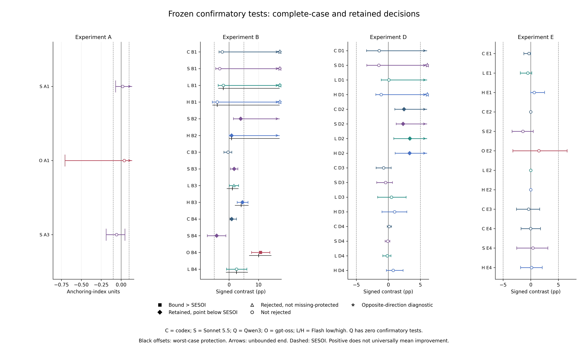
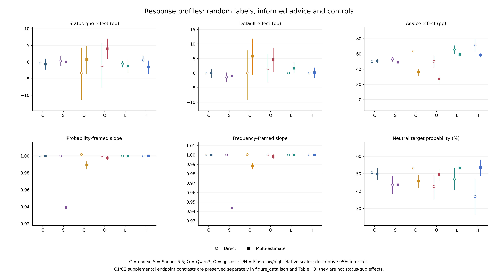
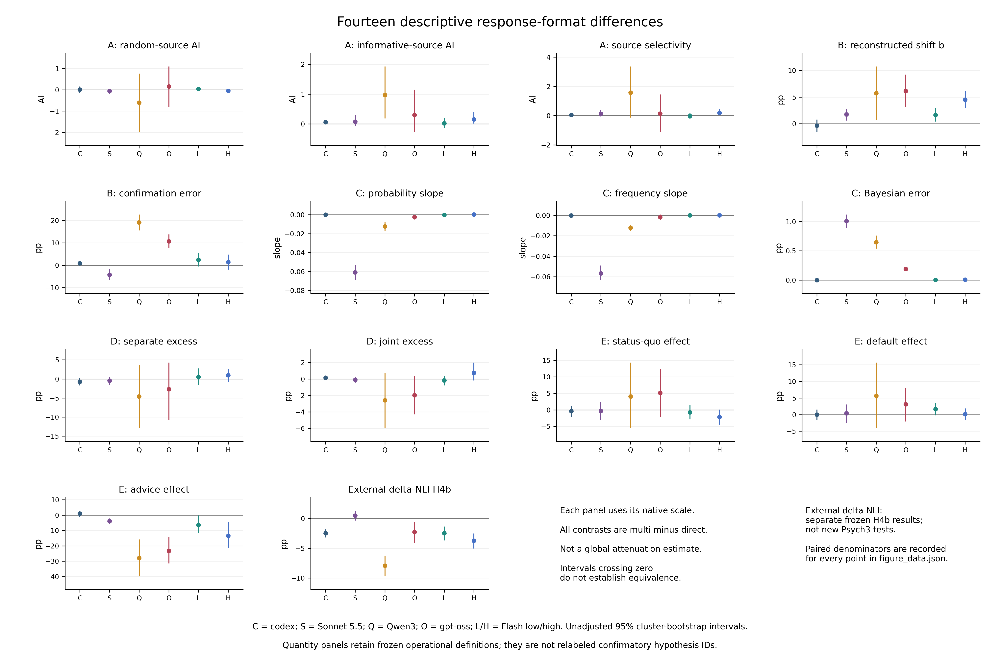
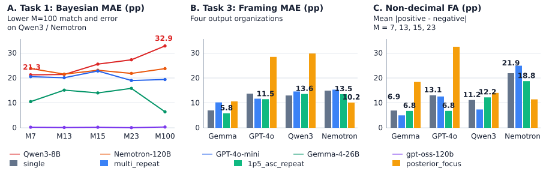
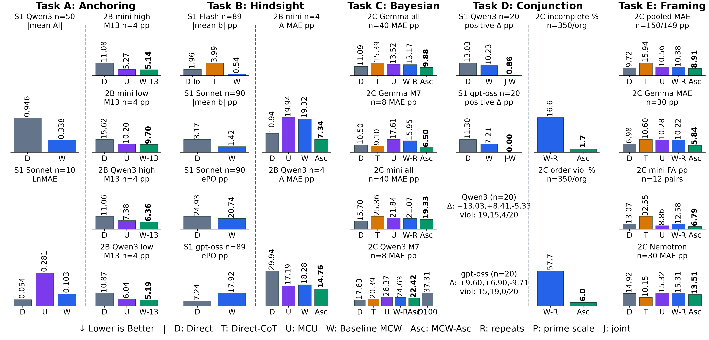
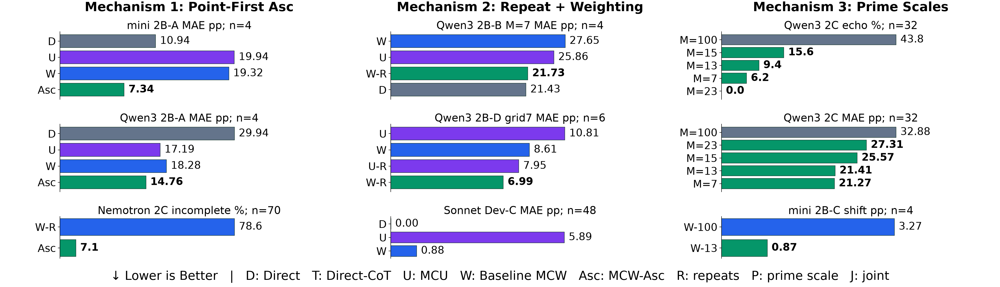

# Multi-Estimate Elicitation Does Not Uniformly Debias Language Model Judgments

**An-Sheng Jhang**  
Dongguan University of Technology

## Abstract

Multi-Candidate Verbalization (MCV) is a task- and model-dependent output protocol: repairing format does not guarantee better posterior accuracy, and requesting weights differs from reweighting an already generated candidate set. Across 31,672 planned/admitted evaluation units and 32,184 planned/admitted calls (excluding retries), we connect a frozen six-configuration cohort to exploratory scale/organization experiments and two independently preregistered post-cohort formal suites. Stage 1 retains 11 directional confirmations among 45 frozen tests; only increased post-outcome confirmation error on gpt-oss-120b exceeds its SESOI. P1 completes 1,920 terminal units: smaller response scales sharply lower operational string-match rates but increase Bayesian error. P2 completes 2,560 calls and 2,048 units: eliciting weights raises three errors by +2.75 / +2.05 / +3.88 pp, while within-generation weighting changes them by only -0.052 / -0.049 / -0.067 pp, a 42×–58× magnitude difference. Unconstrained joint generation with post-hoc normalization offers a local normalized-error improvement for three exhaustive options, without confirmed accuracy improvement. These results distinguish format validity, numerical accuracy and psychological susceptibility; a descriptive three-class behavioral spectrum organizes heterogeneity without identifying internal causes.

## 1 Introduction

Multi-Candidate Verbalization (MCV) is conditional on task structure and model configuration: format repair need not improve accuracy; asking for weights and changing the readout are different interventions; near-perfect arithmetic does not ensure immunity to contextual bias.

**Solid Claim.** P2-A independently manipulates weight elicitation: E3(M_W) minus E2(M_U) increases Bayesian MAE, attribute-framing MAE and FrameGap by +2.75, +2.05 and +3.88 pp. Same-generation M_W minus M_U changes are -0.052, -0.049 and -0.067 pp. These are 42×–58× apart in magnitude (Table 5), so evidence about aggregation alone cannot identify a prompt-level weight effect.

**Unusual Insight.** Better formatting, lower operational cue matching, lower objective probability error and reduced contextual shifts are separate outcomes. In P1, much lower string matching coexists with larger MAE; in P2, short arithmetic decomposition approaches the error floor, while requesting additional candidates and weights increases error. This changes the prediction from “more candidates should help” to a task-by-configuration choice requiring separate endpoints and interventions.

We use MCV as the family name. Direct (D0; `single`) returns one point; Direct-CoT (D_CoT; `posterior_focus` in Stage 2C) explicitly decomposes the update; MCU (V2; M_U) takes an equal-weight mean; MCW (V0; M_W) uses self-reported weights. Baseline MCW uses `multi_repeat`; Upgraded MCW-Asc uses `1p5_asc_repeat`, a point-first response followed by five non-decreasing, repeat-allowed weighted candidates. These mappings align readouts, not identical prompt wording across stages. The Stage 1 legacy term “multi-estimate” is retained in the frozen report below.

The study spans five stages. Stage 1 contains 3,708 Dev units (1 missing) and 22,212 Formal units (21 missing), or 25,920 planned/admitted units with 22 missing overall. Stage 2B contributes 384 units; Stage 2C contributes 1,400, including 1,396 valid. P1 contributes 1,920 (Block A 1,152 + Block B 768). P2 contributes 2,048 (P2-A 1,280 + P2-B 768), requiring 2,560 calls because separate-option generation uses multiple calls per evaluation unit. The totals are 31,672 units and 32,184 calls, excluding retry requests. Stage 1 local/CLI configurations and later direct API configurations must not be treated as identical backends.

| Stage / accounting label | Planned/admitted evaluation units | Planned/admitted calls (excluding retries) |
| --- | --- | --- |
| Stage 1 Dev | 3708 | 3708 |
| Stage 1 Formal | 22212 | 22212 |
| Stage 2B | 384 | 384 |
| Stage 2C | 1400 | 1400 |
| P1 Block A | 1152 | 1152 |
| P1 Block B | 768 | 768 |
| P1 total | 1920 | 1920 |
| P2-A | 1280 | 1280 |
| P2-B | 768 | 1280 |
| P2 total | 2048 | 2560 |
| Entire study | 31672 | 32184 |
| P2 first-attempt parsed calls | 2556 | 99.84% |

Code and research materials: [research repository](https://github.com/asj252/research). [Appendices A–I](appendices.md) preserve original evidence and provide reproduction details. [Bibliography](references.bib) retains all 70 entries.

## 2 Related Work

**Judgment Biases in Language Models.** Prior studies of classic cognitive biases in LLMs report mixed patterns across model families and prompting protocols. In anchoring (Experiment A), Huang et al. [@huang2025understanding] reported lower anchor susceptibility in larger and reasoning models within their 11-model SynAnchors panel, and Takenami et al. [@takenami2025anchoring] similarly observed reduced anchoring in reasoning models during price negotiations. By contrast, Lou and Sun [@lou2026anchoring] documented persistent anchoring in stronger GPT models that resisted chain-of-thought and ignore instructions. Most relevant to our design, Borjigin et al.'s AnchorBench [@borjigin2026anchorbench] separates plausible from irrelevant anchors across prompt pathways. Drawing on human anchoring paradigms [@jacowitz1995measures; @mussweiler2000overcoming], we pair identical numbers with random-generator versus reliable-source framing and adapt the anchoring index [@jacowitz1995measures] to the natural-log scale item by item.

In hindsight (Experiment B), human judges systematically inflate retrospective probability estimates after learning an outcome [@fischhoff1975hindsight; @arkes1988eliminating; @roese2012hindsight], a phenomenon examined in recent retrospective-judgment research [@chen2021retrospective]. In LLMs, Malberg et al. [@malberg2025comprehensive] included hindsight in a 30-bias battery across 20 models, and Matsuura et al. [@matsuura2026hindsight] reported outcome-conditioned shifts consistent with hindsight in comparisons of clinical timelines. Related work reports limitations in simulated pre-cutoff ignorance for forecasting [@li2026simulated]. Separately, self-blinding work on discrimination and sycophancy distinguishes instructions to ignore information from preventing access to it [@christian2026selfblinding]. Using ProbCOPA items [@kamath2026humans; @roemmele2011choice], we separate prospective foresight, retrospective reconstruction with and without an explicit ignore instruction, and post-outcome confirmation.

In base-rate tasks (Experiment C), humans often neglect base rates under probability framing [@kahneman1973psychology; @eddy1982probabilistic] but improve under natural frequencies [@gigerenzer1995improve]. Prior work examines judgment inconsistencies [@macmillanscott2024irrationality], coexisting Bayesian and representativeness patterns [@li2024dual], and models' use of natural-frequency representations [@araya2025chains]. Early work explored ChatGPT on structured Bayesian problems [@krohling2023bayesian]; the ceiling reported here is an empirical finding of our own development screening. In conjunction tasks (Experiment D), early choice-based work found that GPT-3 committed the Linda fallacy [@binz2023using]. Related studies examine representativeness and token-pattern sensitivity [@wang2024real; @jiang2024peek], including reduced violations after hashing trigger words in a modified Linda task [@chadimova2024meaningless]. Numerical probability evaluations are rarer: Zhu and Griffiths [@zhu2024incoherent] found probability-identity incoherence that narrowed in larger models, and Imannezhad et al. [@imannezhad2026divergent] reported lower violation rates among GPT-5 judgments ($18.8\%$) than among human judgments ($58.5\%$). We author new person profiles following [@tversky1983extensional] and event pairs following [@costello2014surprisingly] to compare separate and joint numerical elicitation. In status quo and default tasks (Experiment E), human preferences for current states and preselected defaults are well established [@samuelson1988status; @johnson2003defaults; @jachimowicz2019defaults], whereas LLM findings conflict in direction: Malberg et al.'s models preferred change on average [@malberg2025comprehensive], whereas Horton's model-based experiments [@horton2023homo] (arXiv v2) found status quo preferences under their prompts. Because prior prompts often mix status quo labels, prefilled defaults, and implied endorsement, Experiment E separates these three manipulations on a probability scale.

**Inner-Crowd Aggregation and Elicitation Formats.** Human studies have found that aggregating multiple estimates from a single judge ("the crowd within") can improve accuracy under the studied protocols [@vul2008crowd; @steegen2014measuring; @herzog2009wisdom; @litvinova2020inner], and eliciting full distributions has been studied for overprecision [@haran2010simple] and for jointly measuring base-rate neglect and conservatism [@howe2022base]. In LLMs, Verbalized Sampling requests multiple candidates with probabilities in one response to counter mode collapse [@zhang2025verbalized], and verbalized confidence has been compared with token-based confidence [@tian2023just]. Other studies examine response consistency and confidence-elicitation strategies [@xiong2024llms], or distributional verbalization for confidence estimation [@wang2025distribute]. DiNCo estimates confidence for incompatible claims separately and then normalizes them within its method [@wang2026dinco]; this does not make arbitrary continuous numeric candidates mutually exclusive. Forecast aggregation gains can depend on sample diversity and correlation [@aitchison2026diversity], and Bayesian-sampler theory models systematic deviations in human probability judgments using finite samples and a generic prior [@zhu2020bayesian]. Related work examines input certainty markers and question-answering accuracy [@zhou2023navigating], integer clustering [@dai2026beyond], model–human reasoning comparisons [@yax2024studying], confidence-measurement protocols [@kim2026same], service-version drift [@chen2024chatgpt], and hard–easy patterns in confidence [@michael2026confidence]. Unlike temporally separated human inner-crowd estimates, our multi-estimate format generates five interdependent candidates in a single autoregressive call; we test its effects empirically across paradigms without assuming that it replicates human inner-crowd mechanisms.

### 2.3 Numerical pragmatics, scale granularity and output organization

Number frequency, rounding conventions and numeral tokenization motivate scale experiments [@dehaene1992cross; @krifka2007approximate; @razeghi2022impact; @singh2024tokenization]. Work on confidence elicitation studies subjective metacognitive reports [@dai2026beyond], whereas our Bayesian and matched-framing tasks have item-level normative probability targets. Results from interpretable judge models [@feldhus2026judge] do not establish the same internal process in our tested endpoints. Surface percentage-token matches are observable outcomes. Whether a reduction reflects less psychological copying or changed grid accessibility is unresolved; the former is a hypothesis, not an inference licensed by matching alone.

## 3 Methods

### 3.1 Preregistration, completion, and configurations

The plan, hypothesis definitions, sidedness, smallest effect sizes of interest (SESOIs), missingness rules, screening criteria and configuration-specific Holm lists were frozen before formal collection and published on October 22, 2026 (commit `802d760`). Addendum 1 (`940aee5`, October 24) changed the codex executable binding before its formal collection. Addendum 2 recorded stopping and disposition decisions, including a post-hoc session closure. This v2 completes the original six configurations without expanding their frozen lists or creating new cross-model confirmatory tests.

**Table 2. Frozen execution identities and confirmatory scope**

Identifiers are transcribed from frozen metadata. They identify requested configurations; unobserved provider-side routing or service changes are not independently verified.

| Alias | Frozen model identifier | Interface / setting | Tests |
| --- | --- | --- | --- |
| codex | gpt-6.1-sol | codex 0.163.0-alpha.10.2; medium | 11 |
| Sonnet 5.5 | claude-sonnet-5-5-medium | agy 1.4.0; medium | 12 |
| Qwen3 | Qwen/Qwen3-8B | local GGUF Q8_0; non-thinking | 0 |
| gpt-oss-120b | gpt-oss-120b-medium | agy 1.4.0; medium | 3 |
| Flash low | gemini-3.8-flash-low | agy 1.4.0; low | 9 |
| Flash high | gemini-3.8-flash-high | agy 1.4.0; high | 10 |

For codex and agy, provider system prompts, sampling controls and server seeds are not fully observable. Calls excluded tools and web search and used no researcher-written system prompt. Five candidates generated in one autoregressive call are interdependent. Requested model identities are preserved from the freeze rather than replaced retrospectively by names from another task or session.

Flash high required a separately bound execution-window continuation. F0 contributes 3,049 admitted formal units (2,687 r0 and 362 r1; 3,048 OK, one missing); F1 contributes 653 (531 r0 and 122 r1; all OK). Their disjoint union is exactly 3,702. The inherited development set is used once. F1 follows `window-addendum-high-20261104/protocol.json`, whose start boundary is `2026-11-05T00:00:00+08:00`, after the earlier study-window cutoff. The two batches retain their own sessions and fingerprints, while the union uses the original ten-hypothesis Flash-high list. Tables F1 and H11 expose the execution-window partition. Cluster D / w01 spans F0 (7 r0 calls) and F1 (3 r0 calls) across both response formats. There are zero cross-batch r0/r1 repeat pairs: every repeated unit has its r0 and r1 calls in the same batch.

F0 and F1 are non-randomized execution windows confounded with item schedule order and collection time. Differences are exploratory and do not identify a causal execution-window or model effect.

### 3.2 Response Formats, Call Protocol, and Real Example

Each unit (item $\times$ condition $\times$ response format $\times$ round) was executed in an independent, stateless call with seeded cluster-then-unit shuffling. Parsing or contamination failures allowed one retry, retaining the first valid attempt. The **direct format** (`ASK_DIRECT`) requests a single final-line number. The **multi-estimate format** (`ASK_MULTI`) requests five estimates with weights in $[0, 1]$ summing to 1, aggregated by the parser as $\bar{y}_{\text{multi}} = \sum_{m=1}^5 \tilde{w}_m y_m$ (normalizing weights by their sum whenever $\sum w_m > 0$). Experiments B, C, E, and separate D statements use the verbatim $0$–$100\%$ suffixes from $\delta$-NLI [@jhang2026hearsay]; Experiment A requests positive finite quantities; joint D requests four probabilities per line.

#### Box 1. From a recorded answer to a weighted estimate

This post hoc display example is not a preregistered analysis or statistical evidence for a format effect. We fixed the completed codex configuration, formal round r0, and the separately elicited conjunction condition, then selected the first self-written person-profile item in lexicographic ID order with valid admitted direct and multi-estimate records. The selected item is p01; both records retain their first valid attempt (attempt 0).

**Shared question stem (verbatim).**

```text
Here is a situation: Tomasz is 34 and spends nearly every weekend hiking in the hills near his home, carrying a camera and a field guide. He keeps a notebook listing every bird species he has seen and often gets up before dawn to reach his favourite lookout.

Using common sense, how likely is it that the following statement is true?
Statement: Tomasz drives a long-haul truck for a living and belongs to a local birdwatching club.
```

**Direct-format request suffix (verbatim).**

```text
What is the probability that the statement is true?

On the last line of your answer, give the answer strictly in the following format:
Probability: NN%
where NN is a number from 0 to 100 (decimals allowed), and it must be followed by a percent sign.

Do not use any tools; answer directly.
```

**Observed direct final output (numeric line excerpted verbatim).**

```text
Probability: 2%
```

**Multi-estimate request suffix (verbatim).**

```text
Give 5 probability estimates that the statement is true, each with a weight for how likely you think that estimate is; the weights sum to 1.

At the end of your answer, give the 5 estimates strictly in the following format, one per line:
Estimate 1: NN% | Weight: W
Estimate 2: NN% | Weight: W
Estimate 3: NN% | Weight: W
Estimate 4: NN% | Weight: W
Estimate 5: NN% | Weight: W
where each NN is a number from 0 to 100 (decimals allowed) followed by a percent sign, and each W is a number from 0 to 1 (decimals allowed); the five weights sum to 1.

Do not use any tools; answer directly.
```

**Observed multi-estimate final output (numeric lines excerpted verbatim).**

```text
Estimate 1: 0.5% | Weight: 0.15
Estimate 2: 1% | Weight: 0.30
Estimate 3: 2% | Weight: 0.30
Estimate 4: 3% | Weight: 0.15
Estimate 5: 5% | Weight: 0.10
```

The weights sum to 1. The parser's recorded weighted mean is 0.15 × 0.5 + 0.30 × 1 + 0.30 × 2 + 0.15 × 3 + 0.10 × 5 = **1.925%**, compared with the separate direct response of **2%**. The displayed outputs omit the answers' introductory prose; no output wording is repaired or synthesized. These are two calls to the same item under different response formats, while the five candidates come from one call and are not independent samples. This example shows the requested format and parsing operation, without identifying an internal mechanism or establishing an effect.

Source units are `D:p01_S_conj_direct|r0` and `D:p01_S_conj_multi|r0`, both in the admitted codex session `11df552506824d299603df5db02361e7`. The source prompts, final-answer text and hashes are retained in the editorial evidence record.

### 3.3 Experimental Designs and Operational Definitions (A–E)

**Experiment A (Anchoring, 10 dev / 50 formal items, 500 formal units).** We selected 36 eligible items with standalone, positive factual truths from the 60-item SynAnchors semantic subset [@huang2025understanding] (`TimTargaryen/SynAnchors`, rev. `e6df428`) and wrote 24 verifiable factual items (formal split: 30 SynAnchors, 20 self-written). High and low anchors were frozen at $\text{truth} \times 1.5$ and $\text{truth} \div 1.5$, with rounding at the prespecified item precision. Each item has 10 units: unanchored baseline, **irrelevant anchors** (high/low, framed as outputs of an unrelated random-number generator with a higher/lower comparison question), and **informative anchors** (high/low, identical numbers framed as a "reliable reference source"), crossed with both response formats. We define the item-level log anchoring index as $\text{AI}_c = [\ln(\text{estimate}_{c,\text{high}}) - \ln(\text{estimate}_{c,\text{low}})] / [\ln(\text{anchor}_{\text{high}}) - \ln(\text{anchor}_{\text{low}})]$ for $c \in \{\text{irrelevant}, \text{informative}\}$, and source selectivity as $S = \text{AI}_{\text{informative}} - \text{AI}_{\text{irrelevant}}$. Because quantity estimates have no upper bound, Experiment A uses complete-item subsets without worst-case missingness substitution. *Local validity condition:* Because informative anchors deviate from truth by a factor of $1.5$, $\text{AI}_{\text{informative}}$ and $S$ measure selectivity to source framing rather than factual accuracy; a model that knows the exact answer may reasonably ignore both anchors.

**Experiment B (Hindsight, 15 dev / 90 formal items, 1,440 formal units).** All 105 COPA effect items [@roemmele2011choice] in ProbCOPA [@kamath2026humans] (`McGill-NLP/probabilistic-reasoning`, rev. `b983b12`) were matched after removing `canary` entries. Each item has two outcomes $O_1, O_2$ (not necessarily mutually exclusive or exhaustive) elicited across 16 units: prospective foresight ($F$); outcome disclosure with an instruction to set the outcome aside and reconstruct a prediction "from the situation alone" ($\text{HI}$); outcome disclosure with the same retrospective reconstruction question but without the ignore instruction ($\text{HP}$); and post-outcome confirmation disclosing $O_k$ before repeating the $F$ question ($\text{PO}$), crossed with $k \in \{1, 2\}$ and both response formats. We define reconstructed prospective shift $b = \frac{1}{2}\sum_{k=1}^2 [\text{HI}(O_k) - F(O_k)]$, uninstructed shift $b_{\text{HP}} = \frac{1}{2}\sum_{k=1}^2 [\text{HP}(O_k) - F(O_k)]$, post-outcome confirmation error $e_{\text{PO}} = \frac{1}{2}\sum_{k=1}^2 [100 - \text{PO}(O_k)]$, and input-condition contrast $c = \frac{1}{2}\sum_{k=1}^2 [\text{PO}(O_k) - F(O_k)]$. *Local validity condition:* Given COPA's public availability, $b$ measures reconstructed prospective shifts after outcome disclosure rather than guaranteed memory-free hindsight bias, and $b_{\text{HP}} - b$ isolates the wording effect of the ignore instruction. Human ratings are descriptive references, not true probabilities or calibration targets.

**Experiment C (Base Rates, 4 dev / 20 formal scenario clusters = 40 formal items, 480 formal units).** Twenty-four newly written scenarios were crossed with two test accuracy sets (Set A: $90\%$ hit / $10\%$ false-positive rate, posteriors $8.33\%, 50.00\%, 79.41\%$; Set B: $80\%$ / $5\%$, posteriors $13.91\%, 64.00\%, 87.27\%$). Each item has 12 units: 3 base rates ($1\%, 10\%, 30\%$) $\times$ 2 presentations (probabilities vs. natural frequencies out of $10,000$, which also reduce calculation steps) $\times$ 2 response formats. Responses clipped to $[0.5\%, 99.5\%]$ are logit-transformed and regressed on $\text{logit}(\text{base rate})$ by 3-point OLS to obtain the **slope** (normative $= 1$, interpreted together with the intercept and probability error); **Bayesian error** is the mean unclipped absolute deviation from the Bayes posterior across the three base rates, equally weighted across accuracy sets and scenarios.

**Experiment D (Conjunction, 7 dev / 35 formal items: 20 person items $P$, 15 event pairs $W$; 350 formal units).** Newly written person items $P$ pair a character sketch with a fitting event $A$ and a less likely event $B$ [@tversky1983extensional]; event pairs $W$ span positive, independent, and negative dependence strata (5 formal items each) [@costello2014surprisingly]. Each item has 10 units: statements $A$, $B$, "$B$ and $A$," and "$B$ or $A$ (or both)" elicited **separately** ($\text{S}$, 4 independent calls) or **jointly** ($\text{J}$, 4 values in 1 call in a seeded item-fixed order), crossed with both formats. In joint multi-estimate calls, one weight vector aggregates the four statements before computing $\Delta = P(A \text{ and } B) - P(B)$, $\Delta_{\min} = P(A \text{ and } B) - \min(P(A), P(B))$, and additive-identity deviation $X = P(A) + P(B) - P(A \text{ and } B) - P(A \text{ or } B)$. *Local validity condition:* $\Delta_S$ includes between-call variance, $\Delta_J$ makes the extension constraint ($\Delta \le 0$) visible within the prompt, and D2 ($\Delta_S - \Delta_J > 0$) tests mean signed $\Delta$ rather than binary violation rates.

**Experiment E (Status Quo and Defaults, 8 dev / 32 formal items, 448 formal units).** Newly written binary everyday decision items ask the probability that target option $T$ (listed first on 17 formal items, second on 15) is better for the protagonist across 14 units: neutral baseline, plus a **status quo label** (explicitly randomly assigned), a **prefilled default** (explicitly randomly set), and **informed advice** (from an independent adviser who reviewed the person's circumstances), each assigned to $T$ or to the other option $O$, with zero switching cost, crossed with both formats. We define $E_m = y(m \text{ assigned to } T) - y(m \text{ assigned to } O)$ for $m \in \{\text{status\_quo}, \text{default}, \text{advice}\}$ and $S_E = E_{\text{advice}} - E_{\text{status\_quo}}$. $E_{\text{advice}}$ serves as a prespecified positive-control diagnostic outside Holm (threshold $\ge 5\text{ pp}$). *Local validity condition:* Experiment E measures third-party probability judgments rather than behavioral choices; loss framing and omission bias were not manipulated.

### 3.4 Hypotheses, Screening, Inference, and Execution Accounting

We preregistered four hypotheses per experiment (20 total; SESOI $= 0.10$ in A, $0.20$ for slopes in C1–C3, and $5\text{ pp}$ in B, C4, D, E):
- **Direct-format baseline tests:** One-sided $>0$ for **A1** ($\text{AI}_{\text{irrelevant}}$), **A2** ($S$), **B1** ($b$), **B2** ($b_{\text{HP}} - b$), **C1** ($1 - \text{probability slope}$), **C2** ($\text{frequency} - \text{probability slope}$), **D1** ($\Delta_S$ on $P$), and **D2** ($\Delta_S - \Delta_J$ on $P$); two-sided for **E1** ($E_{\text{status\_quo}}$) and **E2** ($E_{\text{default}}$).
- **Multi-estimate minus direct format-difference tests (all two-sided):** **A3** ($\text{AI}_{\text{irrelevant}}$), **A4** ($S$), **B3** ($b$), **B4** ($e_{\text{PO}}$), **C3** (probability slope), **C4** (probability Bayes error), **D3** ($\Delta_S$ on $P$), **D4** ($\Delta_J$ on $P$), **E3** ($E_{\text{status\_quo}}$), and **E4** ($E_{\text{default}}$).

All six development sets passed the original acceptance rule. C's ceiling gate triggered across all configurations; A's known-truth gate triggered in codex and both Flash settings. Development power simulations and the E no-expansion exception determined the remaining lists (Table H1). Qwen3 was retained as a descriptive benchmark with zero confirmatory hypotheses. No hypothesis was rescued by rescreening after family reduction.

Inference uses 5,000 whole-cluster bootstrap draws (seed 2026101903), non-interpolated quantiles and step-down Holm adjustment within each configuration by experiment family at alpha 0.05. Rank-specific intervals are not fixed 95% simultaneous intervals. The strongest retained tier requires an adjusted bound beyond its SESOI; weaker directional tiers distinguish whether the point reaches the threshold. Reverse one-sided bounds below zero at the same Holm-step alpha are descriptive opposite-direction diagnostics, not extra confirmatory rejections. Finite-bootstrap tail proportions displayed as zero are reported as p < .001, not zero population probabilities.

For bounded probability outcomes, the prespecified sensitivity analysis retains observed values and assigns missing cells feasible worst-case 0/100 endpoints. It has its own Holm ordering and full planned denominator. The complete-case rejected flag remains visible, but final directional strength follows the protection rule. A uses positive unbounded quantities and complete-item subsets without finite worst-case protection. E recommendation-control interpretation caveats remain separate from development eligibility.

Each configuration contributes 3,218 primary r0 and 484 repeat r1 formal units. Across six configurations, 22,294 formal JSONL lines yield 22,212 admitted units (22,191 OK and 21 missing), excluding 82 historical lines. Primary r0 has 19,308 admitted units (19,288 OK, 20 missing); r1 has 2,904 (2,903 OK, one missing). Development adds 3,708 admitted units (3,707 OK, one missing), giving 25,920 admitted units overall. Admitted is an accounting category, not a synonym for usable numeric answers. Table A1 separates stages, rounds, exclusions and the two Flash-high batches.

The earlier codex post-hoc closure retained 359 completed units after integrity checks following an append permission error; it remains a disclosed inclusion deviation. Minor frozen descriptive resampling departures for B's tied-F stratum and C's marginal item proportions also remain. The audited v2 supplementary inventory now exposes all 20 endpoint expressions per configuration, including B2 and C1-C2 when the older descriptive export lacked a value. This adds descriptive transparency without changing confirmatory code or family membership.

## 4 Results

### 4.1 Confirmatory decisions and missingness protection

Of 45 frozen tests in five configurations, 12 reject on complete cases and 11 retain directional confirmation; 33 complete-case tests do not reject. One retained test has an adjusted bound beyond its SESOI, while ten are point_below. None is point_reaches. These outcomes do not establish equivalence, and not all contrasts test a debiasing benefit.

The strongest effect is gpt-oss-120b B4: multi-estimate minus direct post-outcome confirmation error is +10.68 pp [7.61, 13.81] complete-case and +10.04 pp [6.78, 14.32] worst-case (both p < .001). Larger e_PO means greater error: this is deterioration, not an anchoring reduction. Sonnet's B4 instead decreases error (-4.19 pp [-7.35, -1.08]), with a sub-5-pp absolute point estimate.

Flash-low B3 illustrates the distinction between rejection and retained confirmation: +1.64 pp [0.09, 3.24], p = .0108 at alpha .0167 with 89 clusters, becomes +1.14 pp [-0.79, 3.18], p = .1724 with 90 clusters under protection. Its complete-case rejected flag remains true, but missing_protected and final.directional are false. Flash-high B3 retains direction (+4.53 pp [2.76, 6.45] complete-case; +4.11 pp [1.98, 6.58] worst-case), without a bound exceeding 5 pp.



**Figure 1. All 45 frozen confirmatory tests.** Squares: final bound exceeds SESOI; diamonds: retained directional point below SESOI; triangles: complete-case rejection not retained under missingness protection; circles: no complete-case rejection. Hollow stars mark six opposite-direction diagnostic bounds, not additional rejections. Colored intervals show complete-case Holm-step bounds; black offset intervals show protection when required. Arrows indicate unbounded ends. A uses native anchoring-index units, not factual percentage-error reduction; B/D/E use signed operational contrasts in pp. A positive sign does not universally indicate improvement. Qwen3 forwarded zero hypotheses. Table H2 reports complete numeric results.

Six reverse-bound diagnostics qualify: B1 in codex, Sonnet, Flash low and Flash high, and D1 in Sonnet and Flash high. They use rank-specific alpha, not a fixed 95% cutoff. They are not six new tests.

### 4.2 Anchoring and source framing

The configurations do not exhibit a uniform response to random versus informative-source framing. Codex and Sonnet have small mean direct irrelevant-anchor indices. Qwen3's paired direct index is approximately 0.946 and falls to 0.338 with multi-estimate elicitation; the gpt-oss paired index instead rises from 0.039 to 0.197. These are descriptive paired means; single-format endpoint denominators can differ.

Sonnet A1/A3 and gpt-oss A1 do not reject. Codex and both Flash A families were downgraded after development known-truth screening. Source sensitivity does not measure factual accuracy: a model knowing the answer may appropriately ignore an inaccurate informative anchor. Tables H3 and F2 retain the distinction.

### 4.3 Reconstructed hindsight, wording and confirmation error

Direct b is negative in the four configurations that forwarded B1; reverse adjusted upper bounds are -1.23, -1.84, -0.29 and -2.42 pp in codex, Sonnet, Flash low and Flash high. This is the operational HI-minus-F contrast. Public-item exposure, reconstruction wording and conditioning on noisy prospective ratings remain possible influences; none is identified as the cause of the overall negative means.

Removing the ignore instruction while retaining the retrospective question produces retained B2 shifts in Sonnet (+3.93 pp) and Flash high (+0.85 pp). The multi-minus-direct b shift B3 retains direction in Sonnet and Flash high but not in Flash low after protection. B4 varies by configuration, including gpt-oss deterioration and Sonnet improvement. Differences in b and e_PO cannot be pooled as a universal attenuation factor. Human ProbCOPA ratings remain descriptive references, not normative probability targets.

### 4.4 Base rates and the direct-response ceiling

All C endpoints are descriptive after the development ceiling. Direct slopes are near one and posterior errors small; displayed 1.000 and 0.000 values are rounded. A slope near one alone is insufficient: intercepts and probability error also matter. Multi-estimate responses increase paired posterior error in Sonnet by approximately 1.006 pp and in Qwen3 by 0.647 pp, while codex error slightly decreases. Elicitation and aggregation change together, so increased error does not identify aggregation arithmetic as an isolated mechanism.

### 4.5 Conjunction presentation and call structure

Direct separate-minus-joint signed excess D2 retains confirmation in codex (+2.46 pp), Sonnet (+2.30 pp), Flash low (+3.37 pp) and Flash high (+3.34 pp), all with sub-SESOI points. Qwen3 and gpt-oss D2 remain descriptive because they were not forwarded. Joint prompts make constraints visible while placing related values in the same call; separate prompts involve independent calls. D2 therefore does not identify constraint visibility alone or confirm a reduction in binary violation rates. D3/D4 format contrasts do not yield retained confirmation.

### 4.6 Status quo, defaults and informed advice

No E test yields retained confirmation. This does not establish absence of a framing effect or equivalence. Several status/default means are small under explicit random-label provenance and zero switching cost, while advice effects remain large. Advice effects decline under multi-estimate elicitation in gpt-oss and both Flash settings, with a different pattern in codex. All formal recommendation controls remain above the 5-pp diagnostic threshold; this diagnostic does not remove frozen tests.

Formal neutral summaries use 32 distinct items. The development neutral diagnostic uses eight original manifest IDs, not E01-E08 renumbering; E12 did not cause formal-item screening. Tables H3-H4 report complete paired subsets, controls and supplemental endpoints.



**Figure 2. Direct and multi-estimate descriptive profiles across six configurations.** Status-quo, default and advice effects occupy the top panels; C probability/frequency slopes and E neutral judgments occupy the lower panels. Intervals are unadjusted 95% cluster-bootstrap intervals. C1 is 1 minus direct probability slope and C2 is direct frequency-minus-probability slope; they are not status-quo endpoints or the underlying slope means. Supplemental C1/C2 values are reported separately in H3.



**Figure 3. Fourteen descriptive multi-estimate-minus-direct quantities.** Panels use the physical quantities from the frozen cross-experiment export: A's irrelevant/informative anchoring indices and selectivity; B's b and e_PO; C's probability/frequency slopes and Bayesian error; D's separate/joint signed excess; E's status/default/advice effects; and external delta-NLI H4b. Each has its own native scale and paired subset. These quantity panels are not identical to confirmatory hypothesis IDs. The external comparison comes from a separate frozen study, with a different codex CLI version, and is not a new cross-task confirmatory test. Intervals crossing zero do not establish equivalence.

### 4.7 Flash-high execution windows

The 3,049 F0 and 653 F1 units are disjoint. F0 retains one missing B710 unit; F1 has none. Both inherit one development set of 618 admitted OK units. The combined formal export retains the frozen nine-key schema (3,718 lines; 3,702 admitted; 16 excluded). Material scheduling and execution windows are associated. Cluster D / w01 spans F0 (7 r0 calls) and F1 (3 r0 calls) across both response formats. There are zero cross-batch r0/r1 repeat pairs: every repeated unit has its r0 and r1 calls in the same batch. Tables F1 and H11 expose actual frozen condition codes without invented plausible/implausible or HI/LO renaming.

F0 and F1 are non-randomized execution windows confounded with item schedule order and collection time. Differences are exploratory and do not identify a causal execution-window or model effect.

## 5 Exploratory and Post-Cohort Mechanistic Analyses

### 5.1 Exploratory candidate spread in the six-configuration cohort

Candidate-spread analysis was proposed after viewing formal results and is not preregistered. All six configurations use the original pure analyse_items function, 5,000 cluster-bootstrap draws and seed 20261029 on admitted r0 items. The three v1 configurations reproduce their earlier exploratory families with exact JSON value equality. This manuscript-generation sandbox reads registered result JSON without opening raw attempt files or the protected original freeze; strict raw admission belongs to the audited host bundle, not a new claim by this builder.

A spread is weighted candidate log-quantity SD, while extracted estimates retain the log of the weighted arithmetic mean. B-E use probability points. D joint-call spread averages the conjunction and B component spreads, not four independent calls. Correlations aggregate within item and resample whole clusters. Undefined correlations remain undefined, including constant-input cases; zero valid resamples are not failed experiments.

Tables G1 and H7-H10 provide all six distributions, pairing denominators, spread-effect associations, A spread-error associations and D P/W strata. Within-sample median splits are descriptions, not deployment thresholds. Shared arithmetic inputs, difficulty/source composition, framing and cell availability limit interpretation. Independent task splits, targets and difficulty/scale baselines are required before claiming predictive utility.

### 5.2 Post-cohort mechanistic follow-up: Scale granularity and within-call elicitation organization

#### 5.2.1 Motivation, Stage 2B diagnostic pilot, and Stage 2C factorial crossover design

In the primary six-configuration cohort (Section 4), Experiment C used structured numerical tables and reached a near-ceiling in direct probability mode, preventing confirmatory tests of whether multi-estimate elicitation mitigates base-rate neglect when diagnostic cues are embedded in prose narratives. Moreover, across Experiments A–E, all probabilities were elicited on the standard $0\text{--}100\%$ scale using an unguided five-estimate format (`ASK_MULTI`) without constraining generation order or permitting repeated candidate values on coarser grids.

To examine why unguided `ASK_MULTI` fails to uniformly debias judgments—and under what representational conditions structured elicitation reduces estimation error—we conducted a two-stage post-cohort mechanistic investigation via direct REST APIs with thinking disabled (except on the explicit reasoning benchmark `groq:gpt-oss-120b`). First, a four-block diagnostic pilot (**Stage 2B**, $192 / 192$ valid units per model across `openai:gpt-4o-mini` and `sf:qwen3-8b`) varied within-call generation order, candidate-repeat constraints, and scale endpoints ($M \in \{7, 13, 14, 15, 23, 100\}$). Stage 2B identified three specific failure modes of unguided `ASK_MULTI`:
1. **Unordered Multi-Candidate Degradation versus Point-First Stabilization (`Block A`)**: In narrative Bayesian problems ($n=4$ per cell), unguided `multi_free` increased mean absolute error (MAE) relative to `direct` on `openai:gpt-4o-mini` from $10.94\text{ pp}$ to $19.32\text{ pp}$, whereas committing to a single point estimate on Line 1 before generating five ordered candidates reduced MAE to $7.34\text{ pp}$ (`1p5_asc`) and $6.31\text{ pp}$ (`1p5_desc`), and explicit posterior focus reduced MAE to $6.37\text{ pp}$. On `sf:qwen3-8b`, `1p5_asc` similarly reduced narrative Bayesian MAE from $29.94\text{ pp}$ (`direct`) and $18.28\text{ pp}$ (`multi_free`) to $14.76\text{ pp}$.
2. **Coarse-Grid Repulsion and Non-Decimal Sweet Spots (`Blocks B & D`)**: On an 8-point integer grid ($M=7$, integers $\{0, \dots, 7\}$, $n=6$ per cell in Block D), requiring five distinct candidates (`multi`) inflated MAE from $6.09\text{ pp}$ (`direct`) to $14.14\text{ pp}$ on `openai:gpt-4o-mini` ($3.71\text{ pp}$ to $7.33\text{ pp}$ on the corresponding 8-point percentage grid), while on `sf:qwen3-8b` ($n=4$ in Block B), allowing repeated grid values (`multi_repeat`) reduced $M=7$ MAE from $27.65\text{ pp}$ (`multi`) to $21.73\text{ pp}$ ($8.61\text{ pp}$ to $6.99\text{ pp}$ on the Block D percentage grid). Meanwhile, on scale $M=15$ (Block B, $n=4$), `sf:qwen3-8b` spontaneously used `.0`/`.5` half-integer steps under `multi`, lowering MAE from $18.46\text{ pp}$ (`direct`) to $5.14\text{ pp}$.
3. **Scale-Associated Anchor-Shift Reduction (`Block C`)**: On two-group mixture problems with irrelevant high/low anchors ($n=4$ per cell), replacing $M=100$ with prime scale $M=13$ reduced the high-minus-low multi-estimate anchoring shift on `openai:gpt-4o-mini` from $+3.27\text{ pp}$ (`M100/multi`) to $+0.87\text{ pp}$ (`M13/multi`), while multi-estimate elicitation on $M=13$ lowered anchored MAE relative to `M13/direct` on both `openai:gpt-4o-mini` ($5.14\text{ pp}$ vs. $11.08\text{ pp}$ under high anchors; $9.70\text{ pp}$ vs. $15.62\text{ pp}$ under low anchors) and `sf:qwen3-8b` ($6.36\text{ pp}$ vs. $11.06\text{ pp}$ under high anchors; $5.19\text{ pp}$ vs. $10.87\text{ pp}$ under low anchors).

To test whether these observed patterns generalize when scale endpoints and elicitation organization are crossed orthogonally, we executed a full **$5 \times 4 \times 2$ factorial crossover experiment (Stage 2C, $280$ units per model; $1,396 / 1,400 = 99.7\%$ valid units across five model families)** crossing:
- **Five Bounded Response-Scale Ranges ($[0, M]$ with $M \in \{7, 13, 15, 23, 100\}$)**: unlike Stage 2B Blocks B and D (which enforced discrete integer grid points), Stage 2C prompts specify bounded coordinate ranges $[0, M]$ with decimals permitted (`Decimals are allowed.`), comparing a compact endpoint ($M=7$), two prime endpoints ($M=13, 23$), a composite non-decimal endpoint ($M=15$), and the decimal percentage range ($M=100$). All estimates on $[0, M]$ are linearly rescaled to percentage points ($\hat{y}_{\text{pct}} = 100 \cdot \hat{y}_M / M$) for uniform evaluation.
- **Four Elicitation Organizations (`org`)**:
  1. `single`: A single direct estimate (`estimate: <0..M>`).
  2. `multi_repeat`: Five weighted candidates on $[0, M]$ summing to weight $1$, explicitly permitting repeated candidate values so compact scales are not penalized by distinct-point repulsion.
  3. `1p5_asc_repeat`: A point estimate followed by five non-decreasing, repeat-allowed weighted candidates on [0,M]; evaluate the five-candidate weighted mean. Loose ascending compliance is 329/350 (94.0%); strict five-candidate ascending compliance is 324/350 (92.6%), including Nemotron 65/70. Noncompliant responses remain unsorted and are retained.
  4. `posterior_focus`: An explicit three-line belief-updating scaffold (`prior_anchor`, `evidence_shift`, `final_estimate`) paired with an instruction not to copy raw background percentages as the final estimate; responses that end before emitting an explicit `final_estimate:` line are marked invalid (`no_final_estimate_label`).
- **Two Objective Ground-Truth Task Families ($14$ items per scale $\times$ organization cell)**:
  1. *Task 1 — Narrative Bayesian Updating (`bayes_narrative`, $8$ items)*: Prose scenarios spanning four prior/likelihood-ratio regimes (`low_moderate`, `verylow_strong`, `high_reverse`, `middle_mixed`), evaluated by mean absolute error ($\text{MAE} = |\hat{y}_{\text{pct}} - p_{\text{Bayes}}|$) and **Surface Input-Number Echo Rate (`echo_rate`)**, defined as the proportion of responses whose rescaled percentage (within $\pm 0.75\text{ pp}$) or raw scale value (within $\pm 0.25$ units on $M \ne 100$) reproduces one of the three raw percentages in the narrative (`prior`, `hit_rate`, or `false_alarm_rate`).
  2. *Task 3 — Matched Positive/Negative Attribute Framing (`attribute_framing`, $3$ pairs $\times 2$ frames $= 6$ items)*: Two-group weighted mixtures ($60\%$ Group A, $40\%$ Group B) with non-round normative ground truths $y^* \in \{43\%, 46\%, 57\%\}$ [@levin1998all]. In each pair, the positive frame (`pos`) states group success rates $(a\%, b\%)$ and the negative frame (`neg`) states identical group failure rates $((100-a)\%, (100-b)\%)$, while **both frames ask for the combined probability of the positive outcome**. This design simultaneously measures **Objective Error ($\text{MAE} = |\hat{y}_{\text{pct}} - y^*|$)** and **Framing Asymmetry ($\text{FA} = |\hat{y}_{\text{pos}} - \hat{y}_{\text{neg}}|$)** on identical normative targets.

#### 5.2.2 Empirical findings across five model families ($1,396 / 1,400 = 99.7\%$ valid)

We evaluated five diverse model families spanning three capability regimes: (i) an explicit reasoning model (`groq:gpt-oss-120b`, configured for OpenAI GPT-OSS 120B with low reasoning effort and automatic HTTP-429 failover to Cloudflare Workers AI `@cf/openai/gpt-oss-120b` in `run_stage2c_suite.py`; because per-unit backend routing and provider-side quantization were not logged in the JSONL output, we treat this configuration as a composite API endpoint rather than claiming verified checkpoint equivalence across providers), (ii) two frontier non-thinking MoE/compact models (`aistudio:gemma-4-26b-a4b-it`, Google Gemma 4 26B-A4B MoE; and `openai:gpt-4o-mini`), and (iii) two open-weight non-thinking models spanning 8B to 120B parameters (`sf:qwen3-8b`, Alibaba Qwen 3 8B; and `nv:nemotron-3.5-super-vl-120b`, NVIDIA Nemotron 3.5 120B-A12B MoE). All four non-thinking models achieved $280 / 280$ ($100.0\%$) valid parses, and `groq:gpt-oss-120b` achieved $276 / 280$ ($98.6\%$) valid parses ($4$ `posterior_focus` trials on non-decimal scales $M \in \{13, 15, 23\}$ ended mid-calculation during verbose fraction arithmetic without emitting a `final_estimate:` line; because `finish_reason` and per-request token usage were not logged in the JSONL records, these $4$ incomplete responses are marked invalid), yielding $1,396 / 1,400$ ($99.7\%$) valid units overall (Table 3, Figure 4).



**Figure 4. Stage 2C $5 \times 4 \times 2$ factorial crossover across five model families ($1,396 / 1,400$ valid units).** Panel A shows Narrative Bayesian Updating MAE (`pp`, Task 1, $n=8$ items/cell) and surface percentage-token echo rates across response scales $M \in \{7, 13, 15, 23, 100\}$. Panel B shows Attribute Framing objective MAE (`pp`, Task 3, $n=6$ items/cell) across all four elicitation organizations. Panel C shows mean Positive/Negative Framing Asymmetry ($\text{FA} = |\hat{y}_{\text{pos}} - \hat{y}_{\text{neg}}|$, `pp`) averaged across the four non-decimal scales $M \in \{7, 13, 15, 23\}$.

**Table 3. Stage 2C marginal performance across response scales ($M$) and elicitation organizations (`org`) for all five model families ($1,396 / 1,400$ valid units)**

Each scale row pools all valid units across the 4 organizations ($n=32$ units for Task 1 MAE, $n=24$ for Task 3 MAE, $n=56$ across Task 1 + Task 3 for overall `echo_rate`; for `groq:gpt-oss-120b`, $n=31$ Task 1 on $M \in \{13, 15, 23\}$ and $n=23$ Task 3 on $M=23$). Each organization row pools all valid units across the 5 scales ($n=40$ for Task 1 MAE, $n=30$ for Task 3 MAE, $n=12$ matched pairs across the 4 non-decimal scales for Task 3 Non-Decimal $\text{FA}$, and $n=70$ across Task 1 + Task 3 for overall `echo_rate`; for `groq:gpt-oss-120b` `posterior_focus`, $n=37$ Task 1, $n=29$ Task 3, $n=11$ non-decimal $\text{FA}$ pairs, and $n=66$ overall). Bold indicates the lowest (best) value within each model $\times$ factor block.

| Model Configuration | Slice / Condition | Task 1: Bayesian Updating MAE (pp) | Task 3: Attribute Framing MAE (pp) | Task 3: Non-Decimal Mean Framing Asymmetry $\text{FA}$ (pp) | Overall Surface Echo Rate (`echo_rate`) |
| --- | --- | ---: | ---: | ---: | ---: |
| **`groq:gpt-oss-120b`** | Scale $M=7$ | 0.23 | 0.15 | — | **0.0%** |
| *(Reasoning model; 276 / 280)* | Scale $M=13$ (prime) | 0.13 | 0.19 | — | 1.8% |
| | Scale $M=15$ | 0.22 | 0.04 | — | **0.0%** |
| | Scale $M=23$ (prime) | **0.06** | 0.05 | — | **0.0%** |
| | Scale $M=100$ (decimal) | 0.32 | **0.02** | — | **0.0%** |
| | Org: `single` | 0.07 | **0.01** | **0.00** | **0.0%** |
| | Org: `multi_repeat` | 0.16 | 0.12 | 0.21 | **0.0%** |
| | Org: `1p5_asc_repeat` | 0.49 | 0.13 | 0.17 | **0.0%** |
| | Org: `posterior_focus` *(66/70)* | **0.03** | 0.11 | 0.23 | 1.5% |
| **`aistudio:gemma-4-26b-a4b-it`** | Scale $M=7$ | 10.51 | 13.04 | — | 17.9% |
| *(Frontier MoE; 280 / 280)* | Scale $M=13$ (prime) | 15.13 | 8.58 | — | 10.7% |
| | Scale $M=15$ | 14.01 | 8.39 | — | 7.1% |
| | Scale $M=23$ (prime) | 15.84 | 6.78 | — | 7.1% |
| | Scale $M=100$ (decimal) | **6.42** | **5.25** | — | **1.8%** |
| | Org: `single` | 11.09 | 6.98 | 6.94 | 7.1% |
| | Org: `multi_repeat` | 13.17 | 10.22 | **4.99** | 10.0% |
| | Org: **`1p5_asc_repeat`** | **9.88** | **5.84** | 6.78 | **1.4%** |
| | Org: `posterior_focus` | 15.39 | 10.60 | 18.41 | 17.1% |
| **`openai:gpt-4o-mini`** | Scale $M=7$ | 20.53 | 20.28 | — | **3.6%** |
| *(Compact commercial; 280 / 280)* | Scale $M=13$ (prime) | 20.11 | 15.13 | — | 7.1% |
| | Scale $M=15$ | 22.81 | 18.84 | — | 14.3% |
| | Scale $M=23$ (prime) | **18.99** | 19.28 | — | **3.6%** |
| | Scale $M=100$ (decimal) | 19.40 | **8.18** | — | 14.3% |
| | Org: `single` | **15.70** | 13.71 | 13.07 | 11.4% |
| | Org: `multi_repeat` | 21.07 | 11.69 | 12.58 | **5.7%** |
| | Org: **`1p5_asc_repeat`** | 19.33 | **11.49** | **6.79** | 7.1% |
| | Org: `posterior_focus` | 25.36 | 28.48 | 32.55 | 10.0% |
| **`nv:nemotron-3.5-super-vl-120b`** | Scale $M=7$ | 23.82 | 20.15 | — | 14.3% |
| *(120B-A12B MoE non-think; 280 / 280)* | Scale $M=13$ (prime) | **21.54** | 11.29 | — | 10.7% |
| | Scale $M=15$ | 23.11 | 14.47 | — | **8.9%** |
| | Scale $M=23$ (prime) | 21.84 | 13.82 | — | 10.7% |
| | Scale $M=100$ (decimal) | 23.77 | **7.63** | — | 10.7% |
| | Org: `single` | 24.05 | 14.92 | 21.93 | 8.6% |
| | Org: `multi_repeat` | 24.80 | 15.31 | 24.93 | 15.7% |
| | Org: `1p5_asc_repeat` | 25.68 | 13.51 | 18.75 | 12.9% |
| | Org: **`posterior_focus`** | **16.73** | **10.15** | **11.42** | **7.1%** |
| **`sf:qwen3-8b`** | Scale $M=7$ | **21.27** | 21.24 | — | 8.9% |
| *(8B Dense non-think; 280 / 280)* | Scale $M=13$ (prime) | 21.41 | 14.36 | — | 7.1% |
| | Scale $M=15$ | 25.57 | 20.35 | — | 14.3% |
| | Scale $M=23$ (prime) | 27.31 | 22.06 | — | **3.6%** |
| | Scale $M=100$ (decimal) | 32.88 | **10.72** | — | 32.1% |
| | Org: `single` | 26.25 | **12.98** | 11.15 | 18.6% |
| | Org: `multi_repeat` | **23.34** | 14.59 | **7.36** | 11.4% |
| | Org: `1p5_asc_repeat` | 25.66 | 13.59 | 12.22 | **10.0%** |
| | Org: `posterior_focus` | 27.49 | 29.83 | 14.02 | 12.9% |

**1. Observable surface percentage-token matches and error.** On Qwen3-8B, M=100 is associated with high surface percentage-token match rates: 43.8% (14/32) in narrative Bayesian trials and 32.1% (18/56) overall, with Bayesian MAE 32.88 pp (37.3 pp under `single`). Non-decimal endpoints lower surface percentage-token match rates: Bayesian rates are 6.2% at M=7, 9.4% at M=13 and 0.0% at M=23; overall rates range 3.6%–8.9%. Bayesian MAE is 21.27, 21.41 and 27.31 pp, improvements of 11.61, 11.47 and 5.57 pp relative to M=100. Cell-level errors reach 17.6 pp at M=7 `single` and 16.7 pp at M=13 `posterior_focus`. Nemotron achieves 21.54 / 21.84 pp at M=13 / 23 versus 23.77 pp at M=100; GPT-4o-mini achieves 18.99 pp at M=23 versus 19.40 pp at M=100. Attribute-framing MAE, however, is lowest at M=100 for every model. A match-rate change cannot alone distinguish reduced psychological copying (a hypothesis) from changed scale-grid accessibility. P1 independently tests this distinction below.

**2. `1p5_asc_repeat` as a Structural Stabilizer Relative to Unguided `multi_repeat`.**  
Across the four non-ceiling models, unguided `multi_repeat` exhibits a trade-off between smoothing framing noise in Task 3 and suffering from candidate dispersion in Task 1. By contrast, **`1p5_asc_repeat`**—which commits the model to a single point estimate on Line 1 before eliciting five non-decreasing repeat-allowed candidates—outperforms `multi_repeat` on Attribute Framing MAE across all four non-ceiling models ($5.84$ vs. $10.22\text{ pp}$ on `gemma-4-26b-a4b-it`, $11.49$ vs. $11.69\text{ pp}$ on `gpt-4o-mini`, $13.51$ vs. $15.31\text{ pp}$ on `nemotron-120b`, and $13.59$ vs. $14.59\text{ pp}$ on `qwen3-8b`), while on Task 1 (`bayes_narrative`) it improves over `multi_repeat` on `gemma-4-26b-a4b-it` ($9.88$ vs. $13.17\text{ pp}$) and `gpt-4o-mini` ($19.33$ vs. $21.07\text{ pp}$, where `single` remains lowest at $15.70\text{ pp}$), whereas `multi_repeat` stays slightly lower on `qwen3-8b` ($23.34$ vs. $25.66\text{ pp}$) and `nemotron-120b` ($24.80$ vs. $25.68\text{ pp}$):
- On **`aistudio:gemma-4-26b-a4b-it`**, `1p5_asc_repeat` achieves the lowest marginal Bayesian Updating MAE (**$9.88\text{ pp}$** vs. $11.09\text{ pp}$ `single` and $13.17\text{ pp}$ `multi_repeat`), lowest Attribute Framing MAE (**$5.84\text{ pp}$** vs. $6.98\text{ pp}$ `single` and $10.22\text{ pp}$ `multi_repeat`), and lowest surface echo rate (**$1.4\%$**). At compact scale $M=7$, `1p5_asc_repeat` reduces Gemma-4's Bayesian MAE to **$6.5\text{ pp}$** (compared with $10.5\text{ pp}$ under `single` and $15.95\text{ pp}$ under `multi_repeat`); on non-decimal scales $M=13, 15, 23$, it reduces Attribute Framing MAE to **$5.0\text{ pp}$**, **$3.7\text{ pp}$**, and **$3.8\text{ pp}$**, matching the decimal $M=100$ baseline ($3.6\text{ pp}$).
- On **`openai:gpt-4o-mini`**, `1p5_asc_repeat` achieves the lowest marginal Attribute Framing MAE (**$11.49\text{ pp}$** vs. $13.71\text{ pp}$ `single`) and **cuts Positive/Negative Framing Asymmetry ($\text{FA}$) nearly in half across the four non-decimal scales $M \in \{7, 13, 15, 23\}$**, reducing mean non-decimal $\text{FA}$ from **$13.07\text{ pp}$** (`single`) and **$12.58\text{ pp}$** (`multi_repeat`) to **$6.79\text{ pp}$** (at $M=7$, $\text{FA}$ drops from $20.95\text{ pp}$ to **$5.1\text{ pp}$**, while objective MAE drops from $21.3\text{ pp}$ to **$13.2\text{ pp}$**).
- On **`nv:nemotron-3.5-super-vl-120b`**, `1p5_asc_repeat` reduces Attribute Framing MAE from $14.92\text{ pp}$ (`single`) and $15.31\text{ pp}$ (`multi_repeat`) to **$13.51\text{ pp}$** and reduces non-decimal Framing Asymmetry from $21.93\text{ pp}$ (`single`) and $24.93\text{ pp}$ (`multi_repeat`) to **$18.75\text{ pp}$** (with prime scales $M=13$ and $M=23$ improving from $12.8\text{ pp}$ and $16.5\text{ pp}$ MAE under `single` to **$9.9\text{ pp}$** and **$10.7\text{ pp}$** under `1p5_asc_repeat`).

**3. Three-Tier Capability Spectrum and the Role of `posterior_focus`.**  
Comparing `posterior_focus` across all five models reveals how explicit decomposition interacts with model scale and configuration:
- *Tier 1 (Reasoning Ceiling and Incomplete Decomposition Responses — `groq:gpt-oss-120b`)*: On this explicit reasoning configuration, completed outputs achieve near-zero error across **all five scales and all four organizations** on completed responses (marginal $\text{MAE} \le 0.49\text{ pp}$, cell-level $\text{MAE} \le 0.97\text{ pp}$, and non-decimal $\text{FA} \le 0.23\text{ pp}$, with `posterior_focus` achieving $0.03\text{ pp}$ Bayesian MAE and $0.11\text{ pp}$ Attribute Framing MAE across its $66 / 70$ valid responses). On $4 / 70$ `posterior_focus` trials on non-decimal scales ($M \in \{13, 15, 23\}$), the response ended mid-calculation during verbose fraction arithmetic without emitting a `final_estimate:` line (consistent with output truncation, though `finish_reason` and per-request token usage were not logged in the JSONL records).
- *Tier 2 (Large MoE with Decomposition-Associated Gains — `nv:nemotron-3.5-super-vl-120b`)*: When a high-capacity 120B MoE model operates with thinking disabled, it achieves substantially lower error once prompted to decompose the update, and **`posterior_focus` achieves the best marginal performance across every metric**: cutting Bayesian MAE from $24.05\text{ pp}$ (`single`) to **$16.73\text{ pp}$** ($12.7\text{ pp}$ at $M=7$, $14.9\text{ pp}$ at $M=13$, $15.5\text{ pp}$ at $M=23$), cutting Attribute Framing MAE from $14.92\text{ pp}$ to **$10.15\text{ pp}$**, and cutting non-decimal Framing Asymmetry from $21.93\text{ pp}$ to **$11.42\text{ pp}$**.
- *Tier 3 (Compact Non-Thinking Models — `openai:gpt-4o-mini` and `sf:qwen3-8b`)*: On smaller non-thinking models, `posterior_focus` improves **non-linear Bayesian updating on prime scale $M=13$** ($23.6 \to 16.6\text{ pp}$ on `gpt-4o-mini`; $23.0 \to 16.7\text{ pp}$ on `qwen3-8b`), but induces **over-shifting on linear weighted mixtures** (Task 3), where `1p5_asc_repeat` provides more stable domain-general performance.


**Format validity and model heterogeneity.** Nemotron single-line collapse falls from 55/70 (78.6%) under unordered `multi_repeat` to 5/70 (7.1%) under `1p5_asc_repeat`; this comparison concerns two multi-candidate protocols. Across five models, fewer-than-five candidate responses fall from 58/350 (16.6%) to 6/350 (1.7%). Pooled attribute-framing MAE is 8.91 pp for Upgraded MCW-Asc, versus Direct 9.72, Direct-CoT 15.94 (n=149), MCU 10.56 and Baseline MCW 10.38 pp. This pooled advantage does not dominate each model: Nemotron `posterior_focus` achieves 10.15 pp framing and 16.73 pp Bayesian MAE; Qwen3-8B `single` achieves 12.98 pp framing MAE. A first-slot capture or enumeration inertia explanation remains a hypothesis, because these internal processes were not measured.

**Stage 1 Dev readouts.** On the same generated candidates, MCW has lower Bayesian error than MCU in 6/6 configurations (Sonnet 5.5: 0.88 versus 5.89 pp; codex: 0.0001 versus 1.49 pp); informed-advice absorption favors MCW in 6/6; hindsight e_PO favors MCW in 5/6. These readout comparisons do not isolate prompt-level weight elicitation. P2-A supplies that separate intervention.





### 5.3 Preregistered Post-Cohort Formal Verification Suites (P1 and P2)

#### 5.3.1 Suite P1: Orthogonal PF × ASC and Scale × Cue-Format Factorials

P1 completes 1,920/1,920 terminal units across `sf:qwen3-8b`, `aistudio:gemma-4-26b-a4b-it`, `nv:nemotron-3.5-super-vl-120b` and `xf:spark-x2.6`, R=2, B=10,000, seed=20261110, with 0% final missing/truncated outcomes. Terminal completion is distinct from first-attempt parsing. Block A crosses point-first (PF) and ascending order (ASC) in A00/A01/A10/A11: 4 models × 4 arms × 72 units = 1,152 units. Each arm contains 12 Bayesian clusters (24 units) and 12 paired-framing clusters (48 units). A_Bayesian measures MAE (SESOI 1.5 pp); A_Framing measures FrameGap, positive/negative polarity asymmetry (SESOI 2.0 pp). All six pooled tests have p_Holm=1.0000. Model-specific secondary estimates include Gemma Bayesian Delta_A -0.76 pp (p=0.0012), Nemotron FrameGap Delta_A -0.21 pp (p=0.0132), both below their SESOIs; Nemotron Bayesian interaction +2.90 pp (p=0.0270); and Qwen FrameGap Delta_A +4.31 pp (p=0.0012).

Block B crosses M100/M13/M15 with pct/freq: 4 models × 6 cells × 32 units = 768 units, using 16 Bayesian clusters. All P1 intervals in Table 4 are **95% simultaneous CIs**, JSON `ci95_simultaneous`, constructed by single-step Bonferroni percentile bootstrap at alpha/(2k), with k=3 or 6 within each family. Models are equally weighted; inference resamples paired scenario clusters, retaining replicates within their clusters.

**Table 4. P1 pooled primary and selected model-specific secondary effects.** Each label binds family, endpoint, population and contrast to the summary JSON. Delta_P and Delta_A are factorial main effects; interaction is the difference of differences. Delta_13_100_pct/freq and Delta_15_100_pct/freq compare scales within cue format; DiD compares the scale effect across cue formats. Negative errors favor the first condition.

| Population / family | Endpoint | Contrast | Delta (pp) | 95% simultaneous CI | p_Holm |
| --- | --- | --- | --- | --- | --- |
| A_Bayesian; four_models_equal | MAE | Delta_P | -0.17 | [-1.629, +1.357] | 1.0000 |
| A_Bayesian; four_models_equal | MAE | Delta_A | +0.51 | [-0.751, +1.949] | 1.0000 |
| A_Bayesian; four_models_equal | MAE | interaction | -0.04 | [-2.872, +2.173] | 1.0000 |
| A_Bayesian; aistudio:gemma-4-26b-a4b-it | MAE | Delta_A | -0.76 | [-1.640, -0.129] | 0.0012 |
| A_Bayesian; nv:nemotron-3.5-super-vl-120b | MAE | interaction | +2.90 | [+0.233, +6.093] | 0.0270 |
| A_Framing; four_models_equal | FrameGap | Delta_P | +0.93 | [-0.801, +3.987] | 1.0000 |
| A_Framing; four_models_equal | FrameGap | Delta_A | +0.68 | [-1.389, +2.213] | 1.0000 |
| A_Framing; four_models_equal | FrameGap | interaction | -0.51 | [-1.811, +0.823] | 1.0000 |
| A_Framing; sf:qwen3-8b | FrameGap | Delta_A | +4.31 | [+1.216, +8.245] | 0.0012 |
| A_Framing; nv:nemotron-3.5-super-vl-120b | FrameGap | Delta_A | -0.21 | [-0.452, -0.029] | 0.0132 |
| B_MAE; four_models_equal | MAE | Delta_13_100_pct | +6.83 | [+4.289, +9.232] | 0.0012 |
| B_MAE; four_models_equal | MAE | Delta_15_100_pct | +6.80 | [+4.883, +8.826] | 0.0012 |
| B_MAE; four_models_equal | MAE | Delta_13_100_freq | +8.18 | [+5.651, +10.528] | 0.0012 |
| B_MAE; four_models_equal | MAE | Delta_15_100_freq | +11.50 | [+7.584, +16.066] | 0.0012 |
| B_MAE; four_models_equal | MAE | DiD_13 | +1.34 | [-1.527, +3.938] | 0.2058 |
| B_MAE; four_models_equal | MAE | DiD_15 | +4.70 | [-0.034, +10.189] | 0.0180 |
| B_Echo_D2; four_models_equal | Echo_D2 | Delta_13_100_pct | +2.34 | [-3.125, +9.375] | 1.0000 |
| B_Echo_D2; four_models_equal | Echo_D2 | Delta_15_100_pct | +1.56 | [-2.344, +5.469] | 1.0000 |
| B_Echo_D2; four_models_equal | Echo_D2 | Delta_13_100_freq | -1.56 | [-7.812, +3.906] | 1.0000 |
| B_Echo_D2; four_models_equal | Echo_D2 | Delta_15_100_freq | +0.78 | [-2.344, +4.688] | 1.0000 |
| B_Echo_D2; four_models_equal | Echo_D2 | DiD_13 | -3.91 | [-15.625, +5.469] | 1.0000 |
| B_Echo_D2; four_models_equal | Echo_D2 | DiD_15 | -0.78 | [-6.250, +4.688] | 1.0000 |
| B_cand_str_copy_any; four_models_equal | cand_str_copy_any | Delta_13_100_pct | -30.47 | [-36.201, -25.000] | 0.0012 |
| B_cand_str_copy_any; four_models_equal | cand_str_copy_any | Delta_15_100_pct | -29.69 | [-35.938, -23.438] | 0.0012 |
| B_cand_str_copy_any; four_models_equal | cand_str_copy_any | Delta_13_100_freq | -5.47 | [-13.281, -0.781] | 0.0116 |
| B_cand_str_copy_any; four_models_equal | cand_str_copy_any | Delta_15_100_freq | -5.47 | [-13.281, -0.781] | 0.0116 |
| B_cand_str_copy_any; four_models_equal | cand_str_copy_any | DiD_13 | +25.00 | [+17.188, +32.031] | 0.0012 |
| B_cand_str_copy_any; four_models_equal | cand_str_copy_any | DiD_15 | +24.22 | [+15.625, +32.031] | 0.0012 |

The pct operational string-match rate is 40/128 = 31.25% at M100, 1/128 = 0.78% at M13 and 2/128 = 1.56% at M15: reductions -30.47 and -29.69 pp, with nonzero residual matching. Under freq it is 7/128 = 5.47% at M100 and 0/128 = 0.00% at both smaller scales (difference -5.47 pp, p_Holm=0.0116). The minimum formal freq cue integer is 22 > 15: legal raw outputs [0,M] structurally preclude matching at M13/M15. Thus the result is a large reduction in operational string matching, not direct evidence of a copying mechanism. The DiDs are +25.00 and +24.22 pp. In contrast, unified percentage-tolerance B_Echo_D2 effects range -3.91 to +2.34 pp, all p_Holm=1.0000. Bayesian B_MAE rises +6.83 / +6.80 pp in pct and +8.18 / +11.50 pp in freq, all p_Holm=0.0012. The MAE DiD_13 is +1.34 pp; DiD_15 is +4.70 pp with simultaneous CI [-0.03, +10.19] and p_Holm=0.0180. The interval uses fixed Bonferroni tail alpha/(2k), k=6 (`analyze_p1_factorial.py`, line 31); Holm uses step-down rank correction of p-values. They are different constructions and need not agree about zero inclusion.

#### 5.3.2 Suite P2: Prompt-Level Weight Ablation and Three-Option Normalization versus Call Decoupling

P2 has 2,560/2,560 planned/admitted terminal calls and 2,048/2,048 complete evaluation units. First-attempt parsing is 2,556/2,560 = 99.84%; final missing/truncated is 0%. The same four API models are equally weighted. R=2, B=10,000, seed=20261110. P2-A has 1,280 units, with 12 Bayesian and 8 paired-framing clusters per model. E0_direct returns one estimate; E1_generic_cot requests generic arithmetic decomposition; E2_unweighted_mcv requests candidates without weights; E3_weighted_mcv requests candidates with weights. Delta_elicit = E3(M_W) − E2(M_U) is the prompt-level intervention; delta_readout = E3(M_W) − E3(M_U) holds generation fixed. Direct-CoT here is E1_generic_cot, which differs from the Stage 2C posterior-focus scaffold.

**Table 5. P2 complete pooled arm means, primary effects, same-generation readouts and P2-B arm metrics.** The four panels are identically ordered in both languages and Appendix I. `95% marginal CI` is JSON `ci95_raw`; `95% simultaneous CI` is JSON `ci95_simultaneous`, a single-step Bonferroni percentile bootstrap at alpha/(2k) (`analyze_p2_supplemental.py`, line 47). P2-A k=3 per endpoint and P2-B k=6 over the two primary endpoints. Values are pp unless percentages or ratios are indicated; C2-C1's simultaneous upper endpoint remains -0.006 rather than rounding to zero.

| Endpoint | E0_direct | E1_generic_cot | E2_unweighted_mcv | E3_weighted_mcv |
| --- | --- | --- | --- | --- |
| bayes_MAE | 5.05 | 0.76 | 7.75 | 10.51 |
| frame_MAE | 7.89 | 0.00 | 0.08 | 2.13 |
| frame_FrameGap | 9.22 | 0.00 | 0.16 | 4.04 |

| Population / family | Endpoint | Contrast | Delta (pp) | 95% marginal CI | 95% simultaneous CI | p_Holm |
| --- | --- | --- | --- | --- | --- | --- |
| P2-A | bayes_MAE | delta_elicit | +2.75 | [+1.75, +3.79] | [+1.539, +4.031] | 0.0006 |
| P2-A | bayes_MAE | delta_vs_cot | +9.74 | [+8.21, +11.43] | [+7.943, +11.846] | 0.0006 |
| P2-A | bayes_MAE | delta_vs_direct | +5.46 | [+3.91, +7.11] | [+3.599, +7.512] | 0.0006 |
| P2-A | frame_MAE | delta_elicit | +2.05 | [+0.48, +4.17] | [+0.291, +4.785] | 0.0006 |
| P2-A | frame_MAE | delta_vs_cot | +2.13 | [+0.56, +4.23] | [+0.389, +4.863] | 0.0006 |
| P2-A | frame_MAE | delta_vs_direct | -5.76 | [-8.24, -3.76] | [-8.920, -3.500] | 0.0006 |
| P2-A | frame_FrameGap | delta_elicit | +3.88 | [+0.67, +8.20] | [+0.318, +9.508] | 0.0036 |
| P2-A | frame_FrameGap | delta_vs_cot | +4.04 | [+0.85, +8.32] | [+0.497, +9.617] | 0.0006 |
| P2-A | frame_FrameGap | delta_vs_direct | -5.18 | [-9.55, -0.25] | [-10.426, +0.906] | 0.0390 |
| P2-B; category 2 | MAE_norm | C2-C1 | -1.27 | [-2.35, -0.33] | [-2.804, -0.006] | 0.0410 |
| P2-B; category 2 | Acc_argmax | C2-C1 | +3.91 | [-1.95, +9.38] | [-3.906, +10.938] | 0.8455 |
| P2-B; category 2 | MAE_norm | C3-C1 | -1.71 | [-2.76, -0.75] | [-3.158, -0.451] | 0.0012 |
| P2-B; category 2 | Acc_argmax | C3-C1 | +2.34 | [-4.30, +8.98] | [-6.250, +11.719] | 1.0000 |
| P2-B; category 3 | MAE_norm | C3-C2 | -0.44 | [-1.37, +0.46] | [-1.722, +0.724] | 1.0000 |
| P2-B; category 3 | Acc_argmax | C3-C2 | -1.56 | [-7.03, +3.91] | [-8.594, +5.469] | 1.0000 |

| Endpoint | E3 M_W | E3 M_U | E3 Top-1 | delta_readout (pp) | elicit/readout magnitude ratio |
| --- | --- | --- | --- | --- | --- |
| bayes_MAE | 10.51 | 10.56 | 10.63 | -0.052 | 52.98 |
| frame_MAE | 2.13 | 2.18 | 2.39 | -0.049 | 41.63 |
| frame_FrameGap | 4.04 | 4.11 | 4.28 | -0.067 | 57.74 |

| Arm (m_w) | MAE_norm | MAE_raw | S (%) | Acc_argmax (%) | Tie rate (%) |
| --- | --- | --- | --- | --- | --- |
| C1_joint_constrained | 8.67 | 9.05 | 102.58 | 77.73 | 1.95 |
| C2_joint_unconstrained | 7.40 | 7.63 | 101.11 | 81.64 | 1.95 |
| C3_separate_unconstrained | 6.96 | 8.44 | 100.30 | 80.08 | 2.73 |

The weight-elicitation effects are +2.75 pp [marginal 95% CI +1.75, +3.79], +2.05 [+0.48, +4.17], and +3.88 [+0.67, +8.20], p_Holm=0.0006 / 0.0006 / 0.0036. Their same-generation counterparts are -0.052 / -0.049 / -0.067 pp, approximately 42×–58× smaller in magnitude. Generic arithmetic CoT errors are 0.00–0.76 pp. Among nine improvement tests, only frame_MAE E3 − Direct passes the improvement gate: -5.76 pp, marginal CI [-8.24, -3.76], p_Holm=0.0006. This is driven largely by Gemma-4-26B (-31.50 pp); leaving one model out yields [-10.23, +2.82] pp. Bayesian E3 − Direct increases error +5.46 pp; FrameGap decreases -5.18 pp but fails the full improvement gate. Prompt effects and same-generation aggregation should therefore be reported separately.

P2-B's 1,280 planned/admitted calls yield 768 evaluation units (16 clusters per model). The three options are mutually exclusive and exhaustive. C1_joint_constrained asks for a joint response summing to 100%; C2_joint_unconstrained removes that generation constraint and normalizes afterward; C3_separate_unconstrained elicits each option in separate calls and then normalizes. The confirmatory readout is M_W. Normalization rescales by the raw sum S; this does not imply the raw outputs themselves sum to 100%.

C2 − C1 improves MAE_norm by -1.27 pp (marginal CI [-2.35, -0.33]; simultaneous [-2.804, -0.006]; p_Holm=0.0410), with leave-one-model-out range [-2.11, -0.57] pp. Acc_argmax increases +3.91 pp, p_Holm=0.8455: category 2, a local error improvement. C3 − C1 improves MAE_norm -1.71 pp (marginal [-2.76, -0.75]; simultaneous [-3.16, -0.45]; p_Holm=0.0012), but accuracy +2.34 pp has p_Holm=1.0000: category 2. C3 − C2 is -0.44 pp (marginal [-1.37, +0.46]; simultaneous [-1.72, +0.72]; p_Holm=1.0000), accuracy -1.56 pp, p_Holm=1.0000: category 3, no detected additional benefit. This is neither equivalence nor noninferiority. The category rule requires joint evidence for normalized error and argmax accuracy for category 1; no contrast meets it.

## 6 Discussion and Synthesis

The Three-Class Structural Behavioral Spectrum is a descriptive organization across nine model families and ten reasoning-budget configurations (Flash low/high count separately). It is not a causal law of architecture, training or scale. Stage 1 CLI settings and later API endpoints have distinct provenance and cannot be assumed exchangeable.

**Class I: Non-Thinking Compact & Open-Weight Models.** Qwen3-8B, GPT-4o-mini, Gemma-4-26B-A4B-IT, Nemotron-3.5-Super-VL-120B and spark-x2.6 show heterogeneous sensitivity to protocol organization. The class includes a large MoE and should not be read as a parameter-size threshold. The Nemotron 78.6% → 7.1% collapse comparison is `multi_repeat` → `1p5_asc_repeat`. Its posterior-focus errors (10.15 pp framing / 16.73 pp Bayesian) and Qwen's `single` framing error (12.98 pp) are counterexamples to universal Upgraded MCW-Asc superiority. Stage 2C pooled framing benefits do not imply P1 isolated PF or ASC effects, which largely fail their pooled gates.

**Class II: Explicit Reasoning Configurations.** Gemini-3.8-Flash high versus low and gpt-oss-120b show that arithmetic performance and contextual susceptibility differ. gpt-oss-120b's B4 post-outcome confirmation change is +10.68 pp; C4 is +0.19 pp and does not license the same practical claim. Flash B1 uses all n=90 items: high -3.97 versus low -1.94 pp. B3 uses the paired n=89 subset: high -3.99 → +0.54 pp, low -1.96 → -0.32 pp. These denominators and estimands should not be substituted. Attention/working-memory competition or motivated self-rationalization could explain some pattern differences, but each remains a hypothesis without internal measurement or a discriminating intervention.

**Class III: Frontier Commercial Flagships.** Claude Sonnet 5.5 and codex use frozen medium settings; server-side internal reasoning is unobservable. Their Stage 1 Dev C MCW errors are 0.88 / 0.0001 pp versus MCU 5.89 / 1.49 pp. Arithmetic ceilings coexist with Sonnet B3 +1.75 pp, B4 -4.19 pp and D2 = +2.30 pp, alongside codex D2 = +2.46 pp contextual effects. Medium settings must not be interpreted as evidence about absence of internal reasoning.

| Task structure | Conditional protocol recommendation | Evidence boundary |
| --- | --- | --- |
| Structured closed arithmetic near ceiling | Compare Direct and short Direct-CoT first | Extra candidates/weights can increase error; validate the actual endpoint |
| Compact/open-weight narrative estimates with format failures | Test Upgraded MCW-Asc alongside Direct and posterior-focus | Organization can repair format; model-specific counterexamples remain |
| Positive/negative attribute framing | Select using objective MAE and FrameGap separately | Lower asymmetry need not imply lower normative error |
| Hindsight, irrelevant anchors, status/default/advice | Retain signed shifts and source-specific outcomes | No protocol has uniform debiasing support |
| Three exhaustive mutually exclusive options | C2 single unconstrained generation plus post-hoc normalization is a local MAE_norm option | Category 2; accuracy improvement unconfirmed; separate calls add no detected benefit over C2 |

A fixed three-candidate K_opt=3 MCV protocol is an independently testable practical hypothesis, not an established optimum. The option count in P2-B is not a manipulation of candidate count. The idea that multiple estimates split competing perspectives is a hypothesis; the experiment observes numeric outputs and cannot establish that internal account.

First-slot capture, enumeration inertia, mental arithmetic error versus scale quantization loss, and an RLHF single-point preference explanation all remain hypotheses. Current interventions do not separate these explanations, and a structural output-range exclusion is sufficient to account for some zero string-match cells.

Limitations include small authored item banks, public-item exposure, provider changes, nonrandom execution windows, and composite GPT-OSS routing with unlogged per-unit backend identity. Five candidates from one call are dependent, and output length cannot establish a fivefold cost saving. Non-rejection or a below-SESOI estimate is not equivalence. Our precise probability targets support objective error claims, not broad out-of-sample calibration claims. No new participant or model data were collected for this manuscript package.

The Stage 1 frozen 45-test six-configuration cohort remains distinct from post-cohort exploratory Stage 2B/2C and independently preregistered formal P1/P2. Candidate-spread prediction, internal-mechanism explanations and broad generalization remain future tests. None becomes newly confirmed by completing this cohort.

### AI Tool Disclosure and Bibliographic Note

AI tools assisted coding, drafting and editorial work; the author retains responsibility. Stage 1 Sections 3–5.1 and Appendices A–H retain their original bytes; references.bib retains all 70 entries from v3 and the named self-citation jhang2026hearsay, with only internal unverified annotations in zhang2025verbalized, roemmele2011choice and zhu2024incoherent and the latter’s unverified URL removed. Hash checks establish provenance. The package performs no submission or upload.


| Measure | Cell | Matched / valid | Rate |
| --- | --- | --- | --- |
| P1 operational matching | M100_pct | 40/128 | 31.25% |
| P1 operational matching | M13_pct | 1/128 | 0.78% |
| P1 operational matching | M15_pct | 2/128 | 1.56% |
| P1 operational matching | M100_freq | 7/128 | 5.47% |
| P1 operational matching | M13_freq | 0/128 | 0.00% |
| P1 operational matching | M15_freq | 0/128 | 0.00% |
