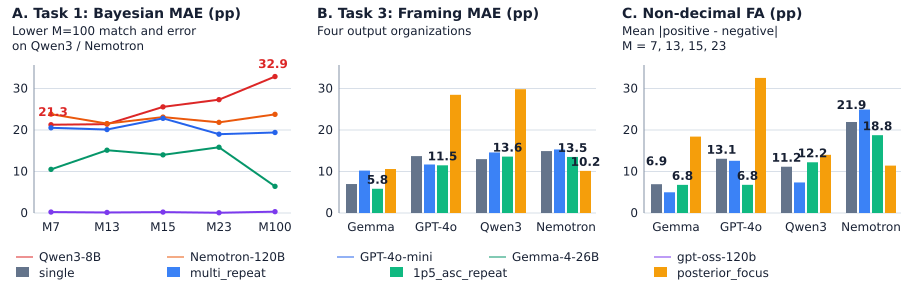
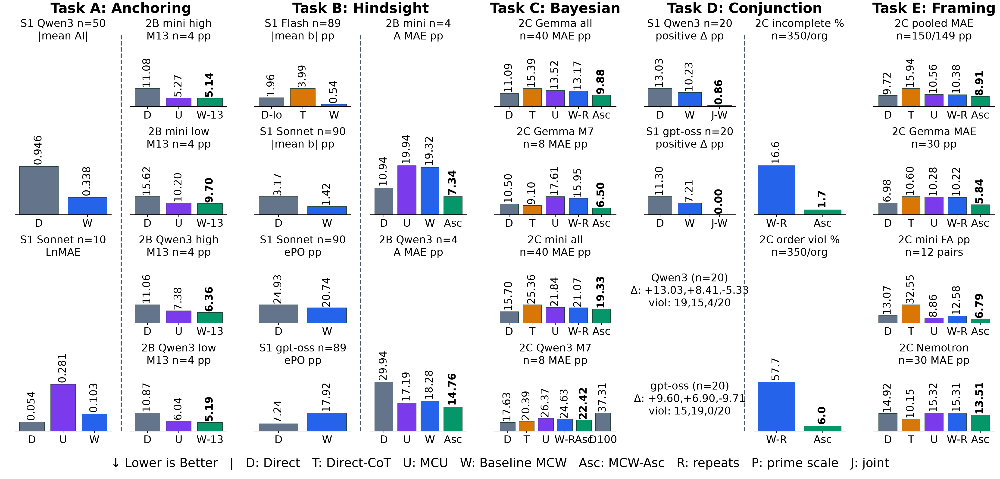
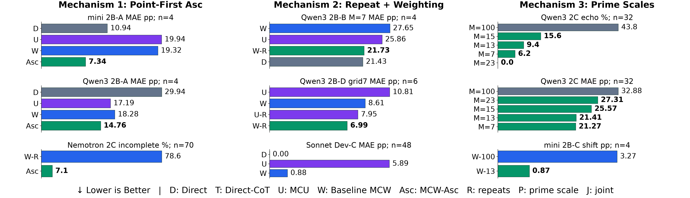

# 多重估計引出法並未一致降低語言模型判斷偏誤（v4 完整對照長文）

**An-Sheng Jhang**  
Dongguan University of Technology

## 摘要

多候選口述是依任務與模型而定的輸出協議：格式修復不保證準確，索取權重不同於事後加權，算術近零誤差也不保證免於情境偏移。

Multi-Candidate Verbalization（MCV）跨五範式與五階段共涵蓋 31,672 個計畫／錄用評估單位、32,184 次計畫／錄用呼叫（不含重試）。Stage 1 的 45 項凍結檢定中，11 項通過方向性確認；僅 gpt-oss-120b 的事後確認誤差增加超出 SESOI。P1 完成 1,920 單位，較小量尺大幅降低操作性字串匹配率，卻提高貝氏誤差。P2 完成 2,560 呼叫、2,048 單位；提示層索取權重使三項誤差增加 +2.75 / +2.05 / +3.88 pp，同生成內加權讀數差僅 -0.052 / -0.049 / -0.067 pp，幅度約差 42–58 倍。三互斥窮盡選項的單次無約束生成及事後歸一化有局部誤差改善，未確認分類準確率改善。三類模型譜系是描述性組織框架，並未辨認內部因果。

## 1 導論

多候選口述是依任務與模型而定的輸出協議：格式修復不保證準確，索取權重不同於事後加權，算術近零誤差也不保證免於情境偏移。

**Solid Claim（可驗證主張）**：P2-A 中 E3(M_W) − E2(M_U) 的三項誤差分別為 +2.75 / +2.05 / +3.88 pp；固定生成的 E3(M_W) − E3(M_U) 僅 -0.052 / -0.049 / -0.067 pp，幅度相差 42×–58×。表 5 將提示介入與讀數介入分開，不能拿後者推論前者。

**Unusual Insight（超越現象的洞見）**：格式完整、線索匹配、規範概率誤差及心理情境偏移是不同終點。P1 顯示匹配率大幅下降可以伴隨 MAE 上升；P2 的簡短算術分解接近誤差下限，追加候選及權重反而提高誤差。因此預測應從「多候選普遍有益」改為任務結構與模型配置的條件化選型。

MCV 為家族名：Direct（D0；`single`）、Direct-CoT（D_CoT；Stage 2C 的 `posterior_focus`）、MCU（V2；M_U，`multi_repeat` 等權）、Baseline MCW（V0；M_W，`multi_repeat` 自報權重）與 Upgraded MCW-Asc（M_W，`1p5_asc_repeat`）。映射對齊輸出角色，並不表示各階段提示詞完全相同。

Stage 1 為 25,920 單位，其中 Dev 3,708（1 缺失）及 Formal 22,212（21 缺失），共 22 缺失。Stage 2B 為 384；Stage 2C 為 1,400（1,396 有效）；P1 為 1,920；P2 為 2,048 單位，需 2,560 呼叫。早期本地／CLI 配置與後期直連 API 配置不可視為相同後端。

| Stage / accounting label | Planned/admitted evaluation units | Planned/admitted calls (excluding retries) |
| --- | --- | --- |
| Stage 1 Dev | 3708 | 3708 |
| Stage 1 Formal | 22212 | 22212 |
| Stage 2B | 384 | 384 |
| Stage 2C | 1400 | 1400 |
| P1 Block A | 1152 | 1152 |
| P1 Block B | 768 | 768 |
| P1 total | 1920 | 1920 |
| P2-A | 1280 | 1280 |
| P2-B | 768 | 1280 |
| P2 total | 2048 | 2560 |
| Entire study | 31672 | 32184 |
| P2 first-attempt parsed calls | 2556 | 99.84% |

[研究倉庫](https://github.com/asj252/research)、[附錄 A–I](appendices.md)及[完整文獻](references.bib)提供研究脈絡與重現依據。

## 2 相關研究

錨定、事後諸葛、基率、合取與現狀偏誤文獻對語言模型的結論不一。實驗 A 對相同數字改變來源可信度；B 區分前瞻、事後重建、忽略指令與事後確認；C 以規範貝氏後驗為準；D 比較分開及聯合概率；E 分離現狀、預設及資訊性建議。人類內在群體平均與口述抽樣為多候選提供動機，但單次自迴歸輸出中的五候選相依，不能直接視為五次獨立抽樣。原文完整引文與 70 條書目保留在英文稿及文獻檔。

### 2.3 數字語用、量尺與單次呼叫組織

數字頻率、四捨五入與分詞研究提出量尺設計的動機；主觀信心校準與本文具客觀答案的概率估計不同。其他評分模型的內部測量不可直接推及本文端點。表面百分比字詞匹配率是可觀察終點；它無法單獨區分心理複製減少（假說）與量尺網格可達性變化。

## 3 方法

### 3.1 預註冊、樣本與配置

Stage 1 六配置各有 618 Dev 與 3,702 Formal 單位。五配置有 45 項預註冊確認性檢定；Qwen 的識別範圍由 Dev 篩選決定。配置含 Sonnet 5.5 medium、codex medium、Flash low/high、gpt-oss-120b medium 與 Qwen3-8B off。配置差異是描述性比較，不是隨機架構介入。Flash high 的兩段執行視窗保留各自來源。

### 3.2 輸出、終點與推論

Direct 為單點概率，多估計為同呼叫五個帶權候選。M_W 是自報權重歸一化平均，M_U 為等權平均，Top-1 為最高權重候選；離散度另列為探索讀數。A 比較無關與可信來源錨點；B 的 e_PO 衡量事後概率重建誤差，另列事後確認；C 用規範後驗誤差；D 用有號合取超額及違反率；E 分別量測現狀、預設及建議吸收。逐題定義、篩選規則、重複測量及缺失保護的原始細節完整保留於英文第 3 節及附錄 A–H。

確認性推論依凍結檢定家族與最小實質效應 SESOI，對多重比較及缺失作預設保護。完整個案拒絕、方向性確認、超過 SESOI 與等效性是不同判準，不可互換。

## 4 Stage 1 核心結果

### 4.1 確認性決策與缺失

45 項檢定有 12 項完整個案拒絕，11 項保留缺失保護後方向性確認。僅 gpt-oss-120b B4 的調整界限超出 SESOI：多估計的事後確認誤差增加 +10.68 pp，最壞情形估計 +10.04 pp。其餘十項保留效應的點估計低於實質門檻；未拒絕不代表等效。Flash low B3 顯示缺失保護可以改變判定。

### 4.2 錨定與來源

隨機來源線索不能與日常無標籤資訊混為一談。來源選擇性不同於答案正確性；同一數字在可靠來源下的變動未必是偏誤。機率判斷也不等同實際選擇。

### 4.3 事後重建與確認

Flash B1 全體 n=90 的 high / low 為 -3.97 / -1.94 pp；B3 配對 n=89 的 high 從 -3.99 到 +0.54 pp，low 從 -1.96 到 -0.32 pp。Sonnet B3 為 +1.75 pp、B4 為 -4.19 pp。這些切片必須保留原始分母及終點意義。

### 4.4 基率與算術天花板

結構化基率題的 Direct 已接近誤差下限，限制了基率忽略改善的確認性檢定。gpt-oss C4 為 +0.19 pp，不能套用 B4 +10.68 pp 的實質結論。

### 4.5 合取呈現與呼叫

四個確認性配置中，聯合呈現降低有號合取超額；但同時改變可見約束與呼叫結構。Sonnet D2 = +2.30 pp；codex D2 = +2.46 pp。有號超額與違反頻率不同，人物資訊可以影響邊際概率，卻不能取消延伸約束。

### 4.6 現狀、預設與建議

現狀標籤、預填預設與資訊性背書分開評估。建議吸收不是單純偏誤程度，因為可信資訊可能應該改變判斷。

### 4.7 執行視窗與解釋限制

Flash high 的兩個視窗以核准延續協議合併並保留批次來源。此做法不隨機化時間，也不消除服務版本及隱藏系統指令差異。

## 5 探索與隊列後研究

### 5.1 候選離散度

六配置的離散度與誤差關係是在樣本內探索；尚需獨立預測驗證。候選分歧不能直接充當校準或準確率指標。

### 5.2 量尺端點與單次呼叫內的引出組織

Stage 2B 在 GPT-4o-mini 與 Qwen3-8B 各完成 192/192 單位，分四區塊診斷順序、重複許可與端點 M=7,13,14,15,23,100。區塊 A 每格 n=4，GPT-4o-mini 的 Direct / multi_free MAE 為 10.94 / 19.32 pp，point-first 升序 / 降序為 7.34 / 6.31 pp，posterior_focus 為 6.37 pp；Qwen 的 Direct / multi_free / 升序為 29.94 / 18.28 / 14.76 pp。此為無序多候選退化與先點估計穩定化的觀察，首槽位捕獲是待檢驗假說。

區塊 B、D 檢查粗網格互異限制：M=7 的八點整數網格，GPT-4o-mini 在 D（n=6）Direct 6.09 pp、互異 multi 14.14 pp；對應百分比網格為 3.71 / 7.33 pp。Qwen 在 B（n=4）允許重複使 27.65 降為 21.73 pp，D 百分比網格 8.61 降為 6.99 pp。M=15 時 Qwen 自發使用半整數，multi 5.14 pp 優於 Direct 18.46 pp。互異排斥是輸出約束的描述，並未辨認內部計算機制。

區塊 C 每格 n=4，GPT-4o-mini 的高減低錨定偏移在 multi 下由 M100 +3.27 降到 M13 +0.87 pp；M13 高／低錨的 multi MAE 為 5.14 / 9.70 pp，Direct 為 11.08 / 15.62 pp。Qwen 相應為 6.36 / 5.19 對 11.06 / 10.87 pp。量尺相關偏移下降不能單獨辨認心理複製減少；該解釋仍是假說。

Stage 2C 為 5×4×2 交叉：端點 M=7,13,15,23,100；組織 single、multi_repeat、1p5_asc_repeat、posterior_focus；任務為 8 道敘事貝氏題與 3 對正負屬性框架題（每格共 14 單位）。此處允許小數，並非強制整數網格；重標定為百分比 100y/M。多候選允許重複；升序先點估計再列五個非遞減候選；posterior_focus 要求 prior_anchor、evidence_shift、final_estimate，缺最後標籤即判無效。貝氏 MAE 對照規範後驗；表面匹配容差為百分比 ±0.75 pp，或非 M100 原始值 ±0.25。框架正負版本均詢問正向結果，以 60%/40% 混合規範值 43%、46%、57% 計算 MAE 與兩極性差 FA。

五模型各 280 單位，總計 1,396/1,400=99.7% 有效；四個非顯式推理配置各 280/280，gpt-oss 為 276/280。後者 4 個非十進位 posterior_focus 回應未產生 final_estimate，因未記錄 finish_reason 與逐請求 token 用量，不能確定截斷原因。GPT-OSS 路由在 Groq 限流時可轉 Cloudflare，未記逐題路由，故應視為複合 API 端點，不能保證跨供應商檢查點等同。

**表 3：五模型量尺與組織的完整邊際數值。** 數字及原始配置標籤與英文表 3 相同。每尺度通常為貝氏 n=32、框架 n=24；每組織通常為 n=40、30，非十進位 FA 為 12 對；GPT-OSS 不完整格採有效分母。

| Model Configuration | Slice / Condition | Task 1: Bayesian Updating MAE (pp) | Task 3: Attribute Framing MAE (pp) | Task 3: Non-Decimal Mean Framing Asymmetry $\text{FA}$ (pp) | Overall Surface Echo Rate (`echo_rate`) |
| --- | --- | ---: | ---: | ---: | ---: |
| **`groq:gpt-oss-120b`** | Scale $M=7$ | 0.23 | 0.15 | — | **0.0%** |
| *(Reasoning model; 276 / 280)* | Scale $M=13$ (prime) | 0.13 | 0.19 | — | 1.8% |
| | Scale $M=15$ | 0.22 | 0.04 | — | **0.0%** |
| | Scale $M=23$ (prime) | **0.06** | 0.05 | — | **0.0%** |
| | Scale $M=100$ (decimal) | 0.32 | **0.02** | — | **0.0%** |
| | Org: `single` | 0.07 | **0.01** | **0.00** | **0.0%** |
| | Org: `multi_repeat` | 0.16 | 0.12 | 0.21 | **0.0%** |
| | Org: `1p5_asc_repeat` | 0.49 | 0.13 | 0.17 | **0.0%** |
| | Org: `posterior_focus` *(66/70)* | **0.03** | 0.11 | 0.23 | 1.5% |
| **`aistudio:gemma-4-26b-a4b-it`** | Scale $M=7$ | 10.51 | 13.04 | — | 17.9% |
| *(Frontier MoE; 280 / 280)* | Scale $M=13$ (prime) | 15.13 | 8.58 | — | 10.7% |
| | Scale $M=15$ | 14.01 | 8.39 | — | 7.1% |
| | Scale $M=23$ (prime) | 15.84 | 6.78 | — | 7.1% |
| | Scale $M=100$ (decimal) | **6.42** | **5.25** | — | **1.8%** |
| | Org: `single` | 11.09 | 6.98 | 6.94 | 7.1% |
| | Org: `multi_repeat` | 13.17 | 10.22 | **4.99** | 10.0% |
| | Org: **`1p5_asc_repeat`** | **9.88** | **5.84** | 6.78 | **1.4%** |
| | Org: `posterior_focus` | 15.39 | 10.60 | 18.41 | 17.1% |
| **`openai:gpt-4o-mini`** | Scale $M=7$ | 20.53 | 20.28 | — | **3.6%** |
| *(Compact commercial; 280 / 280)* | Scale $M=13$ (prime) | 20.11 | 15.13 | — | 7.1% |
| | Scale $M=15$ | 22.81 | 18.84 | — | 14.3% |
| | Scale $M=23$ (prime) | **18.99** | 19.28 | — | **3.6%** |
| | Scale $M=100$ (decimal) | 19.40 | **8.18** | — | 14.3% |
| | Org: `single` | **15.70** | 13.71 | 13.07 | 11.4% |
| | Org: `multi_repeat` | 21.07 | 11.69 | 12.58 | **5.7%** |
| | Org: **`1p5_asc_repeat`** | 19.33 | **11.49** | **6.79** | 7.1% |
| | Org: `posterior_focus` | 25.36 | 28.48 | 32.55 | 10.0% |
| **`nv:nemotron-3.5-super-vl-120b`** | Scale $M=7$ | 23.82 | 20.15 | — | 14.3% |
| *(120B-A12B MoE non-think; 280 / 280)* | Scale $M=13$ (prime) | **21.54** | 11.29 | — | 10.7% |
| | Scale $M=15$ | 23.11 | 14.47 | — | **8.9%** |
| | Scale $M=23$ (prime) | 21.84 | 13.82 | — | 10.7% |
| | Scale $M=100$ (decimal) | 23.77 | **7.63** | — | 10.7% |
| | Org: `single` | 24.05 | 14.92 | 21.93 | 8.6% |
| | Org: `multi_repeat` | 24.80 | 15.31 | 24.93 | 15.7% |
| | Org: `1p5_asc_repeat` | 25.68 | 13.51 | 18.75 | 12.9% |
| | Org: **`posterior_focus`** | **16.73** | **10.15** | **11.42** | **7.1%** |
| **`sf:qwen3-8b`** | Scale $M=7$ | **21.27** | 21.24 | — | 8.9% |
| *(8B Dense non-think; 280 / 280)* | Scale $M=13$ (prime) | 21.41 | 14.36 | — | 7.1% |
| | Scale $M=15$ | 25.57 | 20.35 | — | 14.3% |
| | Scale $M=23$ (prime) | 27.31 | 22.06 | — | **3.6%** |
| | Scale $M=100$ (decimal) | 32.88 | **10.72** | — | 32.1% |
| | Org: `single` | 26.25 | **12.98** | 11.15 | 18.6% |
| | Org: `multi_repeat` | **23.34** | 14.59 | **7.36** | 11.4% |
| | Org: `1p5_asc_repeat` | 25.66 | 13.59 | 12.22 | **10.0%** |
| | Org: `posterior_focus` | 27.49 | 29.83 | 14.02 | 12.9% |

Qwen M100 的貝氏匹配率為 43.8%（14/32），兩任務合計 32.1%（18/56），貝氏 MAE 32.88 pp（single 37.3）。M7 / M13 / M23 貝氏匹配率為 6.2% / 9.4% / 0.0%，MAE 為 21.27 / 21.41 / 27.31 pp，改善 11.61 / 11.47 / 5.57 pp；逐格最低可到 M7 single 17.6 與 M13 posterior_focus 16.7 pp。Nemotron 的 M13/M23 為 21.54/21.84，M100 為 23.77 pp；GPT-4o-mini 的 M23 18.99，M100 19.40 pp。五模型屬性框架 MAE 均以 M100 最低。匹配率降低無法單獨區分心理複製減少（假說）與量尺可達性改變。

1p5_asc_repeat 相較 multi_repeat，四個非天花板模型的框架 MAE 分別從 10.22 降到 5.84、11.69 到 11.49、15.31 到 13.51、14.59 到 13.59 pp。貝氏則 Gemma 13.17 到 9.88、GPT-4o-mini 21.07 到 19.33 pp，但其 single 仍較低（15.70）；Qwen multi_repeat 23.34 低於升序 25.66，Nemotron 24.80 低於 25.68 pp。GPT-4o-mini 非十進位 FA 從 single 13.07、multi_repeat 12.58 降到 6.79 pp；Nemotron 從 21.93、24.93 降到 18.75 pp。這些均是任務與模型相依的輸出差異。

Nemotron 無序多候選 multi_repeat 的單行坍縮由 55/70（78.6%）降到升序 5/70（7.1%）；五模型少於五候選率由 58/350（16.6%）降為 6/350（1.7%）。寬鬆／嚴格五候選升序合規為 329/350（94.0%）／324/350（92.6%，Nemotron 65/70）。合併框架 MAE：升序 8.91 pp、Direct 9.72、Direct-CoT 15.94（n=149）、MCU 10.56、Baseline MCW 10.38。Nemotron posterior_focus 的框架／貝氏 10.15 / 16.73 pp 及 Qwen single 框架 12.98 pp 是重要反例。分解提示與模型尺度／配置交互相關，未測量潛在內部能力。

Stage 1 Dev 同生成讀數中，MCW 貝氏誤差優於 MCU 為 6/6（Sonnet 0.88 對 5.89 pp；codex 0.0001 對 1.49 pp），建議吸收為 6/6，B 的 e_PO 為 5/6。此比較沒有隔離提示層索取權重效應。

### 5.3 隊列後獨立預註冊補充正式實驗 P1 與 P2

#### 5.3.1 P1：PF×ASC 正交 2×2 與量尺×線索格式 3×2

P1 在 sf:qwen3-8b、aistudio:gemma-4-26b-a4b-it、nv:nemotron-3.5-super-vl-120b、xf:spark-x2.6 完成 1,920/1,920 終端單位；R=2、B=10,000、seed=20261110，最終缺失／截斷率均為 0%。終端完成不等於首次解析完成。Block A：4 模型×4 臂 A00/A01/A10/A11×72 單位=1,152；每臂含 12 貝氏簇（24 單位）及 12 配對框架簇（48 單位）。A_Bayesian 終點為 MAE，SESOI=1.5 pp；A_Framing 終點為 FrameGap（正負極性不對稱），SESOI=2.0 pp。六項合併檢定 p_Holm 均為 1.0000。

Block B：4 模型×6 格 M100/M13/M15×pct/freq×每格32單位=768，每模型 16 貝氏簇。模型等權，配對簇重抽並保留簇內重複。所有 P1 區間均為 **95% simultaneous CI（95% 同時區間）**，JSON ci95_simultaneous；以單步 Bonferroni 百分位 bootstrap 的 alpha/(2k) 分位數構造，各家族 k=3 或 6。

**表 4：P1 合併主效應與指定分模型次級效應。** 表頭保留英文機器綁定名稱，逐行逐格與英文 Table 4 相同；Delta_P、Delta_A 為主效應，interaction 為交互，Delta_13_100_pct/freq 等為格式內量尺差，DiD 為格式間量尺效應差。數值單位 pp，負誤差差通常有利第一條件。

| Population / family | Endpoint | Contrast | Delta (pp) | 95% simultaneous CI | p_Holm |
| --- | --- | --- | --- | --- | --- |
| A_Bayesian; four_models_equal | MAE | Delta_P | -0.17 | [-1.629, +1.357] | 1.0000 |
| A_Bayesian; four_models_equal | MAE | Delta_A | +0.51 | [-0.751, +1.949] | 1.0000 |
| A_Bayesian; four_models_equal | MAE | interaction | -0.04 | [-2.872, +2.173] | 1.0000 |
| A_Bayesian; aistudio:gemma-4-26b-a4b-it | MAE | Delta_A | -0.76 | [-1.640, -0.129] | 0.0012 |
| A_Bayesian; nv:nemotron-3.5-super-vl-120b | MAE | interaction | +2.90 | [+0.233, +6.093] | 0.0270 |
| A_Framing; four_models_equal | FrameGap | Delta_P | +0.93 | [-0.801, +3.987] | 1.0000 |
| A_Framing; four_models_equal | FrameGap | Delta_A | +0.68 | [-1.389, +2.213] | 1.0000 |
| A_Framing; four_models_equal | FrameGap | interaction | -0.51 | [-1.811, +0.823] | 1.0000 |
| A_Framing; sf:qwen3-8b | FrameGap | Delta_A | +4.31 | [+1.216, +8.245] | 0.0012 |
| A_Framing; nv:nemotron-3.5-super-vl-120b | FrameGap | Delta_A | -0.21 | [-0.452, -0.029] | 0.0132 |
| B_MAE; four_models_equal | MAE | Delta_13_100_pct | +6.83 | [+4.289, +9.232] | 0.0012 |
| B_MAE; four_models_equal | MAE | Delta_15_100_pct | +6.80 | [+4.883, +8.826] | 0.0012 |
| B_MAE; four_models_equal | MAE | Delta_13_100_freq | +8.18 | [+5.651, +10.528] | 0.0012 |
| B_MAE; four_models_equal | MAE | Delta_15_100_freq | +11.50 | [+7.584, +16.066] | 0.0012 |
| B_MAE; four_models_equal | MAE | DiD_13 | +1.34 | [-1.527, +3.938] | 0.2058 |
| B_MAE; four_models_equal | MAE | DiD_15 | +4.70 | [-0.034, +10.189] | 0.0180 |
| B_Echo_D2; four_models_equal | Echo_D2 | Delta_13_100_pct | +2.34 | [-3.125, +9.375] | 1.0000 |
| B_Echo_D2; four_models_equal | Echo_D2 | Delta_15_100_pct | +1.56 | [-2.344, +5.469] | 1.0000 |
| B_Echo_D2; four_models_equal | Echo_D2 | Delta_13_100_freq | -1.56 | [-7.812, +3.906] | 1.0000 |
| B_Echo_D2; four_models_equal | Echo_D2 | Delta_15_100_freq | +0.78 | [-2.344, +4.688] | 1.0000 |
| B_Echo_D2; four_models_equal | Echo_D2 | DiD_13 | -3.91 | [-15.625, +5.469] | 1.0000 |
| B_Echo_D2; four_models_equal | Echo_D2 | DiD_15 | -0.78 | [-6.250, +4.688] | 1.0000 |
| B_cand_str_copy_any; four_models_equal | cand_str_copy_any | Delta_13_100_pct | -30.47 | [-36.201, -25.000] | 0.0012 |
| B_cand_str_copy_any; four_models_equal | cand_str_copy_any | Delta_15_100_pct | -29.69 | [-35.938, -23.438] | 0.0012 |
| B_cand_str_copy_any; four_models_equal | cand_str_copy_any | Delta_13_100_freq | -5.47 | [-13.281, -0.781] | 0.0116 |
| B_cand_str_copy_any; four_models_equal | cand_str_copy_any | Delta_15_100_freq | -5.47 | [-13.281, -0.781] | 0.0116 |
| B_cand_str_copy_any; four_models_equal | cand_str_copy_any | DiD_13 | +25.00 | [+17.188, +32.031] | 0.0012 |
| B_cand_str_copy_any; four_models_equal | cand_str_copy_any | DiD_15 | +24.22 | [+15.625, +32.031] | 0.0012 |

分模型次分析：Gemma 貝氏 Delta_A=-0.76 pp（p_Holm=0.0012）低於 1.5 pp SESOI；Nemotron FrameGap Delta_A=-0.21 pp（0.0132）低於 2.0 pp SESOI，貝氏交互 +2.90 pp（0.0270）；Qwen FrameGap Delta_A=+4.31 pp（0.0012）。不應以次級結果取代四模型合併主分析。

pct 操作性字串匹配從 M100 的 40/128=31.25% 降至 M13 的 1/128=0.78% 與 M15 的 2/128=1.56%，差為 -30.47、-29.69 pp，保留非零殘留。freq 從 7/128=5.47% 降至兩小量尺的 0/128=0.00%，差 -5.47 pp、同時 CI [-13.28,-0.78]、p_Holm=0.0116。freq 正式題最小整數線索 22>15，因此 M13/M15 的合法原始輸出 [0,M] 結構性排除匹配，不能推論真實心理複製減少；該機制仍是假說。兩項匹配 DiD 為 +25.00、+24.22 pp。統一百分比容差 B_Echo_D2 的六差為 -3.91 至 +2.34 pp，p_Holm 全為 1.0000。

B_MAE 的 pct 差為 +6.83、+6.80 pp，freq 差為 +8.18、+11.50 pp，均 p_Holm=0.0012；MAE DiD_13=+1.34、DiD_15=+4.70 pp。後者單步 Bonferroni 百分位 bootstrap 同時 CI [-0.03,+10.19]，p_Holm=0.0180：區間使用固定 alpha/(2k)、k=6 尾分位數（analyze_p1_factorial.py 第31行），Holm p 使用逐步下降秩次調整，構造不同，故零點涵蓋與 p 判定可不同。

#### 5.3.2 P2：提示層權重消融及三選項歸一化／呼叫解耦

P2 為 2,560/2,560 計畫／錄用終端呼叫、2,048/2,048 完整評估單位；首次解析 2,556/2,560=99.84%，最終缺失／截斷均 0%。同四模型等權；R=2、B=10,000、seed=20261110。P2-A 為 1,280 單位，每模型含12貝氏簇與8配對框架簇；四臂 E0_direct、E1_generic_cot、E2_unweighted_mcv、E3_weighted_mcv。delta_elicit=E3(M_W)−E2(M_U)，delta_readout=E3(M_W)−E3(M_U)。此處 generic_cot 的 Direct-CoT 不等同 Stage 2C posterior_focus 提示。

**表 5：P2 完整合併臂均值、效應、同生成讀數及三選項指標。** 四面板與英文 Table 5、附錄 I 完全對應。95% marginal CI 是 ci95_raw 邊際區間；95% simultaneous CI 是 ci95_simultaneous，以單步 Bonferroni 百分位 bootstrap alpha/(2k) 構造（analyze_p2_supplemental.py 第47行）。P2-A 每終點 k=3，P2-B 兩主終點合計 k=6；C2−C1 同時區間上界保留 -0.006，避免四捨五入為零。

| Endpoint | E0_direct | E1_generic_cot | E2_unweighted_mcv | E3_weighted_mcv |
| --- | --- | --- | --- | --- |
| bayes_MAE | 5.05 | 0.76 | 7.75 | 10.51 |
| frame_MAE | 7.89 | 0.00 | 0.08 | 2.13 |
| frame_FrameGap | 9.22 | 0.00 | 0.16 | 4.04 |

| Population / family | Endpoint | Contrast | Delta (pp) | 95% marginal CI | 95% simultaneous CI | p_Holm |
| --- | --- | --- | --- | --- | --- | --- |
| P2-A | bayes_MAE | delta_elicit | +2.75 | [+1.75, +3.79] | [+1.539, +4.031] | 0.0006 |
| P2-A | bayes_MAE | delta_vs_cot | +9.74 | [+8.21, +11.43] | [+7.943, +11.846] | 0.0006 |
| P2-A | bayes_MAE | delta_vs_direct | +5.46 | [+3.91, +7.11] | [+3.599, +7.512] | 0.0006 |
| P2-A | frame_MAE | delta_elicit | +2.05 | [+0.48, +4.17] | [+0.291, +4.785] | 0.0006 |
| P2-A | frame_MAE | delta_vs_cot | +2.13 | [+0.56, +4.23] | [+0.389, +4.863] | 0.0006 |
| P2-A | frame_MAE | delta_vs_direct | -5.76 | [-8.24, -3.76] | [-8.920, -3.500] | 0.0006 |
| P2-A | frame_FrameGap | delta_elicit | +3.88 | [+0.67, +8.20] | [+0.318, +9.508] | 0.0036 |
| P2-A | frame_FrameGap | delta_vs_cot | +4.04 | [+0.85, +8.32] | [+0.497, +9.617] | 0.0006 |
| P2-A | frame_FrameGap | delta_vs_direct | -5.18 | [-9.55, -0.25] | [-10.426, +0.906] | 0.0390 |
| P2-B; category 2 | MAE_norm | C2-C1 | -1.27 | [-2.35, -0.33] | [-2.804, -0.006] | 0.0410 |
| P2-B; category 2 | Acc_argmax | C2-C1 | +3.91 | [-1.95, +9.38] | [-3.906, +10.938] | 0.8455 |
| P2-B; category 2 | MAE_norm | C3-C1 | -1.71 | [-2.76, -0.75] | [-3.158, -0.451] | 0.0012 |
| P2-B; category 2 | Acc_argmax | C3-C1 | +2.34 | [-4.30, +8.98] | [-6.250, +11.719] | 1.0000 |
| P2-B; category 3 | MAE_norm | C3-C2 | -0.44 | [-1.37, +0.46] | [-1.722, +0.724] | 1.0000 |
| P2-B; category 3 | Acc_argmax | C3-C2 | -1.56 | [-7.03, +3.91] | [-8.594, +5.469] | 1.0000 |

| Endpoint | E3 M_W | E3 M_U | E3 Top-1 | delta_readout (pp) | elicit/readout magnitude ratio |
| --- | --- | --- | --- | --- | --- |
| bayes_MAE | 10.51 | 10.56 | 10.63 | -0.052 | 52.98 |
| frame_MAE | 2.13 | 2.18 | 2.39 | -0.049 | 41.63 |
| frame_FrameGap | 4.04 | 4.11 | 4.28 | -0.067 | 57.74 |

| Arm (m_w) | MAE_norm | MAE_raw | S (%) | Acc_argmax (%) | Tie rate (%) |
| --- | --- | --- | --- | --- | --- |
| C1_joint_constrained | 8.67 | 9.05 | 102.58 | 77.73 | 1.95 |
| C2_joint_unconstrained | 7.40 | 7.63 | 101.11 | 81.64 | 1.95 |
| C3_separate_unconstrained | 6.96 | 8.44 | 100.30 | 80.08 | 2.73 |

三項索取權重效應為 +2.75 pp（邊際95% CI [+1.75,+3.79]）、+2.05（[+0.48,+4.17]）、+3.88（[+0.67,+8.20]），p_Holm=0.0006/0.0006/0.0036。同生成讀數差為 -0.052/-0.049/-0.067 pp，約差42–58倍。E3 的 M_U 均值為10.56/2.18/4.11 pp，Top-1 為10.63/2.39/4.28；generic_cot 僅0.00–0.76 pp。九項改善檢定僅 frame_MAE E3−Direct=-5.76 pp 通過（邊際CI [-8.24,-3.76]，p_Holm=0.0006），主要由 Gemma -31.50 pp 驅動；留一模型範圍 [-10.23,+2.82]。貝氏差+5.46、FrameGap差-5.18 pp 均不通過完整改善門。

P2-B 的1,280計畫／錄用呼叫產生768評估單位，每模型16簇；三選項互斥且窮盡。C1_joint_constrained 聯合生成並要求和100%；C2_joint_unconstrained 單次無約束生成後歸一化；C3_separate_unconstrained 分別呼叫再歸一化。確認性讀數為M_W。原始和S不必等於100%。

C2−C1 的 MAE_norm=-1.27 pp，邊際CI [-2.35,-0.33]、同時CI [-2.804,-0.006]、p_Holm=0.0410，留一範圍[-2.11,-0.57]；Acc_argmax +3.91 pp、p_Holm=0.8455，屬類別2局部改善。C3−C1 為-1.71 pp，邊際[-2.76,-0.75]、同時[-3.16,-0.45]、p_Holm=0.0012；準確率+2.34 pp、p_Holm=1.0000，亦類別2。C3−C2 為-0.44 pp，邊際[-1.37,+0.46]、同時[-1.72,+0.72]、p_Holm=1.0000；準確率-1.56 pp、p_Holm=1.0000，屬類別3未檢出額外改善，不是等效或非劣證明。類別1要求兩主終點穩健改善，無任何對比達成。

## 6 討論與綜合

Three-Class Structural Behavioral Spectrum（三類結構性行為譜系）涵蓋9模型家族、10推理預算配置（Flash low/high分開計），是描述性組織框架，不是架構、訓練或參數尺度因果定律。早期CLI與後期API不可直接視為同後端。

**Class I：非顯式思考緊湊與開放權重模型。** 包括Qwen3-8B、GPT-4o-mini、Gemma-4-26B-A4B-IT、Nemotron-3.5-Super-VL-120B、spark-x2.6；此類也含大型MoE，非單純大小門檻。Nemotron 78.6%→7.1% 指 multi_repeat→1p5_asc_repeat。Nemotron posterior_focus 10.15/16.73 pp 及Qwen single框架12.98 pp 保留為反例。P1合併結果不支持把Stage 2C修復效果單獨歸因PF或ASC。

**Class II：顯式推理配置。** 包括Gemini-3.8-Flash high/low、gpt-oss-120b。後者B4 +10.68 pp 與C4 +0.19 pp必須分開。Flash B1全體n=90 high/low -3.97/-1.94 pp；B3配對n=89 high -3.99→+0.54、low -1.96→-0.32 pp。工作記憶／注意力競爭與動機性自我合理化皆是假說，沒有內部測量或區辨介入。

**Class III：商用閉源旗艦［medium設定，伺服器端內部推理不可觀測］。** Claude Sonnet 5.5與codex的Dev C MCW為0.88/0.0001 pp，MCU為5.89/1.49 pp。Sonnet B3 +1.75、B4 -4.19、D2 = +2.30 pp，以及 codex D2 = +2.46 pp顯示算術近零誤差可以與情境偏移並存；medium不能推論內部推理有無。

| 任務結構 | 條件化選型 | 證據邊界 |
| --- | --- | --- |
| 封閉算術且接近天花板 | 先比較Direct與簡短Direct-CoT | 追加候選及權重可提高誤差 |
| 有格式失范的敘事概率 | Upgraded MCW-Asc與Direct、posterior_focus並列驗證 | 修復格式不保證MAE最低 |
| 正負屬性框架 | 分別檢查MAE與FrameGap | 極性差小不必然規範誤差小 |
| 事後重建、錨點、預設及建議 | 保留有號偏移及來源分層 | 沒有通用去偏方案 |
| 三互斥窮盡選項 | C2單次無約束生成加事後歸一化 | 類別2局部MAE_norm改善，準確率未確認 |

固定三候選K_opt=3的MCV是待獨立驗證的實用假說，並非已證最優。P2-B三選項數不等於候選數介入。多候選拆分競爭視角的內部解釋是假說；本研究只觀察輸出。

首槽位捕獲、列舉慣性、跨基數心算失誤與刻度量化損失之區別、RLHF單點偏好成因皆為假說；現有操作不能區分。合法量程的結構性排除已足以解釋部分零匹配格，無需訴諸已證心理機制。

限制包括自編小題庫、公開題曝光、服務版本改變、不隨機的執行視窗、GPT-OSS複合路由未逐題記錄。單次五候選相依，輸出長度不能推出五倍成本優勢；未拒絕與低於SESOI均不等於等效。這些結果是規範概率誤差，不是跨資料集校準結論。本次文稿整理未採集新模型或參與者資料。

Stage 1六配置凍結45項確認性隊列、探索性Stage 2B/2C與隊列後獨立預註冊正式P1/P2分屬不同證據層級。離散度預測、內部機制及廣泛推論仍需另驗。完成本隊列不會使上述任何尚待驗證的主張獲得新的確認。

### AI工具與書目說明

AI協助代碼、寫作及編輯，作者承擔責任。英文第3至5.1節與附錄A–H保留上游原始字節；references.bib保留v3全部70條書目與實名自引jhang2026hearsay，僅移除zhang2025verbalized、roemmele2011choice及zhu2024incoherent三條指定條目中的內部未核批註，以及最後一條的未核URL。本包不執行投稿或上傳。

| Measure | Cell | Matched / valid | Rate |
| --- | --- | --- | --- |
| P1 operational matching | M100_pct | 40/128 | 31.25% |
| P1 operational matching | M13_pct | 1/128 | 0.78% |
| P1 operational matching | M15_pct | 2/128 | 1.56% |
| P1 operational matching | M100_freq | 7/128 | 5.47% |
| P1 operational matching | M13_freq | 0/128 | 0.00% |
| P1 operational matching | M15_freq | 0/128 | 0.00% |
